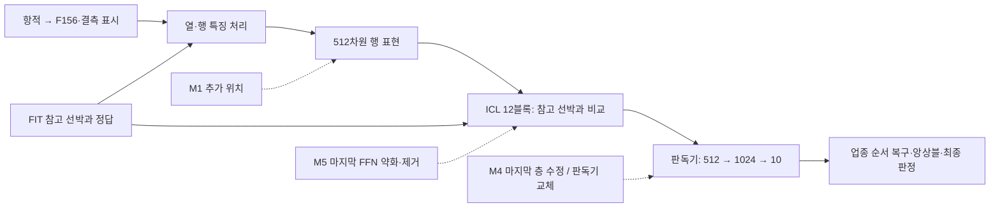

# 알고리즘 변형 아이디어

**비판적 재검토: 2026년 11월 4일 · 제출 마감: 11월 6일 · 상태: 자료·구현 검토 완료 / 새 모델 학습·새 F1 측정 미실행**

> **수정한 추천:** 기준 TabICLv2 A를 유지하고, 먼저 기존 판정 보정의 손익을 확인한다. 내부 변형은 **마지막 출력층의 작은 수정**부터 대조한다. 마지막 층만 직접 학습하는 비교군과, 그 층을 **저랭크 수정 방식으로 바꾸는 안**을 같은 조건에서 시험하는 순서다. 중간 표현 어댑터는 후속 후보로 남긴다.
>
> 이 순서는 **성능 우월성이 입증된 순위가 아니라, 실패 비용과 원인 파악을 고려한 제안**이다. 목표는 Micro-F1과 네 업종 F1의 개선이다. 구조를 바꾼다는 이유로 성능 상승이나 0.88 도달을 약속하지 않는다.

### 재검토에서 바로잡은 핵심

|이전 설명의 문제|수정한 판단|
|---|---|
|중간 표현 어댑터 M1을 최우선으로 단정|유효한 후보지만 최선이라는 증거는 없음. 더 좁은 출력층 변경부터 비교|
|학습 계수가 작은 점을 강조|M1은 동결된 ICL 12블록을 거꾸로 통과해 학습하므로 계산·메모리도 작다고 볼 수 없음|
|마지막 판독부를 약 53.6만 계수 전체로 묶음|최종 Linear만 바꾸는 10,250개 범위와, 저랭크 2,068개 대조를 분리|
|검색 순위의 문제를 attention 변경 근거로 연결|별도 검색기의 오류는 TabICL attention 결함의 증거가 아님. 탐색 가설로 낮춤|
|추가 모듈 중심으로 변형을 설명|출력층 재매개변수화, 판독기 교체, 마지막 FFN 약화·제거를 별도 평가|
|이상탐지 착수에 모든 F1 약 0.88을 연결|0.88은 과거의 지향 목표. 다섯 지표의 고정 착수 문턱으로 합의한 것은 아님|

## 1. 이번 판단의 기준과 자료 우선순위

이 문서는 **현재 사용자 요청 → 1순위 문서 → 2순위 문서 → 3순위 문서 → 참고자료**의 순서로 해석했다. 최신 요청에 따라 기존 Macro-F1 중심의 선택 기준을 Micro-F1·업종별 F1 중심으로 다시 설계하고, 이상탐지 착수에는 조업분류 성능 조건을 둔다. 기존 문서에 적힌 실행 계획을 이번에 자동 실행하라는 지시로 해석하지 않았다.

|순위|자료|이번 설계에서 이어받은 내용|
|---|---|---|
|1|[새로운 방향성 총정리](<C:/Users/User/Desktop/새로운 방향성 총정리.md>)|공간 반복과 업종 구별을 구분. FIT 구성·관측량·혼동 사례를 검토하고, 단일 모델의 개선부터 확인|
|1|[공통점 차이점 비교_데이터 전처리](<C:/Users/User/Desktop/공통점 차이점 비교_데이터 전처리.md>)|재식별과 업종 분류의 목적을 분리. 신뢰도와 유사도 분리, 같은 조건의 대조, 근거 없는 ID 정답 전달 배제|
|2 중 우선|[팀원공유_분석요약_20261103](<C:/Users/User/Desktop/팀원공유_분석요약_20261103.md>)|재식별 순위·이웃 투표·A의 오류와 최근 혼합 탐색 결과. 진행 중이라고 적힌 실험을 완료로 간주하지 않음|
|2|[조업분류_총정리_통합피드백](<C:/Users/User/Desktop/조업분류_총정리_통합피드백.md>)|F156 기준, 이미 완료한 미세조정·짧은 입력·재방문 대조, 선박 분할·정보 손실·확률 보정의 한계|
|2|[이상탐지_총정리_통합피드백](<C:/Users/User/Desktop/이상탐지_총정리_통합피드백.md>)|실제 사고 정답 부재, 과거만 사용하는 원칙, 미지원과 정상 구분, 기존 IF·GRU 등의 재사용 가능성|
|3|[재식별_투트랙_시스템_설계_](<C:/Users/User/Desktop/재식별_투트랙_시스템_설계_.md>)|지문 검색·근거 기록·두 경로 결합의 후보. 상위 문서에서 수정한 검증 해석을 우선|
|참고|A 오분류 CSV, 재식별 1등 오인 CSV, 항적 이미지 2장|오류의 구체적인 형태를 파악하는 가공 자료. 공식 전체 데이터·공식 테스트 정답으로 취급하지 않음|

이번 재검토에서는 위의 **지정 MD 6개 전체를 다시 읽어** 우선순위·실측 결과·미완료 상태를 대조하고, 가공 CSV 감사 결과·이미지·관련 구현·실험 기록을 교차 확인했다. “완벽히 이해했다”는 선언 대신 아래에 어떤 근거를 어떻게 반영했는지 남긴다. 아래에서 **재계산한 사실**, **팀원이 보고한 결과**, **아직 검증하지 않은 제안**을 구분한다. 기존 모델과 원천 자료는 수정하지 않았다.

**상위 문서에서 유지할 제한:** 항적이 닮았다는 것과 같은 배라는 것, 같은 배라는 것과 업종을 맞힌다는 것은 서로 다르다. 현재 A는 F156 요약과 결측 표시를 사용한다. 외부 T5 특징에서 확인된 입력 불일치를 A의 버그로 옮겨 해석하지 않고, 미검증 T5를 새 변형에 섞지 않는다. 최신 요청이 내부 변형을 허용하므로 기존의 입력 개선 중심 방침이 내부 변경 자체를 금지하는 것은 아니다.

## 2. 새 자료를 검토한 결과: 무엇을 해결해야 하는가

### 2.1 배를 다시 찾는 능력과 업종을 맞히는 능력은 다르다

학습은 2026년 7,372개 ID, 테스트는 2025년 7,768개 ID다. 같은 문자열 ID는 6,842개다. 재식별 오류 CSV는 이 공통 ID 중 **검색 1등의 ID가 달랐던 2,283척**만 담는다.

|확인 내용|값|해석|
|---|---:|---|
|같은 ID가 검색 1등|4,559 / 6,842 = **66.63%**|같은 ID를 기준으로 한 검색 순위 일치율|
|같은 ID가 검색 10등 이내|6,254 / 6,842 = **91.41%**|후보 확보는 강하지만 최종 1등 선택은 별도 문제|
|1등 ID는 다르지만 업종은 같은 오류 사례|1,132 / 2,283 = **49.58%**|ID를 잘못 찾는 일이 반드시 업종 오답은 아님|
|1등 ID도 다르고 업종도 다른 오류 사례|1,151 / 2,283 = **50.42%**|같은 해역의 다른 업종을 구별할 근거가 필요|

계산은 가공 CSV의 순위와 신규 MD의 전체 공통 ID 수를 결합했다. **같은 ID가 같은 실제 배이고 업종도 유지됐다는 가정**은 여전히 미확인이다. 검색 결과가 다른 ID를 가리켰다는 사실은 원본 ID가 잘못 매핑됐다는 증거가 아니다.

팀원 문서의 자기 배 제외 이웃 투표 일치율은 0.553이고 통발은 0.220이다. 이는 검색 방식의 한계를 보여주지만 공식 테스트 F1은 아니다. 처음 보는 배에서 검색이 전혀 무용하다고 단정할 근거도 부족하다. 실제로 일부 A 오답은 이웃이 맞혔다.

**설계에 주는 결론:** 이번 목표는 같은 배 찾기 1등 비율 자체를 최대화하는 것이 아니라, **업종 판단에 도움이 되는 사례와 표현을 찾는 것**이다. 위치 유사도만 더 강하게 반영하면 기존 혼동을 확대할 수 있다.

### 2.2 오류가 반복되며, 양방향으로 발생한다

`A_오분류선박_OUTER_seed42.csv`는 **2,506행·23열**, 재식별 오류 CSV는 **2,283행·8열**이다. 두 파일 모두 고유 ID 중복과 빈 셀은 없었다. A 파일은 정답 사례를 포함하지 않으므로 이것만으로 전체 F1을 산출할 수 없다.

|A의 주요 오류|척수|
|---|---:|
|자망 → 연안복합|1,032|
|통발 → 연안복합|412|
|연안복합 → 자망|283|
|연안복합 → 통발|324|
|자망 → 통발|273|
|통발 → 자망|101|
|채낚기연승낚시가 포함된 나머지 오류|81|

자망·통발→연안복합은 **전체 오류의 57.62%**다. 그러나 반대 방향도 607척이다. 연안복합 점수를 무조건 깎거나, 통발 점수를 계속 올리는 방식으로 해결됐다고 판단하면 안 된다.

- seed 42 오답 2,506척 중 **2,407척(96.05%)은 seed 2026에서도 오답**이었다. 무작위 설정만 바꾸는 것으로는 해결하기 어려운 반복 오류다.
- 이웃 투표는 이 2,506척 중 **706척**을 맞혔다. 그러나 통발 오답 523척 중 이웃이 맞힌 것은 **46척**이다.
- 팀원 MD의 “A는 맞고 이웃은 틀린 840척”까지 고려하면, 무조건 이웃으로 교체하는 방식도 손해가 생긴다. 840척은 이번 오류 전용 CSV에 없으므로 MD 보고값으로 구분한다.
- OOF를 보며 비율을 골랐던 혼합 Macro-F1 0.547~0.550은 **탐색 결과**다. INNER에서 비율을 선택한 정식 후속 결과가 확인되기 전에는 채택 성능으로 쓰지 않는다.

참고로 **현재 A와 이웃 투표의 최종 라벨 둘 중 정답인 쪽을 매번 골라주는 이상적인 선택기**를 가정해도, 이 자료에서 맞힐 수 있는 수는 `3,391 + 706 = 4,097척`, Micro-F1 약 **0.6948**이다. 이는 실행 가능한 성적이 아니라 정답을 미리 아는 가상 계산이다. 두 고정 라벨을 고르는 방식만의 한계이며, 확률 혼합이 제3의 업종을 선택하거나 새 모델이 예측을 바꾸는 경우의 상한은 아니다. 단순 분기만으로 0.88을 기대하기 어렵다는 판단 근거다.

### 2.3 이미지에서 보이는 문제는 짧은 이력만의 문제가 아니다

|이미지의 오류 선박|실제 → 예측|관측 날짜 수|현재 확인할 수 있는 점|
|---|---|---:|---|
|34400115|연안복합 → 자망|87|같은 해역에서 비교 선박과 기록된 경로의 주된 축·범위가 다르지만 모델은 혼동|
|36301176|연안복합 → 통발|68|작은 해역의 반복 이동만으로 업종을 확정하기 어려움|
|32100576|자망 → 연안복합|135|긴 관측에서도 연안복합 원확률 **94.17%**로 오답|
|36115425|통발 → 연안복합|36|이웃 투표도 오답이며, 비교 선박 36201692 역시 반대 방향으로 오분류|

주요 네 사례는 모두 30일 넘게 관측됐다. **짧은 이력 대응만 고쳐도 전체 혼동이 해결될 것이라고 기대할 수 없다.** 높은 확신도만으로 재검사를 생략하는 방식도 32100576 같은 사례를 놓친다.

다만 선택한 하루의 그림이 오분류 원인의 증명은 아니다. 비교 선박끼리 전체 관측일·시간 행 수가 다르고, 일부 비교 선박의 정분류 여부는 확인되지 않았다. 선의 색은 시간대·월을 나타내며 실제 속도·위험도·체류시간이 아니다. **기록된 선의 주축은 계산할 수 있어도 점별 정확한 시각과 실제 운항 방향을 만들어낼 수는 없다.**

원본 참고: [식별하기 쉬운 이미지](<C:/Users/User/Desktop/오인_사례_예시_식별하기 쉬운 이미지 버전.png>) · [월·시간 색상 이미지](<C:/Users/User/Desktop/오인_사례_예시.png>)

### 2.4 팀원 코멘트 다섯 가지에 대한 판단

|팀원 의견|평가와 이번 반영|
|---|---|
|0.1° 격자가 너무 거칠다|**유용한 문제 제기.** 0.1°는 이 해역에서 대략 9~11km 규모여서 작은 활동 차이를 뭉갤 수 있다. 그렇지만 기존 F156의 모든 위치 정보가 이 격자 하나인 것은 아니며, 작은 격자 지문도 이미 시험했다. 0.01°와 0.05°를 행동·관측량과 결합하는 방법을 검토한다.|
|상위 10척은 좋지만 1등 정확도를 높여야 한다|**목적을 수정해 반영.** 재식별 1등과 업종 정확도는 별개다. 상위 후보를 활용하되, 최종 업종 성능을 기준으로 고른다.|
|ID와 실제 배가 안 맞으면 모델과 ID 중 무엇을 믿나|**충돌은 기록하되 어느 쪽도 자동 정답으로 삼지 않는다.** 현재 CSV는 검색 오인을 보여줄 뿐 실제 ID 오류를 증명하지 않는다. 공식 정답이 없는 테스트의 ID→업종 조회로 성적을 만들지 않는다.|
|연안복합·자망·통발·채낚기 구별이 어렵다|**핵심 문제로 채택.** 특히 앞의 세 업종의 양방향 오류를 학습·검증에 함께 포함한다. 채낚기를 희생해 전체 평균만 올리지 않는다.|
|항적이 짧은 배는 여전히 어렵다|**채택하되 관측량으로 표현.** 실제 운행시간이 짧다고 확정하지 않는다. 짧은 자연 관측 집단과 긴 배를 인위적으로 자른 집단을 따로 평가한다.|

모항 후보는 신규 MD에서 선박연도의 약 85%가 미지원이라고 보고했다. 현재 정의를 그대로 핵심 조건으로 삼거나 결측을 ‘항구 거리 0’으로 채우지 않는다. 자주 관측되는 위치와 확인된 항구를 구분한다.

## 3. 성능 목표를 바로 세우기: Micro-F1과 업종 F1

한 선박에 정답 하나와 예측 하나를 부여하는 네 업종 분류에서는 **Micro-F1 = 정확도**다. 전체 선박 중 맞힌 비율이다. Macro-F1은 네 업종 F1의 평균이고, 두 지표는 다르게 움직일 수 있다. [F1 정의](https://scikit-learn.org/stable/modules/generated/sklearn.metrics.f1_score.html)

신규 MD의 혼동행렬을 다시 계산한 값은 다음과 같다. A 오류 CSV의 오류수 2,506척과도 일치했다.

|seed 42 개발 선박 5,897척 기준|재계산 값|
|---|---:|
|Micro-F1 / 정확도|**0.575038**|
|Macro-F1|0.537904|
|Weighted-F1|0.558444|
|연안복합 F1|0.689892|
|자망 F1|0.446089|
|통발 F1|0.354545|
|채낚기연승낚시 F1|0.661088|

이는 **한 seed의 개발 평가**다. 기존 두 seed Macro 평균 0.537227, 미보정 확률의 성적, 공식 테스트 성적과 혼동하지 않는다.

짧은 관측 집단도 지표를 구분해야 한다. 신규 MD의 0~7일 962척과 CSV의 그 집단 오류 437척을 맞추면 Micro-F1은 **0.545738**이다. MD의 Macro-F1 **0.264**와 함께 보면, ‘거의 전부 틀린다’보다 **업종을 균형 있게 구분하는 능력이 특히 약하다**고 설명하는 편이 정확하다.

### 이미 적용한 통발 보정을 새 아이디어로 제안하지 않는다

A의 예측과 확률 네 열의 최댓값이 다른 오류 행이 488개 있었다. 이는 기존 통발 판정 보정으로 설명된다. **fold 0·1·2에 각각 통발 2·3·2배를 적용하니 2,506행의 선택 라벨이 모두 재현**됐다.

예를 들어 36201692는 연안복합 원확률이 약 0.578, 통발은 약 0.285다. 통발에 3배를 적용하면 약 0.855가 되어 통발로 선택된다. 이미지의 **28.50%는 선택된 업종의 원래 확률**이며, 보정 후 정규화 확률이 아니다.

**전체 집단의 선행 결과도 있다.** 조업분류 피드백 §2.4에서 F156의 두 seed 평균 원확률 정확도, 즉 Micro-F1은 약 **0.5930**, 원확률 Macro-F1은 약 **0.5156**이었다. 판정 보정 후 Macro 평균은 약 **0.5372**였다. 위 표의 판정 후 Micro **0.575038**은 seed 42 단독값이므로 두 seed 평균과의 차이를 정확한 대응 개선량으로 계산하면 안 된다. 그래도 판정 정책이 Macro와 Micro 사이의 손익을 만들 수 있다는 근거는 충분하다.

**이번 목표가 Micro-F1까지 우선하므로, INNER에서 판정 배수와 모델 선택 기준도 재검토해야 한다.** 다만 오류 파일에서 원래 맞던 배의 손실은 알 수 없다. 오류 사례 289척이 원확률 최댓값으로 돌아가면 맞는다는 사실만으로 보정 제거를 채택하지 않는다. 전체 평가 선박에서 이득과 손해를 함께 계산한다.

## 4. 바꿀 수 있는 부분과 이미 한 시도

### 4.1 현재 계산 구조를 먼저 이해하기

TabICLv2는 특징들을 읽고 한 행의 정보를 합친 다음, 정답이 붙은 참고 행과 비교해 새 행을 예측한다. 우리 구성에서 한 행은 **선박 하나의 요약**이다. 원본 시간별 항적을 직접 순서대로 읽는 모델이 아니다. [TabICLv2, ICML 2026](https://proceedings.mlr.press/v306/qu26a.html)

점선은 **서로 다른 후보의 변경 지점**이다. 전부 동시에 적용한다는 뜻이 아니다. 행 표현은 ‘독립적으로 저장한 배의 지문’도 아니다. 현재 모델은 열 단계부터 FIT 정답을 활용하므로 참고 집합·정답·전처리·클래스 번호 순서에 따라 표현이 달라진다.

설치본은 `tabicl==2.2.0`, 고정 모델은 `tabicl-classifier-v2-20260212.ckpt`다. 체크포인트 실측은 **27,552,258개 계수**, 행 표현 512차원, ICL 12블록이며 GPU는 **RTX 3060 Ti 8GB**다. 공개 최신 코드와도 대조했지만 설치 환경·체크포인트를 교체하지 않았다.

### 4.2 기존 미세조정을 없었던 일로 만들지 않는다

“TabICLv2를 항상 그대로만 썼다”는 전제는 정확하지 않다. 대부분은 고정 모델의 입력·문맥을 바꿨지만 **10·11차는 실제 가중치를 갱신했다.**

|완료 실험, seed 42|학습 범위|원래 Macro / Micro|판정 보정 후 Macro / Micro|
|---|---|---|---|
|10차|열·행 고정, ICL 약 2,628만 계수 갱신|0.51760 / 0.59030|0.53768 / 0.57758|
|11차|열·행을 포함한 전체 미세조정|0.50935 / 0.58962|0.53718 / 0.57453|

둘 다 당시 비교 기준 대비 뚜렷한 채택 근거가 없었다. 10차도 전체 계수의 약 95.4%를 갱신 대상으로 삼았으므로 ‘작은 미세조정’은 아니었다. 당시 입력과 현재 A의 F156 조건은 달라 직접 성능 순위를 매기지 않는다.

근거: [10차 기록](<C:/Users/User/Desktop/2026 데이터 분석대회/TabICLv2/TabICLv2_10차시도/TabICLv2 10차 시도.md>) · [11차 기록](<C:/Users/User/Desktop/2026 데이터 분석대회/TabICLv2/TabICLv2_11차시도/TabICLv2 11차 시도.md>)

계층형 분류, 연안복합 가상 3모드, 창 attention, D16 구간 요약, 원시 형상 CNN, 짧은 문맥 배정·확률 결합, 복귀 8개, 전체 주 학습도 선행 대조가 있다. 따라서 ‘짧은 구간 강조’나 ‘attention’이라는 이름만으로 새 시도라고 부르지 않는다. **이번의 차이는 변경 위치·학습 범위·목표와 대조 조건**으로 설명한다.

### 4.3 추가·교체·제거를 구별한 후보표

기존 M1~M4 번호는 이전 문서와 연결하기 위한 이름이며 우선순위 번호가 아니다. 모든 새 후보의 F1 효과는 아직 미측정이다.

|후보|실제 변경|변형의 성격|판단|
|---|---|---|---|
|**M4-a 최종 Linear만 학습**|1024→10 층의 가중치만 조정|구조 동일, 학습 범위 변경|**첫 비교군**. 판독 단계만 바꾸면 어떤가?|
|**M4-b 최종 Linear 저랭크 수정**|가중치를 `W₀+sBA` 방식으로 수정|학습 매개변수화 교체. 병합 후 원래 구조|**첫 변형 후보**, rank 2부터|
|**M1 행 표현 잔차 어댑터**|512차원 표현과 ICL 사이에 작은 모듈 삽입|내부 구조 추가|표현 변경의 근거가 남을 때 후속|
|**M2 혼동·짧은 관측 학습**|학습 예시 구성·필요시 손실 변경|학습 절차 변경|M1에 종속되지 않는 별도 개선 축|
|**M5 마지막 FFN 약화·제거**|잔차 변환 비중을 1/0.5/0으로 변경|실제 내부 연산 변경·제거|저비용 원인 진단 후보, 우수성 근거 없음|
|**M4-c 판독기 전체 선형 교체**|512→1024→10을 512→10으로 교체|비선형 구조를 선형 구조로 교체|후순위 표현 진단·단순화|
|**M3 attention 점수 보정**|참고 사례별 주의점수에 제한된 보정|내부 추론 계산 변경|구현 위험이 높아 후순위|

미세 격자·문맥 검색·이웃 확률 결합도 유효할 수 있지만 **전처리·시스템 구성 변화**다. 내부 알고리즘 변경과 구별해 설명한다. 구조를 바꿨다는 사실만으로 창의성이나 성능 향상을 주장하지 않는다.

## 5. 먼저 비교할 M4 — 마지막 판단 부분을 작게 수정하기

### 5.1 M4-a: 기존 마지막 층만 직접 학습

현재 판독기(decoder)는 `Linear(512→1024) → GELU → Linear(1024→10)`이다. 앞의 계산을 고정하고 **마지막 Linear만** 바꾼다. 이미 만들어진 단서를 어떤 업종 점수로 읽어낼지 조정하는 것이다. 전체 판독기 535,562개를 모두 학습하는 기존 제안보다 범위가 훨씬 좁다.

마지막 층은 편향 포함 **10,250개**다. 현재 네 업종 손실이 직접 사용하는 첫 네 출력에 해당하는 부분은 **4,100개**다. 나머지 여섯 출력은 데이터 손실에 사용되지 않지만, optimizer의 weight decay가 미사용 행도 바꿀 수 있으므로 그대로 보존하거나 변경 여부를 별도로 기록한다.

**왜 먼저인가:** 기존 F156·비교 구조를 유지해, 오류 중 일부가 최종 판독 방식의 문제인지 작은 범위로 확인할 수 있다. 입력 단서가 부족한 문제나 참고 선박 간 관계 자체를 새로 배우는 문제를 해결한다고 보장하지는 않는다.

### 5.2 M4-b: 같은 층을 저랭크 수정 방식으로 바꾸기

큰 가중치를 마음대로 고치는 대신 **작은 두 행렬의 곱으로 표현되는 수정만 허용**한다. 수정 범위를 제한해 과도한 적응을 줄여보는 가설이다.

`변경한 가중치 W = 기존 가중치 W₀ + s × B × A`

- 기존 `W₀`의 크기는 `10×1024`다. `A`는 `r×1024`, `B`는 `10×r`, `s`는 고정 배율이다.
- **rank r=2이면 학습 행렬은 명목 2,068개**다. 네 출력의 손실이 직접 사용하는 부분은 A 전체와 B의 네 행, 합계 2,056개다. 원래 편향은 우선 고정한다.
- `A`는 작은 무작위 값, `B`는 0으로 시작해 **학습 전에는 원본과 동일하게** 만든다.
- 학습을 마치면 수정량을 원래 가중치에 합친다. 배포할 때는 원래와 같은 Linear 한 층으로 돌아가며, 전체 모델 계수 수 **27,552,258개**도 유지할 수 있다.

이는 알려진 **LoRA**의 저랭크 수정 원리를 마지막 층에 제한해 적용하는 안이다. 새로운 LoRA를 발명한 것이 아니며, 병합 후 추론 구조까지 새로운 신경망이 되는 것도 아니다. **학습할 가중치의 표현 방식을 바꾸는 변형**으로 정확히 소개한다. 원 논문의 언어모델 성과는 우리 F1 향상의 증거가 아니다. [LoRA 원 논문](https://arxiv.org/abs/2106.09685) · [공식 Linear 구현](https://raw.githubusercontent.com/microsoft/LoRA/main/loralib/layers.py)

|비교|학습 범위|배포 크기·의미|
|---|---:|---|
|M4-a 마지막 층 직접 조정, 편향 고정|명목 학습 가중치 10,240개, 네 출력 유효 부분 4,096개|구조·전체 계수 수 동일|
|M4-b rank 2, 편향 고정|2,068개|수정량 FP32 약 8.1KiB. 병합 시 기본 모델 크기 동일|
|rank 4, 편향 고정|4,136개|첫 네 출력의 직접 가중치 4,096개보다 적지 않음. 첫 후보에서 제외|

rank 4는 실제 사용하는 `4×1024` 가중치 변화량을 모두 표현할 수 있어 강한 저랭크 제한이라고 부르기 어렵다. **rank 2를 직접 미세조정과 비교하는 것**이 더 분명한 대조다. 작은 변화량 파일만 있으면 전체 모델이 실행되는 것도 아니다. 원본 가중치·전처리·FIT 문맥은 계속 필요하다.

### 5.3 두 후보에 공통인 구현 조건

1. **같은 F156·분할·참고 문맥·학습 예시·선택 예산을 쓴다.** M4-a와 M4-b 모두 원래 편향을 고정한 대조를 우선해 편향 학습 유무가 효과에 섞이지 않게 한다. M4-a의 명목 학습 가중치는 이때 10,240개, 유효 네 행은 4,096개다.
2. **업종 번호 변환을 지킨다.** TabICL은 실행마다 업종 번호를 바꾸기도 한다. 출력 0번이 항상 연안복합이라는 뜻이 아니다. 학습 참고 정답·문제 정답·업종별 손실을 같은 번호 체계로 맞추고, 예측은 원래 업종 순서로 복구한 다음 합친다. 512차원 숨은 표현을 네 업종 채널처럼 재배열하면 안 된다.
3. **앞부분은 gradient 없이 계산할 수 있다.** 마지막 층 앞의 1024차원 값을 저장하면 반복 학습 비용을 줄일 수 있다. 단, 참고 ID·정답·변환·클래스 순서가 같은 학습 묶음에만 해당한다. 전체 선박의 정답을 넣어 만든 캐시를 나중에 분할하면 안 된다. 캐시를 만드는 비용도 실행 시간에 포함한다.
4. **캐시와 학습 텐서를 구분한다.** `no_grad()`로 얻은 동결 표현은 사용할 수 있으나, `inference_mode` 텐서는 모드 밖 복사 등으로 backward에 사용할 수 있게 해야 한다. 출력층만 바꾸면 앞부분의 K/V는 유지할 수 있지만, 변경 전 logit·확률은 다시 계산해야 한다.
5. **병합·저장을 검증한다.** 기존 가중치·편향을 정확히 복사했는지, 수정량 0일 때 A와 같은지, 학습되는 계수가 의도한 부분뿐인지, 병합 전후·저장 재로드 후 예측을 확인한다. 같은 입력·문맥·업종 순서·정밀도·판정 정책에서 확률 오차를 사전 지정한 허용오차 안에서 비교하고, 라벨 차이가 생기면 원인을 점검한다. 부동소수점 계산 순서가 달라질 수 있으므로 비트 단위 일치를 전제하지 않는다. 수정량을 두 번 더하면 안 된다.
6. **첫 gradient의 0을 오해하지 않는다.** B=0 초기화에서는 첫 단계 A의 gradient가 0인 것이 정상이다. B의 유한한 gradient·갱신과 이후 A까지의 경로를 확인한다. 공식 `predict_proba()` 출력에 손실을 붙이는 방식으로 학습하지 않는다.

공식 구현 근거: [판독기](https://raw.githubusercontent.com/soda-inria/tabicl/main/src/tabicl/_model/learning.py) · [학습 정답 번호 변환](https://raw.githubusercontent.com/soda-inria/tabicl/main/src/tabicl/_finetune/data.py) · [예측 업종 순서 복구](https://raw.githubusercontent.com/soda-inria/tabicl/main/src/tabicl/_sklearn/classifier.py). 실행 시에는 확인한 로컬 2.2.0 동작을 고정한다.

**채택할 가치:** 큰 구조를 건드리기 전에 남아 있는 정보를 더 잘 읽을 수 있는지 진단하고, 수정 폭을 제한할 수 있다. **한계:** 이것이 실패했다고 M1까지 불가능한 것은 아니다. 반대로 과거 전체 미세조정 실패에 이번 실패까지 더해지면 근거 없는 대규모 확대의 우선순위는 낮아진다. 클래스 번호가 바뀌는 학습 특성상, 특정 출력행을 고정 업종 전용 교정기로 해석하지 않는다.

## 6. M1 — 선박 표현에 작은 잔차 어댑터를 넣기

### 무엇을, 왜 바꾸는가

기존 모델이 만든 512개 숫자에 작은 학습 보정량을 더한 뒤 ICL에 전달한다. **원래 열·행·ICL 계수는 고정하고 새 모듈만 학습**한다. FIT에서 참고할 배와 문제로 풀 배를 분리해, 처음 보는 선박의 정답을 맞히는 훈련을 한다.

후보로 남길 근거는 세 가지다. 첫째, 같은 선박의 오류가 두 seed에서 반복되고, 지도 사례에서는 같은 해역의 다른 업종 혼동이 관찰됐다. 둘째, 대규모 미세조정은 이미 개선 근거가 없었다. 셋째, F156 안의 위치·형상·시간대 정보를 해역에 맞게 결합하는 능력을 작은 범위에서 바꿔볼 여지가 있다. 이 사실들은 **어댑터가 최선이거나 문제의 위치가 이 지점이라고 입증하지는 않는다.** **요약에서 사라진 정보를 복원하는 방법은 아니므로**, 남아 있는 정보로 구별할 수 있는지부터 확인해야 한다.

수식은 구현할 부분을 명확히 하기 위한 것이다.

`수정 표현 = 기존 표현 h + g(q) × [U × GELU(V × h + b₁) + b₂]`

- `V`는 512개 숫자를 8개 또는 16개로 압축하고, `U`는 다시 512개 수정량으로 펼친다.
- `GELU`는 숫자 사이의 단순 직선 관계보다 복잡한 조합을 배우도록 하는 함수다.
- `g(q)`는 수정 비중이다. **첫 시험은 일정한 비중**을 쓰고, 관측일·유효 기록·결측 등 `q`에 따른 조절은 후속 대조로 분리한다.
- 처음에는 `U`와 `b₂`를 0으로 두어 수정량을 0으로 만든다. `V`까지 모두 0으로 만들거나 비중도 0으로 고정하면 학습이 막힐 수 있으므로 초기화와 gradient를 확인한다.

**첫 입력은 A의 F156 및 동일한 결측 처리 그대로 유지**한다. 미세 격자·새 재방문·추가 구간을 동시에 넣지 않아야 구조 변형의 효과를 판단할 수 있다.

### 모델 크기는 얼마나 달라지는가

편향항을 포함하고 별도의 LayerNorm·신뢰도 모듈을 넣지 않은 위 식의 계산값이다.

|압축 폭|추가 학습 계수|추가 FP32 계수 용량|기존 전체 계수 대비|
|---|---:|---:|---:|
|8|8,712개|약 34.0KiB|약 0.032%|
|16|16,912개|약 66.1KiB|약 0.061%|

폭 16의 총계수는 **27,569,170개**다. 관측 지원 6개로 scalar gate를 만들면 편향 포함 7개가 추가된다. 이 숫자는 설계식의 계산이며 구현 실측은 아니다. 기존 약 105.26MiB 체크포인트와 문맥은 계속 필요하므로 모델 전체가 66KiB가 되는 것은 아니다. 동결된 ICL을 거꾸로 통과해 수정량을 학습하는 계산도 필요해, GPU 메모리·시간 절감률을 계수 비율로 추정하지 않는다.

### 논문 근거와 우리 변형의 경계

2026년 5월 arXiv에 공개된 **TFM-Retouche**는 동결된 표형 기초모델 앞에 작은 잔차 보정기를 두고, 검증에서 이득이 없으면 원래 모델로 돌아가는 접근을 제시한다. 원문은 **입력 공간의 보정**이다. 여기서 제안하는 **TabICLv2 내부 행 표현 뒤의 보정**은 그 생각을 우리 구조에 옮긴 새 응용 가설이며 논문을 그대로 재현한 것이 아니다. 공개 설치 패키지로 즉시 사용할 수 있다고 확인한 것도 아니다. [원문](https://arxiv.org/html/2605.06047v2)

### 구현에서 반드시 확인할 부분

1. **학습·일반 추론·캐시 추론에 같은 모듈을 적용한다.** 학습할 때만 어댑터를 거치면 제출 모델은 다른 모델이 된다.
2. **원본 계수 동결과 gradient 차단은 다르다.** `predict_proba()`는 `no_grad` 경로이므로 그 출력에 손실을 붙여 학습하지 않는다. 직접 학습 forward에서 원본 계수는 고정하되 어댑터까지 gradient가 흘러야 한다.
3. **표현 캐시에 정답이 섞일 수 있다.** 현재 체크포인트는 `col_target_aware=true`여서 열 단계부터 FIT 정답을 사용한다. FIT 전체를 정답과 함께 인코딩한 뒤 일부를 학습용 문제 행으로 바꾸면 그 문제의 정답이 이미 들어갔을 수 있다. 각 연습 묶음에서 참고 ID·문제 ID를 먼저 나누고, 문제 ID의 정답을 제외한 상태로 표현을 만든다.
4. **기존 `repr` 캐시는 순수한 선박 표현이 아니다.** ICL 정답 인코딩이 반영될 수 있다. 어댑터 계수가 갱신되면 어댑터 이후 표현과 ICL K/V 캐시는 무효화한다. 동결된 어댑터 이전 표현도 참고 ID·정답·열/클래스 순서·변환·연습 묶음이 동일할 때만 재사용한다. ICL이 정답 표현을 제자리에서 더하는 부분이 있으므로 재사용 원본은 복사해서 전달한다.
5. **희소 업종이 학습에서 빠지지 않게 한다.** 문제 행의 업종이 참고 문맥에 없으면 공식 학습기가 해당 묶음을 건너뛸 수 있다. 업종별 참고 사례와 실제 학습·건너뛴 묶음 수를 기록한다.
6. **0 보정일 때 A와 일치하는지 검사한다.** 같은 입력·정밀도에서 확률과 라벨을 대조하고, 저장 후 다시 읽은 전체 평가 예측도 확인한다. 0으로 시작한 상향 행렬 때문에 첫 step의 하향 행렬 gradient가 0일 수 있으므로, 몇 차례 갱신 후 새 모듈에 학습 신호가 전달되는지도 확인한다.

원본 동결 설정이 새 모듈까지 함께 동결하지 않는지도 optimizer 생성 전에 확인한다. 현재 학습 경로의 `row_interactor` 출력→`icl_predictor` 입력이 삽입 지점이다. 캐시 경로에도 대응 지점이 있다. [로컬 연결 코드](<C:/Users/User/Desktop/2026 데이터 분석대회/TabM/TinyTabM/TinyTabM_구현_20261029/.venv/Lib/site-packages/tabicl/_model/tabicl.py:348>)

**우선순위를 낮춘 이유:** M4와 달리 어댑터까지 학습 신호를 돌려보내기 위해 ICL 12블록의 연산을 거쳐야 한다. 계수 0.061% 추가를 학습 비용 0.061%로 읽으면 안 된다.

**채택할 가치:** 기존 정보 조합의 작은 교정이 가능하고 되돌리기 쉽다. **폐기할 조건:** INNER에서 개선 없이 확신도만 커지거나, 같은 해역의 미학습 선박·짧은 집단이 나빠지거나, 필요한 입력 정보 자체가 없다는 근거가 강해질 때다. 어댑터를 키우는 것으로 자동 대응하지 않는다.

## 7. M2 — 무엇을 구별하도록 연습시킬지 바꾸기

이는 M4·M1과 별개인 **학습 조건의 개선 축**이다. M1이 성공해야만 의미가 생기는 것은 아니다. 먼저 구조 하나의 효과를 분리한 뒤, 남은 오류에 맞춰 하나를 적용한다. **혼동 사례 학습과 짧은 관측 학습을 처음부터 동시에 넣지 않는다.**

### M2-A. 같은 해역의 다른 업종을 함께 대비하기

위치가 비슷하다는 이유로 같은 업종이라고 판단하지 않도록, **비슷한 해역·관측량이지만 정답 업종은 다른 FIT 선박**을 함께 제공한다. 이런 사례를 어려운 대비 사례라고 부른다.

우리의 새 강조점은 자망·통발→연안복합만 골라내는 것이 아니라 **반대 방향의 연안복합 오답과 정상적으로 맞히는 사례까지 함께 유지**하는 것이다. 채낚기도 참고 자료에서 빠지지 않는다. 선택 규칙은 FIT 내부의 선박 제외 예측에서 정하고, 제공받은 OUTER 오류 CSV의 오류 표시를 학습 선별 규칙으로 가져오지 않는다. 다른 fold에서 정당하게 FIT가 되는 ID 자체를 모두 금지한다는 뜻은 아니다. **현재 fold의 FIT 안에서 다시 얻은 선박 제외 오류**만 사용한다.

첫 단계는 기존 **교차엔트로피 손실**을 유지한다. 이는 정답 업종에 낮은 확률을 주면 더 큰 벌점을 주는 기본 학습 방식이다. 대비 사례 배치만으로 효과가 없고 구체적인 근거가 있으면 다음 보조 손실을 아주 작은 비중으로 검토한다.

`기본 손실 + λ × softplus(혼동 업종 점수 − 실제 업종 점수 + 여유 폭)`

앙상블·학습 묶음에서 클래스 번호를 바꾸면 **실제 업종에 맞춰 혼동쌍 번호도 함께 변환**한다. 특정 번호를 항상 통발이라고 가정하면 다른 업종에 벌점을 줄 수 있다.

이 항은 FIT에서 정한 특정 혼동쌍을 더 구분하도록 유도하는 **학습목표의 변형**이다. 기본 교차엔트로피도 이미 정답 점수를 높이므로, 추가 항은 특정 혼동을 더 강조하는 재가중에 가까울 수 있다. 새로운 구별 정보를 만들어내지는 않는다. 모든 다른 업종을 억지로 멀리 밀거나 연안복합을 가짜 하위 정답으로 나누는 방식은 아니다. 비슷한 항적이 실제로 다른 등록 업종일 수 있으므로, 큰 벌점은 없는 단서를 외우게 만들 수 있다. `λ=0`을 필수 비교군으로 둔다.

**기존과 차이:** 현재 통발 점수 배수는 학습이 끝난 뒤의 판정 조절이다. 이번은 출력층 또는 표현층을 학습하는 단계의 변경이다. 다만 단순 업종 가중손실이나 어려운 사례 학습 자체는 알려진 방법이며, 우리 기여는 데이터의 혼동 조건에 맞춘 선정·적용·검증에 있다.

### M2-B. 전체 이력을 남겨둔 짧은 관측 연습

긴 배의 첫 7일·14일 등 제한된 입력을 학습용으로 만든다. 전체 이력을 없애지 않고, 매 연습에서 전체 또는 짧은 관측을 선택하여 **두 조건을 모두 접하게 한다.** 같은 배를 많이 복제해 다른 배보다 큰 영향력을 갖게 하지 않도록 선박별 총 손실 비중을 맞춘다.

같은 선박의 전체·짧은 예시가 **참고 정답 쪽과 문제 쪽에 동시에 들어가면 안 된다.** 새 선박 일반화 연습에서는 먼저 부모 ID를 분리한다. 같은 문제 ID의 전체·짧은 예측을 비교하는 일관성 손실은 가능하지만, 정답이 포함된 자기 배를 참고해서 얻은 예측을 교사로 쓰지 않는다.

첫 비교에서는 실제 업종을 맞히는 손실만 사용한다. 긴 이력 교사의 예측을 짧은 이력에 강제하는 손실은 후순위다. 짧은 구간에 업종 단서가 없거나 긴 이력 모델도 틀리면 **틀린 확신을 복제**할 수 있기 때문이다.

**기존과 차이:** 4단계 B는 배당 한 예시를 전체·7일·30일로 배정하면서 일부 긴 이력을 덜 봤고, E는 두 문맥의 확률 결합이었다. 이번은 작은 출력층 수정이나 어댑터의 학습 과정에서 전체·짧은 관측을 함께 경험하게 하는 안이다. 단, 기간을 잘라 쓰는 생각 자체는 이미 제안·시험했던 계열이다.

자연적으로 1~7개 날짜만 기록된 배와 인위적으로 첫 7달력일을 남긴 배는 다르다. 둘을 별도 평가한다. **평가할 선박의 잘라낸 이후 관측**으로 통계·대표 구간을 만들면 안 된다. 반면 현재 fold의 FIT에서 정당하게 학습해 고정한 행동 사전·대체 통계·변환기는 사용할 수 있다. 대상 선박 요약의 기간 제한과 FIT 변환기의 학습 범위를 구분한다. 정확한 정의가 다른 자료를 모두 ‘7일’로 합치지 않는다.

### 관측량에 따른 보정은 선택 사항이다

M1의 일정한 수정 비중과 관측 지원에 따른 `g(q)`를 비교할 수 있다. 관측이 많다고 무조건 정확한 것도, 적다고 무조건 수정량을 0으로 해야 하는 것도 아니다. **관측량은 믿을 근거의 정도**로 사용하고 신원이나 업종의 대체 이름표로 고정하지 않는다. 과거 ‘짧으면 E 사용’ 역시 아직 검증이 필요한 규칙이다.

## 8. 교체·제거의 추가 후보와 후순위 접근

### 8.1 M5: 마지막 FFN의 변환을 약하게 하거나 제거

ICL 블록은 참고 사례를 비교하는 attention과, 그 결과를 다시 가공하는 FFN으로 구성된다. 현재 pre-norm 구현의 마지막 FFN 잔차를 다음처럼 바꿀 수 있다.

`기존: x + FFN(norm2(x))`

`변경: x + γ × FFN(norm2(x))`, `γ ∈ {1, 0.5, 0}`

`γ=1`은 원본, `0.5`는 마지막 가공의 영향 축소, `0`은 그 FFN 연산 제거다. **새 모듈을 붙이는 대신 기존 연산의 비중을 바꾸거나 없애는 실제 내부 변형**이다. 원본이 작은 해역의 차이를 마지막 단계에서 불리하게 바꾸는지 검사할 수 있으나, 그런 현상이 실제로 있다는 증거는 아직 없다.

학습 없이 INNER에서 세 값만 대조할 수 있어 초기 진단 비용은 비교적 작다. 마지막 블록의 attention·정규화·출력 경로와 캐시 반환 형식은 보존한다. 단순히 계산한 FFN에 0을 곱하면 실행 비용은 줄지 않는다. 제거 효과를 측정하려면 계산을 실제로 건너뛰고, 저장 계수도 제거했는지 따로 기록해야 한다. 변경 후 출력은 다시 계산한다. **기존의 시간 창 attention 실험과는 변경 위치가 다르지만, 더 잘 맞힌다고 확인된 방법은 아니다.**

### 8.2 M4-c: 복잡한 판독기를 선형 판독기로 교체

`512→1024→10` 비선형 판독기 전체를 `512→10` Linear로 바꾸고, 나머지를 고정한 채 새 판독기를 학습한다. 새 판독기는 **5,130개**, 전체 모델은 **27,021,826개**로 **530,432개(약 1.93%)** 줄어든다.

이는 ‘새 부품 추가’가 아닌 **구조 교체**이며, 기존 최종 표현을 단순 경계로 읽어도 구별되는지 검사한다. 하지만 사전학습으로 얻은 비선형 판독 능력을 버린다. 계수가 줄어든다는 사실은 F1 상승 근거가 아니므로 주력보다 후순위 진단으로 둔다. 원본 판독기는 보존하고 클래스 순서 변환도 유지한다.

### 8.3 제거할 수 있다고 모두 제거하지 않는다

|제거 후보|예상 변화|판단|
|---|---|---|
|마지막 ICL 블록 전체|2,144,512개 감소, 전체 25,407,746개(약 7.78% 감소)|FFN만 바꾸는 것보다 영향이 큼. 학습된 비교 깊이를 잃고 캐시 층수도 바뀜. F1 개선 근거 없이 우선 시행하지 않음|
|사용하지 않는 출력 6개|6,150개 감소|원본도 첫 네 출력만 사용. 동일 가중치를 복사하면 예측·F1은 동일. 성능 개선안에서 제외|
|target-aware 열 처리·정답 입력·전체 ICL 비교|모델의 핵심 동작 변경|지금의 오류가 이 부분 때문이라는 증거가 없음. 사전학습과 맞지 않는 큰 변경이어서 비추천|
|지리 특징·관측 품질 표시 일괄 제외|모델 입력 변경|공간은 이미 유용한 단서이며 관측 없음과 0도 달라야 함. 필요하면 정보 블록별 입력 대조로 시행, 내부 구조 변경으로 부르지 않음|

출력을 4개로 만드는 것이 **본질적으로 불가능한 것은 아니다.** 임시 업종 번호와 역변환을 일관되게 유지하면 가능하다. 다만 앞 네 출력을 복사하는 단순 축소는 새 판단 능력을 만들지 않고, 이번 일정에 API·저장 호환성을 바꿀 실익도 작다.

### 8.4 M3: 참고 선박별 attention 점수 보정

attention은 어느 참고 사례의 정보를 얼마나 반영할지 정하는 계산이다. 마지막 ICL 블록에서 **softmax 직전 점수**에 제한된 보정을 추가하는 방법을 고려할 수 있다.

`새 점수(q,j) = 원래 점수(q,j) + λ × 제한된 보정값(q,j)`

`q`는 판단할 배, `j`는 FIT 참고 배다. 보정값은 행동·다중 크기 공간 겹침·관측 지원을 결합한다. 위치만 비슷한 다른 업종을 과도하게 참고하지 않게 하려는 가설이다.

**근거의 한계:** 지문 검색 Top-10과 Top-1의 차이는 다른 검색기의 결과다. TabICL의 내부 표현·attention과 같지 않으므로 attention 결함을 입증하지 않는다. 현재로서는 탐색 후보이고, 입력·참고 집합을 통제한 내부 대조가 먼저 필요하다.

구현은 다음을 지켜야 한다.

- `λ=0`은 원본과 같아야 한다. query의 실제 업종·테스트 ID 정답을 넣지 않는다.
- 모든 참고 배에 같은 상수를 더하면 softmax에서 상쇄된다. **참고 배 j에 따라 달라지는 상대 보정**이어야 한다. 보정이 존재한다는 것과 실제 계산을 바꾼다는 것을 구분한다.
- 기존 QASSMax의 크기 조절과 참고 행만 보는 범위를 유지하고, 기존 차단 mask를 풀지 않는다. 차단 위치는 여전히 차단한다.
- 현재 상위 ICL·Encoder·일반/캐시 경로에 점수를 전달하는 통로가 필요하다. 행·클래스 순서·query chunk와 보정 행렬을 맞추고, bool mask의 허용/차단 의미를 실제 attention 함수에 맞춰 검증한다.
- dense query×context 행렬의 메모리와 처리 시간을 실측한다. 계수를 거의 추가하지 않아도 계산 비용은 커질 수 있다.

attention 값은 그 자체로 인과적 설명이 아니다. 마감 전에는 작은 출력층 대조보다 우선할 근거가 부족하다.

### 8.5 외부 보완은 구조 효과와 분리

팀원 MD에는 혼합 비율·이웃 수·통발 배수를 INNER에서 고르는 후속이 **진행 중**이라고 적혀 있다. 완료 결과가 확인되면 같은 분할의 비교군으로 활용하되, 지금 완료·개선으로 단정하지 않는다.

**Localized TabICLv2**는 행 표현의 가까운 참고 예시를 골라 비용을 줄이는 2026년 연구다. arXiv 공개 논문이며 저자는 ICML 2026 FMSD 워크숍 채택을 명시했다. TabICLv2의 ICML 본회의 논문과 구분한다. 구조 변경 없이 수행하는 방식이며 **98.64%는 원본 정확도의 유지 비율**이다. 우리 데이터의 정확도나 F1 예측이 아니다. [원문](https://arxiv.org/abs/2608.16429)

0.01° 재방문도 처음 시도하는 발상이 아니다. 기존 F의 복귀 8개는 전체 개선 근거가 부족했다. 팀원 제안의 **며칠 간격 재방문**은 1시간 초과 공백에서 이력을 초기화했던 기존 F와 정의가 다를 수 있다. 그러나 관측 재등장을 그물을 걷는 행위로 확정하지 않는다. 관측 기회·격자 경계·항구 후보의 영향을 함께 다뤄야 한다.

이런 입력 보완은 **A+입력 보완만**의 비교군으로 분리한다. 내부 변형과 동시에 넣고 모든 이득을 새 알고리즘의 효과로 설명하지 않는다.

## 9. 검증 계획: 좋아 보이는 숫자보다 같은 시험의 개선

### 9.1 평가 집합과 목표를 먼저 고정한다

1. **현재 A·개발 5,897척·기존 FIT/INNER/OUTER 분할을 재사용한다.** 모든 날짜·절단 예시는 부모 선박의 역할을 따른다. 새 학습 예시 선정·정규화·신뢰도 학습은 FIT에서, 설정 선택은 INNER에서 한다.
2. **이번 CSV는 진단 근거다.** OUTER 오류를 보고 세운 가설이므로 연구 수준의 선택 편향은 이미 존재한다. 오류 CSV에서 읽은 현재 OUTER의 정답·오류 여부를 학습 선택에 쓰지 않는다. 다른 fold에서 FIT가 되는 ID는 그 fold의 FIT 자료로 사용할 수 있지만, 오류 선별은 현재 FIT 안에서 다시 수행한다.
3. **미학습 ID 평가를 주된 비교로 유지한다.** 같은 배의 다른 기간 평가는 별도 결과로 둔다. 88:12 비율로 두 집단 F1을 평균하지 않는다. 공식 Test A의 최종 신규 ID 구성 설명과 현재 파일의 ID 중복을 혼동하지 않는다.
4. **기존에 본 Holdout도 새 맹검이 아니다.** 새 seed나 새 분할 이름이 독립 검증을 만들어주지 않는다. 마지막 후보·판정 기준을 고정한 뒤 평가하고, 본 결과로 기준을 느슨하게 바꾸지 않는다.

### 9.2 필수 비교군을 적게, 분명하게 둔다

|순서|실험|답하려는 질문|
|---|---|---|
|R0|A의 원확률 최댓값 / 기존 판정 / 새 목표로 INNER 선택한 판정|학습 없이 판정 규칙만 바꾸는 손익은?|
|R1|M4-a 직접 조정 / M4-b rank 2, 같은 편향 고정|최종 층의 읽는 방식과 수정 제한이 도움이 되는가?|
|R2|오류 근거에 따라 M2-A 또는 M2-B 하나. 필요하면 M1을 별도 단독 대조|학습 조건 문제인가, 중간 표현을 바꿀 여지가 있는가?|
|조건부 진단|M5의 γ 세 값 또는 M4-c 중 근거가 있는 하나|마지막 변환을 약하게 하거나 단순화할 가치가 있는가?|

이 표 전체를 반드시 실행한다는 뜻은 아니다. **이득이 없고 새 단서도 없으면 확대하지 않는다.** M4 실패가 M1 불가능의 증명은 아니지만, 확대할 이유 없이 구조를 계속 추가하지도 않는다.

R0의 새 판정 정책은 INNER에서만 선택한다. 구조 효과를 보려면 R0·R1에 **같은 정책**을 적용하고, 최종 시스템 비교에서는 **각각 같은 INNER 선택 예산**을 준다. 원확률·판정 후 점수를 모두 남긴다. 많은 후보를 탐색한 모델만 유리하게 비교하지 않는다.

### 9.3 선택·채택 기준의 제안

다음 수치는 **검토자가 제시하는 실행 전 고정 후보**다. 사용자가 합의한 의무 문턱이나 이미 통과한 기준은 아니다. 실제 실행 전 기준 A의 같은 조건 성적과 함께 명세에 고정해야 한다.

- INNER에서는 **Micro-F1을 우선**하되, 기준 A 대비 Macro-F1과 업종별·자연 짧은 집단의 큰 하락이 없는 후보만 고른다. epoch 선택에도 같은 취지를 적용한다.
- 정식 대조에서 **두 seed 평균 Micro-F1 +0.005 이상**, 두 seed 모두 개선, 같은 선박을 재추출한 대응 95% 구간의 하한이 0보다 큰지를 확인한다.
- 동시에 **두 seed 평균 Macro-F1은 감소하지 않고**, 각 seed의 업종별 F1과 자연 1~7관측일 Macro-F1 하락이 **0.01 이내**인지 본다. 이 허용폭은 목표가 아니라 제한이며, 네 업종 모두 개선되는 후보를 우선한다.
- 기준을 통과하지 못하면 개선을 확정하지 않는다. 작은 양수 차이·한 seed 최고값·특정 업종 개선만으로 자동 채택하지 않는다.

기존 seed 42·2026은 TabICL의 실행 무작위 설정이며 사전학습 가중치를 새로 초기화했다는 뜻이 아니다. 이번에는 **새 계수 초기화·학습 예시 추출·최적화 seed와 추론 앙상블 seed**를 나눠 기록한다.

대응 구간은 고정된 예측에 대한 불확실성이다. **선박을 단위로 두 seed의 예측을 함께 재추출**하고, 같은 배를 seed마다 독립된 두 척으로 세지 않는다. 각 재추출에서 seed별 지표를 구한 뒤 평균 차이를 계산한다. 반복된 설계 선택이나 해역 의존을 모두 보정하지 않는다. 손실은 미분 가능한 교차엔트로피 등을 쓰고, 미분하기 어려운 F1을 직접 손실로 썼다고 설명하지 않는다.

**이 기준의 +0.005는 새 구성의 채택을 검토할 최소 개선량이다. ‘조업분류가 우수해졌다’거나 이상탐지 착수 조건을 충족했다는 뜻이 아니다.** 과거 목표인 0.88 수준은 별도의 절대 성능 목표로 유지한다.

### 9.4 반드시 남길 결과

|평가 대상|지표와 이유|
|---|---|
|전체 선박|Micro·Macro·Weighted-F1, 정답/오답 수|
|네 업종 각각|정밀도·재현율·F1·척수. 연안복합↔자망·통발 양방향 혼동|
|취약 집단|자연 1~7관측일, 인위적 첫 7/14/30달력일, 미학습 ID, 충분히 관측된 혼동 선박|
|확률|로그손실·Brier·확신도 대비 실제 적중률. 높은 확신의 오답이 줄었는지|
|비용·재현|추가 계수, 전체 계수, 공유 가중치·문맥·추가 모듈 용량, 시간·최고 GPU 메모리, 저장 후 예측 재생|

공식 테스트 업종 정답이 없으므로 공식 테스트 F1은 산출할 수 없다. 2025년 같은 ID의 2026년 업종을 대신 붙여 높은 F1을 만들지 않는다.

## 10. 마감 전 실행 범위와 시간 추정

아래는 **향후 구현할 경우의 계획용 추정**이다. 이번 재검토의 소요 시간이나 이미 수행한 실험 시간이 아니다. 캐시·환경이 정상이라는 전제이며, 새 학습의 실제 속도·메모리는 아직 측정하지 않았다.

|단계|예상 소요|완료 조건|
|---|---|---|
|R0 기준·판정·분할 확인|0.5~1.5시간|전체 예측 재현, 새 지표 선택 기준 고정|
|M4-a/b 구현·원본 일치·gradient·병합·재로드 검사|1.5~3시간|업종 매핑·캐시·변경 계수 범위 확인|
|한 fold INNER 소규모 비교|0.5~1.5시간|직접 조정과 rank 2의 개선 가능성·비용 확인|
|선택 후보 하나의 두 seed×3분할 평가·분석|1~3시간|전체·업종·관측량·확률·비용 지표 확보|
|근거가 있을 때 M2 하나 추가|추가 2~4시간|별도 추가 효과 확인|
|M1로 확대하는 경우|연결·검증 2~4시간 + 학습·평가 별도|12블록 역전파·캐시 무효화까지 검증|
|최종 추론·제출 파일 검사|별도 2~4시간 확보|선박 누락·중복·업종·확률·시트 형식 확인|

M4까지의 제한된 첫 검증은 합계 **약 3.5~9시간**을 계획 범위로 잡는다. 고정 문맥을 캐시할 수 있는지, 학습 때 문맥을 얼마나 바꾸는지에 따라 달라지므로 첫 pilot 뒤 다시 추정한다. 새 구조의 계수 비율만으로 시간을 계산한 값은 아니다.

11월 4~5일에 근거 있는 후보만 비교하고 **11월 5일 안에 모델 선택을 고정**하는 방향이 적절하다. 11월 6일의 정확한 마감 시각은 제공되지 않았으므로 마지막 날까지 구조 탐색을 계속하는 계획은 세우지 않는다. 실패하면 기준 A 또는 같은 조건에서 검증된 팀원 결합안을 보존한다.

## 11. 이상탐지는 조업분류 성능 조건을 만족한 뒤

현재 자료의 조업분류 성적은 우수한 수준을 확보했다고 보기 어렵다. 따라서 **이번에는 새 이상탐지 구조를 상세 설계하거나 학습하지 않았다.** 다음의 연결 조건만 보존한다.

1. **조업분류의 절대 목표와 안정성을 먼저 확인한다.** 과거의 0.88은 지향 목표이며, **Micro와 네 업종 F1 모두 0.88 이상을 고정 착수 문턱으로 합의한 것은 아니다.** 현재 요청의 조건은 “조업분류에서 우수한 성능을 먼저 확보”하는 것이다. 구체적인 수치 문턱은 미정으로 남긴다. Micro만 높고 통발 등 특정 업종은 낮은 상태를 충분한 성공으로 부르지 않는다.
2. 분류 성능이 조건을 충족하면, 개선된 업종 정보가 기존 개인·동종 비교군을 더 정확히 구성하는지 검토할 수 있다. 잘못 예측한 업종을 확정 정답처럼 사용하거나, 업종 확신도가 낮다는 이유로 사고로 판정하지 않는다.
3. 시간별 사고 점수에는 **그 시점까지의 관측만** 쓴다. 조업분류의 전체 기간 요약·미래 기록·2026년 이력을 2025년의 개인 과거로 넣지 않는다.
4. 기존 IF·GRU·개인 통계와 지원 부족 처리의 기록을 재사용한다. 실제 사고 연결 정답이 없으므로 실제 사고 F1을 만들지 않는다. F1이 원래 조업분류에만 쓰이는 지표인 것은 아니지만, **현재 우리 자료에서 신뢰할 실제 F1을 계산할 수 있는 과제는 조업분류**다.

좋은 조업분류가 좋은 사고 탐지를 자동으로 보장하지 않는다. 개인 과거가 부족한 배, 정상 정지, 공동 수신 장애는 별도 문제다. 사용자의 세 가지 의심점도 강제 AND 조건으로 쓰지 않는다.

**제출 범위 확인 사항:** 분류가 목표에 못 미치면 사용자 지시에 따라 새 이상탐지 설계를 보류한다. 다만 두 과제 모두 제출해야 한다면 기존 이상탐지 결과를 제출용으로 사용할 수 있는지 별도 확인이 필요하다. 이 문서는 기존 이상점수의 최종 제출 준비 완료를 인증하지 않는다.

## 12. 구현 인수인계와 이번 판단의 한계

### 12.1 기존 코드를 재사용하는 구성

공통 파서·F156 특징·선박 분할·지표 계산을 처음부터 다시 만들 필요는 없다. 새 변경은 별도 wrapper 또는 버전을 고정한 코드에 한정하고 원본 설치본과 과거 기록을 덮어쓰지 않는다. 다음은 **파일 역할 제안**이며 이 모델 코드를 작성했다는 뜻은 아니다.

|역할|담을 내용|
|---|---|
|`readout_variant.py`|M4-a 마지막 층 조정, M4-b rank 2 수정·병합. M4-c는 선택 기능|
|`vessel_episode.py`|FIT 내부 참고/문제 부모 ID 분리, 업종 매핑·전체/짧은 관측·선박 비중|
|`train_variant.py`|동결 목록·학습 경로·INNER 선택·원본 복귀, 실행 seed 분리 기록|
|`evaluate_variant.py`|원확률/판정, 전체·업종·관측량 지표와 대응 차이|
|`export_variant.py`|원본 지문·변경량·전처리·문맥·판정 규칙 저장, 재로드 검증|
|선택 모듈|M1 어댑터 또는 M5 FFN 변경. 필요할 때만 추가|

관련 로컬 위치:

- [판독기 구조](<C:/Users/User/Desktop/2026 데이터 분석대회/TabM/TinyTabM/TinyTabM_구현_20261029/.venv/Lib/site-packages/tabicl/_model/learning.py:115>)와 [정답 주입·판독 호출](<C:/Users/User/Desktop/2026 데이터 분석대회/TabM/TinyTabM/TinyTabM_구현_20261029/.venv/Lib/site-packages/tabicl/_model/learning.py:265>): 정답이 들어가기 전후를 구분한다.
- [행 표현→ICL 연결](<C:/Users/User/Desktop/2026 데이터 분석대회/TabM/TinyTabM/TinyTabM_구현_20261029/.venv/Lib/site-packages/tabicl/_model/tabicl.py:348>): M1의 학습·일반 추론·캐시 경로를 함께 맞춘다.
- [ICL 블록의 attention·FFN](<C:/Users/User/Desktop/2026 데이터 분석대회/TabM/TinyTabM/TinyTabM_구현_20261029/.venv/Lib/site-packages/tabicl/_model/layers.py:364>): M5는 마지막 블록의 FFN 잔차만 변경한다.
- [기존 미세조정 실행기](<C:/Users/User/Desktop/2026 데이터 분석대회/TabICLv2/코드/finetune_experiments_v2.py:32>): 분할·학습 재현 코드를 활용하되 학습 범위는 새 명세대로 제한한다.
- [기존 판정 처리](<C:/Users/User/Desktop/2026 데이터 분석대회/TabICLv2/코드/tabicl_experiments.py:192>): 확률·학습 손실·최종 라벨을 구별한다.
- [고정 모델 명세](<C:/Users/User/Desktop/2026 데이터 분석대회/TabM/TabM_0차시도/TabM_개선_20261030/work/comparisons/tabicl_checkpoint_manifest.json>): SHA-256 `bdc7dbd5e4ff21f8f0456fcf90c6b7cdf72dbea960f2d05b19bec19f9b3d4ed0`.

### 12.2 무엇이 유용하고, 무엇을 아직 모르는가

**권장 순서는 판정 손익 확인 → 작은 출력층 직접 수정/저랭크 대조 → 남은 오류에 맞춘 한 가지 후속**이다. 사용자가 제안한 교체·제거는 타당한 탐구 방식이다. 다만 어느 층을 없애도 좋아질 것이라는 논리는 성립하지 않는다. 변형 전후의 기능과 손해를 같이 확인해야 한다.

창의성은 과적합에 가까운 학습이나 부품 수 자체에 있지 않다. **공간이 겹치는 업종의 양방향 혼동을 겨냥하고, 관측 지원과 선박별 기여를 통제하며, 필요한 부분만 수정해 실제로 좋아지는지 검증하는 설계**에 있다. LoRA·잔차·어려운 사례 학습은 알려진 기법이고, 우리 기여는 이 데이터에 대한 선택·결합·검증에 해당한다.

지금은 반복 오류와 변경 가능한 지점을 확인했을 뿐이다. **내부 구조를 바꾸면 F1이 크게 오른다는 증거는 아직 없다.** 최종 출력층에 충분한 정보가 없으면 M4가, F156에서 이미 정보가 사라졌으면 M1도 제한된다. 구조 변경의 실패를 곧 데이터가 무용하다는 결론으로 확대하지 않는다.

### 12.3 확인한 범위와 남은 사항

- 지정 **MD 6개 전체**, 신규 가공 CSV 전행 감사 결과, MD 혼동행렬, 이미지 2장, 기존 미세조정 기록, 로컬 구현·체크포인트 계수, 관련 1차 논문·공식 코드를 교차 검토했다. 문서의 과거 계획과 실제 완료 기록, 실측과 제안을 구분했다.
- 공식 원본 약 810만 행을 **이번에 다시 전수 파싱한 것은 아니다.** 입력 특성은 기존 원본 감사와 지정 피드백을 근거로 한다. 이 검토를 모든 과거 코드·모든 데이터의 무오류 인증으로 부르지 않는다.
- [가공 자료 감사 코드](<C:/Users/User/Desktop/2026 데이터 분석대회/알고리즘 변형 아이디어_근거/audit_reference_data.py>)와 [재계산 결과](<C:/Users/User/Desktop/2026 데이터 분석대회/알고리즘 변형 아이디어_근거/신규자료_감사결과.json>)에 파일 지문·분모·집계 근거가 있다. [재검토 전 보고서](<C:/Users/User/Desktop/2026 데이터 분석대회/알고리즘 변형 아이디어_근거/재검토전_알고리즘 변형 아이디어_20261104.md>)도 보존했다.
- 팀원 ‘지시 002’의 최신 완료 성적, 실제 선박 ID 대응, 최종 채점 대상·입력 허용 범위, 정확한 마감 시각은 이번 자료로 확정하지 못했다. 불명확한 값을 전제로 성능이나 제출 준비 완료를 주장하지 않는다.
- **새 학습·새 F1 검증·제출 파일 생성은 수행하지 않았다.** 이 문서는 검토를 마친 설계 제안이며, 후보 전부를 자동 실행하는 목록이 아니다. 새 이상탐지 설계도 조업분류 우수성 확인 전까지 보류한다.
