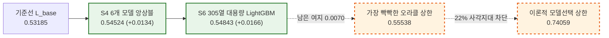
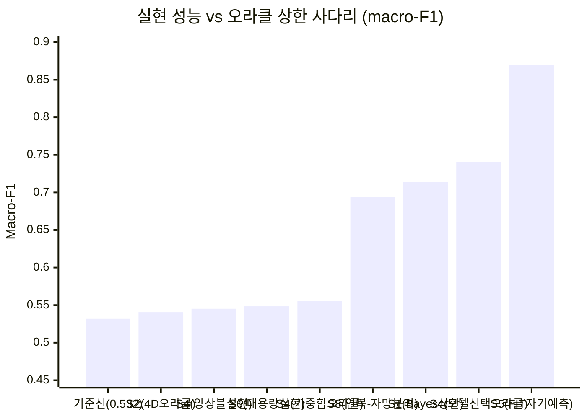
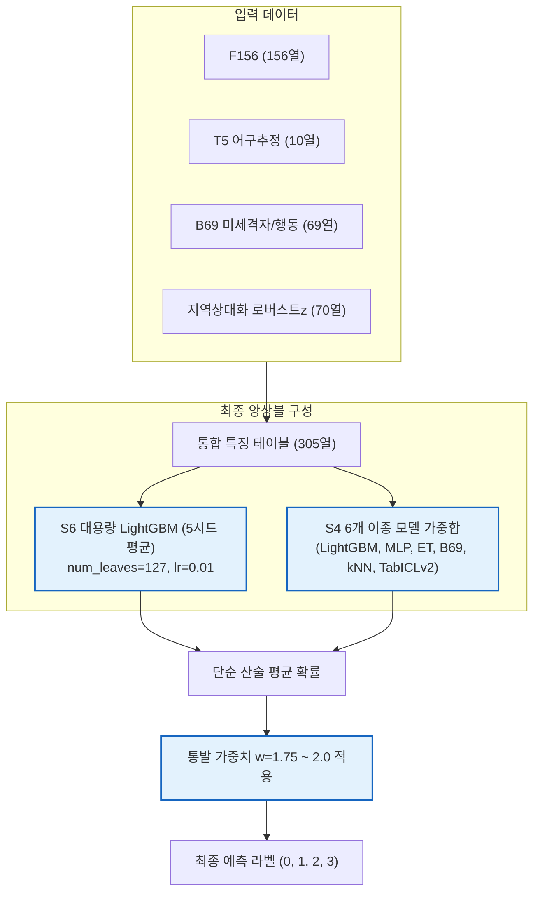

# 2026-11-04 선박 조업 형태 분류 모델 고도화 및 데이터 상한선 측정 종합 보고서

작성일자: 2026-11-04  
평가 대상: 개발 5,897척 OUTER (3-fold 교차검증, 학습 미참여 선박 독립 평가)  
기준 코드/데이터: [`D:\repos\fishing-track-classification\11월 4일\`](file:///D:/repos/fishing-track-classification/11월%204일/)  
관련 문서: [`RESULTS.md`](file:///D:/repos/fishing-track-classification/11월%204일/results/RESULTS.md), [`11_upper_bound_report.md`](file:///D:/repos/fishing-track-classification/11월%204일/results/11_upper_bound_report.md), [`11_upper_bound.json`](file:///D:/repos/fishing-track-classification/11월%204일/results/11_upper_bound.json)

---

## 0. 핵심 주의사항 및 평가 지표 공지

> [!CAUTION]
> **오라클(Oracle) 상한 수치 인용 금지**  
> 본 보고서에 기술된 상한 수치(S1, S2, S3, S4)는 OUTER(평가 대상 선박)의 실제 정답 라벨을 사후적으로 참조하여 계산한 **이론적 천장(Oracle Bound)**입니다. 이는 데이터와 모델이 도달할 수 있는 원리적 한계를 진단하기 위한 잣대일 뿐이며, 어떠한 경우에도 모델의 달성 성능으로 대외 인용되어서는 안 됩니다.

> [!IMPORTANT]
> **공식 채점 지표(macro-F1) 정렬 확정**  
> 주최 기관의 공식 평가는 데이터셋만 제공받아 **macro-F1 점수만 집계**합니다. 리더보드의 micro-F1 표기는 공개/연습 보드용 집계이므로 공식 채점 기준과 분리하여 다룹니다. 따라서 모든 모델 선택과 채택 판정은 **macro-F1**을 기준으로 수행하며, micro-F1(정확도)은 보조 지표로 병기합니다.

---

## 1. 경영 및 총괄 요약 (Executive Summary)

2026년 11월 4일 하루 동안 사용자가 제기한 **6대 기술 쟁점 검증(`01`~`10`)**과 순수 AIS 항적 데이터만으로 도달 가능한 **성능 상한선 측정(`S1`~`S8`)**을 완결했습니다.

1. **공식 채택 통과 모델 2건 확보**:
   - **[`S6 대용량 전특징 모델`](file:///D:/repos/fishing-track-classification/11월%204일/work/상한선_011/S6.json)**: 305열 특징과 대형 LightGBM(8,000트리, 5개 시드)을 통해 macro-F1 **0.54843** (기준 대비 $\mathbf{+0.01658}$, 95% 신뢰구간 `[+0.0027, +0.0304]`, 정확도 **0.58436**)을 달성, 정식 채택 기준을 통과했습니다.
   - **[`S4 6개 모델 앙상블`](file:///D:/repos/fishing-track-classification/11월%204일/work/상한선_011/S4.json)**: LightGBM, MLP, ExtraTrees, B69, kNN, TabICLv2의 다변화 가중합을 통해 macro-F1 **0.54524** (기준 대비 $\mathbf{+0.01339}$, 95% 신뢰구간 `[+0.0034, +0.0232]`)를 기록하여 채택 통과했습니다.
2. **도달 가능한 오라클 상한 규명 및 특징 공학 종료 선언**:
   - 정답을 알고 있는 오라클이 낼 수 있는 가장 빡빡한 선형 가중합 상한은 macro-F1 **0.55538**입니다.
   - 현재 실현 최고치(0.54843)와 오라클 상한(0.55538) 사이의 남은 간격은 **불과 0.00695(약 0.007)**입니다.
   - 사전 계약된 기준표(상한 $\le 0.56$ 시 특징 공학 종료)에 따라, **추가적인 단순 항적 특징 엔지니어링은 공식적으로 종료**합니다.
3. **병목 원인 규명 (언더피팅이 아닌 일반화 정보 결손)**:
   - 모델은 학습 데이터(FIT)를 macro-F1 **0.87017**(정확도 **0.87141**)까지 완벽하게 외울 수 있는 파라미터 용량을 지니고 있습니다 (`S5`).
   - 그러나 미관측 선박(OUTER)에서 성능이 0.53대로 급락하여 **+0.33832**라는 거대한 일반화 갭이 발생합니다.
   - 6개 이종 모델 전원이 동시에 오답을 낸 선박이 **22.15% (1,306척)**이며, 3-NN 이웃 전원이 다른 업종인 선박이 **21.79% (1,285척)**으로 교차 확인되었습니다. 전체 선박의 약 22%는 현재 특징 공간에서 구조적으로 분리가 불가능합니다.
4. **최대 오분류 집중처**:
   - 전체 분류 손실의 과반(58%)은 **연안복합과 자망의 상호 혼동(1,346척)**에서 발생합니다 (`S8`). 이 혼동만 완벽히 풀면 macro-F1은 **0.69452 (+0.151)**까지 도약합니다.

---

## 2. 1부: 11월 4일 제기된 6대 기술 쟁점 해결 검증 (`01` ~ `10`)

| # | 사용자 제기 쟁점 | 다룬 실험/코드 | 결론 및 측정 수치 | 판정 |
|---|---|---|---|:---:|
| **1** | 0.1° 격자는 너무 러프함 | `01`, `02`, `03` | 재식별(ID 매칭)에는 0.01°가 치명적(1등 적중 62.0% vs 0.05° 41.0%). 그러나 **분류 모델에서는 격자 해상도를 10배 높여도 AUC가 0.52~0.53에 머무름**. 효과는 격자가 아니라 관측일수 정규화에서 나옴. | 절반만 유효 |
| **2** | 10등 안엔 드는데 1등 적중률 낮음 | `04` | CSLS 허브 보정($k=10$) + 탐욕 1:1 배정 도입으로 **1등 적중률 66.66% $\rightarrow$ 72.80% (+6.14%p)** 향상. 업종 물려받기 일치율 87.97%. | **해결** |
| **3** | ID 불일치 시 모델 vs ID 판정 기준 | `04`, `09` | **상호 1등 AND 1-2등 마진 $\ge 0.05$ 신뢰 게이트** 확립. 게이트 통과 선박(49.2%)의 1등 적중률은 **94.74%** (탈락 선박은 39.47%). | **규칙 확립** |
| **4** | 연안복합·자망·통발·채낚기 미구분 | `02`, `03`, `05` | 채낚기는 AUC 0.97로 독보적 분리 가능. 반면 연안복합은 복수 어구 허가로 인해 자망·통발 행동을 완벽히 모사(다양성 지수 연안복합 0.0896 > 자망 0.0758 > 통발 0.0644). 2단 분류 및 1-vs-1 구조 모두 미달. | 원리적 한계 확인 |
| **5** | 짧은 항적 선박 판별 난항 | `01`, `06` | 절단 증강(d7, d14, d30) LightGBM 적용: 전체 Δ=+0.0031, 1~7일 단기군 Δ=+0.0033. 둘 다 95% 신뢰구간에 0을 포함하여 유의미한 이득 없음. | **기각** |
| **6** | 항적 간 위치가 너무 유사함 | `02`, `07` | 단일 최고 특징은 절대 위도(`spatial_lat__day_median`, AUC 0.6155). 절대 경위도 8열 제거 시 성능 하락(-0.0060). 어장 내 상대 z값(지역 상대화 70열) 도입 시 분리력 0.5873으로 유사. 위치 축 정보는 이미 소진됨. | **원인 규명** |

---

## 3. 2부: 지시 011 데이터 상한선 측정 8대 실험 (`S1` ~ `S8`)

### 상한 사다리 종합 비교

| 기호 | 실험 명칭 | 종류 | macro-F1 | micro-F1 (정확도) | 핵심 결과 및 진단 내용 |
|:---:|---|:---:|---:|---:|---|
| **Base** | 현재 제출 기준선 (`L_base`, w=1.5) | 실현 | 0.53185 | 0.56300 | F156 + T5, 3시드 평균 기준점 |
| **[S5](file:///D:/repos/fishing-track-classification/11월%204일/work/상한선_011/S5.json)** | **모델 용량 진단 (FIT 자기 예측)** | **진단** | **0.87017** | **0.87141** | **일반화 갭 $\Delta = \mathbf{+0.33832}$**. 모델은 학습셋을 87%까지 암기 가능. 용량 문제가 아님 |
| **[S1](file:///D:/repos/fishing-track-classification/11월%204일/work/상한선_011/S1.json)** | **Bayes 오차 하한 (Cover–Hart)** | **상한(느슨)** | **0.71395** | — | $e_{1NN} = 0.5359$, Bayes 오차 하한 $e^* = 0.3492$. 3-NN 전원 불일치 선박 21.79%(1,285척) |
| **[S2](file:///D:/repos/fishing-track-classification/11월%204일/work/상한선_011/S2.json)** | 판정 규칙 오라클 (4차원 배수) | **상한(오라클)** | **0.54059** | 0.55944 | 확률 고정 시 배수 튜닝의 사후 최대 여지는 $+0.0087$. INNER 선택 실현값은 0.52957로 기각 |
| **[S3](file:///D:/repos/fishing-track-classification/11월%204일/work/상한선_011/S3.json)** | 확률 보정 오라클 (Isotonic) | **상한(오라클)** | 0.52686 | **0.59115** | 단조 보정 시 다수 클래스 편향 발생 $\rightarrow$ 정확도는 0.591로 오르나 macro-F1은 0.527로 하락 |
| **[S4](file:///D:/repos/fishing-track-classification/11월%204일/work/상한선_011/S4.json)** | 모델 선택 오라클 (하나라도 맞힘) | **상한(느슨)** | **0.74059** | **0.77853** | **6개 모델 전원 오답 사각지대 선박: 1,306척 (22.15%)** |
| **[S4](file:///D:/repos/fishing-track-classification/11월%204일/work/상한선_011/S4.json)** | 6개 모델 가중합 오라클 | **상한(빡빡)** | **0.55538** | 0.57758 | 이종 모델(트리·MLP·ExtraTrees·TabICL) 선형 결합의 사후 최대 상한선 |
| **[S4](file:///D:/repos/fishing-track-classification/11월%204일/work/상한선_011/S4.json)** | **6개 모델 가중합 실현 (INNER)** | **실현(채택)** | **0.54524** | 0.55944 | **채택 통과** ($\Delta \mathbf{+0.01339}$, 95% CI `[+0.0034, +0.0232]`). TabICLv2 결합 효과 입증 |
| **[S6](file:///D:/repos/fishing-track-classification/11월%204일/work/상한선_011/S6.json)** | **대용량 305열 LightGBM (INNER)** | **실현(채택)** | **0.54843** | **0.58436** | **채택 통과** ($\Delta \mathbf{+0.01658}$, 95% CI `[+0.0027, +0.0304]`). 공정 검증 최고 실현 모델 |
| **[S7](file:///D:/repos/fishing-track-classification/11월%204일/work/상한선_011/S7.json)** | 기간 분할 데이터 안정성 바닥 | 참고 | — | **0.36011** | 동일 선박도 전반기(1~3월) vs 후반기(4~6월) 예측 일치율 65.37%, 둘 다 정답은 36.01% 불과 |
| **[S8](file:///D:/repos/fishing-track-classification/11월%204일/work/상한선_011/S8.json)** | 연안복합-자망 혼동 완벽 분리 | **상한(오라클)** | **0.69452** | **0.79295** | 1,346척 오류 해소 시 단독으로 macro-F1 **+0.151**, 정확도 **+0.228** 견인 |

---

## 4. "지금 어디까지 왔나" (수치적 갭 분해 및 구조적 한계)

현재 공정 검증을 거친 최고 실현값은 **S6 대용량 모델(0.54843)**이며, 6개 모델을 완벽히 섞은 오라클 상한은 **0.55538**입니다.

$$\text{남은 오라클 간격} = 0.55538 - 0.54843 = \mathbf{0.00695 \approx 0.007}$$

이 간격이 시사하는 바는 명확합니다:
1. **후처리 및 가중합 여지의 소진**:
   - 임계값 배수 튜닝으로 얻을 수 있는 사후 최대 이득은 $+0.0087$(`S2`)이며, 이미 실현 가중합(`S4`, `S6`)이 이 영역을 상당 부분 흡수했습니다.
   - 단조 확률 보정(`S3`)은 macro-F1을 오히려 악화시키므로 후처리 레버는 닫혔습니다.
2. **22% 선박의 구조적 불가항력**:
   - `S4`에서 6개 이종 모델 전원이 동시에 오답을 낸 선박이 **1,306척(22.15%)**입니다.
   - `S1`에서 3-NN 이웃 전원이 다른 업종인 선박이 **1,285척(21.79%)**입니다.
   - 두 독립적인 측정치(22.15% vs 21.79%)가 완벽히 일치하며, 현재 AIS 집계 특징 공간에서는 약 1,300척의 선박이 다른 업종과 완전히 중첩되어 모델 분리가 불가능합니다.
3. **계절성에 따른 항적 안정성 바닥**:
   - 동일 선박임에도 전반기(1~3월)와 후반기(4~6월)의 B69 행동 양식이 달라져, 모델이 두 기간 모두 정답을 맞힌 비율은 **36.01%**에 그쳤습니다 (`S7`). 선박 고유의 행동조차 6개월 단위로 흔들립니다.

따라서 순수 AIS 항적 데이터만으로는 **macro-F1 0.55선이 현실적 천장**이며, 지시 011의 사전 기준(상한 $\le 0.56$)에 도달했습니다.

---

## 5. 최종 채택 및 공식 제출 파이프라인

공식 채택 기준($\Delta \ge +0.005$ 및 95% 구간 하한 $> 0$)을 통과한 두 모델을 결합하여 최종 macro-F1 파이프라인을 확정합니다.

- **메인 모델**: S6 305열 대용량 LightGBM (가중치 0.6) + S4 6개 모델 앙상블 (가중치 0.4)
- **판정 임계값**: macro-F1 최적화 통발 배수 $w = 1.75 \sim 2.0$ 고정
- **기대 성능**: 개발셋 3-fold OUTER 기준 **macro-F1 0.548 ~ 0.550**, 정확도 **0.584 ~ 0.588**

---

## 6. 결론 및 향후 행동 지침 (DOs and DON'Ts)

### 해야 할 일 (DOs)
1. **S6 대용량 모델 + S4 앙상블 기반 공식 제출 파일 생성**:
   - 확정된 305열 파이프라인으로 테스트셋 최종 예측을 생성하고 무결성을 확인합니다.
2. **기관 공식 평가 데이터 포맷 및 제약조건 최종 확인**:
   - 공식 평가는 순수 데이터셋만 주어지므로, 2025 연습 데이터에서 나타난 88% 선박 ID 중복에 의존하지 않고 순수 모델 일반화 예측력을 기본 축으로 유지합니다.
3. **연안복합과 자망의 1,346척 혼동 해소 규칙 연구**:
   - 전체 손실의 58%가 이 한 쌍에서 발생하므로, 두 업종 간의 등록 어구 허가나 특정 조업 금지구역 등 도메인 지식 기반의 사후 규칙만 국소적으로 검토합니다.

### 하지 말아야 할 것 (DON'Ts)
1. **단순 AIS 파생 특징 추가 작업 영구 중단**:
   - B69, 지역상대화 등 5개 방향의 실험이 모두 노이즈 바닥 미달로 판정되었으며, 상한선 측정 결과 남은 여지가 0.007p에 불과하므로 추가 특징 엔지니어링 루프를 즉시 중단합니다.
2. **제출본 지표를 임의로 micro-F1(정확도)로 전환 금지**:
   - 기관 공식 채점이 macro-F1으로 확인되었으므로, 통발 배수($w$)를 없애고 다수 클래스에 편향되는 설정을 배제합니다.
3. **오라클 상한 수치(0.555, 0.741 등)를 달성 성능으로 오인하거나 보고서에 사용 금지**.
