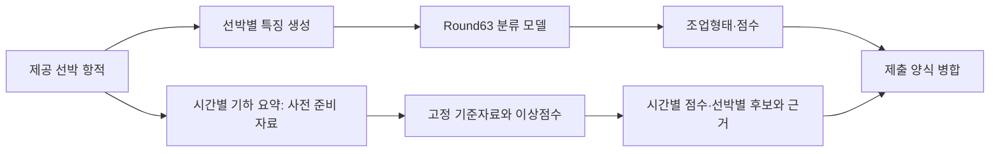

# 어선 항적 분석: 조업형태 분류와 사고 후보 검토

시간대별로 요약된 어선 항적을 이용해 **선박의 조업형태를 분류**하고, 별도의 경로에서 **사고와 관련될 수 있는 이상 시각의 검토 후보**를 생성한 데이터 분석 프로젝트이다.

바다 위에서 같은 자리 주변을 오가는 움직임은 정상적인 조업일 수도, 도움이 필요한 상황일 수도 있다. 제공 항적은 좌표별 시각이 없어 실제 속력을 직접 복원할 수 없으며, 기하 변화만으로 사고 여부를 확정할 수도 없다. 따라서 선박 단위 분류와 시간별 이상점수라는 두 문제를 구분하고, 각 결과가 어디까지 유효한지 검증하였다.

## 문제에서 접근으로

**조업형태 분류(Test A)**는 선박별 여러 항적을 요약해 네 유형을 예측한다. 전체 정답률뿐 아니라 소수 유형이 다른 유형으로 얼마나 잘못 분류되는지도 문제였다. Round63 제출 패키지는 형상·공간·관측 시간 특징 337개와 고정 학습 문맥을 사용하고, 4분류와 유형 쌍별 비교 결과를 결합한다. 모델 선택에 사용한 TUNE과 개발 성능을 확인한 REPORT를 구분하되, REPORT도 반복 개발에 노출된 자료로 기록한다. ([모델·분할 설명](test_a/deliverables/round63_submission_20261106/docs/과제1_모델설명.md))

**이상항적 분석(Test B)**은 위치, 과거 움직임과의 차이, 관측 공백이라는 세 성분으로 시간별 점수를 만든다. 점수는 사고 확률이 아니라 검토 우선순위다. 후보가 왜 선택됐는지 성분과 이력 수를 함께 보관하고, 사고 선박을 고르는 문제와 시각을 고르는 문제를 별도로 평가하였다. ([실행 패키지](test_b/deliverables/testb_system_20261106/README.md))

화살표는 확인된 자료 흐름을 나타낸다. Test B 실행 패키지는 원 WKT 전체 전처리가 아니라 이미 만들어진 시간별 기하 요약을 입력받는다. 통합 스크립트는 두 결과를 엑셀에 병합하며, Test A 예측을 Test B 점수 함수에 전달하지 않는다. ([Test B 입력](test_b/deliverables/testb_system_20261106/src/run_analysis.py), [병합 코드](test_a/deliverables/round63_submission_20261106/scripts/export_integrated.py))

## 검증으로 판단을 바꾼 과정

| 질문 | 조건과 확인된 결과 | 후속 판단 |
| --- | --- | --- |
| 분류 점수가 올랐는가? | 이전 Round26 개발 OUTER 5,897척의 공표값 3,552척 정답은 재현됐다. 후속 검토는 22개 후보의 선택에 OUTER 결과가 사용됐고, 원래 INNER 보호조건을 통과한 후보가 0개였음을 확인했다. | 공표값을 독립 성과로 제시하지 않는다. 점수 계산과 후보 선택의 타당성을 별도로 검증한다. ([검토](test_a/11_04_final/rounds/round_026/review_20261105/REVIEW_ROUND026_0.60돌파_검증_20261105.md)) |
| 제출 분류기는 어느 정도인가? | Round63 개발 REPORT 1,475척에서 903척 정답, micro-F1 0.612203이다. 같은 집단에서 통발 재현율은 0.177033이다. | 전체 점수와 유형별 실패를 함께 본다. REPORT는 반복 개발에 사용된 자료이며 공식·독립 평가가 아니다. ([기록](test_a/deliverables/round63_submission_20261106/docs/과제1_모델설명.md)) |
| 최고 이상점수가 사고 시각을 찾는가? | 2026년 개발자료의 잠정 연결 82척을 전부 예측한 자체 계산에서 ±6시간 3척 적중, F1 0.0366이었다. | 사고-선박 연결과 일부 공식 채점 산식이 미확정이므로 자체 평가로 제한한다. 제출 대상은 별도의 2025년 항적이다. ([평가](test_b/final/round_015_official_f1_20261106/ROUND015_공식F1_보고서_20261106.md)) |
| 정상 조업 맥락을 넣으면 나아지는가? | 어업별 기준을 적용한 G는 동일 개발 100사건에서 1건 적중했고 B0는 3건이었다. | 당시 규칙에서 개선을 확인하지 못했다. 조업형태 정보가 모든 방법에서 쓸모없다는 뜻은 아니다. ([실험](test_b/final/round_004_20261105/ROUND004_상세보고서.md)) |

정렬 오류를 발견해 실행 성공으로 기록된 비교를 무효화한 사례도 있다. 정렬에 쓰려던 새 점수 대신 기존 점수가 사용된 것이 원인이었으며, 수정한 실행을 별도로 남겼다. ([무효 기록](test_b/final/round_002_20261105/execution_001/INVALID_COMPARISON.md), [후속 재채점](test_b/final/round_013_metric_rescore/RESCORE.md))

## 현재 결과의 사용 범위

Test A는 고정 제출 대상 선박의 조업형태 예측 파일을 생성하는 구성이고, Test B는 제공된 100척·46,705행의 시간별 요약에서 점수와 후보를 재현하는 구성이다. Test B 패키지의 보관된 검증 기록은 기존 저장 점수와의 전수 비교에서 최대 절대차 0.0을 보고한다. 이는 **저장 결과의 재현성**이지 실제 사고 탐지 성능이나 현장 운용의 증거는 아니다. ([검증 기록](test_b/deliverables/testb_system_20261106/results/reproduction_001/summary.json))

사후 제출 분석에서는 제공된 전체 기간을 참고한다. 실제 시점의 경보로 전환하려면 수신 가능 시각, 당시 참조자료의 가용성, 확정 사고·정상 정답과 오경보·지연 정의가 추가로 필요하다. 입력 시간순 계약 검사는 별도 구현돼 있으나, 그 통과가 실시간 탐지 성능을 뜻하지는 않는다. ([계약 코드](fishing_demo/causal_replay.py), [적용 범위](docs/portfolio/04_application.md))

## 실행과 자료 탐색

- **Test A:** [실행·데이터·모델 안내](test_a/deliverables/README.md). 제출 모델 가중치 2개는 저장소에 포함되지 않아 원본 자료에서 복원해야 한다. 현재 CLI는 고정 대상 명부의 재현 경로이다.
- **Test B:** [재현 명령과 입력 조건](test_b/deliverables/testb_system_20261106/README.md). 새 출력 디렉터리에서 실행하며, 가용 메모리와 고정 입력 해시를 검사한다.
- **포트폴리오 상세:** [문제](docs/portfolio/01_problem.md) · [설계와 통제](docs/portfolio/02_approach.md) · [결과와 판단 변경](docs/portfolio/03_results.md) · [적용과 한계](docs/portfolio/04_application.md).
- **연구 지식:** [실험 흐름과 개인 지식 색인](knowledge/README.md). 일부는 검토 초안이며 각 문서의 범위와 원문 링크를 확인한다.

프로젝트 자료에는 팀 산출물과 AI 지원 기록이 함께 포함된다. 작성자나 결정 주체를 근거 없이 개인에게 귀속하지 않는다. 원본의 참가자 역할·AI 활용 기록은 [검토 문서](test_a/deliverables/round63_submission_20261106/docs/AI_활용과_검토.md)에서 확인할 수 있다.
