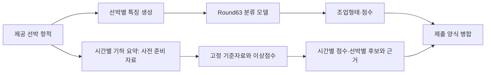

# 어선 항적 분석: 조업형태 분류와 사고 후보 검토

시간대별로 요약된 어선 항적으로 **선박의 조업형태를 분류**하고(Test A), 별도 경로에서 **사고와 관련될 수 있는 시각을 검토 후보로 제시**하는(Test B) 데이터 분석 프로젝트다.

> **한눈에 보기**
> - **무엇:** 좌표별 시각이 없는 어선 항적에서 조업형태 분류(Test A)와 이상 시각 검토 후보 제시(Test B)
> - **기술:** Python, 337개 형상·공간·시간 특징, TabICL 기반 분류 모델, 성분별 이상점수
> - **핵심 수치:** Test A micro-F1 0.612(개발 자료 1,475척), Test B 100척·46,705행 완전 재현
> - **차별점:** 재현 불가·평가 누수·정렬 오류를 직접 찾아내 결과를 무효 처리하거나 재실행한 검증 기록



두 경로는 서로 독립이다. 통합 스크립트는 두 결과를 엑셀 하나로 합칠 뿐, Test A의 예측을 Test B의 점수 계산에 쓰지 않는다.

## 무엇을 하는가

- **조업형태 분류 (Test A).** 선박마다 여러 항적을 요약해 네 유형 중 하나로 분류한다. 형상·공간·관측 시간 특징 337개와 TabICL 기반 Round63 모델을 쓴다.
- **이상 시각 후보 (Test B).** 위치, 과거 움직임과의 차이, 관측 공백 세 성분으로 시간별 점수를 만들고 선박마다 최고점 시각을 후보로 낸다. 점수는 사고 확률이 아니라 검토 우선순위다.
- **후보의 근거를 함께 남긴다.** 후보가 왜 뽑혔는지 성분별 점수와 사용한 이력 수를 같이 보관한다.

제공 항적에는 좌표별 시각이 없다. 그래서 실제 속력을 복원할 수 없고, 움직임의 모양만으로 사고 여부를 확정할 수 없다. 이 제약이 두 문제를 나눠 푼 이유다.

## 결과 요약

| 항목 | 결과 | 읽을 때 주의할 점 |
|---|---|---|
| Test A 분류 | 개발 REPORT 1,475척 중 903척 정답, micro-F1 0.612203 | REPORT는 반복 개발에 쓰인 자료다. 공식·독립 평가가 아니다 |
| Test A 소수 유형 | 통발 재현율 0.177033 (209척 중 37척) | 전체 점수가 가리는 실패다 |
| Test B 재현성 | 100척·46,705행에서 저장된 점수와 최대 절대차 0.0 | 같은 입력을 다시 계산한 결과다. 사고 탐지 성능이 아니다 |
| Test B 사고 시각 | 개발자료 82척 중 ±6시간 적중 3척, 자체 F1 0.0366 | 사고-선박 연결과 공식 채점식이 미확정이라 자체 평가다 |

공식 Test B F1, 현장 탐지 지연, 오경보율은 확인하지 못했다. 수치별 조건은 [결과와 판단 변경](docs/portfolio/03_results.md)에 있다.

## 검증으로 판단을 바꾼 사례

| 질문 | 확인한 사실 | 바꾼 판단 |
|---|---|---|
| 분류 점수가 0.60을 넘었는가? | Round26의 공표값(5,897척 중 3,552척)은 재현됐다. 그러나 후보 22개를 고를 때 평가용 자료의 결과를 썼고, 원래 보호조건을 통과한 후보는 0개였다 | 이 수치를 독립 성과로 제시하지 않는다 ([검토](test_a/11_04_final/rounds/round_026/review_20261105/REVIEW_ROUND026_0.60돌파_검증_20261105.md)) |
| 최고 이상점수가 사고 시각을 찾는가? | 82척 중 3척만 ±6시간 안에 들었다 | 점수를 사고 시각 예측으로 쓰지 않고 검토 후보로만 쓴다 ([평가](test_b/final/round_015_official_f1_20261106/ROUND015_공식F1_보고서_20261106.md)) |
| 어업별 기준을 넣으면 나아지는가? | 같은 100사건에서 어업별 기준은 1건, 기존 방법은 3건을 맞혔다 | 그 규칙에서는 개선이 없었다. 조업형태 정보가 쓸모없다는 결론은 아니다 ([실험](test_b/final/round_004_20261105/ROUND004_상세보고서.md)) |
| 실행에 성공한 비교는 믿을 수 있는가? | 정렬에 새 점수 대신 기존 점수가 쓰인 오류를 발견했다 | 그 비교를 무효로 기록하고 고쳐서 다시 실행했다 ([무효 기록](test_b/final/round_002_20261105/execution_001/INVALID_COMPARISON.md), [재채점](test_b/final/round_013_metric_rescore/RESCORE.md)) |

## 다음 단계

- [ ] 통발 등 소수 유형 재현율 개선(클래스 가중치, 유형별 특징 보강)
- [ ] 개발에 쓰지 않은 독립 자료로 Test A 재평가
- [ ] Test B를 새 선박 자료에도 돌릴 수 있는 일반 추론 경로로 확장
- [ ] 실시간 운용 조건(수신 시각, 오경보·지연 정의) 반영 설계

## 빠른 시작

### Test B: 이상 시각 후보 재현

GPU 없이 실행된다. 확인한 환경은 Windows 11, Python 3.13.3이다.

```powershell
cd test_b/deliverables/testb_system_20261106
python -m venv .venv
.venv\Scripts\python.exe -m pip install -r requirements.txt
.venv\Scripts\python.exe src/run_analysis.py --output results/reproduction_new
```

출력 폴더에 시간별 점수(`scored_rows.parquet`), 선박별 후보와 근거(`candidates.csv`), 재현 대조 결과(`summary.json`)가 생긴다. 출력 폴더가 이미 있으면 덮어쓰지 않고 멈춘다.

이 실행기는 동봉된 100척 입력을 재현하는 용도다. 새 선박 자료를 넣는 일반 추론은 지원하지 않는다. 자세한 조건은 [Test B 안내](test_b/deliverables/testb_system_20261106/README.md)에 있다.

### Test A: 조업형태 분류

모델 가중치 두 파일(`round63.ckpt`, `public_init.ckpt`)은 GitHub 파일 크기 제한을 넘어 저장소에 없다. 추론이나 재학습을 하려면 원본 ZIP에서 두 파일을 `model/`에 복원해야 한다. 복원 방법, 해시, 실행 환경은 [Test A 안내](test_a/deliverables/README.md)에 있다.

## 폴더 구조

```text
data-ai-shipping/
├── test_a/
│   ├── deliverables/     Round63 제출 패키지 (코드, 데이터, 결과, 검증 기록)
│   ├── 11_04_final/      라운드별 실험 기록
│   └── history/          이전 실험
├── test_b/
│   ├── deliverables/     실행 패키지와 결과 보고서
│   ├── final/            라운드별 실험 기록
│   └── 과거/, history/    이전 실험
├── docs/
│   ├── portfolio/        문제, 접근, 결과, 적용 범위 요약
│   └── ai_textbook/      학습용 교재
├── knowledge/            실험 흐름 색인과 재사용 지식
├── fishing_demo/         초기 샘플 시스템 코드
├── 제출결과물/            제출 묶음과 데모
└── tests/, tools/        테스트와 도구
```

이 저장소는 작업 폴더를 그대로 동기화한 것이라 `tmp/`, `_handoff/`, `.codex/` 같은 작업용 폴더도 들어 있다.

## 문서

| 알고 싶은 것 | 문서 |
|---|---|
| 문제가 무엇이었나 | [문제](docs/portfolio/01_problem.md) |
| 어떻게 설계하고 통제했나 | [설계와 통제](docs/portfolio/02_approach.md) |
| 수치와 그 조건 | [결과와 판단 변경](docs/portfolio/03_results.md) |
| 실제 운용에 쓰려면 무엇이 더 필요한가 | [적용과 한계](docs/portfolio/04_application.md) |
| 라운드별로 무엇을 했나 | [지식 문서 색인](knowledge/README.md) |
| Test A 모델과 자료 분할 | [모델 설명](test_a/deliverables/round63_submission_20261106/docs/과제1_모델설명.md) |

## 사용 범위

이 결과는 제공된 전체 기간을 사후에 분석한 것이다. 실시간 경보로 쓰려면 자료의 실제 수신 시각, 그 시점에 쓸 수 있었던 참조자료, 확정된 사고·정상 정답, 오경보와 지연의 정의가 더 필요하다.

프로젝트 자료에는 팀 산출물과 AI 지원 기록이 함께 들어 있다. 작성자나 결정 주체를 근거 없이 개인에게 귀속하지 않는다. 참가자 역할과 AI 활용 기록은 [AI 활용과 검토](test_a/deliverables/round63_submission_20261106/docs/AI_활용과_검토.md)에 있다.
