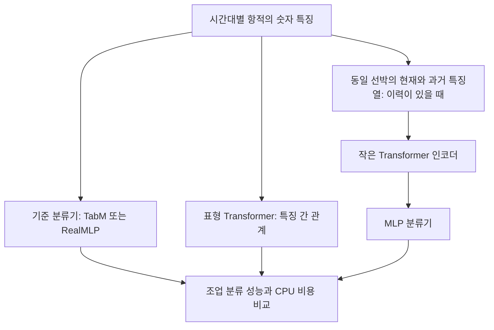

# 프로젝트 제안서 보완안: 인코더·디코더·Transformer 활용

**기준일: 2026-10-16 | Python·일반 노트북 CPU | 제안 단계**

기존 TabM·RealMLP 프로젝트 제안서의 **‘프로젝트 목표’와 ‘프로젝트 내용’에 추가할 공통 보완안**이다. 4·5절은 제안서에 붙여 넣을 수 있는 문장으로 작성했다. 각 제안서에서는 ‘기준 모델’을 해당 모델명인 **TabM 또는 RealMLP**로 바꾸어 사용하면 된다.

**[확인]** 현재 샘플은 10행·10척이며 점별 시각과 선박별 연속 시간 이력을 확인할 수 없다. **[제안]** 아래 설계는 정식 자료의 구성에 따라 선택할 실험안이다. 모델 성능이나 사고 예방 효과를 확인한 결과는 아니다.

## 1. 기존 제안서에 추가할 수 있는가?

**추가할 수 있다. 다만 ‘세 기술을 모두 사용하는 시스템을 확정했다’보다 ‘입력 조건에 맞는 표현 학습의 추가 효과를 검증한다’고 작성하는 것이 타당하다.**

| 추가 항목 | 목표에 넣을 내용 | 내용에 넣을 설계 | 적용 조건 |
|---|---|---|---|
| **인코더** | 항적에서 유용한 패턴을 자동으로 추출하는 방법 검토 | 항적 → 특징 벡터 → 분류기 | 사용할 입력의 의미·순서 확인 |
| **Transformer** | 특징 간 또는 시간대 간 관계가 분류에 도움이 되는지 비교 | 숫자 표 모델 또는 작은 시계열 인코더 | 방식에 맞는 선박 수·이력·CPU 비용 확인 |
| **디코더** | 복원 학습과 복원오차의 활용 가능성 검토 | 가린 특징 복원 → 보조 학습·이상 분석 | 충분한 학습 자료와 별도 효과 검증 |

**대회 목표는 유지한다.** 목표 A는 신규 선박의 조업형태·분류 확률 산출, 목표 B는 시간대별 이상점수 산출이다. 미래 항적 생성은 필수 제출 결과가 아니므로, 독립된 대규모 생성 과제로 확대할 필요는 없다.

**기존 제안서에서의 위치:** 목표의 ‘접근의 합리성’ 뒤에 표현 학습 비교 목표를 넣고, 내용의 ‘입력과 분류 설계’에 인코더 경로를 추가한다. 디코더 활용은 ‘이상 분석과 검증’의 조건부 확장으로 배치한다.

## 2. 용어와 데이터 조건을 먼저 구분

### 2-1. 세 용어는 같은 종류의 선택지가 아니다

| 용어 | 쉽게 설명하면 | 이 프로젝트의 예 |
|---|---|---|
| **인코더** | 입력을 분석해 필요한 정보를 담은 표현으로 바꾸는 부분 | 여러 항적 특징을 하나의 특징 벡터로 정리 |
| **디코더** | 그 표현에서 원하는 출력을 만드는 부분 | 가려 놓은 항적 특징을 복원 |
| **Transformer** | 입력 요소 사이의 관계를 Attention으로 배우는 구조 | 어떤 특징·시간대를 함께 봐야 하는지 학습 |

**특징 벡터**는 항적을 설명하는 여러 숫자를 모아 놓은 표현이다. **Attention**은 입력 요소 사이의 관련성을 계산하는 장치다. Attention 값만으로 사고 원인이나 설명의 정확성이 입증되는 것은 아니다.

MLP도 인코더·디코더의 일부가 될 수 있다. 따라서 ‘MLP 응용’이라는 방향과 인코더 활용은 양립한다. Transformer는 인코더만 사용할 수도 있으며, **디코더도 반드시 Transformer로 만들 필요는 없다.** [구조 개념의 근거: Transformer 원 논문](https://papers.nips.cc/paper_files/paper/2017/hash/3f5ee243547dee91fbd053c1c4a845aa-Abstract.html)

수업과는 MLP 분류기·MLP 복원기와 PyTorch 구현을 통해 연결할 수 있다. Attention과 순서 표현은 별도로 학습할 항목으로 둔다.

### 2-2. 입력을 세 가지 방식으로 구성할 수 있다 [제안]

| 방식 | 실제로 넣을 입력 | 가능한 학습 | 확인할 점 |
|---|---|---|---|
| **A. 한 시간의 숫자 표** | 길이·직선성·굴곡·범위·관측 품질 | 표형 Transformer로 특징 간 관계 학습 | 점별 시각·연속 이력은 필수 아님 |
| **B. 한 시간의 좌표열** | 구성선별 상대 좌표와 점 순서 | 작은 인코더로 형상 관계 학습 | 순서 의미 확인, 구성선 경계 보존 |
| **C. 여러 시간의 특징열** | 같은 선박의 현재·이전 시간대 숫자 특징 | 시간 변화·반복 패턴 학습 | 날짜+시간 정렬, 결측 시간·관측 간격 표시 |

**현재 우선 검토할 확장:** A는 기존 특징 표를 재사용하기 쉽다. 정식 자료에 연속 이력이 충분하면 C를 검토한다. B는 좌표 순서와 점 수·품질을 확인한 뒤 선택한다. 세 방식을 모두 구현하겠다고 약속할 필요는 없다.

예를 들어 C는 ‘이전 시간대들에 비해 현재 굴곡·이동 범위가 어떻게 바뀌었는가’를 학습하는 방식이다. **‘현재를 포함한 최근 6시간 → 현재 조업 분류’는 설명용 예시이며 확정한 입력 길이가 아니다.** 현재 시간대도 실제 항적을 수신한 뒤에만 입력으로 사용할 수 있다.

좌표가 순서대로 적혀 있어도 같은 시간 간격으로 관측됐다는 뜻은 아니다. 점별 시각 없이 순간 속도·가속도를 만들지 않으며, MultiLineString의 분리된 구성선을 임의로 잇지 않는다.

C에서는 시간대의 순번·시각·관측 간격을 입력 표현에 함께 넣어 모델이 순서를 구분하게 한다. 길이를 맞추려고 채운 가짜 입력은 실제 관측과 구분하고 Attention 계산에서 제외하도록 처리한다.

## 3. 활용 방안과 기존 모델의 연결

### 3-1. 조업 분류: 인코더와 작은 MLP 분류기

아래 그림의 경로들은 **서로 비교할 후보**이며, 출력을 모두 평균하겠다는 설계가 아니다.

**쉽게 말하면:** 기존 경로는 우리가 만든 특징을 기준 모델이 조합한다. 확장 경로는 특징 간 관계나 여러 시간대의 흐름도 모델이 배우도록 한다.

- **첫 실험:** 기준 모델과 Transformer 경로를 각각 학습해 비교한다. 분류만 한다면 좌표열을 생성하는 디코더는 필요하지 않다.
- **선택적 결합:** 서로 다른 오류를 줄이는지 확인된 경우에만 같은 조업 클래스의 확률을 결합한다. 분류 확률과 이상점수는 평균하지 않는다.
- **다른 연결 방법:** 인코더의 특징 벡터와 기존 기하 특징을 합쳐 TabM·RealMLP의 입력으로 사용하는 실험도 가능하다. 이는 **우리가 구성한 수정안**이며 원 논문이 그 조합의 효과를 입증한 것은 아니다.

인코더 뒤의 작은 MLP 분류기는 **TabM·RealMLP 원 모델과 동일하다는 뜻이 아니다.** 제안서에서는 ‘기준 모델 비교’와 ‘인코더 기반 수정안’을 구분해 이름을 붙인다.

### 3-2. 디코더: 가린 특징을 복원하는 보조 학습

**쉽게 말하면:** 이동 범위 같은 일부 숫자를 숨기고 다른 특징을 보고 복원하게 한다. 정답 조업 라벨이 없어도, 원래 특징값을 학습의 답으로 활용할 수 있다. 이런 방식을 **자기지도 학습**이라고 한다.

**활용 ① — 분류 전 보조 학습 [제안]**

허용된 학습 자료로 복원 학습을 먼저 수행한 뒤, 인코더의 표현을 조업 분류에 재사용한다. 복원 학습을 하지 않은 동일 구조와 비교해 추가 이득을 확인한다. 가린 부분을 맞히게 해 입력 전체를 단순 복사하는 학습을 줄이는 방향을 검토한다.

**활용 ② — 이상점수 후보 [제안]**

정상 후보에서의 복원오차 범위와 새로운 항적의 복원오차를 비교한다. 복원오차는 원래 특징과 복원값의 차이다. 가림 방식·참조 분포를 학습 영역 안에서 정하고, 기존 전역 이상 기준과 독립적으로 비교한다.

이상 분석 경로에서는 알려진 사고 주변을 정상 후보의 기준과 분리해 관리한다. 정상 후보에도 미확인 이상이 섞일 수 있고, 정상적인 조업 변화도 오차를 키울 수 있다. 반대로 모델이 이상까지 잘 복원할 수도 있다. **복원오차는 사고 확률이 아니며, 복원 디코더를 넣었다는 이유만으로 탐지 성능 향상을 주장하지 않는다.**

**미래 예측을 활용한다면:** 과거 특징으로 다음 시간대 특징을 예측하고, 실제 관측이 확보된 후 차이를 계산하는 방법을 검토할 수 있다. 오차는 다음 관측을 받은 뒤에야 계산 가능하므로, 그 시점을 앞당겨 ‘사고 전 경보’로 평가하지 않는다. 이 경로는 복원안의 효과를 확인한 뒤 추가할 후순위 선택지다.

## 4. 프로젝트 목표에 바로 추가할 문장

아래 문장은 기존 목표 A·B를 유지하면서 추가하는 형태다. **1·2번을 공통 목표로, 3번을 조건부 확장 목표로 사용하는 안**을 권한다.

### 추가 목표 1. 항적 표현 학습의 활용 가능성 검증

> 항적의 길이·굴곡·범위 등 기하 특징을 이용하는 기준 모델과, Transformer 기반 표현 학습을 적용한 분류 모델을 비교한다. 특징 간 관계를 학습하는 방법을 검토하고, 정식 데이터에 충분한 연속 이력이 제공되면 시간대별 변화도 활용한다. 이를 통해 신규 선박의 조업형태 판별에 추가적인 정보가 되는지 평가한다.

**쉽게 설명:** 모양을 설명하는 숫자만 조합하는 방법과, 숫자 사이의 관계·시간 흐름까지 배우는 방법을 비교한다.

### 추가 목표 2. 데이터·자원 조건에 맞는 모델 선택

> 기존 기준 모델과 인코더 기반 모델을 동일한 선박 분할과 정보 사용 조건에서 평가한다. 분류 성능뿐 아니라 관측 누락에 대한 안정성, 전처리 포함 CPU 추론 시간과 메모리 사용량을 비교하여 학부 프로젝트의 실행 환경에 적합한 구성을 선택한다.

**쉽게 설명:** 모델 이름이나 복잡성보다, 처음 보는 배를 얼마나 잘 분류하고 노트북에서 어느 정도 비용이 드는지로 선택한다.

### 조건부 목표 3. 복원 학습과 이상 분석의 보조 효과 검토

> 학습 자료가 충분한 경우, 인코더·디코더를 활용해 일부 항적 특징을 복원하는 보조 학습을 검토한다. 학습된 표현의 분류 활용 가능성과 복원오차의 이상점수 활용 가능성을 각각 평가한다. 사고 연결 정보가 확보되면 기존 이상 기준과 비교하여 오경보 및 사고 전 탐지 가능성을 분석한다.

**쉽게 설명:** 빠진 특징을 복원하는 연습이 분류를 돕는지, 복원이 어려운 기록이 실제 확인할 만한 이상인지 따로 검증한다.

## 5. 프로젝트 내용에 바로 추가할 문장

### ① 입력 구성과 적용 경로 선택

> WKT 항적의 구성선과 좌표 품질을 확인하고, 기하 특징 및 관측 품질 정보를 시간대별 숫자 표로 구성한다. 한 시간대의 표형 입력을 우선 활용하며, 선박별 연속 이력이 확보되면 날짜와 시간을 기준으로 현재와 과거의 특징열을 구성한다. 결측 시간은 표시하고, 점별 시각이 없는 자료에서 임의의 속도·가속도를 생성하지 않는다.

### ② 인코더 기반 조업 분류 비교

> 기준 모델과 별도로 표형 Transformer 또는 작은 시계열 Transformer 인코더를 비교 후보로 설계한다. 시계열 경로에서는 순서·시간 정보를 포함해 현재까지 관측된 특징열을 인코더가 분석하고, 그 표현을 MLP 분류기에 전달하여 현재 시간대의 조업형태 확률을 산출한다. 연속 이력이 부족한 선박에는 현재 시간대 특징만을 사용하는 경로를 적용할 수 있도록 한다.

### ③ 디코더의 조건부 활용

> 자료와 자원이 허용되는 경우, 일부 특징을 가린 입력을 인코더에 제공하고 작은 디코더로 해당 특징을 복원하는 보조 학습을 검토한다. 보조 학습 전후의 분류 성능을 비교하며, 복원오차는 별도의 이상점수 후보로 평가한다. 디코더는 작은 MLP 등으로 구성할 수 있고, 복잡한 Transformer 디코더를 필수로 두지 않는다.

### ④ 공정한 비교와 미래 정보 유입 방지

> 분류 모델은 선박 단위로 나누어 평가하고, 시계열·이상 분석에는 평가 시점까지 사용 가능한 관측만 활용한다. 과거 이력을 추가한 모델을 비교할 때 기준 모델에도 같은 기간의 이력 요약 특징을 제공하여, 정보량 증가와 구조 변경의 효과를 구분한다. 특징 변환·보조 학습·혼합 비중 선택은 학습 영역 안에서 수행하고, 별도로 남긴 최종 평가 자료로 확인한다.

### ⑤ 경량화와 결과물

> 작은 층수와 특징 표현 크기에서 시작하고, 입력 점 수 또는 시간 창의 길이를 제한해 CPU 비용을 관리한다. 조업 분류 결과·분류 확률·시간대별 이상점수와 함께 관측 품질 및 모델별 비교 결과를 제시한다. 정식 평가 기준을 우선 적용하고, 추가 구성의 이득이 확인되지 않으면 더 단순한 경로를 선택한다.

## 6. 적용 범위와 채택 기준

| 상황 | 제안서에서의 처리 |
|---|---|
| **지금의 샘플만 있는 단계** | 입력 처리와 연결 가능성을 점검. Transformer·MLP의 성능 우열은 미산출 |
| **라벨 있는 선박은 충분하지만 연속 이력은 부족** | 현재 시간대 특징으로 기준 모델과 표형 Transformer 비교 |
| **연속 시간 이력도 충분** | 작은 시계열 인코더 비교. 기준 모델에도 같은 과거 정보 제공 |
| **허용된 학습 자료·자원에 여유가 있음** | 복원 보조 학습을 추가하고, 분류 효과와 이상탐지 효과를 분리 평가 |

**신규 선박 처리:** 인코더의 개인 이력이 없거나 짧으면 현재 시간대 입력 경로로 시작한다. Test 이력의 이용·갱신은 대회 규칙이 허용하는 범위에서만 수행한다. 선박 ID는 분할·이력 연결에 쓰고 분류 특징으로 넣지 않는다.

**비용 판단:** 복원 디코더를 사전학습에만 쓰면 최종 분류 때 제외할 수 있다. 반면 복원오차를 이상점수로 사용하면 운영 시에도 필요하다. 어떤 경로에 디코더가 남는지 구분해 전체 CPU 비용을 측정한다.

**추가가 필요한 검증:** 복원 학습 유무, 과거 이력 유무, 혼합 유무를 한 번에 하나씩 바꿔 비교한다. 분류는 클래스별 F1·macro-F1과 확률 품질을 확인한다. Macro-F1은 조업 종류별 F1을 같은 비중으로 평균한 값이다. 사고 자료가 있으면 같은 오경보 수준에서 사건별 탐지율·선행시간을 비교한다.

**시간 기준:** 시간대별 항적이 실제로 확보된 시점을 기준으로 점수를 평가한다. 사고 후 관측을 포함한 시간대 전체를 사고 전 탐지로 세지 않으며, 사고 정보가 없으면 해당 평가를 미산출로 남긴다.

**제목과의 관계:** 현재 제목을 유지하면 Transformer를 보조 비교 실험으로 설명할 수 있다. 향후 주력 모델이 바뀌면 제목도 최종 범위에 맞춘다. 예를 들어 ‘어선 항적의 표현 학습을 이용한 조업형태 분류 및 이상항적 분석’처럼 모델명을 고정하지 않는 제목을 검토할 수 있다.

## 7. 논문 근거와 이번 제안의 경계

| 근거 | 확인된 내용 | 우리 과제에 적용할 때의 한계 |
|---|---|---|
| [Attention Is All You Need · NeurIPS 2017](https://papers.nips.cc/paper_files/paper/2017/hash/3f5ee243547dee91fbd053c1c4a845aa-Abstract.html) | Attention 기반 Transformer 구조의 출발점 | 어선 조업 분류·사고 탐지 성능을 입증한 논문은 아님 |
| [Revisiting Deep Learning Models for Tabular Data · NeurIPS 2021](https://proceedings.neurips.cc/paper/2021/hash/9d86d83f925f2149e9edb0ac3b49229c-Abstract.html) | FT-Transformer를 통해 표형 자료의 관계 학습을 평가 | 시간대별 항적 이력이나 우리 특징 표에서의 우위를 보장하지 않음 |
| [A Transformer-based Framework for Multivariate Time Series Representation Learning · KDD 2021](https://doi.org/10.1145/3447548.3467401) | Transformer 인코더·자기지도 사전학습과 분류·회귀 활용을 평가 | 우리 항적 입력·복원 이상점수의 효과는 별도 가설임. [저자 소속기관 설명](https://research.ibm.com/publications/a-transformer-based-framework-for-multivariate-time-series-representation-learning) |
| [TabICLv2 · ICML 2026](https://proceedings.mlr.press/v306/qu26a.html) | 사전학습된 표형 모델이라는 최근 대안이 존재 | 우리가 작은 시계열 인코더를 처음부터 학습하는 방식과 다름. CPU 비용·사용 조건은 별도 검토 |

2017·2021년 논문은 **구조와 적용 가능성의 기초 근거**로 사용했다. ‘Transformer를 사용하므로 2026년의 새로운 알고리즘을 개발한다’고 주장하지 않는다. 사전학습된 모델을 가져오는 선택지도 있지만, 이번 보완안에서 필수 구성으로 확정하지 않는다.

**작성·검토 범위:** 기존 두 제안서의 목표·내용, 제공 공지와 샘플의 확인 사항에 맞춰 추가 문장을 구성했다. 인코더는 특징 학습, 디코더는 복원 등의 출력, Transformer는 관계 학습 구조라는 역할을 구분했다. 실제 사고 확률·예방률, 모델 간 우열, 수치 성능 목표는 정식 자료 검증 전의 확정 내용에 포함하지 않았다.
