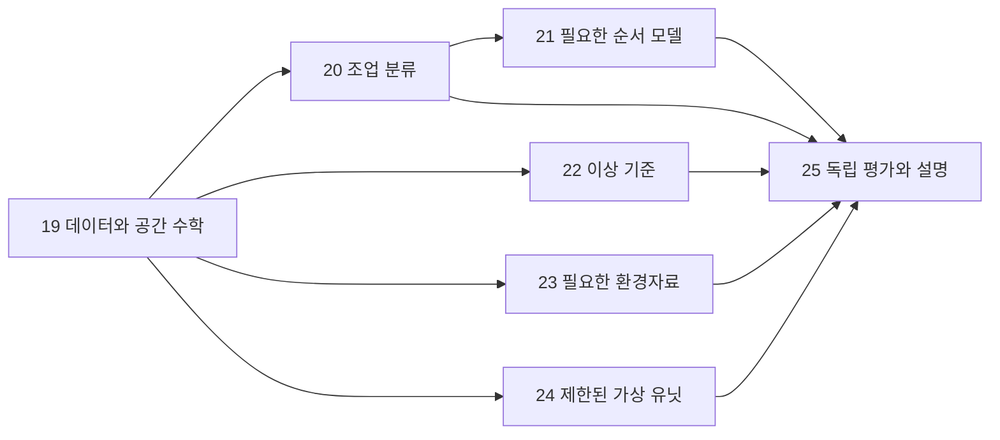

# 어선 항적 모델 제작을 위한 학습 길잡이

NotebookLM에 넣거나 혼자 차례로 공부할 단일 문서는 [26장: 샘플 시스템 개인 학습 노트](chapters/26_fishing_sample_system_personal_study.md)를 사용한다. 현재 구현과 수식·숫자 예제·실험 결과를 포함하며, 실제자료 적용은 후속 절차로 구분한다.

> **2026-10-12 S0 실습 추가:** 실제 데이터 수령 전 합성 자료 생성·모델 학습·평가·시각화를 구현했다. [샘플 시스템 실습서](../fishing_sample_system_guide.md)에서 수식 유도, 코드 대응, 과적합 통제와 실행 방법을 함께 학습한다. [S0 검증 기록](../fishing_sample_verification.md)에 실행 근거를 남겼다. 아래 2026-10-09 범위와 준비 상태는 당시 이력이며 최신 합성 실험 상태와 구별한다.

[전체 AI 교재](모델%20해석%20목차.md) · [프로젝트 목적](<../project_purpose(초안).md>) · [초기 명세](<../initial_spec(초안 조건 분석).md>) · [실행 계획](../fishing_execution_plan.md) · [연습 해설](94_fishing_solutions.md)

## 용도와 목표

이 적용편은 본인이 어선 항적 모델을 설명·설계·구현·검증하기 위한 **학습자용 교재**다. 사용자 선택에 따라 기초 직관에서 기호·수식·유도·손계산·조건 변경으로 이어진다. 기존 01~18장이 AI의 공통 이론을 설명하고, 여기의 19~25장은 그 이론을 현재 어선 프로젝트의 데이터와 목적에 적용한다.

다루는 범위는 데이터 구조와 공간 수학, 조업 분류, 순서·시계열, 이상 탐지, 외부 환경자료, 가상 선박·생성, 평가와 시스템 연결이다. 해당 과제의 핵심 개념과 대표 모델을 연결했으며 모든 해양공학·AI 연구를 망라했다는 뜻은 아니다. 정밀 선박 물리, 신경 생성기와 복잡한 융합은 필요한 조건에서 확장할 심화 내용이다.

기술 목표는 자료 계약을 확인하고 작은 전체 분석 흐름에서 출발해 검증 근거가 있는 부분을 확장하는 것이다. 학습 목표는 자료로 알 수 있는 것, 모델을 선택한 이유, 손실과 기울기, 점수의 의미, 고장과 조건 변화에 대한 대응을 스스로 설명하는 것이다. 문서를 읽고 계산한 상태와 실제 시스템을 구현·검증한 상태를 구분한다.

## 2026-10-09 현재 실행 범위

사용자는 F0→F1 준비 범위로 입력 계약 보완, 검사기 강화, 평면 미터 합성 경로의 명시적 부분선 기하 검산을 승인했다. 합성 경로에서 확인할 값은 각 부분선의 길이·변위·직선성이다. 좌표별 시각이나 조업·이상 정답은 이 fixture에 없으므로 속력이나 라벨을 출력하지 않는다. 현재 승인은 실제 항적 feature pipeline, 모델 학습·실제 평가, 외부 자료 수집, 가상 유닛, 시뮬레이터, 3D 구현을 포함하지 않는다. 세부 티켓과 승인 관문은 [실행 계획](../fishing_execution_plan.md)에서 확인한다.

기존 tools/inspect_data.py는 geom 접두부만 확인하므로 전체 WKT 파서로 설명하지 않는다. 원자료 값 비노출, 허용 WKT subset, EMPTY의 파싱 성공·분석 불가 별도 집계, CRS 미확인 기본 범위검사 생략을 위한 보완 작업은 진행 중이다. 구현·검증 기록이 연결되기 전에는 완료 기능이나 확인된 실제 데이터 특성으로 적지 않는다.
## 현재 자료와 미확인 조건

이 문단의 최초 작성 기준일은 2026-10-07이다. 당시 프로젝트는 초기 명세와 원자료 구조 점검 도구 단계였으며, 실제 CSV 조사 결과가 없다고 기록했다. 2026-10-09 현재 data/raw에는 .gitkeep만 있고 outputs/data_inventory.json은 CSV 0개를 보고한다. 실제 원자료의 행 수·전체 조업 코드·품질, 좌표별 시각·CRS·시간대는 계속 미확인이다. 아래의 예제는 손계산용 가상 자료이며 실제 항적의 측정값이나 모델 학습 결과가 아니다.

공식 설명의 주요 항목은 날짜 `part_dt`, 선박 `rfid_id`, 시간대 `rfid_time`, WKT MultiLineString 경로 `geom`, Train의 조업 라벨 `fishing_code`다. Test A 신규 선박 분류와 Test B 사고 정보가 숨겨진 이상 평가를 구분한다. 단일 모델·두 출력, 가상 유닛·시뮬레이터·3D 뷰어는 프로젝트 확장 계획이다. [공식 과제](https://aida.kisti.re.kr/competition/main/problem/PROB_000000000004601/detail.do)

수학·Python 수준, 주당 학습 시간, 학습용 CPU/GPU·메모리와 실습 장비는 아직 확인하지 않았다. 손계산과 표준 라이브러리 검산은 GPU 없이 시작할 수 있다. 장치 연결은 현재 학습 범위에 없으며 전압·핀·전원 등의 조건을 가정해 추가하지 않는다.

## 7개 장과 연결 순서

| 장 | 본문 | 개념·수식·대표 모델 |
| --- | --- | --- |
| 19 | [데이터와 공간 특징](chapters/19_fishing_data_geometry.md) | 표본·부분선, CRS, haversine, 길이·직선성·굴곡·공분산, 호길이 재표본화, DTW·Fréchet·Hausdorff |
| 20 | [조업 분류와 두 출력](chapters/20_fishing_classification.md) | softmax·CE 미분, kNN·SVM·트리·RF·GBDT·MLP, 라벨 마스크, 공유 표현·역전파·Adam |
| 21 | [순서·시간·확률 모델](chapters/21_fishing_sequence_models.md) | CNN·TCN·GRU·LSTM·Transformer, 공간/시간 위치 정보, HMM forward·Viterbi, AR·Kalman |
| 22 | [이상 탐지](chapters/22_fishing_anomaly.md) | MAD, Mahalanobis·NLL, KDE·kNN, Isolation Forest·One-Class SVM, PCA·AE, 잔차·CUSUM·꼬리 교정·지도 BCE |
| 23 | [외부 환경자료 결합](chapters/23_fishing_environment.md) | 자료 가용시각, 방향·단위, IDW·쌍선형·GP/kriging, 시간대 요약·결측, 특징/표현/결과 융합 |
| 24 | [가상 선박과 생성](chapters/24_fishing_virtual_units.md) | 상태·Markov·체류시간, 운동학·흐름·목표 제어, AR(1)·OU·확산 잡음, 공간 변형·CVAE·GAN·DDPM·선택적 선박 동역학 |
| 25 | [평가와 시스템](chapters/25_fishing_evaluation_system.md) | 선박·시간 분할, macro F1·ROC·AP, 경보 비용·선행 시간, Brier·NLL·보정, SHAP·출처·오류 전달 |

이는 장기 학습 내용의 의존 관계이며 현재 구현 승인 목록은 아니다. 25장의 분할·시점 조건은 첫 계산부터 다룬다. 19 → 20의 단순 기준선 → 22의 단순 이상 기준은 교재 순서 제안이고, 실제 구현은 확인된 실패와 후속 관문에 따른다. 2026-10-09 현재는 입력 계약·검사기 보완과 합성 평면 기하 검산까지만 승인되었다. 다른 적용편과 장 번호가 겹치므로 어선 장은 정확한 *_fishing_*.md 파일명으로 참조한다.

## 먼저 준비할 기초와 기호

| 필요한 질문 | 앞 장 | 어선 적용 |
| --- | --- | --- |
| 벡터 길이·내적·행렬 곱·고유값은 무엇인가? | [02 수학](chapters/02_math.md) | 공간 범위·굴곡·공분산·신경층 |
| 조건부 확률·우도·평균·분산은 어떻게 다른가? | [03 확률](chapters/03_probability.md) | HMM·정상 기준·이상·환경 추정 |
| 손실 미분·학습과 일반화는 어떻게 연결되는가? | [06](chapters/06_statistical_learning.md), [08](chapters/08_neural_networks.md) | CE·공유 기울기·최적화 |
| 숨은 상태·Gaussian 모델은 무엇을 가정하는가? | [07](chapters/07_probabilistic_models.md), [14](chapters/14_structured_domains.md) | 활동·필터·환경 보간 |
| 생성·제어·인과는 예측과 어떻게 다른가? | [10](chapters/10_generative.md), [11](chapters/11_reinforcement_control.md), [15](chapters/15_causality.md) | 가상 유닛·조건 변화 실험 |

수식에서 $\mathbb R^d$는 실수 성분 $d$개인 벡터 공간, $A^\top$은 전치, $\|x\|_2$는 길이, $\odot$은 원소별 곱, $\mathbf1(\cdot)$는 조건이 맞으면 1인 지시함수, $\mathbb E$는 기대값, $\operatorname{Cov}$는 공분산, $\nabla$는 미분을 모은 기울기다. $\log$는 따로 표시하지 않으면 자연로그다. $N(\mu,\sigma^2)$의 둘째 수는 표준편차가 아니라 분산이다.

각 장의 기호는 문맥 안에서 정의한다. 특히 $x$는 특징 또는 위치, $p$는 위치 또는 확률, $y$는 관측 또는 조업 라벨로 쓰일 수 있으므로 정의를 확인한다. 클래스 번호 0부터 시작하는 구현 설명과 1부터 시작하는 수학 설명도 각각의 범위에서 읽는다. 실제 조업 코드를 확인한 뒤 대응표를 만드는 것은 별도 단계다.

## 수식을 공부하는 방법

한 수식마다 다음 여섯 가지를 기록한다.

1. **질문:** 거리, 분류 확률, 복원 오차, 상태 전이 중 무엇을 구하는가?
2. **입력:** 어떤 관측과 언제 사용 가능한 정보가 필요한가?
3. **차원·단위:** 벡터·행렬 크기와 m·s·rad·무차원은 맞는가?
4. **가정:** 구면·선형·Gaussian·정상성·라벨 신뢰성 중 무엇을 두었는가?
5. **계산:** 가상 작은 값으로 중간 단계와 결과를 직접 구할 수 있는가?
6. **해석:** 그 결과로 말할 수 있는 것과 추가 검증이 필요한 것은 무엇인가?

유도는 식을 외우기 위한 장식이 아니다. CE 미분의 $p-y$, Gaussian NLL의 이차형식과 log determinant, Markov 체류시간의 기하급수, ELBO의 Jensen 부등식, kriging의 제약 최적화가 각각 다른 모델의 작동 이유를 설명한다. 자신이 계산한 뒤 조건 하나를 바꿔 결과를 예측한다.

## 끝까지 구분해야 하는 경계

- 시간대 경로의 공간 점 순서와 점별 실측 시각은 다르다. 위치 차이만으로 실제 속력·가속도·체류시간을 만들지 않는다.
- MultiLineString 부분선 사이를 임의 연결하지 않는다. 좌표계·축 순서·경로 순서는 실제 자료와 설명으로 확인한다.
- 조업 클래스의 불확실성, 통계적 이상, 사고 발생 여부는 다른 질문이다. 0~1 점수도 자동으로 사고 확률이 되지 않는다.
- 사고가 표시되지 않은 자료는 확인된 정상 자료와 같지 않다. 결측 라벨은 가짜 음성으로 채우지 않는다.
- 환경 관측과 보간값, 관측시각과 공개 가능 시각, 실제 환경 관계와 가상 개입을 구분한다.
- 가상 유닛의 내부 활동과 관측 경로를 구분한다. High 변동을 사고 정답으로 붙이지 않는다.
- 실제·합성 자료, 코드 테스트·수치 검산·시뮬레이션·실제 데이터 평가·실측은 별도의 증거다.

## 단계별 학습 성취 확인

| 관문 | 기술 산출물 | 독립적으로 설명할 내용 |
| --- | --- | --- |
| F0 | 데이터 조건표·학습 환경 기록 | 무엇이 확인·가정·미확인인가 |
| F1 준비 | 평면 미터 합성 fixture의 부분선별 길이·변위·직선성 손계산과 명시 계약 검산 | 단위 가정·부분선 단절·좌표별 시간 부재의 한계 |
| F2 | CE·HMM 또는 Gaussian 계산 노트 | 목표·우도·기울기·점수 차이 |
| F3 | 후보 모델·분할·지표 선택안 | 복잡성의 필요와 누수 방지 |
| F4 | 가상 유닛 한 조건 변화 설계 | 상태·관측·환경·변동·라벨 보존 |
| F5 | 오류 사례·결과 전달 규격 | 판단 근거·유보·계층별 진단 |

각 장의 3문항, 총 21문항을 먼저 풀고 [별도 해설](94_fishing_solutions.md)과 비교한다. 해설을 보고 이해한 상태와 해설 없이 조건을 바꾸어 해결한 상태를 따로 남긴다. 교재 작성 완료가 관문 통과나 실제 모델 완성을 뜻하지 않는다.

이론·공식 자료의 연결은 [출처 색인](92_sources.md), 교재의 계산·문서 검사는 [검증 기록](validation/README.md)에서 확인한다. 프로젝트의 실행 티켓과 현재 승인 범위는 [어선 실행 계획](../fishing_execution_plan.md), 후속 검사기·합성 검산 결과는 [프로젝트 검증 기록](../fishing_verification.md)에서 확인한다.

