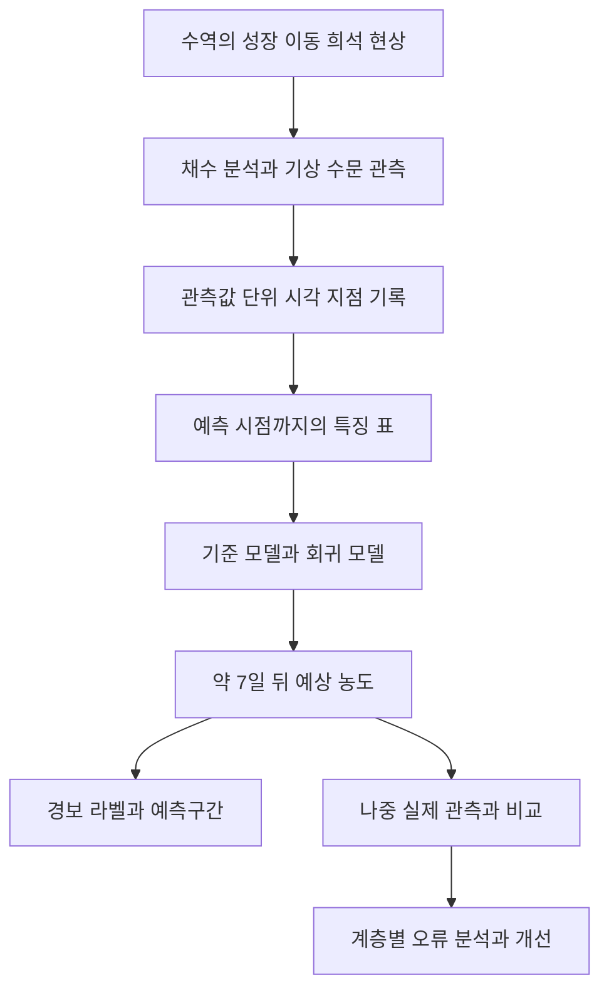

# M25 녹조 예측을 작은 프로젝트로 연결하기

이 장은 앞 장의 개념을 실제 제작 순서로 연결한다. 교재를 완성한 상태와 학습자가 모델을 구현·설명·검증한 상태를 별도로 관리한다. 현재 실제 제공자료의 분석이나 모델 학습을 완료한 것은 아니다.

## 1 학습 목표와 준비 조건

기술 목표는 한 지점의 자료를 읽고, 입력·정답을 연결하고, 기준 예측과 하나의 개선 모델을 날짜순으로 비교하는 것이다. 학습 목표는 데이터 연결, 단위, 예측 시점, 모델 선택과 오차의 이유를 설명하는 것이다.

파이썬 함수·표 자료 처리, 평균·로그·손실 계산을 준비한다. 부족하면 [M04](04_computing.md), [M19](19_algae_foundations.md), [M21](21_algae_data_features.md)로 돌아간다. 다음 항목을 기록한 뒤 범위를 확정한다.

| 준비 항목 | 기록할 내용 |
| --- | --- |
| 학습자 | 파이썬·수학 경험, 독립 계산 가능한 범위 |
| 목표 | 개념 설명, 모델 구현, 대회 제출 중 현재 목표 |
| 환경 | OS, 런타임·패키지 버전, 메모리와 저장 공간 |
| 시간 | 회당 실습 시간과 총 가용 시간 |
| 자료 | 제공 파일·설명서 버전, 사용 조건, 접근 상태 |

학습자의 경험과 가용 시간은 아직 확인되지 않았다. 기간·GPU 필요량을 임의로 확정하지 않는다. 초기 표 기반 실습은 자료 규모를 확인한 뒤 CPU 중심으로 시작할 수 있는지 판단한다.

## 2 현상에서 모델 출력까지



이 프로젝트는 이미 관측된 자료를 사용한다. 직접 센서를 설치한 경우의 회로·펌웨어·통신 검증과 혼동하지 않는다. 수온 센서만으로 세포수·독소를 직접 측정했다고 표현할 수 없다. 하드웨어를 추가하려면 해당 장치의 허용 전압, 핀, 측정 범위, 단위, 표본 주기, 통신·전원·오류 상태를 별도 확인한다.

## 3 학습용 데이터 계약

아래는 프로젝트 내부에서 사용할 수 있는 **논리적 필드 제안**이다. 실제 제공 파일 컬럼이나 제출 파일 형식으로 확정한 것이 아니다.

| 필드 | 뜻 | 단위 또는 형식 |
| --- | --- | --- |
| station | 예측 수질 지점 | 지점 코드 |
| base_time | 예측 기준 시각 | 시간대가 명시된 날짜·시간 |
| current_cells | 당시 이용 가능한 농도 | cells/mL |
| previous_cells | 같은 지점 이전 관측 농도 | cells/mL |
| previous_gap_days | 이전 관측과 현재의 간격 | day |
| feature_values | 수온·최근 강수·수문 요약 등 | 특징별 단위 |
| availability_times | 입력이 공개·이용 가능해진 시각 | 날짜·시간 |
| target_time | 정답으로 연결한 미래 측정일 | 날짜·시간 |
| target_cells | 미래 정답 농도 | cells/mL |
| target_available_time | 정답을 알 수 있게 된 시각 | 날짜·시간 |

예측 프로그램에는 미래 정답 필드가 입력되지 않도록 경계를 분리한다. 학습·평가용 연결표에는 정답이 필요하지만, 실제 예측 요청에는 기준일까지의 입력만 필요하다.

관측일과 공개일, 결측과 실제 0, 관측값과 대체값을 구분한다. 농도가 0 미만이면 값의 의미·오류 코드를 먼저 확인한다. 평균·표준편차·대체 규칙은 학습 기간에서 맞춘다.

## 4 구현 순서와 진행 관문

### G A 자료 이해

한 지점의 원자료를 읽고 날짜별 농도 그래프를 만든다. 단위·중복·관측 간격·미측정 구간을 표로 정리한다.

**기술 관문:** 원자료를 변경하지 않고 정리 결과를 재현할 수 있다. **학습 관문:** 각 필드가 어떤 현상을 측정했는지, 빈 값이 왜 0이 아닌지 설명한다.

### G B 작은 전체 흐름

입력과 미래 정답을 연결하고 현재값 유지 예측을 만든다. 수질 한 지점에서 읽기 → 정답 연결 → 예측 → 비교 그래프를 먼저 완성한다.

**기술 관문:** 몇 행의 정답 연결을 수작업으로 검산하고 날짜순 기준 성능을 계산한다. **학습 관문:** 이 행의 정답이 왜 선택됐는지, 그때 어떤 정보가 이용 가능했는지 설명한다.

### G C 첫 회귀 모델

현재·이전 농도, 측정 간격, 월 등의 소수 특징으로 Ridge 또는 작은 트리 모델 하나를 만든다. 모델 선택은 자료 품질과 학습 목표에 맞춘다.

**기술 관문:** 기준 모델과 동일 검증 행에서 점수를 비교한다. **학습 관문:** 학습 오차 감소와 미래 성능 개선의 차이, 로그 출력의 의미를 설명한다.

### G D 환경 융합

최근 수온·강수·일조·유입·방류 정보를 추가한다. 단위와 집계 창을 기록하고 누락 비율을 함께 표시한다.

**기술 관문:** 상태 모델과 융합 모델의 성능·오류 날짜를 비교한다. **학습 관문:** 어느 변수 묶음이 어떤 조건에서 도움이 됐는지 말하고, 인과 주장으로 확대하지 않는다.

### G E 신뢰성과 확장

다지점 평가, 급증·고농도 오류, 경보 라벨, 예측구간, 재현 실행을 필요에 따라 추가한다. 복잡한 시계열·공간·혼합 모형은 기존 오류를 해결할 근거가 있을 때 검토한다.

**기술 관문:** 지점별 결과와 실행 조건을 저장한다. **학습 관문:** 조건이 바뀌었을 때 어떤 가정과 데이터 연결을 다시 확인해야 하는지 설명한다.

이번 첫 단계의 구현 범위는 G A와 G B다. G C 이후는 앞 단계 동작과 이해를 확인한 다음 진행한다. 이 문서는 완성된 전체 시스템 코드를 대신 제공하지 않는다.

## 5 모델 비교 실험을 설계하기

입력 묶음을 $X_S$ 상태, $X_E$ 환경, $X_L$ 장소·계절로 구분한다. 같은 정답 집합에서

$$
\widehat y^{(0)}=y_{\mathrm{current}},\qquad
\widehat y^{(1)}=f_{\theta_1}(X_S,X_L),\qquad
\widehat y^{(2)}=f_{\theta_2}(X_S,X_E,X_L)
$$

를 비교한다. $y$는 로그 농도다. $(0)$은 현재값 유지이고 $(1),(2)$는 각각 학습된 후보다. 융합 모델의 성능 차이는 입력 추가와 재학습 결과의 차이며 개별 변수의 인과 효과가 아니다.

하이퍼파라미터를 바꿀 때도 예측 간격, 정답 연결, 검증 행, 손실·집계 기준을 유지한다. 결측 때문에 비교 대상 행이 달라지면 공통 행 결과와 전체 사용 가능 행 결과를 구분한다.

**학습자가 결정할 핵심:** 첫 지점, 결측 허용 규칙, 관측 공개 지연 처리, 비교할 후보 하나, 오류 분석 기준. 도구 설정과 반복 집계는 AI의 도움을 받을 수 있지만 이 판단의 이유는 본인이 기록한다.

## 6 실험 기록 양식

```text
실험 이름과 날짜:
기술 목표:
학습 목표:
자료 버전과 기간:
입력 단위와 이용 가능 시점:
학습과 검증 날짜 및 정답 경계 처리:
기준 모델:
이번에 바꾼 조건:
예상 결과와 이유:
실제 계산 또는 평가 결과:
실패 날짜와 지점:
원인 후보 및 다음 확인:
독립 설명 가능 여부:
```

예상 결과는 실험 전 가설이다. 실제 계산값과 실측값을 다른 칸에 기록한다. 합성 예제의 테스트 통과를 실제 수역 검증으로 적지 않는다.

## 7 계층별 오류 진단

| 계층 | 관찰한 문제 | 먼저 확인할 내용 |
| --- | --- | --- |
| 원자료 | 날짜가 없거나 농도가 음수 | 파일 설명, 인코딩, 결측·오류 코드 |
| 연결 | 같은 행에 다른 지역 기상이 붙음 | 지점·댐·기상소 대응표 |
| 특징 | 강수 합계가 비정상적으로 큼 | 누적값과 구간값, 중복, 집계 경계 |
| 분할 | 점수가 비현실적으로 좋음 | 미래 입력·정답·정규화 누수 |
| 학습 | 학습은 좋고 검증은 나쁨 | 복잡도, 자료 변화, 표본 수 |
| 출력 | 세포수 규모가 크게 틀림 | 단위, 밑 10/자연로그, 역변환 |
| 해석 | 중요 변수를 정책 효과로 설명 | 상관·예측·개입의 구분 |

문제에 따라 하드웨어·펌웨어·통신·응용 계층을 구분한다. 현재는 관측 파일 기반이므로 센서 결함을 확인한 것처럼 쓰지 않고 원자료 설명과 제공기관 기록을 확인한다.

## 8 결과 화면의 최소 구성

초기에는 기준일, 실제 정답일, 실제 농도, 기준 예측, 모델 예측을 그래프로 비교한다. 관측점 사이의 선은 시각화 연결이며 그 사이 값이 실측됐다는 뜻이 아니다.

후속 화면에는 자료가 오래됐거나 결측이 많다는 상태, 모델·데이터 버전, 구간 평가 결과를 표시할 수 있다. 예측을 현재 실측 농도로 표시하거나 과제용 경보 라벨을 기관 발령으로 표시하지 않는다.

## 9 모델을 더 복잡하게 만들기 전 질문

1. 현재값 유지보다 개선됐는가?
2. 자료 연결과 정답 경계를 검산했는가?
3. 반복 측정과 측정 간격이 보존됐는가?
4. 특정 지점·계절·급증에서만 실패하는가?
5. 새로운 모델이 해결하려는 구체적 문제가 무엇인가?
6. 그 모델이 요구하는 시간·공간·외생 정보가 실제로 있는가?

이 질문에 답한 후 [M23](23_algae_temporal_hybrid.md)의 모델을 선택한다. 새로운 모델 이름을 많이 사용하는 것과 학습·기술 성과는 다른 기준이다.

## 10 연습과 단계 힌트

### M25-Q1

한 지점에서 최근 수온은 있으나 강수 자료의 40%가 비어 있다. 현재값 유지와 첫 모델을 비교하려면 어떤 실험을 먼저 하고 어떤 정보를 기록할지 설계하라.

힌트 1: 작은 전체 흐름을 먼저 만든다. 힌트 2: 빈 강수를 0으로 단정하지 않는다. 힌트 3: 입력이 적은 모델과 환경 추가 모델의 비교 행을 맞춘다.

### M25-Q2

모델의 로그 RMSE가 줄었지만 고농도 구간에서 과소예측이 커졌다. 바로 완성으로 판단할 수 있는가? 다음 분석 두 가지와 추가 모델의 필요성을 판단할 기준을 제시하라.

힌트 1: 전체 로그 오차와 고농도 원 단위 오차는 다른 질문이다. 힌트 2: 해당 구간 표본 수를 확인한다. 힌트 3: 모델 복잡도보다 문제 정의·손실·자료 품질을 먼저 살핀다.

### M25-Q3

합성 물통 예제의 계산 검사를 통과했고 실제 수역 모델은 아직 학습하지 않았다. 현재 기술 결과와 학습 성과를 구분해 보고문 두 문장을 작성하라.

힌트 1: 무엇을 검산했는지 적는다. 힌트 2: 실제 관측자료 평가를 완료했다고 쓰지 않는다. 힌트 3: 식의 가정을 독립적으로 설명했는지 별도 확인한다.

[별도 해설](../95_algae_solutions.md) · [녹조 학습 길잡이](../algae_learning_path.md)
