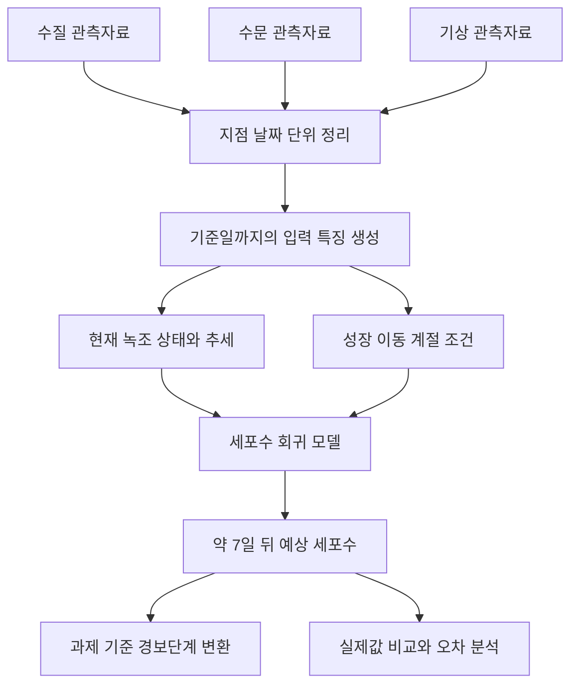

# 녹조 7일 예측 시스템 설계

작성일: 2026년 10월 6일

## 1 목적과 현재 단계

현재 녹조 상태와 최근 환경 조건을 이용해 측정 지점의 약 7일 뒤 유해남조류 농도를 예측한다. 예측 대상은 물 1mL당 세포수인 `cells/mL`이며, 수역 전체의 세포 총량과 구분한다.

이 문서는 프로젝트를 시작하는 학습자가 시스템의 구성과 검증 이유를 이해하기 위한 설계 자료다. 지금 단계에서는 설계를 정리하며, 전체 시스템의 코드 구현이나 모델 학습을 수행하지 않는다. 제공 데이터의 실제 컬럼, 관측 주기, 결측률과 사용 조건은 아직 확인하지 않았다.

시작 전에 학습자의 파이썬·통계·머신러닝 경험, 개인 또는 팀 작업 여부, 사용 가능한 컴퓨터, 실습 시간과 실행 환경을 확인한다. 초기 설계는 제공 관측자료를 분석하는 소프트웨어 프로젝트이며 별도 센서나 회로 연결을 요구하지 않는다.

## 2 공식 과제 조건

공식 과제명은 「수질·수문·기상 융합 기반 댐·하천 유해남조류(녹조) 7일 예측 AI 모델 개발」이다.

- 주과제는 미래 유해남조류 세포수 회귀 예측이고, 부과제는 예측 세포수에 따른 경보단계 분류다.
- 대상 지점은 해평, 강정·고령, 칠서, 물금·매리, 대청호 회남이다.
- 기준일은 실제 측정이 존재하는 날이다. 정답은 기준일에서 7일 뒤에 가장 가까운 측정일의 값으로, 목표일과의 차이가 ±3일 이내여야 한다. 해당 측정이 없으면 채점에서 제외한다.
- 학습은 2023년까지, 검증은 2024년, 비공개 평가는 2025년 이후로 구분한다. 기준일 이후 관측값의 입력 사용은 금지한다.
- 로그 변환 `log10(세포수 + 1)` 기준 RMSE·MAE, 원 단위 R²·NSE, 분류 Macro-F1을 평가한다. 회귀 70%와 분류 30% 가중은 공식 설명에 예시로 제시되어 있다.
- 제출물은 재현 가능한 모델 코드, 평가 기간 예측 파일, 방법 설명서다. 최종 배점·형식·경보 라벨 규칙은 제출 안내에서 재확인한다.

출처: [KISTI 공식 과제 설명](https://aida.kisti.re.kr/competition/main/problem/PROB_000000000004602/detail.do)

이하의 입력 구성과 모델 순서는 프로젝트 설계 제안이며, 공식 요구사항과 구분한다.

## 3 녹조 변화에 대한 이해

녹조 농도는 세포의 증식만으로 결정되지 않는다. 세포의 성장·사멸, 상류에서의 유입, 외부로의 배출, 물의 양과 혼합 상태가 함께 영향을 준다.

현재 세포수가 많으면 같은 세포당 성장률에서도 절대 증가량은 커질 수 있다. 그러나 영양분·빛 등의 제한으로 계속 같은 속도로 증가한다고 가정할 수 없다. 최근 측정값의 변화에는 이동과 희석도 섞이므로 이를 생물학적 증식률이라고 부르지 않는다.

| 역할 | 관련 변수 | 해석 |
|---|---|---|
| 현재 상태 | 현재·이전 세포수 | 예측의 출발점 |
| 최근 추세 | 세포수 변화, 측정 간격 | 최근 증가·감소 방향과 속도 |
| 성장 조건 | 수온, 일조·일사, 질소·인 | 성장에 필요한 열·빛·영양분 |
| 이동과 희석 | 강수, 유입량, 방류량, 저수량 | 세포·영양분 이동과 물의 교체 |
| 혼합과 축적 | 바람, 수직 혼합, 성층 | 특정 위치에 모이거나 흩어지는 조건 |
| 계절 배경 | 월·계절 | 반복되는 환경 패턴 |

강수와 유입은 영양분·세포를 가져와 농도 증가에 기여할 수도 있고, 희석·배출을 통해 감소에 기여할 수도 있다. 같은 강수량도 현재 상태와 유입수의 성질에 따라 효과가 달라진다. 양방향 영향 자체가 비선형의 증거는 아니며, 실제 관계는 자료로 확인한다.

잘 섞인 물에서 물과 세포가 같은 비율로 빠져나가면 총세포수는 감소해도 농도는 유지될 수 있다. 따라서 방류량 증가를 농도 감소와 동일하게 취급하지 않는다.

계절은 수온·일조·강수 패턴의 배경 정보다. 같은 계절에도 실제 날씨는 달라지므로 월과 관측 환경을 함께 후보 입력으로 둔다. 중복 정보가 성능에 도움이 되는지는 검증한다.

참고: [EPA 녹조 발생 요인](https://www.epa.gov/habs/what-causes-habs), [EPA 강우와 녹조](https://www.epa.gov/habs/climate-change-and-freshwater-harmful-algal-blooms), [USGS 수역 내 분포와 측정](https://pubs.usgs.gov/twri/twri9a7/twri9a7_7.5.pdf)

## 4 전체 시스템 구조

관측자료에서 특징을 만들고, 모델은 조건들의 조합과 미래 농도 사이의 관계를 학습한다. 이 모델이 생물학적 증식과 이동 효과를 각각 분리해 측정하거나 인과관계를 입증하는 것은 아니다.

초기에는 모델을 하나로 구성해 세포수를 예측하고, 그 결과를 과제 기준의 경보단계로 변환한다. 분류 모델을 별도로 학습할지는 이후 검증 결과에 따라 결정한다. 과제용 경보 분류와 실제 기관의 발령 절차는 구분한다.

## 5 데이터 연결 조건

| 항목 | 확인 및 처리 조건 |
|---|---|
| 지점 연결 | 수질 지점과 관련 댐·기상관측소의 대응 근거 기록 |
| 날짜와 시간 | 시간대, 관측 시각, 일 집계 경계 확인 |
| 정보 가용성 | 측정 시각과 공개 시각 구분, 기준일 이후 값 배제 |
| 단위 | 세포수 cells/mL, 유량 m³/s 등 원자료 단위 확인 후 변환 |
| 관측 주기 | 주간·일간·시간 자료를 구분하고 실제 간격 유지 |
| 결측 | 미측정과 실제 0을 구분, 결측 여부와 정보 경과일 기록 |
| 오류 | 음수·중복·날짜 오류·단위 불일치를 점검하고 처리 근거 기록 |
| 정답 매칭 | 목표일 ±3일 규칙 적용, 동률 처리 등 세부 조건 확인 |

값의 상태는 공식 문서에서 확인한 값, 설계 가정, 원자료 관측값, 모델 예측값으로 구분한다. 실제 파일의 유효 범위는 자료 설명과 함께 확인하며, 임의의 범위를 실측 사실처럼 사용하지 않는다.

미래 측정값으로 과거 결측을 보간하지 않는다. 보간·대체·정규화 등에 학습이 필요한 경우 학습 기간에서만 규칙을 맞춘다. 학습 행의 정답 시점이 검증 기간을 침범하지 않는지도 확인한다.

## 6 초기 입력 특징

| 특징 | 계산 또는 선택 방법 | 주의점 |
|---|---|---|
| 현재 세포수 | 기준일 관측값 | 해당 시점에 이용 가능한 값인지 확인 |
| 이전 세포수 | 같은 지점의 직전 관측값 | 이전 관측일도 보존 |
| 측정 간격 | 현재일과 이전일의 차이 | 관측 1회가 반드시 7일은 아님 |
| 일평균 변화 | 세포수 차이 ÷ 경과일 | 생물학적 증식률과 구분 |
| 수온 | 기준일까지 최근 관측값 | 주간 자료를 일별 실측처럼 취급하지 않음 |
| 최근 강수 | 최근 7일 누적 | 시간 자료의 누락과 집계 구간 확인 |
| 최근 일조·일사 | 최근 7일 합계 또는 평균 | 변수별 단위와 요약 방식 명시 |
| 유입·방류 | 최근 7일 평균 | 관측자료 주기에 맞춰 집계 |
| 저수량 | 최근 이용 가능한 값 | 실제 단위 확인 |
| 지점과 월 | 기준일의 지점·월 | 계절 정보 추가 효과 비교 |

직전 관측이 없으면 추세를 억지로 계산하지 않고 결측으로 표시한다. 영양염류, 탁도, 바람과 종류별 세포수는 제공 여부와 관측 품질을 확인한 뒤 확장한다.

체류시간 대리값은 저수량을 방류량으로 나누어 후보로 만들 수 있다. 저수량이 m³, 방류량이 m³/s이면 결과는 초이므로 일 단위 변환이 필요하다. 방류량이 0이거나 매우 작으면 별도 처리한다. 이 값은 완전 혼합과 흐름의 정상성을 가정한 근사이며 실제 체류시간과 동일하지 않다.

## 7 모델 구성과 비교

| 모델 | 구성 | 비교 목적 |
|---|---|---|
| 기준 모델 | 미래 농도를 현재 농도와 같게 예측 | 최소 비교 기준 확보 |
| 상태 모델 | 세포수·최근 추세·지점·월로 회귀 | 기존 상태만의 예측력 확인 |
| 융합 모델 | 상태 입력에 수온·기상·수문 추가 | 환경 정보의 추가 효과 확인 |

처음에는 트리 기반 회귀 모델 하나를 후보로 사용한다. 비선형 관계와 입력 간 상호작용을 학습하도록 하되 성능 개선을 미리 보장하지 않는다. 변수의 곱을 모두 만들거나 복잡한 성장 방정식을 추가하는 작업은 초기 범위에 넣지 않는다.

로그 세포수를 학습 대상으로 사용하는 방법을 검토한다. 로그 예측값을 원 단위로 변환할 때는 `10^예측값 - 1`을 사용한다. 음수 예측 처리 등 후처리 규칙을 명시하고 로그·원 단위 성능을 함께 비교한다.

성장 방정식은 개념 설명에 활용할 수 있지만, 수용력이나 실제 증식률을 관측자료만으로 식별했다고 주장하지 않는다.

## 8 검증과 해석

세 모델에 동일한 검증 행과 정답을 사용한다. 무작위 분할보다 공식 시간 분할을 우선한다. 전체 성능뿐 아니라 지점별, 계절별, 고농도·급증 구간별 오차를 비교한다. 해당 구간의 정의도 평가 전에 정한다.

환경 변수 묶음을 추가하거나 제거해 검증 성능 변화를 확인한다. 월·계절과 실제 기상 정보의 중복 효과도 비교한다. 중요 변수 분석은 예측에 대한 기여를 설명하는 자료이며 원인 증명으로 해석하지 않는다.

실패 원인은 다음 순서로 좁힌다.

1. 데이터 계층: 날짜·지점 대응, 단위, 중복·결측 확인.
2. 특징 계층: 미래 정보 포함 여부, 집계 구간과 측정 간격 확인.
3. 모델 계층: 과적합, 급증 과소예측, 학습·검증 분포 차이 확인.
4. 출력 계층: 로그 역변환, 지점·날짜 정렬, 경보 변환 확인.

검증 기록에는 데이터 기간과 조건, 예상 결과, 실제 지표, 해석을 남긴다. 코드 테스트·합성 데이터 점검·실제 관측자료 평가·장치 실험을 구분한다. 현재는 어떤 모델 성능이나 장치 동작도 검증하지 않았다.

## 9 단계별 구현과 학습 목표

| 단계 | 기술 목표와 구현물 | 관찰 및 검증 | 설명할 질문 |
|---|---|---|---|
| 1 데이터 확인 | 한 지점의 날짜·단위·결측 요약 | 관측 간격과 누락 구간 확인 | 각 값은 무엇을 측정했는가 |
| 2 예측 표 생성 | 입력과 미래 정답이 연결된 표 | 몇 행을 수작업 검산 | 이 입력을 기준일에 알 수 있었나 |
| 3 기준 모델 | 현재값 유지 예측과 비교 그래프 | 날짜순 오차 계산 | 학습 없이 어느 정도 맞는가 |
| 4 상태 모델 | 세포수 추세 기반 회귀 | 같은 검증 행에서 비교 | 추세 정보가 도움이 되었나 |
| 5 융합 모델 | 환경 입력 추가 | 변수 묶음별 개선 확인 | 성장·이동 조건 중 무엇이 도움을 주나 |
| 6 확장 | 다지점·예외 처리·경보 표시 | 지점별 오류와 재현 실행 확인 | 조건이 달라져도 결과를 설명할 수 있나 |

각 단계에서 동작과 이해를 확인한 뒤 다음 단계로 진행한다. 첫 구현 범위는 한 지점의 데이터 확인, 정답 매칭, 현재값 유지 모델까지다. 관측 추세의 의미, 정답 연결 규칙과 미래 정보 차단을 설명할 수 있어야 이 단계를 완료한 것으로 본다.

## 10 결과물과 다음 작업

최종 프로젝트 결과물은 데이터 처리·학습·예측 코드, 성능 비교표, 실제값과 예측값 그래프, 예측 파일과 방법 설명서다. 대시보드는 모델 검증 이후 필요에 따라 추가한다.

다음 작업은 제공 데이터와 설명서를 확보해 지점·컬럼·단위·기간·관측 주기·결측을 확인하는 것이다. 그 결과와 학습자 경험·실습 시간을 바탕으로 첫 구현 범위를 확정한다.

### 첫 단계 완료 확인

- [ ] 실제 컬럼과 단위를 설명할 수 있다.
- [ ] 측정값 0과 미측정을 구분했다.
- [ ] 한 지점의 정답 연결을 수작업으로 검산했다.
- [ ] 기준일 이후 정보가 입력에 없음을 확인했다.
- [ ] 현재값 유지 예측을 실제 관측과 비교했다.
- [ ] 기술적 동작과 학습자의 설명 능력을 각각 확인했다.
