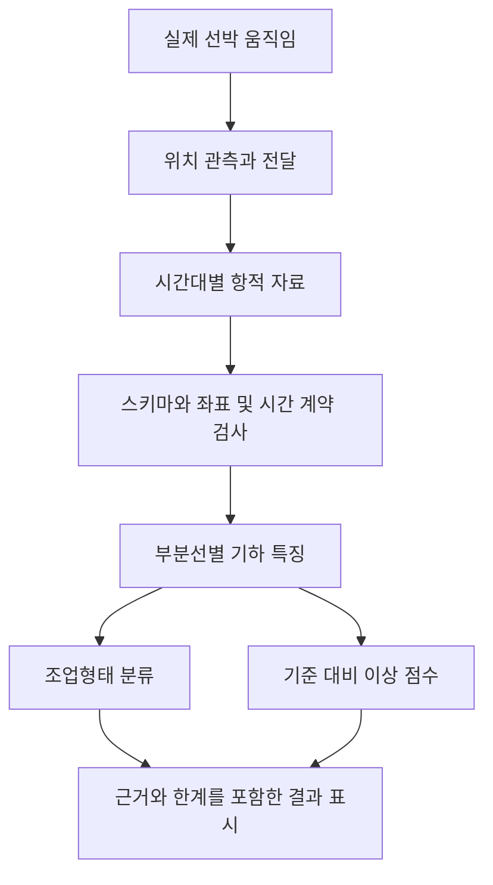

# 어선 항적 과제와 우리 프로젝트의 현재 상태

[통합 가이드로 돌아가기](../../어선%20항적%20통합%20학습%20가이드.md) · [다음 데이터와 전처리](02_데이터와_전처리.md)

이 프로젝트의 목적은 어선의 위치 기록에서 조업형태와 평소와 다른 움직임을 추정하고, 사람이 판단 근거와 한계를 확인하도록 만드는 것이다. **기술적으로 계산되는 값이 있다고 해서 그 값의 현실 의미까지 검증된 것은 아니다.** 경로 길이, 조업 확률, 이상 점수는 서로 다른 질문에 답한다.

## 해결하려는 두 문제

PDF들이 설명하는 과제 구조는 다음과 같다. Test A와 Test B의 세부 제출 단위·공식 지표는 최신 제공 규격으로 최종 확인해야 한다. 근거는 [이해가이드 10~13쪽](sources/어선항적과제_이해가이드.pdf#page=10), [신청서 안내 2쪽](sources/01_참가신청서_가이드와_제안서_통합본.pdf#page=2)이다.

| 구분 | 과제 1 조업형태 분류와 Test A | 과제 2 이상항적 점수와 Test B |
| --- | --- | --- |
| 질문 | 이 항적은 어떤 조업형태와 관련 있는가 | 이 항적은 정한 기준에서 얼마나 다른가 |
| 학습 신호 | 의미를 확인한 조업 라벨 | 정상 후보 기준, 일부 사고정보 등 가용 근거 |
| 출력 | 예측 클래스와 확률 | 시간대별 연속 점수 |
| 핵심 일반화 | 처음 보는 선박 | 평가 시점에 이용 가능한 정보로 이후 상황 평가 |
| 주요 실패 | 같은 배의 위치·기기 특성 암기 | 미래 정보 사용, 정상 기준 오염, 사고 후 반응을 조기로 계산 |
| 오해하기 쉬운 것 | 조업 종류 라벨이 현재 조업 중이라는 행동 라벨인 것은 아님 | 높은 점수가 사고의 증명이나 사고 확률인 것은 아님 |

예를 들어 좁은 곳에서 자주 방향을 바꾸는 경로가 있다고 하자. 분류기는 그런 모양이 어떤 라벨과 함께 나타났는지를 학습한다. 이상 모델은 선택한 기준 분포에서 그 경로가 드문지를 계산한다. 방향 전환이 원래 흔한 집단에서는 낮은 점수일 수 있고, 매우 드문 집단에서는 높은 점수일 수 있다. 어느 경우에도 그것만으로 사고를 확정할 수 없다.

## 실제 세계에서 데이터까지의 흐름

실제 선박의 움직임은 위치 관측과 전달, 원천 기록의 가공을 거쳐 시간대별 항적으로 제공된다. PDF는 배경 장치로 V-Pass를 설명하지만, 이번 작업은 장치의 센서·회로·펌웨어를 연결하는 단계가 아니다. 수신 누락이나 가공 규칙의 결과가 최종 CSV에 나타날 수 있다는 관점이 중요하다.

이 그림은 실제자료용 목표 구조다. 현재 S0에서는 맨 앞의 실제 선박·위치 관측 대신 **합성 생성기**가 지역 평면의 XY 좌표를 만든다. 따라서 장치 오차·전파 수신·실제 조업·사고의 물리 과정을 재현했다는 뜻은 아니다.

| 계층 | 필요한 지식 | 학습 활동 | 실패를 좁히는 질문 |
| --- | --- | --- | --- |
| 자료와 계약 | 행·키·형식·시간·좌표계 | 한 행의 의미를 말로 풀기 | 어떤 정보가 원래 없었는가 |
| 기하 | 벡터·거리·각도·부분선 | 작은 좌표 예제 손계산 | 관측되지 않은 연결을 더했는가 |
| 모델 | 특징·손실·적합·보정 | 입력부터 확률까지 추적 | 학습하지 않은 선박에도 통하는가 |
| 평가 | 누수·표본 독립성·사건·분모 | 분할표와 시간표 만들기 | 판단 당시 알 수 없는 정보를 썼는가 |
| 표시 | 단위·출처·유보 상태 | 화면 설명과 오류 찾기 | 점수를 실제 의미보다 강하게 표시했는가 |

## 세 PDF와 기존 프로젝트의 역할

| 자료 | 통합에서 맡는 역할 | 읽을 때의 조건 |
| --- | --- | --- |
| 이해가이드 P1 | 과제 배경, 열의 의미, 신규 선박 문제, 샘플 관찰의 출발점 | 비공식 학습 자료이며 일부 계산·해석을 정정해야 함 |
| 신청서 통합본 P2 | 제안서 항목, 제출 문안, 필수·선택 범위 | 계획을 성과로 쓰지 않으며 실제 신청서 원본과 규격 별도 확인 |
| 모델 통합본 P3 | 부분선·반복·결측 처리, 작은 모델, 시간순 평가, 후속 실험 | 제안 알고리즘과 수치를 구현 결과와 구분 |
| 기존 실행 계획 | 현재 단계와 다음 관문 | 상단 최신 확장과 과거 준비 이력을 구분 |
| S0 코드와 저장 JSON | 지금 작동하는 합성 시스템의 근거 | 합성 경로 유형에만 평가가 적용됨 |
| 기존 교재 | 수학과 모델 이론의 심화 학습 | 교재 완성이 실제 데이터 검증이나 학습 달성을 뜻하지 않음 |

PDF 안의 “공식”, “직접 확인”, “검증”이라는 표시는 그 PDF가 원문과 샘플을 어떻게 다뤘다고 설명하는지 나타낸다. 이번 통합에서 원본 HWP나 해당 10행 CSV를 직접 재검증한 것과 같지 않다. PDF 안에 제시된 실행 순서도 참고할 설계안이며, 현재 프로젝트 계약을 자동 변경하지 않는다.

## 현재 무엇이 구현되었는가

현재 상태의 기준은 [실행 계획](../fishing_execution_plan.md)과 [S0 검증 기록](../fishing_sample_verification.md)이다. 구현 파일·보고서 해시가 저장 검증 기록과 일치하는지도 이번 문서 검토에서 대조했다. 저장 테스트 결과를 이번에 새로 실행한 결과로 표현하지 않는다.

| 구성요소 | 현재 구현 | 이 결과가 설명하지 못하는 것 |
| --- | --- | --- |
| 실제자료 구조 검사기 | 제한된 CSV 표본과 2D WKT 검사 | 원자료 전체 품질, 실제 CRS·시간 의미 |
| 고정 기하 검산 | 평면 미터 예제의 부분선별 길이·변위 | 실제 선박 성능 |
| 합성 생성기 | 직진·굴곡·회전 유형, 잡음과 단절 조건 | 물리 기반 선박 조종·어구 작업·사고 생성 |
| 특징 추출 | 기하 특징 8개, 부분선 보존, 유보 사유 | 점별 시각을 사용한 속력·가속도 |
| 분류 | 선형 및 작은 MLP의 고정 후보 비교 | 실제 자망·통발 등 공식 조업 분류 성능 |
| 보정과 거리 | 온도 보정, 클래스별 공분산 거리 | 실제 사고 확률 |
| 표시 | 외부 자원이 필요 없는 HTML 대시보드 | 지도 서비스, 실시간 운용, 3D |

현재 구현은 [코드 폴더](../../fishing_demo/__init__.py), [실행 CLI](../../tools/run_sample_system.py), [저장 보고서](../../outputs/sample_system/report.json)로 이어진다. 상세 알고리즘은 [03 모델과 현재 구현](03_모델과_현재구현.md)에서 연결한다.

## 샘플 두 종류를 구별하기

PDF의 “샘플 10행”과 프로젝트의 “합성 1008개”는 다른 자료다.

| 항목 | PDF가 보고한 10행 샘플 | 현재 S0 합성 데이터 |
| --- | --- | --- |
| 출처 | 제공 샘플 CSV를 PDF 작성자가 분석했다고 보고 | 우리 생성기가 저장한 JSON |
| 단위 | 10척의 같은 날짜·시간대 행이라고 보고 | 84개 가상 그룹에서 만든 1008개 경로 |
| 클래스 | 자망 4, 연안복합 4, 통발 1, 채낚기연승낚시 1로 보고 | straight, sweep, turn 각 336개 |
| 좌표 | 경도·위도 설명, 실제 CRS 재확인 필요 | local_xy_m로 명시된 지역 평면 미터 |
| 시간 | 점별 시각 없음으로 보고 | sim_times가 있으나 모델 특징으로 사용하지 않음 |
| 정답의 의미 | 실제 조업 코드 의미를 원문과 대조해야 함 | 생성기의 경로 유형 |
| 이번 근거 | PDF에 기재된 통계 | 저장 데이터·코드·실험 보고서 |

현재 `data/raw`에 실제 CSV가 없다는 사실과 PDF가 샘플 분석을 보고한다는 사실은 모순이 아니다. 자료의 보관 위치와 확인 주체가 다르기 때문이다. PDF의 표만으로 CSV 전체나 원래 좌표를 복원하지 않는다.

## 이번 통합 이후의 순서

S0를 통해 데이터 흐름과 학습 분리를 이해한다. 실제 자료가 준비되면 F1에서 시간·좌표·기하 계약을 확인하고, 조건을 통과한 대표 원자료로 F2 무라벨 기하 점검을 진행한다. **F2는 조업 라벨과 모델 평가 분할 확정까지 기다릴 필요가 없다.** 점별 시각이 없다는 사실이 확인되면 속력 없이 기하를 검증할 수 있다.

실제 분류와 이상 기준선을 만드는 F3에는 라벨 의미와 평가 분할 근거가 필요하다. 환경자료·주변 선박·강화학습·3D·실선 운용은 각자의 자료와 평가 조건이 마련된 후속 범위다. 자세한 통과 조건은 [04 평가와 후속 실험](04_평가와_후속실험.md)에 있다.

## 이해 확인

1. 분류 확률이 0.9이고 이상 점수가 높다면 두 출력은 각각 무엇을 말하는가?
2. S0 정확도가 높아져도 실제 어선 성능을 주장할 수 없는 이유는 무엇인가?
3. CSV에 기록된 부분선 단절을 수신 장애로 확정하려면 어떤 추가 근거가 필요한가?

답을 쓰기 전에는 03의 모델 해설이나 PDF의 결론을 그대로 옮기지 말고, 입력·기준·출력의 차이로 설명해 본다.
