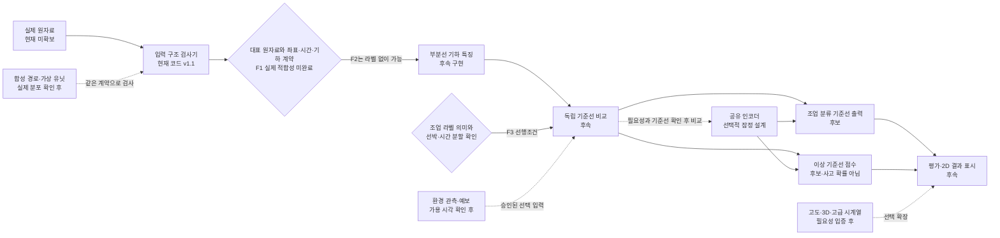

# 어선 항적 분석 팀 협업 설명서

**2026-10-12 후속 단계:** 사용자가 실제자료 이전 합성 샘플 모델·시각화 구현을 요청하여 [S0 샘플 계약](sample_system_contract.md)으로 범위를 확장했다. 아래 현재 상태와 미구현 표시는 2026-10-09 기준 기록이다. 후속 샘플의 클래스는 실제 조업 코드가 아니며 실제 F1 적합성을 대체하지 않는다.

이 문서는 팀원이 시스템의 목적과 데이터 흐름, 핵심 계산, 작업 경계와 인수 기준을 같은 언어로 설명하도록 돕는다. 문서 기준일은 2026-10-09이다. 프로젝트는 본인 학습자용으로 확인되었지만 학습자 수준·선수지식·실습 시간·사용 환경은 아직 정해지지 않았다. 따라서 교육 활동은 수학과 구현을 설명하는 기초 자료로 제안하며, 차시와 난이도는 그 조건을 확인한 뒤 맞춘다.

문서 안의 수식과 예시는 상태를 함께 표시한다.

- **[현재 코드]** 저장소 코드가 수행하는 일이다.
- **[저장된 검증 기록]** 2026-10-09 보고서에 남아 있는 결과다. 이 문서 작업 중 재실행한 결과가 아니다.
- **[후보 설계]** 교재에 나온 수학적 방법을 팀이 자료·목표에 맞게 검토할 때 쓸 설명이다. 현재 파이프라인에 구현된 것으로 보지 않는다.
- **[이번 범위 제외]** 최신 실행 계획과 결정에서 현재 구현 범위 밖으로 둔 방법이다.

## 먼저 읽을 경로와 현재 상태

팀원은 먼저 [프로젝트 목적 초안](project_purpose%28초안%29.md)과 [실행 계획](fishing_execution_plan.md)을 읽고, 작업에 따라 [검증 기록](fishing_verification.md)과 [19장 기하](ai_textbook/chapters/19_fishing_data_geometry.md), [20장 분류](ai_textbook/chapters/20_fishing_classification.md), [21장 순서 모델](ai_textbook/chapters/21_fishing_sequence_models.md), [22장 이상 탐지](ai_textbook/chapters/22_fishing_anomaly.md), [23장 환경자료](ai_textbook/chapters/23_fishing_environment.md), [24장 가상 유닛](ai_textbook/chapters/24_fishing_virtual_units.md), [25장 평가](ai_textbook/chapters/25_fishing_evaluation_system.md)를 참고한다. 조류 프로젝트와 장 번호가 겹칠 수 있으므로 문서 이름에 `fishing`이 든 정확한 파일명을 사용한다.

**현재 구현은 준비 단계다.** [현재 코드] `tools/inspect_data.py`는 CSV 구조, 정해 둔 필드, 표본 안의 일부 날짜·시간·경로 조건을 읽기 전용으로 검사한다. 2D `MULTILINESTRING`의 유한 XY 쌍과 부분선별 최소 2점을 확인하고 `EMPTY`는 문법 인식 후 분석 불가로 분류한다. CRS가 미확인인 기본 입력에는 좌표 범위 검사를 하지 않는다. 명시적으로 `--coordinate-assumption lonlat`을 주면 경도·위도 범위만 가정에 따라 확인하며 CRS를 증명하지 않는다. 원본 필드값/WKT를 보고서에 내보내지 않고 부분선을 잇거나 거리·속력·조업·이상 점수를 계산하지 않는다. CSV 표본은 기본 100행, 2 MiB, 최대 100개 파일이며 기본 디렉터리 탐색은 비재귀다.

**[현재 코드]** `tools/check_synthetic_contract.py`는 별도 교육용 JSON의 평면 XY 미터 점들에서 각 부분선의 길이·변위·직선성을 계산하고 기대값과 대조한다. 정해진 좌표로만 계산하므로 난수나 실제 항적을 쓰지 않는다. 실제 출처 검증, feature pipeline, 시뮬레이터, 모델 학습은 하지 않는다. `examples/fishing_contract_synthetic.json`은 사고·조업 라벨과 점별 시각이 없는 합성 fixture다.

**[저장된 검증 기록]** 2026-10-09 보고서는 자동 테스트 41개 중 40개 통과, 실패·오류 0, Windows 심볼릭 링크 생성 제약으로 1개 skip을 기록한다. 합성 기하 계약 계산 12개 통과, 교재 구조 43개 문서·32개 장·오류 0·경고 0도 기록되어 있다. fixture 수치 비교의 허용오차는 길이 절대 오차 $10^{-9}$m, 비율 절대 오차 $10^{-12}$이며 코드 계산과 손계산 기대값의 수치 비교 기준이다. 센서 정밀도나 실제 측정 정확도가 아니다. `outputs/data_inventory.json`에는 검사 CSV 0개, 원자료 평가 미수행, CRS 미확인, 거리 계산 미수행으로 남아 있다. `data/raw`에는 `.gitkeep`만 있다. Astra의 최종 승인은 기술 준비 범위만 승인했으며 실제 F1 자료 적합성, 모델 학습/평가, 실측과 학습자 성취는 미확인이다. 이들은 저장된 준비 단계 기록이며 새 데이터의 적합성이나 학습 성능을 뜻하지 않는다. 자세한 범위는 [검증 기록](fishing_verification.md), [통합 실행 보고서](../outputs/fishing_execution_report.json), [자료 조사 보고서](../outputs/data_inventory.json)에서 확인한다.

## 전체 시스템 흐름

목표는 항적에서 조업 형태와 기준 대비 이탈 점수를 추정하고, 사람이 입력·근거·한계를 살펴볼 수 있게 전달하는 것이다. 대회 설명에서 요약된 핵심은 조업 형태 분류와 시간대별 이상점수다. 프로젝트의 가상 선박·환경 결합·시뮬레이터·3D 화면은 확장 계획이다. 현재 단계에서 원자료, 실제 특징 추출, 모델, 환경 수집, 시뮬레이터, 화면은 아직 구현·검증되지 않았다.



| 계층 | 입력과 책임 | 후보 출력·실패 상태 |
| --- | --- | --- |
| 출처·원자료 | 제공 파일을 원본 그대로 식별하고 버전·해시·출처를 기록한다. 실제자료, 외부환경, 합성자료의 출처를 구별한다. | 파일 식별 정보, 출처, 수집·관측·공개 시각, 버전 |
| 검사·계약 | 헤더·필수값·날짜·시간 의미·geometry 문법·좌표 조건을 문서와 대조한다. | 통과, 경고, 분석 불가, 거부; 행·필드 위치의 안전한 오류 코드 |
| 기하 특징 | 검증된 좌표계와 부분선 안에서만 길이·방향·공간 범위 등을 계산한다. | 값과 단위, 부분선 ID, 결측 사유, 계산 조건 |
| 분류 | Train 라벨 의미가 확인되면 조업 클래스 분포를 추정한다. | logits/확률, 예측 클래스, 적용 가능성 상태 |
| 이상 분석 | 학습에서 정한 기준과의 편차를 점수화한다. | 방향이 통일된 원점수, 기준 버전, 판단 유보 사유 |
| 환경 선택 입력 | 위치·시각에 맞고 판단 때 이용 가능했던 관측/예보만 제공한다. | 값·단위·관측/공개/유효 시각·관측소 거리·품질·결측 마스크 |
| 결과 표시 | 경로의 부분선 경계, 출처, 결과, 정보 부족을 읽을 수 있게 전달한다. | 지도상 부분선과 결과 요약. 실제 이동 시각이 없으면 재생 속도를 실제 속력으로 표현하지 않는다. |

### 원자료·합성자료·환경자료는 다른 근거다

공식 설명을 요약한 초안에서는 한 행이 선박·날짜·시간대 항적이며 `part_dt`, `rfid_id`, `rfid_time`, `geom`, 학습 라벨 후보 `fishing_code`가 주요 필드라고 적었다. `part_dt` 형식·`rfid_time` 범위·WKT `MULTILINESTRING`·좌표 경도/위도 순서도 설명에 등장하지만, **실제 파일과 전체 계약은 아직 대조되지 않았다.** 검사기는 `part_dt`, `rfid_id`, `rfid_time`, `geom`을 요구하고 `fishing_code`를 알려진 선택 필드로 인식한다. 필드가 설명에 등장한다는 사실은 실데이터에서 검증했다는 뜻이 아니다. 원자료를 받으면 공식 문서와 파일의 버전·헤더·행 표본을 함께 확인한다.

Train은 조업 라벨을 이용할 수 있는 자료 후보, Test A는 새 선박 일반화 확인 후보, Test B는 숨겨진 사고 정보를 대상으로 한 점수·사고 전후 평가 후보로 설명되어 있다. 제출 형식·사고 라벨 의미·점별 시각·CRS·시간대 해석은 실제 데이터 문서로 재확인한다. 사고 정보가 보이지 않는 행은 정상 정답이 아니다.

합성은 적어도 세 가지를 구별한다. 지금 코드의 **고정 기하 fixture**는 두 평면 부분선을 이용해 계산 계약을 검산하는 예제다. 후속 **템플릿 변형/가상 유닛**은 실제자료에서 관찰된 특징과 라벨 의미를 확인한 뒤에야 설계할 수 있다. **외부 환경**은 실제 관측/예보의 공간 대표성과 시간 가용성을 확인한 별도 자료다. 합성이라는 선언이나 파일 안의 메타데이터만으로 실제 출처가 증명되지는 않는다.

환경자료의 우선 후보는 프로젝트 목적 문서에 적힌 [기상청 해양기상부이](https://data.kma.go.kr/data/sea/selectBuoyRltmList.do?pgmNo=52)의 바람·파고와 [국립해양조사원 해양관측부이](https://www.data.go.kr/data/15155516/openapi.do)의 해류 방향·세기다. 지금 수집한 자료는 없다. 이용 허가, 과거 기간, 단위, 시간대, 관측 간격, 위치 대표성, 판단 시점에 공개된 시각을 확인한 뒤 필요한 경우만 사용한다.

## 사람 팀의 역할과 소유권 제안

구성원의 이름과 실제 분담은 미정이다. 아래 역할을 팀원이 정해 배정한다. 한 파일의 작성자는 한 명이다. 공용 스키마·단위·오류코드를 바꾸려면 통합 담당자와 문서 계약을 먼저 맞춘 뒤 소비자 작업을 다시 확인한다. 티켓 사이 병렬 작업은 서로 다른 소유 파일과 고정된 입출력 계약을 쓴다.

| 사람 역할 제안 | 맡을 판단과 산출물 | 완료 때 설명할 수 있어야 하는 것 |
| --- | --- | --- |
| 데이터·계약 담당 | 원자료 출처/버전, 실제 헤더, CRS·축 순서·시간/라벨 의미, 검사 범위와 미검사 범위를 기록한다. 지금은 검사기 보고서와 문서 계약만 다룬다. | 어떤 필드·행·좌표를 확인했고 무엇이 여전히 unknown인지, 왜 부분선을 잇지 않는지 |
| 특징 담당 | F1 입력 조건이 확인된 후 한 부분선 기하 특징을 계산하고 단위·null 사유를 전달한다. | 길이·변위·비율을 직접 계산하고 CRS/시각 조건이 결과에 미치는 영향 |
| 모델 담당 | 분류 기준선과 이상 점수 기준선을 각각 만들고, 이후 근거가 있을 때만 공유 인코더를 비교한다. 학습 분할에서만 적합한다. | 라벨 마스크·목적함수·분할·점수 방향과 선택 근거 |
| 표시 담당 | 2D 경로와 결과 계약을 읽기 쉽게 보여준다. 출처·부분선·시간/좌표 신뢰도·결측·판단 유보를 함께 전달한다. | 화면의 각 표시가 원자료, 계산값, 예측, 가정 중 무엇인지 |
| 통합·검증 담당 | 티켓 범위·파일 소유권·인터페이스·검증 종류·보고서 링크·남은 한계를 확인한다. 실제 평가/장치실험을 주장할 근거가 있는지 확인한다. | 코드 테스트, 합성 검산, 실제자료 평가, 실측의 차이와 완료/미완료 관문 |

이 역할표는 제안이다. 실제 이름, 수업 시간, 장비, 교실 환경과 각 역할의 교차 숙련도는 확인 뒤 배정한다. 현재 하드웨어 입력 요구가 없어 센서·전압·핀·펌웨어·통신 조건을 만들어 넣지 않는다.

### AI 작업 역할

AI는 제안·구현·검토를 돕지만 데이터 의미와 위험 수용, 공식 평가 기준, 최종 통합 여부는 사람 팀이 결정한다. 모델 프로필은 작업 역할이지 저장 설정만으로 현재 실행 세션의 모델을 증명하지 않는다. 실제 작업 때 요청된 모델·effort와 세션 결과를 티켓에 남긴다.

| 역할 프로필 | 지정 모델·effort | 적합한 작업 |
| --- | --- | --- |
| `astra_decision` | GPT-6 Astra high | 범위, 중요한 결정, 근거와 후속 관문을 종합 판단 |
| `sol_review` | GPT-6.1 Sol high | 독립 검토와 간단한 읽기/조건 보완 |
| `sol_module` | GPT-6.1 Sol xhigh | 확정 계약 아래의 독립 모듈·수치 검산 |
| `sol_complex` | GPT-6.1 Sol max | 복잡 구현과 원인 분석 |
| `luna_worker` | GPT-6 Luna xhigh | 문서화, 반복적이고 명확한 산출물 |

2026-10-09 준비 티켓 기록은 T01 Astra high(결정), T02/T06 Sol high(검토), T03 Sol max(검사기), T04 Sol xhigh(합성 검산), T05 Luna xhigh(문서 정합성)로 남아 있다. 현재 부모 세션의 모델이 프로젝트 파일 설정으로 바뀌었다고 말하지 않는다. 이번 문서는 사용자 지정에 따라 Luna xhigh 문서 역할로 작성한다. AI가 코드를 냈더라도 담당자는 계약·출력·검증과 미확인 항목을 직접 확인한다.

## 공통 데이터·인터페이스 계약 초안

실제 schema version과 출력 이름은 원자료 및 구현 티켓에서 확정한다. 아래는 역할 사이 전달 누락을 막기 위한 후보 계약이다. 좌표와 시간의 의미가 확인되지 않으면 수치를 정상 상태처럼 전달하지 않고 `unknown`/결측 이유를 유지한다.

| 전달 경계 | 후보 필드와 단위 | 오류·결측 규칙 |
| --- | --- | --- |
| 원자료 → 검사 | 날짜·선박 ID·시간대·WKT geometry; Train 라벨 후보. 시간대의 시간대 기준/구간과 좌표별 timestamp는 별도 확인 | 파일·schema 버전, 검사 행/바이트 수와 한도, 미검사 범위. `EMPTY`, 잘못된 문법, 미확인 CRS를 구별 |
| 검사 → 특징 | 각 부분선을 순서 보존된 좌표열과 부분선 식별자로 전달. 실제 거리 단위는 검증된 CRS/투영 조건이 정한 m 또는 확인한 측지 계산 | 한 부분선 끝에서 다음 시작을 잇지 않음. 점별 시각 없으면 실제 속력/가속도 필드 없음 |
| 특징 → 모델 | 표본 ID·선박 그룹 ID·시점·`x∈R^d`·특징 단위·유효성 마스크·원자료 출처 | 결측값은 0으로 정상값 대치하지 않음. 입력 특징 정의와 모델 버전 고정 |
| 모델 → 평가/표시 | 조업 logits/확률/예측 클래스, 별도 이상 원점수, 기준·분할 버전, 판단 시점과 상태 | `score`를 사고 확률이라고 부르지 않음. 미표시/누락/입력 부족은 정상도 0점도 아님 |
| 환경 → 특징/모델 | 관측소/셀 ID·위치·거리·변수와 단위·관측시각·공개시각·유효시각·품질 플래그 | 가용하지 않은 관측은 마스크 처리. 유효 입력이 하나도 없으면 환경 결측 상태 |
| 시뮬레이터 → 검사기 | `source_type=synthetic`, 생성기·시나리오 버전, `seed`, `sim_time`, `Δt`, 좌표 convention, 조건, 원본 템플릿 ID | 실제 관측 시각과 분리. 부분선 구분 보존. 높은 변동 조건을 사고 라벨로 바꾸지 않음 |
| 분석 → 화면 | 부분선별 경로, 출처, 좌표계·단위 상태, 결과값·점수 방향·참고 기준, 오류 코드 | 누락은 `missing/unknown/unavailable`로 표시. 결과가 없다는 사실을 정상으로 렌더링하지 않음 |

검사기 v1.1의 현재 데이터 읽기 방식과 안전 경계는 [검증 기록](fishing_verification.md)에 있다. 후보 입출력 계약이 기존 코드의 인터페이스가 되었다고 미리 가정하지 않는다.

## 기초 수학: 데이터에서 경로 특징까지

### 부분선의 길이·변위·직선성

**[현재 코드 / 이번 범위]** 부분선 `j`의 순서 있는 평면 점을 $p_{jk}=(x_{jk},y_{jk})$라 하자. 점 사이 거리와 부분선 길이는

$$\ell_{jk}=\sqrt{(x_{j,k+1}-x_{jk})^2+(y_{j,k+1}-y_{jk})^2},\qquad
L_j=\sum_{k=1}^{n_j-1}\ell_{jk}.$$

부분선 양 끝점의 직선거리(순변위 크기)와 직선성은

$$D_j=\sqrt{(x_{j,n_j}-x_{j1})^2+(y_{j,n_j}-y_{j1})^2},\qquad
S_j=\begin{cases}D_j/L_j,&L_j>0,\\\text{정의되지 않음(null)},&L_j=0.\end{cases}$$

$L_j,D_j$의 단위는 입력 좌표의 거리 단위(교육 fixture에서는 m), $S_j$는 무차원이다. 삼각부등식으로 $0\le S_j\le1$이다. $S_j=1$은 부분선이 끝점 사이 직선과 같은 길이일 때, 작은 값은 해당 부분선이 더 굽어 있을 때 나온다. 이 값만으로 조업 의도나 사고를 단정할 수 없다.

fixture의 A 부분선 `[(0,0),(3,4),(6,4)]`는 구간 길이 $5+3=8$m, 변위 $\sqrt{6^2+4^2}=\sqrt{52}\approx7.2111$m, $S_A\approx0.9014$다. B 부분선 `[(100,0),(100,12)]`는 길이·변위가 12m, $S_B=1$이다. 두 관측 부분선의 길이 합은 $8+12=20$m다. B가 A의 다음 시각에 이어졌다는 자료가 없으므로 그 사이 이동은 미관측이다.

금지 연결 반례로 A 끝 `(6,4)`와 B 시작 `(100,0)`을 잘못 잇는 거리 $\sqrt{94^2+(-4)^2}=\sqrt{8852}\approx94.0851$m를 더하면 잘못된 합계는 약 114.0851m다. 이 값은 관측 feature가 아니라 오류를 드러내는 교육 반례다. 현재 결정은 부분선별 $L_j,D_j,S_j$, 총 부분선 길이 합, 반례만 다룬다. **[이번 범위 제외]** 여러 부분선의 직선성을 하나의 집계값으로 만들기, 부분선 사이 변위 합, 전체 경로를 한 선으로 본 비율은 이번 계산에 넣지 않는다.

**0 길이 조건.** 모든 인접점이 같으면 $L_j=0$이고 $D_j/L_j$는 정의되지 않는다. 코드는 `straightness: null`과 `zero_observed_length` 사유로 다룬다. 임의의 작은 수를 분모에 더해 정상 수치처럼 만들지 않는다.

실제 WKT가 경도·위도 도 단위라면 이 평면식에 그대로 대입해 m라고 부를 수 없다. 먼저 CRS·측지 기준·축 순서를 확인하고 적절한 투영이나 측지선 길이를 고른다. **[후보/미구현]** 구면 반지름 $R$의 haversine은 라디안 경위도에 대해

$$a=\sin^2(\Delta\phi/2)+\cos\phi_1\cos\phi_2\sin^2(\Delta\lambda/2),\quad
\theta=2\operatorname{atan2}(\sqrt a,\sqrt{1-a}),\quad d=R\theta.$$

교육 가정 $R=6{,}371{,}000$m, 적도, 경도차 $0.01^\circ=0.01\pi/180$이면 $d\approx1{,}111.949$m다. 이 수치는 구면 가정 예시다. 실제 자료에 해당 CRS나 반지름을 적용했다는 확인값이 아니다. 출처 설명은 [QGIS 좌표계 개요](https://docs.qgis.org/3.44/en/docs/gentle_gis_introduction/coordinate_reference_systems.html)와 [pyproj Geod 역측지 계산](https://pyproj4.github.io/pyproj/stable/api/geod.html)을 참고한다.

### 좌표 순서와 실제 시간

부분선 안의 $k$는 저장된 공간 순번일 뿐 초·분·시간이 아니다. `rfid_time` 같은 시간대 필드가 존재해도 그 시간대 안의 각 좌표에 시각이 자동으로 붙지 않는다. 좌표별 $t_{jk}$와 $\Delta t_k>0$가 확인될 때만 유한차분 $\hat v_k=(p_{k+1}-p_k)/\Delta t_k$를 검토한다. 좌표 m·시간 s라면 단위는 m/s다. 관측 시각을 확인하지 않고 균등 간격을 발명하지 않는다. 그래서 현재 geometry 검사기는 길이·속력·가속도를 출력하지 않는다.

## 특징 표준화와 조업 분류

### 표준화는 학습 분할에서만 맞춘다

**[후보 설계]** 학습 행 집합 $\mathcal T$의 특징 열 $j$에서

$$\mu_j=\frac1{|\mathcal T|}\sum_{i\in\mathcal T}x_{ij},\quad
s_j=\sqrt{\frac1{|\mathcal T|}\sum_{i\in\mathcal T}(x_{ij}-\mu_j)^2},\quad
\tilde x_{ij}=\frac{x_{ij}-\mu_j}{s_j}.$$

길이 열이 m라면 $\mu_j,s_j$도 m이고 $\tilde x$는 단위가 없다. 훈련 길이 100m, 300m의 평균은 200m, 모집단 표준편차는 100m라서 변환값은 -1, +1이다. 새 길이 1,000m도 훈련 기준으로 변환하면 8이다. 시험 자료를 포함해 평균을 다시 구하면 기준에 시험 분포가 새어 든다.

$s_j=0$인 상수 열은 0으로 나누지 않는다. 학습에서 열을 제거하거나 사전에 고정한 처리 규칙을 쓰고 기록한다. 결측 대치값·변환 상수도 학습 분할에서만 적합한다. 변환과 라벨 mask는 별개다.

### Softmax와 교차엔트로피

**[후보 수학, 현재 미구현]** 특징 $x\in\mathbb R^d$, 클래스 수 $C$, 가중치 $W\in\mathbb R^{C\times d}$, 편향 $b\in\mathbb R^C$일 때 클래스 점수(logit) $z=Wx+b$는 확률이 아니다. 확률은

$$p_k=\frac{e^{z_k}}{\sum_{r=0}^{C-1}e^{z_r}},\quad\sum_kp_k=1,\quad
\hat y=\arg\max_kp_k.$$

정답 클래스 $y$의 one-hot 값 $q_k=1[k=y]$라면 교차엔트로피는

$$L=-\sum_kq_k\log p_k=-\log p_y=-z_y+\log\sum_re^{z_r}.$$

먼저 softmax 미분은 $\frac{\partial p_k}{\partial z_j}=p_k(\mathbf1[k=j]-p_j)$다. CE에 연쇄법칙을 적용하면

$$\begin{aligned}
\frac{\partial L}{\partial z_j}
&=\sum_k\left(-\frac{q_k}{p_k}\right)p_k(\mathbf1[k=j]-p_j)\\
&=-\sum_kq_k(\mathbf1[k=j]-p_j)\\
&=p_j-q_j.
\end{aligned}$$

$$\nabla_WL=(p-q)x^\top,\qquad\nabla_bL=p-q.$$

첫 미분의 의미는 예측 확률에서 정답 one-hot을 뺀 값이다. 모델은 코드 번호의 크기를 회귀하는 게 아니라 정답 클래스 확률을 높인다. 클래스가 셋이고 $z=(0,\log2,\log3)$, 정답 $y=1$이면 지수는 $(1,2,3)$이므로 $p=(1/6,1/3,1/2)$, 손실 $-\log(1/3)=\log3\approx1.098612$, 기울기 $p-q=(1/6,-2/3,1/2)$다. 이는 손계산 예시지 신규 선박의 정확도 증거가 아니다.

라벨 유효 표본 인덱스 집합을 $I_y=\{i:\text{라벨이 유효하고 }0\le y_i<C\}$로 먼저 만든다. 마스크된 표본에도 손실 함수를 먼저 호출한 뒤 0을 곱하면 잘못된 클래스 번호나 NaN을 안전하게 제거하지 못할 수 있다. 유효 라벨만 선택한 뒤 CE와 가중치를 계산한다. $m_i^y$는 그 유효 여부를 표시하고, 클래스 가중치 $w_{y_i}$를 사용한다면

$$D_{cls}=\sum_{i\in I_y} w_{y_i},\qquad
J_{cls}=\frac{\sum_{i\in I_y}w_{y_i}L_i}{D_{cls}}\quad(D_{cls}>0).$$

분모는 유효 라벨 표본의 가중치 합이다. $D_{cls}=0$이면 CE task를 건너뛰고 `no_valid_labels`로 보고한다. 임의의 0 손실을 평균에 섞지 않는다. 예를 들어 유효 표본 두 개의 클래스 가중치가 2, 5이고 손실이 0.2, 1.2라면 $J_{cls}=(2\cdot0.2+5\cdot1.2)/(2+5)=6.4/7\approx0.9143$이다. 이 분모 정의는 $n$으로 나누는 평균과 다르므로 구현과 문서에 일치시킨다. [PyTorch CrossEntropyLoss 문서](https://docs.pytorch.org/docs/2.14/generated/torch.nn.CrossEntropyLoss.html)도 정답 표현에 따라 reduction 해석을 확인하는 근거다.

## 공유 인코더와 두 출력: 잠정 설계

표준화 특징 $\tilde x_i\in\mathbb R^d$를 공유 인코더 $h_i=f_\theta(\tilde x_i)\in\mathbb R^h$에 넣고, 조업 분류 logits를 $\ell_i=W_ch_i+b_c\in\mathbb R^C$로 둔다($W_c\in\mathbb R^{C\times h}$). 첫 이상용 출력 후보는 사고를 예측하는 지도 logits가 아니라 입력 특징을 복원하는 decoder $\widehat{\tilde x}_i=g_\psi(h_i)\in\mathbb R^d$다. 분류와 복원은 서로 다른 출력이다. 재구성 오차는 후보 이상 원점수다.

재구성 목적에 사용할 기준 학습 행 집합을 $R$이라고 하자. $R$은 학습 분할에서 별도 기준으로 정하고 출처와 포함 조건을 기록할 후보 집합이다. 사고 정보가 없다는 이유로 정상 정답을 붙인 집합이 아니다. 현재 기준 표본은 없으며 실제 $R$의 선별 조건도 미확인이다. 관측 마스크 $m_{ij}^x\in\{0,1\}$는 각 특징 차원이 실제 관측되어 복원 비교에 유효한지를 표시한다. 유효 셀 $\{(i,j):i\in R, m_{ij}^x=1\}$만 선택한 뒤 재구성 손실을 계산한다.

$$D_{rec}=\sum_{i\in R,j}m_{ij}^x,\qquad
J_{rec}=\frac{\sum_{i\in R,j:m_{ij}^x=1}(\tilde x_{ij}-\widehat{\tilde x}_{ij})^2}{D_{rec}}\quad(D_{rec}>0).$$

$D_{rec}$은 기준 표본에서 비교 가능한 특징 셀 수다. 모든 셀이 결측이면 $D_{rec}=0$이라 재구성 task를 건너뛴다. 이 식은 셀 단위 가중 평균이어서 관측 특징이 많은 표본이 더 큰 비중을 가진다. 표본별로 먼저 유효 차원 평균을 내고 그 표본 점수를 다시 평균하는 정의도 가능하지만 서로 다른 목적함수이므로 하나를 명시해 고정한다. 예컨대 $\tilde x=(2,0)$, $\widehat{\tilde x}=(1.5,0.5)$이면 두 제곱 오차가 $0.25+0.25$여서 전체 MSE는 $0.25$다. 두 번째 특징이 결측이어도 첫 번째 유효 차원만의 제곱오차 평균은 $0.25$이며, 결측 칸을 0 오차로 분모에 넣지 않는다. 이 점수는 표준화 특징의 무차원 제곱 단위다.

두 과업 분모가 양수일 때 결합 목적함수 후보는

$$J=J_{cls}+\lambda J_{rec},\qquad\lambda\ge0.$$

두 손실을 각각 유효항으로 평균낸 뒤 결합할 때 $\lambda$는 상대 학습 비중을 정하는 무차원 설계값이다. 한 과업의 분모가 0이면 그 항을 skip한다. 분류용 검증 분할과 재구성용 기준 자료의 역할·집합을 별도로 정하고 최종 평가를 적합이나 조정에 쓰지 않는다.

공유 인코더의 기울기는 고정된 $\lambda$에서 $\nabla_\theta J=\nabla_\theta J_{cls}+\lambda\nabla_\theta J_{rec}$다. 분류는 클래스 구별에 도움 되는 표현을, 재구성은 입력의 여러 변동을 보존하는 표현을 요구할 수 있어 두 기울기가 충돌할 수 있다. $\lambda$가 크면 조업 구분이 약해질 수 있고 작으면 재구성이 주는 신호가 사라질 수 있다. 그러므로 분류 전용 기준선과 이상 기준선부터 따로 평가하고, 그 다음 공유 인코더가 목적에 실제 도움이 되는지 독립 평가로 비교한다. 공유 표현이 성능을 보장하지 않는다.

중요하게도 $m_{ij}^x$는 관측 특징의 존재 여부이지 “사고 아님” 표시가 아니다. 사고 관련 라벨이 실제로 정의·확인될 때만 별도 라벨 마스크를 두고 지도 이상 분류를 검토한다. 사고 정보가 가려졌거나 미표시라는 사실로 음성 라벨을 만들지 않는다.

## 이상 점수의 의미와 수식 후보

이상은 선택한 기준에 비해 드물거나 어긋난 패턴이고 사고는 확인해야 할 별도 사건이다. 조업 분류의 불확실성과 이상 점수도 다르다. 한 항적이 높은 이상 점수를 받는 이유는 새 조업 활동, 다른 선박의 정상 차이, 환경 변화, 누락·가공 오류일 수도 있다. **[현재 코드] 이상 모델과 사고 확률 보정은 없다.**

### MAD: 한 특징의 강건한 편차

**[후보 설계]** 학습 기준 특징 $j$의 중앙값과 median absolute deviation을

$$b_j=\operatorname{median}_i x_{ij},\quad
MAD_j=\operatorname{median}_i|x_{ij}-b_j|,\quad
r_j=\frac{x_j-b_j}{\max(1.4826MAD_j,\epsilon_j)}$$

로 두면 $r_j$는 무차원 표준 편차 유사량이다. $1.4826$은 정규분포에서 MAD를 표준편차 척도로 맞추는 상수이지, 항적의 정규성을 증명하지 않는다. 길이 기준이 8, 9, 10, 11, 12km면 중앙값 10km, MAD 1km다. 새 14km 값은 $|r|=4/1.4826\approx2.698$이다.

MAD가 0이면 분모가 0이 되므로 무한 점수를 만들지 않는다. $\epsilon_j$는 특징 단위와 측정 해상도에 맞춰 근거를 정하거나 해당 특징을 제외/별도 표시한다. 모든 특징을 하나의 점수로 만들 때 `max |r_j|`는 가장 큰 이탈을 설명하기 쉽지만 특징 수가 늘수록 우연히 큰 값이 생길 수 있다. 평균 제곱은 합동 이탈을 보지만 상관을 직접 반영하지 않는다. [SciPy MAD 정의](https://docs.scipy.org/doc/scipy/reference/generated/scipy.stats.median_abs_deviation.html)를 참고한다.

### Mahalanobis 거리: 특징 간 상관을 반영

**[후보 설계]** 표준화한 열벡터 $z\in\mathbb R^{d\times1}$, 기준 평균 $\mu\in\mathbb R^{d\times1}$, 대칭 양의 정부호 공분산 $\Sigma\in\mathbb R^{d\times d}$에 대해

$$\delta=z-\mu,\qquad D^2=\delta^\top\Sigma^{-1}\delta.$$

여기서 $\delta=z-\mu$는 $d\times1$, $\delta^\top$는 $1\times d$이므로 결과 $D^2$는 스칼라다. 같은 기준 변동 방향을 따라 멀리 있는 값은 덜 놀랄 수 있고, 분산이 작은 방향으로 멀어지면 점수가 커진다. $\mu=(0,0)^\top$, $\Sigma=\begin{pmatrix}1&0.8\\0.8&1\end{pmatrix}$일 때 $z=(2,2)^\top$는 $D^2\approx4.444$, $z=(2,-2)^\top$는 $D^2=40$이다. 두 벡터의 유클리드 제곱 길이는 모두 8이지만, 두 번째 조합이 양의 상관 기준과 더 어긋난다.

관측 수가 특징 수보다 적거나 열이 중복되면 표본 공분산이 특이할 수 있다. 중복 열을 검토하고 $\hat\Sigma+\eta I$ 같은 정규화, 대각 근사 등을 학습 자료에서 적합한 뒤 검증한다. 표준화 벡터에서는 $I$가 무차원이고 $\eta$도 무차원 크기다. 원단위 공분산이라면 대각 항의 단위와 크기를 맞춰야 한다. 역행렬을 직접 만들기보다 선형방정식 풀이를 쓸 수 있다. 정규화는 수치 문제를 완화할 뿐 정규분포나 단일 정상 군집 가정을 증명하지 않는다.

### 재구성 점수와 점수 교정

**[후보 설계]** Autoencoder나 PCA로 기준 자료의 구조를 재구성하고 $s_{AE}=\|z-\hat z\|^2/d$를 이상 후보 점수로 쓸 수 있다. 설계 예에서 $z=(2,0)$, 재구성 $(1.5,0.5)$면 점수는 $0.25$다. 용량이 큰 모델은 이상도 잘 복원할 수 있고, 드물지만 정상인 활동은 잘 복원하지 못할 수 있다. 재구성 오차 하나가 확률밀도나 사고 확률은 아니다.

별도 보정 집합의 원점수 $s_1,\ldots,s_M$과 비교하는 위쪽 꼬리 비율 후보는

$$p_{tail}(s)=\frac{1+\sum_{i=1}^{M}\mathbf1[s_i\ge s]}{M+1},\qquad A(s)=1-p_{tail}(s).$$

기준 점수 0.2, 0.5, 0.5, 0.8, 1.0에서 새 점수 $s=0.8$이면 $p_{tail}=3/6=0.5$, $A=0.5$다. $s=1.2$면 $p_{tail}=1/6$, $A=5/6$다. 두 번째 수치는 사고 확률 83.3%가 아니라 그 보정 점수 집합에서 높은 쪽 순위라는 뜻이다. 독립성·대표성 조건도 확인해야 한다.

## 시간 순서: 점 인덱스·관측 시각·시뮬레이션 시각

공간 점열의 배열 순번 $k$, 실제 관측 시각 $t$, 시뮬레이션 시간 `sim_time`은 단위와 의미가 다르다. 시간대 행을 정렬할 수 있어도 좌표별 시간을 복원한 것은 아니다. 시간 모델은 중복/누락 행, 날짜 경계, 처리 지연, 시간 간격을 확인한 후 선택한다.

HMM은 **[후보 설계]** 숨은 활동 $z_t$가 직전 숨은 상태에만 조건부 의존하고 관측 $o_t$가 현재 상태에 조건부 의존한다고 둔다. 시작 분포 $\pi_k=P(z_1=k)$, 전이 $A_{jk}=P(z_t=k\mid z_{t-1}=j)$, 방출 $b_k(o)=P(o\mid z_t=k)$면

$$P(z_{1:T},o_{1:T})=\pi_{z_1}b_{z_1}(o_1)\prod_{t=2}^{T}A_{z_{t-1},z_t}b_{z_t}(o_t).$$

각 전이행렬 행의 합은 1이다. 예를 들어 $\pi=(0.6,0.4)$, $A=\begin{pmatrix}0.8&0.2\\0.3&0.7\end{pmatrix}$, 관측 `a`의 방출확률이 두 상태에서 0.9·0.2, `b`에서는 0.1·0.8이라 하자. `a` 뒤 forward 값은 $\alpha_1=(0.6\cdot0.9,0.4\cdot0.2)=(0.54,0.08)$다. `b` 뒤 상태 U 값은 $0.54\cdot0.8\cdot0.1+0.08\cdot0.3\cdot0.1=0.0456$, 상태 V 값은 $0.54\cdot0.2\cdot0.8+0.08\cdot0.7\cdot0.8=0.1312$다. 정규화 전 합은 0.1768, V의 filtering 확률은 $0.1312/0.1768\approx0.7421$이다.

이 계산은 가상의 상태·방출 조건이다. 대회 라벨 `fishing_code`와 숨은 활동 상태가 같은 정의라고 볼 수 없고, U/V를 사고 상태라고 부르지 않는다. 행 하나가 몇 시간 간격인지 모르면 매 인접 행에 같은 $A$를 적용하는 것도 보류한다. 1시간과 3시간 간격에 다른 전이를 적용하거나 긴 공백에서 상태를 재시작하는 규칙이 필요하다. GRU/LSTM, causal CNN, attention, Kalman filter 등 다른 후보의 전체 유도는 [21장](ai_textbook/chapters/21_fishing_sequence_models.md)의 선택 조건과 해당 절을 참고한다. 미래 관측으로 현재를 설명하는 평활화는 조기탐지 시점에 허용 가능한 입력과 구분한다.

## 환경자료 연결 후보

환경 관측 하나를 $E_j=(r_j,t_j^{obs},t_j^{pub},t_j^{valid},e_j,q_j)$로 표현할 수 있다. 위치 $r_j$, 관측시각, 공개/수신 가능시각, 예보 유효시각, 환경값 벡터, 품질값을 따로 둔다. 판단시각 $\tau$에서 쓸 후보는 공개시각 $t_j^{pub}\le\tau$, 품질 적합을 만족해야 한다. 과거 실측도 쓸 때는 $t_j^{obs}\le\tau$여야 한다. 미래 유효시각의 예보는 목표 시각과 변수 정의가 맞고 발표·수신된 시각이 $\tau$ 이전이면 사용할 수 있지만, 판단시각 뒤에 공개된 미래 관측으로 앞선 입력을 보간하면 시간 누수다. 예를 들어 10:00 관측값이 2m, 11:00 관측값이 4m이고 각각 10:10, 11:10에 공개되었다면 10:30 판단에는 2m만 가용하다. 두 값을 선형보간한 3m는 11:10 이후 사후 분석용이다.

**[후보 설계]** 유효 관측소 $j$의 거리를 확인된 공통 미터 좌표계에서 $d_j$, 거리 가중 지수를 $p>0$라 하면 inverse-distance weighting은

$$a_j=(d_j+\epsilon)^{-p},\quad w_j=\frac{a_j}{\sum_{k\in V}a_k},\quad
\hat e(r)=\sum_{j\in V}w_je(r_j).$$

$V$는 거리 상한·시간 차이 상한·품질 조건과 가용시각 게이트를 통과한 관측만의 집합이다. $d_j$와 수치 안정화용 $\epsilon\ge0$는 같은 단위이며, 이 설명에서는 m로 둔다. 가상 관측소가 1km에서 파고 2m, 2km에서 5m이고 $p=2$, $\epsilon=0$이면 가중치는 0.8과 0.2, 추정값은 2.6m다. $p=1$이면 각각 $2/3$, $1/3$이라 추정값 3m다. IDW는 측정값이 아니라 공간 보간 추정이다.

거리 0인 관측소와 선박 위치가 정확히 같으면 $\epsilon=0$에서 나누기 전에 그 관측소의 값을 그대로 반환한다. 유효 관측이 없으면 분모 0 계산 대신 환경 값을 missing 처리하고 항적 단독 입력 상태로 돌아간다. 풍향/유향은 각도 숫자를 산술평균하지 않고 방향 convention을 확인한다. 북쪽 0°, 시계방향, 흘러가는 방향이라는 가정에서는 속도 크기 $V$의 성분이 $u=V\sin\theta$, $v=V\cos\theta$다. 바람이 불어오는 방향을 기록했다면 부호가 반대다. 도/라디안, knot/m/s를 구분하고 파고를 속도 벡터처럼 취급하지 않는다.

환경 연결은 공간·시간 해상도, 관측소 대표성, 이용 규칙과 대회 조건을 검토한 후 한 변수부터 비교한다. 지금 외부자료 수집·IDW·환경 모델은 구현되지 않았다. kriging이나 attention은 첫 기능의 필수조건이 아니다.

## 가상 유닛과 시뮬레이션 수학 후보

현재 고정 점 fixture는 시뮬레이터가 아니다. 실제 항적 특징 분포와 라벨 의미를 확인한 뒤, 가상 유닛 하나의 조건과 라벨 보존을 검토하는 것이 후속 관문이다. 활동 상태는 예를 들어 이동·탐색·작업·귀환처럼 생성기 안에서 쓰는 잠재 범주이며 공식 조업 라벨의 뜻과 동일하다고 가정하지 않는다.

### 상태 전이와 기대 체류시간

**[후보 설계]** 상태 전이 확률은 $P_{ij}=P(z_{k+1}=j\mid z_k=i)$, $P_{ij}\ge0$, $\sum_jP_{ij}=1$이다. T=이동, F=작업의 교육용 행렬을 $P=\begin{pmatrix}0.8&0.2\\0.4&0.6\end{pmatrix}$로 놓고 처음 T라면 분포는 $(1,0)$에서 한 단계 후 $(0.8,0.2)$, 두 단계 후 $(0.72,0.28)$다. T에서 다음 단계에 떠날 확률이 매번 0.2인 기하분포 가정이면 기대 체류 단계는 $1/0.2=5$다. 한 단계가 가상 10초로 정의되면 기대 체류시간 50초다. $\Delta t$를 1초로 바꾸고 행렬을 그대로 두면 기대 체류시간은 5초로 바뀐다. 전이행렬과 시뮬레이션 시간 간격을 함께 기록한다. 이 행렬은 실조업 비율의 추정값이 아니다.

### 위치·방향 갱신과 단위

**[후보 설계]** 작은 지역 평면에서 x=동쪽, y=북쪽, $\psi$=동쪽부터 반시계 방향, 각도 rad, 위치 m, 시간 s, 대수 속력 m/s, 회전률 $r$ rad/s로 둔다. 흐름 $\mathbf c_k=(c_x,c_y)$도 m/s라 하면

$$\mathbf v_k^{ground}=v_k(\cos\psi_k,\sin\psi_k)+\mathbf c_k,$$

$$\mathbf p_{k+1}=\mathbf p_k+\Delta t\,\mathbf v_k^{ground},\quad
\psi_{k+1}=wrap(\psi_k+\Delta t\,r_k),\quad
v_{k+1}=clip(v_k+\Delta t\,a_k^{cmd},0,v_{max}).$$

여기서 $a^{cmd}$의 단위는 m/s²다. 위치 갱신은 **현재** 방향과 속력으로 먼저 하고 다음 방향/속력을 갱신한다는 순서다. 예로 $p_0=(0,0)$m, $\psi_0=0$, $v_0=3$m/s, 흐름 $(0.5,0.2)$m/s, $r_0=0.01$rad/s, $\Delta t=10$s라면 $p_1=(35,2)$m, $\psi_1=0.1$rad다. 첫 대지 속력은 $\sqrt{3.5^2+0.2^2}\approx3.5057$m/s다. 이는 선언한 평면 가정을 계산한 값이지 실제 어선의 성능이나 자료 속력 검증이 아니다. `sim_time`은 실제 관측 timestamp와 다른 축이다.

### 잡음과 변동 수준

**[후보 설계]** 관측 위치에만 각 축 독립 균등 잡음 $\epsilon_x,\epsilon_y\sim U[-b,b]$를 넣으면 $\tilde p_k=p_k+\epsilon_k$다. 평균은 0, 축별 분산은 $b^2/3$ m², 2D 위치 오차 벡터의 최대 유클리드 크기는 $\sqrt2b$ m다. 이것은 관측값 흔들림이다. 움직임 자체의 확산 후보

$$\mathbf p_{k+1}=\mathbf p_k+\Delta t\,\mathbf v_k^{ground}+G\sqrt{\Delta t}\,\boldsymbol\xi_k,\quad
\boldsymbol\xi_k\sim N(0,I),\quad GG^\top=Q$$

는 이동 상태를 흔든다. 한 단계 잡음 공분산은 $Q\Delta t$, 따라서 $Q$ 단위는 m²/s이고 $G$는 m/$\sqrt{s}$다. 서로 다른 두 잡음을 한꺼번에 키우면 어느 요인이 경로를 바꿨는지 분리하기 어렵다.

Low·Medium·High는 실험에서 조절하는 변동 조건이지 사고 등급이 아니다. 높은 변동, 큰 이상점수, 긴 경로는 사고 정답으로 바꾸지 않는다. 실제 특징의 변동 범위와 라벨 의미를 확인하기 전 실제 선박의 허용 범위로 해석하지 않는다. 합성 출력에는 `seed`, 난수 알고리즘/버전, 생성기 버전, 각 항의 설정, 좌표 convention, 초기 상태, 종료 조건, `sim_time`, $\Delta t$, 템플릿 ID와 `source_type=synthetic`을 남긴다. 같은 seed만으로 모든 라이브러리·실행순서에서 재현된다고 보장하지 않는다. 활동·이동·관측 잡음의 난수 흐름을 나눌 수 있다.

부분선 템플릿을 쓸 때 각 부분선별로 호길이를 계산해 공간 재표본화하며 끊김은 유지한다. 공간 간격을 일정하게 맞춘 것이 일정한 실제 시간 간격이나 실제 속력·가속도를 복원하지 않는다. 현재 가상 유닛, 활동 전이, 운동 갱신, 환경 반응, Low/Medium/High 생성은 모두 미구현이다.

## 평가·누수 방지·완료 기준

### 데이터를 어디서 적합하고 무엇으로 평가하는가

**[후속 평가 규칙]** 신규 선박 평가를 위해 선박 ID 집합 $V_{train},V_{val},V_{cal},V_{test}$를 서로 겹치지 않게 나눈다.

$$V_{train}\cap V_{val}=V_{train}\cap V_{cal}=V_{train}\cap V_{test}
=V_{val}\cap V_{cal}=V_{val}\cap V_{test}=V_{cal}\cap V_{test}=\varnothing.$$

같은 선박의 원본, 파생 창, 증강/합성 자식이 서로 다른 분할로 넘어가지 않게 한다. 시간 순서 평가도 별도로 만들고 판단 시점에 이용 가능했던 입력만 허용한다. 모든 선박 분할에 시간 가용성 제약을 적용한다. 겹치는 시간 창의 원관측이 경계 양쪽에 들어가지 않도록 간격을 둔다.

표준화·결측 처리·특징 선택·모델·정상 기준은 **학습 분할에서만** 적합한다. 구조/하이퍼파라미터와 운영 임계값은 고정한 검증 분할에서 선택한다. 확률 또는 순위 점수 보정이 필요하면 별도의 보정 분할을 사용한다. 최종 평가 분할은 선택·적합·보정에서 제외해 마지막 평가에 쓴다. 이 분할 규칙은 설계이며, 현재 실제 분할·학습·평가는 수행하지 않았다.

### 혼동행렬과 macro F1

혼동행렬 $M_{ab}$의 행 $a$는 실제 클래스, 열 $b$는 예측 클래스의 건수다. 클래스 $c$에 대해 $TP_c=M_{cc}$, $FP_c=\sum_{a\ne c}M_{ac}$, $FN_c=\sum_{b\ne c}M_{cb}$이고

$$P_c=\frac{TP_c}{TP_c+FP_c},\quad
R_c=\frac{TP_c}{TP_c+FN_c},\quad
F1_c=\frac{2TP_c}{2TP_c+FP_c+FN_c},\quad
MacroF1=\frac1C\sum_{c=1}^{C}F1_c.$$

예를 들어 가상 혼동행렬

$$M=\begin{pmatrix}3&1&0\\1&1&0\\0&1&2\end{pmatrix}$$

에서 클래스별 F1은 0.75, 0.40, 0.80이므로 macro F1은 $0.65$다. 정확도는 대각합 $6/9\approx0.6667$다. macro F1은 드문 클래스에도 동일한 비중을 주지만, 평가에 넣을 클래스와 분모 0인 클래스의 처리, 각 클래스 지지 수를 함께 보고해야 한다. 이것은 실제 조업 코드가 아닌 지표 계산 예시다. [scikit-learn 지표 정의](https://scikit-learn.org/stable/modules/model_evaluation.html)를 참고한다.

이상 score는 순위/거리와 별도 임계값을 구분하고, 신뢰할 사고 정답과 실제 판단 가능 시각이 있어야 사건 탐지율·선행시간 등을 계산한다. 한 시간대 전체 경로가 11:05에 처리되었고 사고가 10:40이면, 그 경로에서 나온 경보를 10:00에 알았다고 소급할 수 없다. 사고 시각의 정밀도가 시간대뿐이면 결과도 그 정밀도에 맞춰 보고한다.

### 사람 팀의 작업 티켓과 인수 조건

이 표는 후속 작업을 분할하기 위한 초안이다. 실제 작업 전에 작성자 1명, 읽기 전제, 정확한 수정 경로와 입력/출력 계약을 각 티켓에 지정한다. 데이터 원자료와 F1 적합성 전에 미래 단계 코드를 채워서 완성했다고 표시하지 않는다.

| 티켓 제안 | 단일 소유자 역할 | 시작 조건과 파일 범위 설정 | 완료 조건 |
| --- | --- | --- | --- |
| F1 자료 계약/검사 | 데이터 담당 | 식별 가능한 원자료와 버전, 공식 설명. 보고서/계약 문서를 소유 경로로 지정 | 검사한 파일·행·바이트, 표본 한도, 미검사 구간, CRS/축/시간·라벨 확인 여부와 불일치 기록 |
| F2 무라벨 기하 | 특징 담당 | 대표 원자료와 CRS·축·부분선 내 순서·단위 계약 통과, 시간 의미 확인. 좌표별 시각이 없다고 확인되면 이를 명시해 기하만 진행 가능. 특징 코드/문서의 정확한 소유 경로 지정 | 독립 계산 예, null/EMPTY/단절 처리, 점별 시각 부재 시 속력·가속도 제외. 소량 실제 경로를 검토하고 계산과 출처 설명 |
| F3 분류·이상 기준선 | 모델 담당 | 라벨 의미와 새 선박/시간 평가 분할 근거 확인. 분류·이상 모듈은 각각 파일 소유자 지정 | 훈련에서만 적합, 별도 검증/보정/최종평가, 지표 정의·오류 상태·기준선 비교. 실제 자료 결과와 한계 기록 |
| 환경 옵션 | 데이터 또는 모델 담당 1명 | 외부자료 이용 가능성·관측/공개/유효 시각·공간 대표성과 단위 확인 | 가용시각 gate, 관측소 거리·품질·결측, 무환경 기준선과 비교한 결과 기록 |
| 가상 유닛 1개 | 가상자료 담당 | 실제 특징 분포와 라벨 의미 확인, 생성 목적·조건 승인. 생성기와 입력 계약의 단일 소유자 명시 | seed/버전/시뮬레이션 시각/Δt/변동 요소/라벨 보존 비교, 실제와 synthetic을 분리 표시 |
| 결과 표시 | 표시 담당 | 최소 결과 payload와 오류/유보 상태 확정. 화면/표시 파일 경로를 단일 소유자가 지정 | 부분선 경계·출처·단위·결과·판단 유보가 보이고 누락/미표시는 정상으로 표현되지 않음 |
| 통합 인수 | 통합 담당 | 모듈별 계약과 검증 보고서가 준비되고, 모듈 구현자가 파일을 단독 소유 | 변경 파일/결과·테스트/시뮬레이션/실데이터 증거·미해결 사유 확인, 계약 버전 고정 |

각 티켓 본문에는 목적, 단계, 선행조건, 확정 사실/설계 가정/미확인 정보, 허용·금지 파일, 데이터 shape/단위/오류 상태, 예상 수치와 검증 종류, 역할별 AI 요청 모델·effort, 완료 기준, 후속 관문을 남긴다. 업무 완료는 코드/검산/실제자료 결과의 증거와 학습자 설명 결과를 분리해 판정한다. 기술 산출물만으로 학습 성취를 선언하지 않는다.

### 다른 작업 세션에 전달할 프롬프트와 실행 순서

다음 템플릿은 새 담당자나 AI 세션이 티켓 범위를 넘지 않고 작업을 인계하도록 쓰는 문구다. 대괄호 항목을 티켓 근거로 채우고, 실제 세션 생성 요청에 모델과 effort를 명시한다. 모델 프로필 파일만 설정한 사실을 실행 증거로 대신하지 않는다.

```text
읽을 문서: AGENTS.md, docs/fishing_execution_plan.md, docs/fishing_verification.md와 [티켓별 근거 문서/정확한 *_fishing_*.md 파일명]을 먼저 읽어라.
이번 단계: [F1 자료 적합성 / F2 무라벨 기하 / F3 분류·이상 기준선 / 승인된 후속 티켓]만 수행하라. 현재 단계와 완료 기록을 혼동하지 말라.
입력 계약: [필드·shape·좌표계/축 순서·단위·시간/가용 시각·라벨·오류 상태·결측 mask]를 사용하고, 확정 사실/가정/unknown을 따로 표시하라. 부분선을 잇지 말고, 좌표별 실제 시각이 확인되지 않으면 속력·가속도를 만들지 말라. High 변동과 사고 라벨, 미표시와 정상 라벨을 동일시하지 말라.
파일 소유권: 이 티켓의 단일 작성 파일은 [정확한 경로]다. 다른 파일이나 공용 계약 변경이 필요하면 수정하지 말고 변경 제안과 근거를 먼저 보고하라.
금지 범위: [원자료 미확보·후속 관문·허가 전 외부수집·미승인 UI/모델 등 이 작업에서 제외할 내용]을 자동 구현하거나 완료로 표현하지 말라. 원자료·실측이 없으면 합성 검산/코드 검사와 구분하라.
요청 모델/effort: [프로필명, 모델, effort]. 실제 생성 요청과 실행 결과를 남기고, 저장된 기본 설정이 현재 세션 모델을 바꿨다고 추정하지 말라.
검증: [기대 수치와 허용오차/오류 경계], 검증 종류(정적 검사·코드 테스트·합성 계산·실제 자료 평가·실측)를 명시하고 수행한 것만 보고하라. 테스트를 하지 않은 경우 그 사실을 적어라.
인계 형식: 목적과 결정 → 변경한 정확한 파일 → 입출력 계약 → 검증 조건/결과 → 미해결·미확인 → 다음 관문. 기술 결과와 학습자 설명/수행 결과를 따로 적어라.
```

병렬 작업은 **계약 확정 → 독립 파일과 단일 소유자 지정 → 서로 다른 파일의 작업 → 독립 검토 → 통합 담당자의 계약·증거 검토와 통합 결정** 순서로 진행한다. 같은 파일을 두 사람이 동시에 쓰지 않는다. 검토자는 지적만 남기고 소유자 한 명이 수정하며, 공용 계약 변경은 소비 모듈에 다시 확인한다. 계층 간 의존성이 있는 티켓을 먼저 병렬 착수하지 않는다.

## 출처와 참고 문서

프로젝트 내부 근거와 인용 출처는 기존 문서에 기록된 링크를 이어 쓴다. 새 최신 사실을 추가하지 않았으며, 아래 외부 링크는 주장의 범위를 확인하기 위한 참고다. 외부 환경자료의 실제 수집·가용성은 이 링크만으로 확인된 상태가 아니다.

- 프로젝트 내부: [프로젝트 목적 초안](project_purpose%28초안%29.md), [초기 조건 분석](initial_spec%28초안%20조건%20분석%29.md), [실행 계획](fishing_execution_plan.md), [검증 기록](fishing_verification.md), [학습자 길잡이 95](ai_textbook/95_fishing_guide.md), [해설 94](ai_textbook/94_fishing_solutions.md).
- 항적·기하: [해양경찰청 주관 공식 과제 설명](https://aida.kisti.re.kr/competition/main/problem/PROB_000000000004601/detail.do), [GEOS WKT 문법](https://libgeos.org/specifications/wkt/), [QGIS 좌표계 설명](https://docs.qgis.org/3.44/en/docs/gentle_gis_introduction/coordinate_reference_systems.html), [pyproj Geod 역측지 API](https://pyproj4.github.io/pyproj/stable/api/geod.html).
- 분류·분할·지표: [scikit-learn 전처리와 데이터 누수](https://scikit-learn.org/stable/common_pitfalls.html#data-leakage), [그룹·시간 교차검증](https://scikit-learn.org/stable/modules/cross_validation.html), [다항 로지스틱 회귀](https://scikit-learn.org/stable/modules/linear_model.html#logistic-regression), [PyTorch CrossEntropyLoss](https://docs.pytorch.org/docs/2.14/generated/torch.nn.CrossEntropyLoss.html), [scikit-learn 평가 지표](https://scikit-learn.org/stable/modules/model_evaluation.html).
- 이상·순서: [SciPy MAD](https://docs.scipy.org/doc/scipy/reference/generated/scipy.stats.median_abs_deviation.html), [SciPy 다변량 정규분포](https://docs.scipy.org/doc/scipy/reference/generated/scipy.stats.multivariate_normal.html), [hmmlearn HMM 튜토리얼](https://hmmlearn.readthedocs.io/en/stable/tutorial.html), [Rabiner HMM 튜토리얼 논문](https://www.cs.cmu.edu/~cga/behavior/rabiner1.pdf).
- 환경·가상 유닛·에이전트 설정: [기상청 해양기상부이](https://data.kma.go.kr/data/sea/selectBuoyRltmList.do?pgmNo=52), [국립해양조사원 해양관측부이](https://www.data.go.kr/data/15155516/openapi.do), [Fossen 해양 이동체 모델](https://www.fossen.biz/html/marineCraftModel.html), [Duke OU 과정 학습자료](https://sites.duke.edu/probabilityworkbook/ornstein-uhlenbeck-process/), [OpenAI 공식 subagent 설정 설명](https://learn.chatgpt.com/docs/agent-configuration/subagents).
