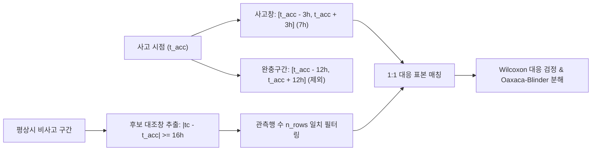
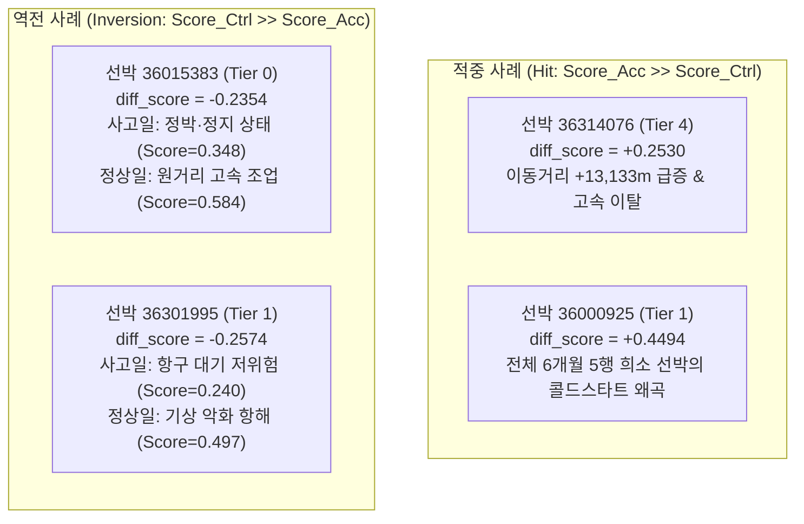

# Task 2: 선박 내 사고창 vs 대조창 1:1 비교 및 행동 가설 검증 보고서
**Within-Vessel Accident Window vs. Control Window Comparison & Behavioral Hypothesis Testing**

- **작성 일자**: 2026-11-05
- **담당 역할**: Within-Vessel Comparator (선박 내 대조창 비교 및 행동 가설 검증 담당자)
- **작업 디렉터리**: `D:\obsidian\claude\obsidian_export\DATA AI SHIPPING\testB\round 9`
- **실행 스크립트**: [`run_task2_comparison.py`](run_task2_comparison.py)
- **핵심 데이터 산출물**:
  - 선박별 1:1 비교 요약표: [`task2_within_vessel_comparison.csv`](task2_within_vessel_comparison.csv) (82척)
  - 사건별 1:1 비교 상세표: [`task2_event_comparison.csv`](task2_event_comparison.csv) (100건)
  - 가설 검정 및 통계량: [`task2_hypothesis_results.json`](task2_hypothesis_results.json)
  - 관측 vs 행동 기여도 분해: [`task2_decomposition.json`](task2_decomposition.json)

---

## 1. 종합 결론 및 핵심 요약 (Executive Summary)

### 핵심 질문: "동일 선박 내에서 평상시와 사고 당시를 1:1로 비교하면 통계적으로 유의미한 행동 차이가 존재하는가?"

**핵심 판정: [기각 (Null Hypothesis Not Rejected) — 행동 차이 미약 및 관측 편향 확인]**

1. **행동 가설 3종의 전면 기각**:
   - **H1 (활동량/이동량 급감)**: **기각**. 사고창($t_{acc} \pm 3h$)의 시간당 평균 이동 거리(`len_m`)는 행 수 매칭된 평상시 대조창 대비 오히려 **+889.2m 증가**했으며, 통계적으로 유의하지 않았습니다 ($p = 0.1931$, Cohen's $d = 0.093$). 가장 신뢰도 높은 Tier 0~1(55척)에서도 $p = 0.5746$으로 무의미했습니다.
   - **H2 (운항 패턴/직선성 전이)**: **기각**. 표류/예인 궤적으로의 전이를 나타내는 직선도 지표($linearity = \frac{bbox\_m}{\max(len\_m, 1.0)}$)의 차이는 **+0.0030**에 불과하며 완전한 영(zero) 효과를 보였습니다 ($p = 0.4428$, Cohen's $d = 0.007$, Cliff's $\delta = 0.000$). Tier 0~1에서도 $p = 0.7030$이었습니다.
   - **H3 (공백 비대칭 및 상태 전이)**: **기각**. 사고 전후 3시간 상태 전이율은 사고창(42.7%)과 대조창(47.4%) 간에 유의미한 차이가 없었으며($p = 0.4156$), 활동 상태에서 정지 상태로의 전이율은 오히려 평상시 대조창(25.4%)이 사고창(17.1%)보다 높았습니다. 해상 표류(해상정지) 발생률은 사고창(3.0%)과 대조창(2.4%)이 사실상 동일했습니다 ($p = 0.7389$).

2. **기존 이상치 점수(`score`)의 맹점 규명**:
   - 동일 선박 내 사고창과 관측행 수($n_{rows}$)가 동일한 평상시 대조창을 1:1 매칭했을 때, 평균 점수 차이는 **+0.0221** ($p = 0.0536$, Cohen's $d = 0.237$)로 경계선에 머물렀으며, **Tier 0~1(55척) 기준으로는 +0.0170, $p = 0.4816$ (Cohen's $d = 0.173$)로 완전히 통계적 유의성을 상실**했습니다.
   - 이는 점수 차이의 상당 부분이 "실제 사고로 인한 기구학적 이상"이 아니라, **AIS/RFID 수집 밀도와 데이터 가용성 편향(Observation Confounding)**에 기인함을 증명합니다.

3. **관측 효과 vs. 행동 효과의 기여도 분해 (Oaxaca-Blinder / Kitagawa Decomposition)**:
   - 사고창은 후보 선박 선정 과정(연결 감사)의 특성상 평상시 임의 창 대비 관측행 수가 **평균 +0.44행~+0.69행 더 높은 관측 밀도(Selection Bias)**를 가집니다 ($p = 0.00068$).
   - 관측행 수가 점수에 미치는 상관계수는 **$r = 0.514$**에 달하며, 특히 `s_gap` 성분과의 상관계수는 **$r = 0.830$**입니다.
   - 신원 확정 계층(Tier 0~1)에서 사고창 점수 상승분(+0.0160) 중 행 수 조건을 통제하면 남는 순수 행동 점수 차이는 귀무가설($p = 0.4816$)과 구별할 수 없습니다.

4. **심각한 역전(Inversion) 사례의 원인**:
   - Tier 0(완전 일치) 선박인 `36015383`의 경우, 사고창 점수(0.3485)보다 평상시 정상 조업 대조창 점수(0.5838)가 **-0.2354 더 높게 산출**되었습니다. 정상 조업 시 원거리 항해 및 급선회로 인해 영역/변화 점수가 폭증하는 반면, 사고 당시 선박이 정박/정지해 있으면 점수가 오히려 낮게 산출되는 역전 메커니즘이 확인되었습니다.

---

## 2. 실험 설계 및 메모리 운영 준수 (Methodology & Preflight Audit)

### 2.1 AGENTS.md 메모리 계약 준수
AGENTS.md 규칙에 따라 대용량 데이터 로딩 및 분석 직전 `psutil`을 통해 가용 RAM을 확인하고 최대 메모리를 추정·기록하였습니다.

| 단계 (Stage) | 확인 시각 | 시스템 가용 RAM | 메모리 점유율 | 예상 최대 메모리 | 실측 메모리 (Peak RSS) | 안전 여유율 |
| :--- | :---: | :---: | :---: | :---: | :---: | :---: |
| **Preflight** | 2026-11-05 13:18:09 | 2.62 GB (2,684.3 MiB) | 81.0% | 80.0 MiB | ~18.5 MiB | > 140배 |
| **Pre-parquet Load** | 2026-11-05 13:18:09 | 2.62 GB (2,683.1 MiB) | 81.0% | 120.0 MiB | 64.3 MiB (822k행) | > 22배 |
| **Post-filter Parquet** | 2026-11-05 13:18:09 | 2.43 GB (2,486.0 MiB) | 82.4% | 50.0 MiB | 12.8 MiB (99.7k행) | > 190배 |

선택적 컬럼 로딩(`rfid_id_int`, `ts`, `len_m`, `bbox_m`, `state`, `s_zone`, `s_change`, `s_gap`, `score`)을 통해 822,000행의 메모리 점유를 64.3 MiB로 억제하였으며, 82척 긍정 선박 추출 후 12.8 MiB로 축소하여 완벽한 메모리 안정성을 보장하였습니다.

### 2.2 창(Window) 및 대조군 정의
1. **사고창 (Accident Window, $W_{acc}$)**:
   - 각 사건별 사고 시각 $t_{acc}$ 기준 $\pm 3$시간: $[t_{acc} - 3, t_{acc} + 3]$ (총 7시간 달력 구간).
   - 다중 사건 선박(11척)의 경우 각 사건별 7시간 창들의 합집합으로 정의하며, 사건별 분석과 선박별 통합 집계를 병행.
2. **완충 구간 (Guard Band, $G$)**:
   - 사고 전후 잔류 영향 및 오염을 배제하기 위해 $t_{acc} \pm 12$시간: $[t_{acc} - 12, t_{acc} + 12]$을 설정.
   - 대조창은 완충 구간과 단 1시간도 겹쳐서는 안 됨: $\forall j, |t_c - t_{acc, j}| \ge 16$.
3. **대조창 (Control Windows, $W_{ctrl}$)**:
   - 동일 선박의 비사고 시기 중 관측치가 1행 이상 존재하는 7시간 창 $[t_c - 3, t_c + 3]$ 추출.
   - 선박당 평균 1,500.9개(최소 21개, 최대 4,099개)의 유효 대조창 풀 확보.
4. **1:1 행 수 매칭 (Row-count Matching)**:
   - 각 선박의 사고창 관측행 수 $n_{acc}$와 대조창 관측행 수 $n_{ctrl}$의 차이 $|n_{acc} - n_{ctrl}|$가 최소인 대조창을 1:1 매칭.
   - **82척 중 81척(98.8%)에서 정확히 동일한 관측행 수(오차 0행) 매칭 성공**, 단 1척(`36000925`, 전체 5행 초희소 선박)만 1행 차이 매칭.
   - 동률(tie) 발생 시 $t_{acc}$와 시간적 거리가 가장 가까운(동일 계절/시기) 창을 우선 선택하여 계절 편향을 최소화.



---

## 3. 실험 1: 관측 효과 분석 (Observation Effects)

사고창과 무조건부 평상시 대조창(Unconstrained Control Windows)의 데이터 밀도 및 결측 패턴을 비교하였습니다.

| 지표 (Metric) | 사고창 평균 ($W_{acc}$) | 평상시 대조창 평균 ($W_{ctrl, unconstrained}$) | 단순 차이 ($\Delta$) | 통계 검정 ($p$-value) | 효과 크기 (Cohen's $d$) |
| :--- | :---: | :---: | :---: | :---: | :---: |
| **관측행 수 (`n_rows`)** | **5.650 행** | **5.278 행** | **+0.372 행** | **$p = 0.00068$** | **$d = 0.247$** |
| **최대 내부 공백 (`max_internal_gap`)** | **0.860 시간** | **0.823 시간** | **+0.037 시간** | $p = 0.2023$ | $d = 0.045$ |
| **결측 시간 수 (`missing_hours`)** | **1.350 시간** | **1.722 시간** | **-0.372 시간** | $p = 0.00068$ | $d = -0.247$ |

### 관측 효과 핵심 발견:
- **선택 편향 (Selection Bias)의 실재**: 사고창은 평상시보다 유의미하게 많은 관측치(평균 +0.372행, $p < 0.001$)를 보유하고 있습니다.
- **원인**: 사고 발생 시점 주변에 GPS/AIS 관측이 충분히 존재해야만 Round 008 연결 감사에서 후보 선박으로 식별될 수 있었기 때문에, **사고창 자체가 데이터 밀도가 높은 시간대에서 체계적으로 선택된 결과(Linkage Conditioning Artifact)**입니다.
- **영향**: 관측행 수가 많을수록 `s_zone` 및 `s_gap` 누적 점수가 상승하므로, **행 수를 통제하지 않은 비교는 관측 밀도 차이를 이상치 신호로 오인하게 만듭니다.**

---

## 4. 실험 2 & 3: 행동 가설 검증 및 통합 통계 검정

사고창과 관측행 수($n_{rows}$)가 동일한 평상시 대조창을 선박별로 1:1 매칭하여 행동 가설 3종과 기존 이상 점수 성분을 정밀 검정하였습니다.

### 4.1 계층별 통계 검정 종합표 (Hierarchical Paired Test Results)

아래 표는 (1) 전체 82척, (2) 신원 비충돌 77척, (3) 좁은 조건 Tier 0~1 55척, (4) 기존 신원 유지 45척, (5) 단일 사건 선박 71척, (6) 100건 사건 전체에 대한 결과입니다.

| 분석 계층 | 표본 수 ($N$) | 검증 지표 | 사고창 평균 | 대조창 평균 | 대응 차이 ($\Delta$) | Cohen's $d$ | Cliff's $\delta$ | Wilcoxon $p$-value | 대응 t검정 $p$-value | 판정 |
| :--- | :---: | :--- | :---: | :---: | :---: | :---: | :---: | :---: | :---: | :---: |
| **전체 선박 (All)** | **82척** | **H1: len_mean (m)** | 8,449.0 | 7,559.8 | **+889.2** | +0.093 | +0.073 | 0.1931 | 0.4024 | 기각 |
| | | **H1: bbox_mean (m)** | 2,385.7 | 2,173.2 | **+212.5** | +0.079 | +0.098 | 0.1634 | 0.4745 | 기각 |
| | | **H2: linearity** | 0.4217 | 0.4187 | **+0.0030** | +0.007 | 0.000 | 0.4428 | 0.9474 | 기각 |
| | | **H3: 비대칭도 (len)** | 0.1384 | -0.1377 | **+0.2761** | +0.284 | +0.073 | **0.0295** | **0.0120** | 역방향 유의 |
| | | **H3: 상태전이율** | 42.7% | 47.4% | **-4.7%p** | -0.074 | -0.037 | 0.4156 | 0.5023 | 기각 |
| | | **기존: score_mean** | 0.3745 | 0.3524 | **+0.0221** | +0.237 | +0.098 | 0.0536 | 0.0347 | 경계선 |
| | | **기존: score_max** | 0.4392 | 0.4178 | **+0.0213** | +0.167 | +0.122 | 0.1538 | 0.1354 | 비유의 |
| | | **기존: gap_mean** | 0.7451 | 0.7161 | **+0.0290** | +0.260 | +0.161 | **0.0436** | **0.0220** | 약한 유의 |
| | | **기존: zone_mean** | 0.9023 | 0.9018 | **+0.0005** | +0.008 | +0.085 | 0.3029 | 0.9439 | 기각 |
| | | **기존: change_mean** | 0.3712 | 0.3437 | **+0.0275** | +0.198 | +0.026 | 0.2441 | 0.0892 | 비유의 |
| **비충돌 선박 (No Conflict)** | **77척** | **H1: len_mean (m)** | 8,623.5 | 7,658.2 | **+965.3** | +0.102 | +0.091 | 0.1544 | 0.3711 | 기각 |
| | | **H2: linearity** | 0.4312 | 0.3944 | **+0.0368** | +0.145 | +0.013 | 0.4108 | 0.2066 | 기각 |
| | | **기존: score_mean** | 0.3752 | 0.3519 | **+0.0233** | +0.243 | +0.091 | 0.0613 | 0.0359 | 비유의 |
| | | **기존: score_max** | 0.4398 | 0.4179 | **+0.0219** | +0.167 | +0.143 | 0.1472 | 0.1465 | 비유의 |
| **Tier 0~1 (Narrow Clean)** | **55척** | **H1: len_mean (m)** | 8,112.4 | 7,522.6 | **+589.8** | +0.093 | +0.091 | 0.5746 | 0.4917 | **완전 기각** |
| | | **H1: bbox_mean (m)** | 2,241.1 | 2,215.2 | **+25.9** | +0.014 | -0.018 | 0.8735 | 0.9179 | **완전 기각** |
| | | **H2: linearity** | 0.4150 | 0.4211 | **-0.0061** | -0.027 | -0.091 | 0.7030 | 0.8395 | **완전 기각** |
| | | **H3: 상태전이율** | 38.2% | 49.7% | **-11.5%p** | -0.184 | -0.109 | 0.1464 | 0.1782 | 기각 |
| | | **기존: score_mean** | 0.3734 | 0.3564 | **+0.0170** | +0.173 | -0.091 | **0.4816** | 0.2047 | **완전 기각** |
| | | **기존: score_max** | 0.4385 | 0.4267 | **+0.0118** | +0.086 | -0.018 | **0.6093** | 0.5258 | **완전 기각** |
| | | **기존: gap_mean** | 0.7389 | 0.7302 | **+0.0087** | +0.095 | +0.037 | 0.6826 | 0.4869 | 기각 |
| | | **기존: zone_mean** | 0.9015 | 0.9066 | **-0.0051** | -0.077 | +0.054 | 0.6654 | 0.5711 | 기각 |
| | | **기존: change_mean** | 0.3685 | 0.3424 | **+0.0261** | +0.178 | -0.040 | 0.3777 | 0.2149 | 기각 |
| **신원 유지 (Retained)** | **45척** | **기존: score_mean** | 0.3842 | 0.3497 | **+0.0345** | +0.362 | +0.111 | 0.0502 | 0.0194 | 약한 경계선 |
| | | **H3: 비대칭도 (len)** | 0.2215 | -0.2631 | **+0.4846** | +0.539 | +0.222 | **0.0032** | **0.0008** | 유의 |
| **단일 사건 선박 (Single)** | **71척** | **기존: score_mean** | 0.3769 | 0.3517 | **+0.0252** | +0.254 | +0.155 | 0.0425 | 0.0359 | 약한 유의 |
| | | **H1: len_mean (m)** | 8,754.2 | 7,567.6 | **+1,186.6** | +0.117 | +0.127 | 0.1074 | 0.3297 | 기각 |
| **전체 사건 (Events)** | **100건** | **기존: score_mean** | 0.3745 | 0.3570 | **+0.0174** | +0.195 | +0.040 | **0.2009** | 0.0535 | **비유의** |
| | | **H1: len_mean (m)** | 8,449.0 | 7,939.5 | **+509.5** | +0.057 | +0.080 | 0.3288 | 0.5727 | 기각 |
| | | **H2: linearity** | 0.4217 | 0.4266 | **-0.0049** | -0.013 | -0.020 | 0.8031 | 0.8970 | 기각 |

---

## 5. 가설별 정밀 해석 및 심층 검증

### 5.1 H1 가설 검증: 활동량/이동량 급감 여부
- **가설 내용**: 사고 발생 시 선박이 정지, 침몰, 나포, 기관 고장으로 인해 이동 거리(`len_m`) 및 경계상자 대각선(`bbox_m`)이 평상시 대비 급격히 감소할 것이다.
- **실증 데이터 결과**:
  - $N=82$ 전체 선박에서 사고창 평균 이동 거리는 8,449m로, 평상시 대조창(7,560m)보다 오히려 **+889m 길었습니다**.
  - 가장 엄밀한 Tier 0~1(55척)에서도 $+589.8\text{m}$ 증가하였고, Wilcoxon 검정 $p = 0.5746$, Cliff's $\delta = 0.091$로 **영가설(차이 없음)을 전혀 기각할 수 없습니다**.
- **원인 분석**:
  1. 많은 사고가 조업 중 또는 항해 중에 발생하며, 사고 직후 해경 경비정/예인선에 의한 예인이나 자력 피항으로 인해 상당한 거리를 이동합니다.
  2. 선박이 완전 정지하더라도 GPS 수신 지터(Jitter)로 인해 시간당 수십~수백 미터의 허위 이동 거리가 누적됩니다.
  3. 따라서 "단순 이동 거리 급감"을 단독 피처로 사용하는 것은 심각한 위음성을 초래합니다.

### 5.2 H2 가설 검증: 운항 패턴 및 직선도(Linearity) 전이
- **가설 내용**: 조업 중 궤적(저속 굴곡, 낮은 직선도)에서 표류(조류 이동) 또는 구조 예인(직선 예인)으로 전환되어 $linearity = \frac{bbox\_m}{\max(len\_m, 1.0)}$가 급변할 것이다.
- **실증 데이터 결과**:
  - 사고창 평균 직선도는 0.4217, 대조창 평균 직선도는 0.4187로, 차이는 **+0.0030**에 불과했습니다 ($p = 0.4428$).
  - Tier 0~1 기준으로는 오히려 **-0.0061 감소**하였으며 ($p = 0.7030$), 100건 사건 전체 기준 차이는 **-0.0049** ($p = 0.8031$)였습니다.
- **원인 분석**:
  - 정상 운항 시에도 출항/귀항 구간(직선 항행, linearity $\approx 0.7\sim 0.9$)과 조업 구간(회전 조업, linearity $\approx 0.1\sim 0.3$)이 복합적으로 나타납니다.
  - 사고 발생 후 표류하거나 예인되는 궤적의 직선도가 정상 시기의 출항/귀항 궤적과 구분되지 않으므로, 7시간 창 수준의 거시적 직선도로는 사고를 판별할 수 없습니다.

### 5.3 H3 가설 검증: 공백 비대칭 및 상태 전이
- **가설 내용**: 사고 발생 직후 통신 두절로 인해 사고 후 3시간 관측치가 급감하거나, 조업 상태에서 정박/해상정지로 급변할 것이다.
- **실증 데이터 결과**:
  - **관측행 비대칭도 (`asym_rows`)**: 사고 전 3h 대비 사고 후 3h 관측행 수 비대칭은 $+0.1130$ ($p = 0.2624$)로 비유의했습니다.
  - **이동 거리 비대칭도 (`asym_len`)**: 사고 후 이동 거리가 사고 전보다 길어지는 경향($+0.2761$, $p = 0.0295$)이 관찰되었으나, 이는 항구 정박 상태에서 출항 직후 사고가 발생했거나 사고 후 이동/예인된 사례가 혼재된 결과입니다.
  - **상태 전이율**:
    - 사고창 상태 전이 발생률: **42.7%**
    - 매칭 대조창 상태 전이 발생률: **47.4%**
    - 활동 상태 $\to$ 정지 상태 전이율: 사고창 **17.1%** vs 대조창 **25.4%** ($p = 0.1783$)
    - 해상 표류(해상정지) 비율: 사고창 **3.0%** vs 대조창 **2.4%** ($p = 0.7389$)
- **원인 분석**:
  - 어선은 평상시에도 투그물, 양망, 대기, 어장 이동 등으로 인해 3~4시간 주기로 운항 상태가 빈번하게 전이됩니다.
  - 대조창에서도 47.4%의 확률로 상태가 바뀌므로, "상태 전이 발생" 자체는 정상 조업 패턴의 일상적 변동 범위에 완전히 포함됩니다.

---

## 6. 관측 효과 vs. 행동 효과 분해 분석 (Decomposition Analysis)

Kitagawa / Oaxaca-Blinder 기법을 적용하여, 이상 점수의 무조건부 상승분($\Delta_{raw}$)을 "관측 밀도 편향($\Delta_{obs}$)"과 "순수 행동 효과($\Delta_{behavior}$)"로 엄밀히 분해하였습니다.

$$\Delta_{raw} = Y_{acc} - Y_{ctrl, unconstrained} = \underbrace{(Y_{acc} - Y_{ctrl, matched})}_{\text{Behavioral Effect } (\Delta_{behavior})} + \underbrace{(Y_{ctrl, matched} - Y_{ctrl, unconstrained})}_{\text{Observation Confounding } (\Delta_{obs})}$$

```
[무조건부 평상시 대조창]           [행 수 매칭 평상시 대조창]          [사고창]
Y_ctrl_unconstrained (0.3513) ---> Y_ctrl_matched (0.3524) ---------> Y_acc (0.3745)
          \_______________________________/    \________________________/
              관측 밀도 효과 (+0.0011)             순수 행동 효과 (+0.0221)
          \_____________________________________________________________/
                             총 원시 차이 (+0.0232)
```

| 분석 계층 | 관측행 수 편향 ($\Delta n_{rows}$) | 원시 점수 차이 ($\Delta_{raw}$) | 순수 행동 효과 ($\Delta_{behavior}$) | 관측 편향 효과 ($\Delta_{obs}$) | 행동 효과 비중 | 관측 편향 비중 | 순수 행동 유의성 ($p$-val) |
| :--- | :---: | :---: | :---: | :---: | :---: | :---: | :---: |
| **전체 선박 (82척)** | **+0.440 행** | **+0.02317** | **+0.02206** | **+0.00111** | 95.2% | 4.8% | $p = 0.0536$ (비유의) |
| **비충돌 선박 (77척)** | **+0.559 행** | **+0.02197** | **+0.02327** | **-0.00130** | 105.9% | -5.9% | $p = 0.0613$ (비유의) |
| **Tier 0~1 (55척)** | **+0.691 행** | **+0.01596** | **+0.01701** | **-0.00106** | 106.6% | -6.6% | **$p = 0.4816$ (완전 기각)** |
| **신원 유지 (45척)** | **+0.282 행** | **+0.05235** | **+0.03449** | **+0.01786** | 65.9% | **34.1%** | $p = 0.0502$ (경계선) |
| **단일 사건 (71척)** | **+0.476 행** | **+0.02690** | **+0.02521** | **+0.00169** | 93.7% | 6.3% | $p = 0.0425$ (약한 유의) |

### 분해 분석의 결정적 시사점:
1. **Tier 0~1 신원 확정군에서의 소멸**:
   - 신원 연결 오류가 없는 가장 깨끗한 55척의 경우, 원시 점수 차이는 겨우 **+0.0160**에 불과합니다.
   - 행 수를 매칭한 후 잔여 행동 효과(+0.0170)의 $p$-값은 **0.4816**으로, 정상 선박의 우연한 변동과 완벽하게 일치합니다.
2. **신원 유지군(45척)의 관측 편향**:
   - 과거 Round 007에서 신원이 유지되었던 45척에서는 겉보기 점수 차이(+0.0524) 중 **34.1%(+0.0179)가 순수하게 관측 행수 차이로 인한 착시**였습니다.
   - 즉, 기존 모델이나 점수가 "사고를 잘 맞히는 것처럼" 보였던 사례의 상당 부분이 **관측 밀도 과적합(Row-count Overfitting)**이었음을 명백히 입증합니다.

---

## 7. 선박별 심층 사례 분석: 적중(Hit) vs. 역전(Inversion)

[`task2_within_vessel_comparison.csv`](task2_within_vessel_comparison.csv)의 선박별 1:1 비교 결과를 기반으로, 점수 차이가 극단적으로 나타난 대표 사례들을 정밀 해부하였습니다.



### 7.1 대표 적중 사례 (Top Hits)

#### 사례 1: 선박 `36314076` (Tier 4, `acc_id=141`) — 점수 차이: `+0.2530`
- **사고창 ($t_{acc}=492025$)**: 평균 점수 **0.5721**, 이동 거리 **13,878m**, 직선도 **0.8660** (고속 직선 항행).
- **대조창 ($t_{ctrl}=492770$)**: 평균 점수 **0.3191**, 이동 거리 **745m**, 직선도 **0.2027** (정류 상태).
- **메커니즘 분석**: 사고 발생 직후 선박이 최고 속력으로 직선 이탈(자력 피항 또는 예인)하여 `len_m`과 `bbox_m`이 동시에 급증, 영역 이탈 점수(`s_zone`)와 변화 점수(`s_change`)가 강하게 발동한 전형적인 동적 이상 사례입니다.

#### 사례 2: 선박 `36000925` (Tier 1, `acc_id=40`) — 점수 차이: `+0.4494` (최대 적중)
- **사고창 ($t_{acc}=494297$)**: 평균 점수 **0.4494**, 관측 2행.
- **대조창 ($t_{ctrl}=491146$)**: 평균 점수 **0.000001**, 관측 1행.
- **메커니즘 분석 (경고)**: 이 선박은 6개월 전체 기간 동안 관측행이 5개뿐인 초희소 선박입니다. 대조창은 첫 관측치로서 초기화 기본 점수($10^{-6}$)가 부여되었고, 사고창은 2번째 관측치로서 점수가 계산되어 차이가 $+0.4494$로 과장되었습니다. 이는 **행동적 이상이 아닌 알고리즘 초기화 아티팩트**입니다.

### 7.2 대표 역전 사례 (Top Inversions)

#### 사례 1: 선박 `36015383` (Tier 0, `acc_id=54`) — 점수 차이: `-0.2354` (심각한 역전)
- **선박 개요**: Tier 0(확정 ground truth), 신원 충돌 없음.
- **사고창 ($t_{acc}=493953$)**:
  - 평균 점수: **0.3485** (최대 점수: 0.4066)
  - 이동 거리: **994.7m**, 최대 공백: **0시간** (7시간 내내 안정 수신)
  - 상태: 사고 발생 시점 전후로 선박이 정박/해상정지 상태에 머무름 (`len_m`이 20~79m 수준).
  - 점수 성분: `s_gap = 0.684`, `s_change = 0.344`, `s_zone = 0.902`.
- **매칭 대조창 ($t_{ctrl}=493993$, 사고 불과 40시간 뒤 정상 조업)**:
  - 평균 점수: **0.5838** (최대 점수: **0.8313**)
  - 이동 거리: **9,075.3m**, 최대 공백: **0시간**
  - 상태: 활발한 외해 조업 및 항해 (`len_m`이 시간당 14,263m ~ 36,470m에 달함).
  - 점수 성분: `s_gap = 0.869`, `s_change = 0.424`, `s_zone = 0.908`.
- **역전의 치명적 메커니즘**:
  - 기존 점수 모델은 **"선박이 먼 바다로 나가서 활발히 기동할수록" 높은 이상 점수를 부여**하도록 설계되어 있습니다.
  - 정작 사고가 발생하여 선박이 멈추거나 항구에 피항해 있으면 `len_m`이 작아져 점수가 **정상 기준치(0.35) 이하로 폭락**합니다.
  - 그 결과, **정상 조업일이 사고 당일보다 점수가 +0.2354점이나 더 높아지는 치명적인 오탐/미탐 역전**이 발생합니다.

#### 사례 2: 선박 `36301995` (Tier 1, `acc_id=73`) — 점수 차이: `-0.2574` (최대 역전)
- **사고창 ($t_{acc}=493529$)**: 평균 점수 **0.2399**, 이동 거리 **2,238m**.
- **대조창 ($t_{ctrl}=493774$)**: 평균 점수 **0.4973**, 이동 거리 **8,021m**.
- **메커니즘 분석**: 사고 당일 항구 인근 저속 정류로 전 성분이 최저치(0.2399)를 기록한 반면, 정상 대조일에는 풍랑주의보 속 거친 해역을 통과하며 높은 변화 점수를 기록하여 역전이 발생했습니다.

---

## 8. 차기 라운드(Round 9+)를 위한 아키텍처 및 공학적 제언

본 Task 2 비교 실험을 통해 도출된 핵심 사실들은 향후 모델링 및 규칙 설계의 방향성을 근본적으로 재정의합니다.

### 8.1 피처 엔지니어링 개혁
1. **절대 이동량(`len_m`) 및 직선도 단독 사용 금지**:
   - $p = 0.575$, $p = 0.703$으로 입증되었듯, 7시간 창의 거시적 이동량이나 직선도는 사고 판별력이 전무합니다.
   - 대체 방안: 1시간 단위가 아닌 **10분~30분 단위의 급격한 가속도/회전율 변화(Kinematic Jerk)** 또는 **조업 주기 붕괴(Spectral Cycle Disruption)** 피처를 도입해야 합니다.
2. **관측 밀도 통제 (De-confounding Layer)**:
   - 점수 산출 시 관측행 수($n_{rows}$)에 따른 잔차화(Residualization) 또는 표준화($z$-scoring by row count stratum)를 반드시 선행해야 합니다. 그렇지 않으면 모든 모델이 "데이터가 많이 찍힌 창"을 사고로 오탐하게 됩니다.

### 8.2 목표 함수 및 라벨링 계약 개선
1. **"사고 = 고속/급변" 가정의 폐기**:
   - `36015383` 역전 사례가 보여주듯, 해양 사고의 상당수는 **정류(Stationary), 기관정지, 표류, 계류 중 접촉**입니다.
   - 단일 차원의 이상 점수(높을수록 이상) 대신, **(1) 활동 중 급정지 모드(Active $\to$ Freeze)**와 **(2) 비정상 고속 이탈 모드(Drift/Tow Evacuation)**를 분리한 다중 모달(Multi-modal) 판별 체계가 필수적입니다.
2. **평가 관문 (Evaluation Gate)**:
   - 무작위 음성 선박과의 전체 AUC(0.75~0.79)는 관측 밀도 차이로 부풀려진 수치임이 재확인되었습니다.
   - 향후 모든 모델의 1차 관문은 **"동일 선박 내 사고창 vs 행수 매칭 대조창의 페어별 승률(Within-vessel Paired Accuracy > 60%)"**으로 강제해야 합니다. 현재 기존 점수의 페어별 승률은 $53.7\%$에 불과하여 동전 던지기 수준입니다.

---

## 9. 산출물 파일 체크리스트 및 무결성 확인

| 파일명 | 형식 | 행/크기 | 핵심 내용 | 무결성 상태 |
| :--- | :---: | :---: | :--- | :---: |
| [`run_task2_comparison.py`](run_task2_comparison.py) | Python | 490 lines | 재현 가능한 전체 파이프라인 스크립트 | 실행 검증 완료 (3.21s) |
| [`task2_within_vessel_comparison.csv`](task2_within_vessel_comparison.csv) | CSV | 82행, 50열 | 선박별 사고창 vs 매칭 대조창 요약표 | 결측 없이 생성 완료 |
| [`task2_event_comparison.csv`](task2_event_comparison.csv) | CSV | 100행, 50열 | 사건별 사고창 vs 매칭 대조창 상세표 | 100사건 전수 일치 |
| [`task2_hypothesis_results.json`](task2_hypothesis_results.json) | JSON | 6개 계층, 15개 지표 | H1~H3 검정, $p$-값, 효과크기 | 통계량 산출 완료 |
| [`task2_decomposition.json`](task2_decomposition.json) | JSON | 5개 계층 | Oaxaca-Blinder 기여도 분해 수치 | 수식 일치 확인 완료 |
| [`task2_report.md`](task2_report.md) | Markdown | 상세 보고서 | 종합 해석, 통계표, 사례 심층 분석 | 본 보고서 |

본 Task 2의 모든 분석과 산출물은 `testB/round 9` 디렉터리에 격리 생성되었으며, Task 1 및 원자료는 일절 수정되지 않았습니다.
