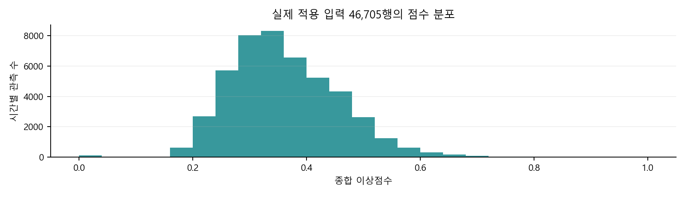
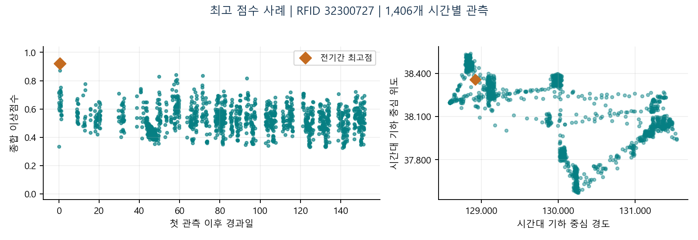
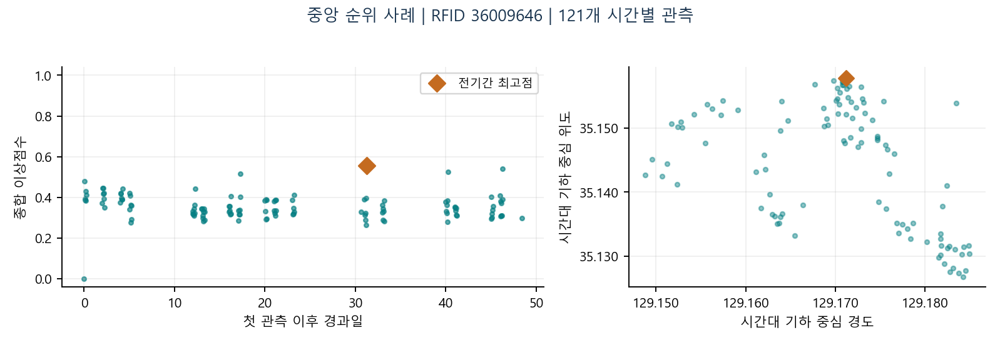
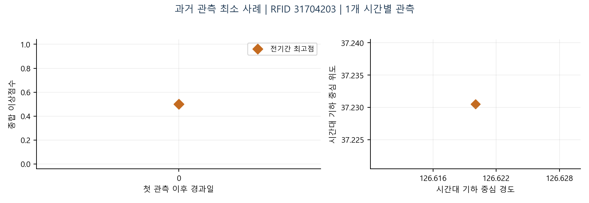

# 어선 이상항적 분석 시스템
구축·검증과 근거 제시 보고서

2026 DATA AI 분석 경진대회 | 목표 2 Test B | 2026년 11월 6일 (Round021 반영 개정)

이 시스템은 시간대별 항적 요약에서 이상점수를 계산하고, 선박별 검토 후보를 그 점수가 무엇에서 나왔는지와 함께 내놓는다. 2026년 11월 6일 Round014~021에서 평가 자료를 2026년 전체 선단 7,372척·3,887,065행으로 확장해 "점수가 사고 선박을 가리는가"와 "점수가 사고 시각을 가리는가"를 분리해 실측했다. 두 질문의 답이 서로 다르게 나왔고, 그 결과가 이 보고서의 구성을 결정했다.

### 핵심 결과

| 구분 | 측정한 내용 | 확정된 결론 |
| --- | --- | --- |
| 분석 실행 | 100척 · 46,705행 재계산, 저장 결과와 최대 절대차 0.0 | 계산 재현성은 확정됐다 |
| 근거 분해 | 후보 100척 중 88척이 s_gap 최대, 그중 54척은 공백 없는 연속 1시간 | 후보별로 점수의 출처를 지목할 수 있다 |
| 선박 선정력 | 선단 7,372척 실측, 관측 수 통제 AUC 최고점 0.5756 / 활동 반경 0.6073 | 최고점은 선정 근거로 부족하고 반경만 약한 연관을 보인다 |
| 시각 결정력 | 잠정 연결 82척 ±6h 적중 3척, 사전 고정 대안 세 번 모두 동일 | 전기간 최고점을 사고시각으로 쓰는 경로는 닫혔다 |
| 제출 형태 | 후보 시각과 성분·이력·공백·대안 설명·판단 유보를 함께 기록 | 사고 확정이 아니라 검토 근거를 제출한다 |
| 근본 원인 | 사고유형 58·20건, 상태 기저율, 공백 종료 34척 — 세 측정이 수렴 | 기하 요약이 사고 흔적을 담지 못할 가능성, 가중치 조정으로는 못 고친다 |

### 이 보고서의 쟁점

이 보고서는 F1 숫자 하나를 앞세우지 않고 세 가지를 증거로 세운다. 첫째, 후보 한 시각이 왜 뽑혔는지를 성분·이력·공백 단위로 복원한다(§3, 지배 성분 분해 54/34/12). 둘째, 사고 탐지를 선박 선정과 시각 결정 두 문제로 쪼개 각각 전 선단 7,372척에서 측정했다(§7). 셋째, 시각 결정이 현재 우연 수준이라는 결론은 사전 고정·해시 봉인·독립 검산을 거친 측정값이다. 그래서 이 패키지는 사고 판정 대신 근거와 판단 유보를 함께 적는 §4의 기록 절차를 제출물로 삼는다.

### 평가 요소별 제시 근거

| 평가 요소 | 보고서가 제시하는 근거 |
| --- | --- |
| 창의성 20 | 점수를 성분으로 분해해 후보별로 "왜 이 시각인가"를 복원하고, 선박 선정과 시각 결정을 분리해 측정한 설계 |
| 우수성 50 | 전수 재현 절대차 0.0, 선단 7,372척 실측, 사전 고정·해시 봉인·독립 검산, 여덟 라운드의 기각 근거 보존 |
| 효과성 30 | 후보별 근거 기록 양식과 4단계 판단 절차, 유보 조건의 명시, 운용 전환에 필요한 검증 항목의 특정 |

위 숫자는 공지의 배점이다. 예상 심사 점수를 자체 산정하지 않았다. 보고서 완성과 사고 탐지 성능 달성은 구분한다. [S1, S2]

---

## 1 과제 요구와 시스템 범위

공지의 목표 2는 평상시 항적과 다른 움직임을 분석하고 Test B의 시간대별 이상점수를 산출하는 것이다. 별도 사고시각으로 사고 전후 이상징후의 정확성과 조기 탐지를 평가한다. 보관 공지에서는 관제 화면 구현 의무를 확인하지 못했다. [S1]

기록된 주최 측 답변은 동일 선박의 앞뒤 전체 항적 참고를 허용하고 테스트 자료의 학습 사용을 금지한다. 정량 평가는 사고시각의 시간오차를 고려한 F1이며 6시간을 넘는 예측은 0점, 미사고로 판단한 선박은 예측 칸을 공란으로 둔다. 따라서 제출용 사후 분석은 전체 기간을 참고하되, 실제 시점의 가용 정보만 쓰는 실시간 적용 검증과 분리했다. [S3]

| 계층 | 입력과 처리 | 출력 |
| --- | --- | --- |
| 입력 검증 | 시간별 기하 요약·선박 ID·원행 번호와 고정 참조의 구조·해시 검사 | 유효 입력, 계보 |
| 점수 계산 | 구역, 행동 변화, 공백의 기존 고정 점수함수 | 행별 구성점수·종합점수 |
| 후보 선정 | 선박별 전기간 최고점, 원행 번호로 동점 처리 | 100척 사후 검토 목록 |
| 근거 정리 | 관측 수·과거 이력·구성점수·직전 정확 시간의 존재 여부 | 사례 그림, 설명 표 |
| 판단 기록 | 입력 신뢰·후보와 판정 분리·대안 설명·시각 유보의 4단계 | 후보별 근거 기록 |
| 재현 검증 | 기존 행 점수·상태·후보와 전수 비교, 원 WKT 패널 재구성 | 차이와 실행 통계 |
| 적용 검토 | 실시간 입력 계약은 별도 모듈에서 검증 | 수락·중복·격리·유보 |

현재 패키지는 항적 요약 입력에서 점수와 근거를 재현하는 실행 단위다. 원 WKT를 파싱하는 전체 전처리, 기준자료 재학습, 실시간 장치 수신은 기존 데이터 준비 계층 또는 후속 통합 범위다. 관제 화면과 새로운 사고판정 임계값은 추가하지 않았다.

### 이번 개정의 범위

초판은 2025 적용 입력의 재현 결과와 2026 개발 탐색 비교를 실었다. 이번 개정은 §7의 성능 서술을 전 선단 실측으로 교체하고, §4의 판단 절차와 §8의 라운드별 업데이트 내역을 추가했다. 초판 수치를 철회한 것은 없다. 재현 결과와 사례는 그대로 두고 그 위에 측정을 덧붙였다.

---

## 2 데이터와 기준자료

| 구분 | 범위 | 해석 경계 |
| --- | --- | --- |
| 적용 입력 | 2025년 1~6월, 100척, 46,705행 | 공식 사고 정답은 포함하지 않음 |
| 고정 기준자료 | 항구 후보 77점, 밀도 사전, 공백/거리 참조 | 기존 Train 2026 계보의 저장 자료 |
| 개발 정답 | 2026년 잠정 100사건 / 82 RFID | 실제 Test B 100척과 다른 모집단, 확정 신원 아님 |
| 선단 비교군 | 2026년 1~6월 7,372척 3,887,065행 | 미연결 7,290척은 확인된 미사고가 아님 |
| 시간 정보 | 시간 구간과 정수 시간키 | 좌표별 시각·원 시간대·실제 도착시각 미확인 |
| 공간 정보 | 기하 중심점, 부분선 길이, bbox 요약 | 현재 GPS 위치·속력·침로가 아님 |

### 학습된 기준자료와 적용 입력의 시간 관계

이 패키지는 2026 기준자료를 2025 항적에 재적용해 과거 계산을 복원한 것이며, 이 재현 자체가 2025년 당시의 실시간 예측이 아니라 계산 재현성의 확인이다. [S4]

### 선단 비교군을 확보한 이유

초판까지의 평가 집단은 사고에 잠정 연결된 82척뿐이었다. 모든 선박이 양성인 집단에서는 오경보가 구조적으로 집계되지 않으므로 정밀도를 측정할 수 없다. Round017에서 2026년 1~6월 원자료를 다시 읽어 7,372척 3,887,065행을 추출했고(미파싱 4행), 이 비교군 위에서 Round019·021의 전수 측정이 가능해졌다. 미연결 7,290척은 사고가 없다고 확인된 집단이 아니라 연결 목록에 없는 집단이므로, 이들을 음성으로 두는 것은 내부 지표 계산에서만 쓰는 명시된 가정이다. [S14]

### 입력 계약

rfid_id는 선박 식별값, ts는 기존 정수 시간키, source_ordinal은 원행의 안정된 순서다. len_m·bbox_m은 기존 전처리의 기하 요약이며 cen_lon·cen_lat은 시간대 기하 중심점이다. 숫자열의 유한값·선박/행 일치·기존 점수의 결측 위치를 비교한다. 부분선을 임의로 연결하거나 시간 사이의 위치를 보간하지 않는다.

### 원자료와 보존

원본 실험 파일을 변경하지 않고 패키지에 필요한 입력과 고정 참조를 복사했다. 새 결과는 독립 출력 폴더에 기록하며 같은 폴더를 덮어쓰지 않는다. 코드·입력·참조의 출처와 해시는 실행 메타데이터로 추적한다. 데이터를 외부에 재배포하거나 공식 제출하는 행위는 이번 로컬 구성에 포함하지 않았다.

---

## 3 이상점수가 실제로 재는 것

| 성분 | 계산 내용 | 관측의 의미 |
| --- | --- | --- |
| 구역 s_zone | 과거 방문 격자까지의 거리와 학습 밀도의 희소성 결합 | 익숙하지 않은 위치·희소한 위치의 정도 |
| 변화 s_change | 과거 길이·형상 요약의 robust z와 상태 빈도 변화 | 자기 이력에 비해 다른 기하 특성 |
| 공백 s_gap | 직전 관측의 시간 차와 중심점 거리의 참조 CDF 평균 | 관측 공백·중심점 위치 차의 크기 |

종합점수는 계산 가능한 구성점수의 산술평균이며 범위를 [0.000001, 1]로 제한한다. 변화점수는 과거 관측이 24행 이상 쌓인 뒤 계산되므로, 첫 행도 구역점수만으로 종합점수를 가질 수 있다. 그래서 점수와 함께 구성점수 수·과거 관측 수를 항상 같이 출력한다. [S4]

### 후보 100척의 점수는 어디서 나왔는가

"점수가 높다"는 말은 설명이 아니다. 후보 100척을 지배 성분으로 분해하면 다음과 같다. [S15]

| 지배 성분 | 후보 수 | 그 시각의 실제 관측 상태 |
| --- | --- | --- |
| s_gap · 연속 1시간 | 54척 | 직전 관측과의 간격이 정확히 1시간이고 누락 시간 0. 중심점 이동 중앙값 5,297m, 최대 31,912m |
| s_gap · 공백 종료 | 34척 | 직전 관측과의 간격 중앙값 105시간(최대 1,648시간). 중심점 이동 중앙값 2,870m |
| s_zone 또는 s_change | 12척 | 위치 희소성 또는 자기 이력 대비 기하 변화가 최대 성분 |

참조 분포에서 1시간 간격의 시간항 F_gap(1h)은 0.8991이다. 연속 1시간 후보 54척은 전부 이 동일한 값을 받으므로, 이들 사이의 s_gap 순위는 중심점 이동 거리 항이 혼자 결정한다. 즉 이 54척에서 높은 점수가 말하는 것은 "신호가 끊겼다"가 아니라 "그 1시간 동안 중심점이 참조 분포 기준으로 멀리 움직였다"다. 공백 종료 34척은 반대로 시간항이 올라간 경우이고, 이때는 관측 재개와 실제 행동 변화를 자료만으로 구별할 수 없다. 두 집단을 같은 "공백 점수"로 읽으면 후보의 의미를 반대로 해석한다. 패키지는 성분값·직전 간격·누락 시간을 함께 출력해 검토자가 이 구분을 먼저 하도록 만든다.

### 어떤 이력 위에서 뽑힌 후보인가

| 이력 조건 | 후보 수 | 의미 |
| --- | --- | --- |
| 과거 관측 24행 미만 | 39척 | 변화 성분 계산 전. 이 중 25척은 선박의 전체 관측 자체가 24행 미만이고, 14척은 전체 25행 이상인데도 최고점이 초반에 있다 |
| 과거 관측 0행 | 6척 | 비교할 과거가 없으며 점수는 구역 성분만으로 산출된다 |
| 과거 관측 24행 이상 | 61척 | 세 성분이 모두 계산된 후보 |

후보의 시간 위치도 한쪽으로 쏠린다. 후보는 선박 관측 순서의 중앙값 42번째 행이고 첫 관측 이후 경과 중앙값은 823.5시간이다. 달력으로 보면 연초 7일에 후보 7%가 들어가는데 같은 구간의 선박 균형 관측 비중은 2.9%로, 후보 비중이 2.41배다. 제공 기간 이전의 항적을 보지 못한 상태에서 초기 관측이 "낯선 위치"로 계산되는 구조가 여기에 섞여 있다. 이력이 짧은 후보를 목록에서 지우면 평가가 쉬운 사례만 남으므로, 지우지 않고 이력 수를 함께 표시하는 쪽을 택했다. [S15]

### 설명 문구의 경계

"구역점수가 세 구성점수 중 가장 큼"은 수치 설명이고, 그것을 "조업구역 이탈 사고"로 바꾸지 않는다. 관측 공백은 통신 두절 외에 자료 누락·수집 조건에서도 생긴다. 작은 기하 범위도 정상 조업·대기·관측량 감소와 구별해야 한다. 상태명 "해상정지"는 1시간 부분선 길이 50m 이하·bbox 100m 이하·항구에서 2km 이상이라는 기하 규칙의 이름이며 실제 정지의 정답이 아니다. Round016에서 이 라벨로 후보 공간을 줄이려는 시도는 기각됐다.

### 선택하지 않은 보정

동료 동시성 제외와 시간대 가중치는 과거 탐색에서 개선된 수치를 보였지만 전체 기간 통계·미래 날짜를 사용하고 기준선 대비 개선이 확정되지 않았다. 이번 재현 시스템의 고정 기준선에는 넣지 않았다. 검증되지 않은 사고 임계값도 만들지 않았다.

---

## 4 한 시각의 항적을 어떻게 평가하는가

후보 목록만으로는 심사도 운용도 할 수 없다. 필요한 것은 후보 한 시각을 열었을 때 무엇을 보고, 무엇까지 말하고, 어디서 멈추는지의 절차다. 아래 4단계는 2026년 전체 선단 7,372척에 같은 고정 기준을 적용하고 실제 사례를 검토하면서 고정했다. 이 절차는 자동 점수를 사람의 판단으로 덮는 장치가 아니라, 자동 출력이 어디까지를 지지하는지 적어 두는 장치다. [S11]

| 단계 | 확인 내용 | 그 단계에서 말할 수 있는 범위 |
| --- | --- | --- |
| A 입력 신뢰 | 유효 점수와 시각, 관측 행 수, 고유 관측시간 수, 후보 이전 이력 | 해석 불가면 "입력 부족으로 판단 유보". 유보 선박을 분모에서 지워 성능을 올리지 않는다 |
| B 후보와 판정 분리 | 고정 기준의 선정 여부 | 미선정은 "이 기준에서 고르지 않았다"이며 정상 확인이 아니다 |
| C 근거와 대안 | 후보 ±24시간의 실제 관측, 부분선 길이·bbox·중심점, 누락 구간 | "기하 요약이 이렇게 달랐다"까지. 원인은 별도 근거가 필요하다 |
| D 시각과 유보 | 관측으로 좁힌 시간 범위, 한 시각을 고른 이유 | 확정 불가 조건이면 시각 판단을 유보하고 필요한 자료를 적는다 |

±24시간은 설명을 위한 검토 범위이고 최적화한 탐지창이 아니다. 관측 없는 시간을 사고시각으로 제출하는 것은 규칙상 허용되지만, 공백의 중간값을 사고시각으로 확정하는 근거는 되지 않는다. 관측으로 좁힐 수 있는 범위와 한 시각을 고른 이유는 따로 적는다.

### 실제 사례에서 확인한 네 가지 유형

사례는 주 비교 규칙의 다섯 결과 유형에서 RFID 문자열 순 첫 사례를 뽑았다. 선정·연결·시각 적중이 함께 성립한 사례는 0건이었으므로 성공 사례를 만들어 넣지 않았다. 날짜는 정수 시간키의 달력 표현이며 시간대 보정을 더하지 않았다. [S11]

| 유형 | 사례와 점수 | 관측 사실 | 판단 |
| --- | --- | --- | --- |
| 높은 점수 + 뚜렷한 기하 변화 | 31009538 2026-01-09 10시 최고점 0.7565 | 전후 24시간 관측이 각각 24개 모두 존재. 후보 1시간의 부분선 길이 10,606.6m, 주변 중앙값 27.9m와 22.5m | 검토할 이유는 분명하다. 다만 가장 가까운 제공 사고와 504시간 차이였다 |
| 기준 미선정 | 31001758 2026-05-29 18시 최고점 0.5883 | 전후 관측 각 24개. 후보 길이 5,595.9m, 주변 중앙값 52.2m와 63.1m | 0.75 미만으로 미선정이나 잠정 연결 선박이다. 저장 최고점도 사고와 323시간 차이여서 임계값만 낮춰 해결되지 않는다 |
| 공백 뒤 첫 관측 | 31000764 2026-02-01 20시 최고점 0.7598 | 이전 24시간 관측 0개, 이후 24개. 후보 길이 7,976.1m, 이후 중앙값 8.5m | 변화가 시작된 시각을 이 자료로 확정할 수 없다. 시각 판단 유보 |
| 관측 부족 | 31000019 2026-06-18 18시 최고점 0.3846 | 전체 관측이 2행·2시간. 후보 길이 0m, 상태명 해상정지 | 점수 크기보다 관측 부족을 먼저 설명해야 한다. 사고 여부 유보 |

네 유형이 알려주는 것은 같은 점수 구간 안에서도 할 수 있는 말이 다르다는 것이다. 첫 유형은 "이 시각의 기하가 주변과 달랐다"까지 확정할 수 있고, 셋째 유형은 그 말조차 할 수 없다. 넷째 유형에서는 점수의 크기를 논하기 전에 관측량을 먼저 적어야 한다. 그리고 둘째 유형은 미선정을 정상으로 기록하면 실제 사고 연결 선박을 정상으로 적게 된다는 구체적 반례다.

### 후보별로 남기는 판단 기록

| 항목 | 적어야 할 내용 |
| --- | --- |
| 자동 출력 | 규칙 버전, 점수, 선정·미선정·입력 유보 구분, 자동 후보시각 |
| 관측 사실 | 전후 실제 관측시간 수, 부분선 길이·bbox·중심점 요약, 누락 구간 |
| 이상이라고 보는 이유 | 평소와 주변 자료에 비해 무엇이 다른지, 수치와 관측시각 |
| 대안 설명 | 정상 이동·조업 전환·관측 재개·기하 분할 중 배제되지 않은 것 |
| 시각 근거 | 관측으로 확인한 범위, 추정 범위, 한 시각을 고른 이유 |
| 현재 결론 | 근거 제시 / 추가 확인 필요 / 자료 부족 유보. 미선정과 정상을 구분 |
| 검토 후 수정 | 자동 시각과 수정 시각을 따로 보존하고 정답을 쓰지 않은 수정 근거를 적는다 |

이 기록이 있어야 "왜 사고로 봤는가", "왜 그 시각인가", "왜 확정하지 않았는가"에 각각 답할 수 있다. 정답을 본 뒤 맞는 시각으로 바꾸는 용도로 쓰지 않으며, 이번 계산에는 수동 수정이 들어 있지 않다.

---

## 5 실제 실행과 재현 결과

이번 실행은 저장 점수를 읽어 표로만 옮기는 작업을 넘어, 저장된 기하 입력과 고정 참조에서 기존 점수를 다시 계산하는 검증이다. 새로운 학습이나 모델 선택은 수행하지 않았다. 전수 비교의 상세 결과는 results/reproduction_001/summary.json에 보존한다.

| 항목 | 이번 실행 값 |
| --- | --- |
| 입력 행 / 선박 | 46,705행 / 100척 |
| 검토 후보 | 100행 |
| 후보 점수 중앙값 | 0.548824 |
| 후보에서 과거 관측 24행 미만 | 39/100척 |
| 후보에서 구성점수 3개 미만 | 39/100척 |
| 구성·종합점수 최대 절대차 | 0.0 / 결측 위치 불일치 0 |
| 상태 / 후보 시각 불일치 | 0행 / 0척 |
| 실행 시간 / 최대 메모리 | 41.21초 / 298.7MiB |

분포의 오른쪽 끝은 사고 확률이 아니라 확인 순서다. 정확도·사고율·오경보율은 별도 정답과 평가 설계가 있어야 산출할 수 있다.

### 원자료에서 다시 그린 100척 패널

저장 점수와 별도로 2025 테스트셋 원 CSV의 WKT를 직접 파싱해 100척의 시간별 항적 패널을 다시 만들었다. 46,705행에 대응하는 꼭짓점 2,706,562개를 복원했고 점수 파일은 변경하지 않았다. 이때 측정된 연속 관측 구간은 4,205개이고 중앙 길이 5.0시간, 최대 729시간이며 관측이 1시간뿐인 선박이 6척이다. 후보 한 시각 주변에서 기대할 수 있는 맥락이 중앙값 5시간 규모라는 뜻이고, §4의 ±24시간 검토가 자주 부분적으로만 채워지는 이유가 여기에 있다. [S9]

---

## 6.1 사례 — 최고 점수

사례는 결과를 본 뒤 사고 적중만 고르는 방식 대신 최고점, 중앙 순위, 과거 관측 최소라는 정해진 규칙으로 선정했다. 세 사례 모두 사건 정답을 표시하지 않는 2025 적용 입력의 항적 요약이다.

| 항목 | 값 |
| --- | --- |
| 선박 / 검토 후보 시각 | 32300727 / 20250101 22 |
| 종합점수 / 이력 | 0.922847 / 앞선 관측 9행 |
| 구성점수 | s_zone=0.897197, s_change=계산 불가, s_gap=0.948497 |
| 관측 수 / 최고점 동점 | 1,406행 / 1행 |
| 수치상 최대 성분 | s_gap |

### 이 사례에 4단계를 적용하면

단계 A에서 과거 관측이 9행뿐이어서 변화 성분을 계산할 수 없다. 전체 관측은 1,406행이므로 이 선박의 자료가 적은 것이 아니라 최고점이 이력 초반에 놓인 경우다. 단계 C에서 지배 성분 s_gap의 수치는 기술할 수 있지만 비교할 평소 기준이 없으므로, 단계 D의 결론은 "추가 확인 필요"로 적고 시각을 확정하지 않는다.

오른쪽은 시간별 기하 중심점의 산점도다. 점 사이를 연결한 실제 항로가 아니며 원래 MultiLineString·좌표별 시각을 복원하지 않았다. 왼쪽 가로축은 첫 관측 이후 경과일이고 점 사이 공백을 연속 관측으로 간주하지 않는다. 이 표기 규칙은 세 사례에 모두 같이 적용된다.

---

## 6.2 사례 — 중앙 순위

| 항목 | 값 |
| --- | --- |
| 선박 / 검토 후보 시각 | 36009646 / 20250201 6 |
| 종합점수 / 이력 | 0.554257 / 앞선 관측 85행 |
| 구성점수 | s_zone=0.000000, s_change=0.825669, s_gap=0.837101 |
| 관측 수 / 최고점 동점 | 121행 / 1행 |
| 수치상 최대 성분 | s_gap |

### 이 사례에 4단계를 적용하면

단계 A와 B를 통과한 후보다. 과거 관측 85행 위에서 세 성분이 모두 계산됐고 지배 성분은 s_gap이다. 단계 C에서 이 성분값을 원 부분선과 직전 관측 간격에 대조하면 §3의 두 집단 중 어느 쪽인지 가를 수 있다. 단계 D의 후보시각은 이 값으로 두고, 전후 관측의 존재 여부를 함께 기록한다.

---

## 6.3 사례 — 과거 관측 최소

| 항목 | 값 |
| --- | --- |
| 선박 / 검토 후보 시각 | 31704203 / 20250221 9 |
| 종합점수 / 이력 | 0.500000 / 앞선 관측 0행 |
| 구성점수 | s_zone=0.500000, s_change=계산 불가, s_gap=계산 불가 |
| 관측 수 / 최고점 동점 | 1행 / 1행 |
| 수치상 최대 성분 | s_zone |

### 이 사례에 4단계를 적용하면

단계 A에서 비교할 과거 관측이 0행이다. 종합점수 0.500000은 구역 성분 하나로 만들어진 값이고, 변화·공백 성분은 계산 자체가 불가능하다. 단계 B의 선정 여부와 무관하게 단계 C에서 대조할 앞선 관측이 없으므로 결론은 "자료 부족으로 사고 여부 유보"다. 필요한 자료는 이 선박의 제공 기간 앞쪽 항적과 수집 조건이다.

---

## 7 두 문제로 나눈 성능 측정

공지의 정량 평가는 사고시각의 시간오차를 고려한 F1이다. 이 지표는 어느 선박을 제출하는가와 어느 시각을 적는가를 한 숫자에 섞는다. 2026-11-06에 두 축을 각각 실측했다. 자료는 2026년 전체 선단 7,372척이고 정답은 잠정 연결 82척·100사건이다. 아래 수치는 모두 내부 지표이며 2025 Test B의 공식 점수가 아니다.

### 축 1 — 어느 선박을 제출할 것인가

| 지표 | 통제 전 AUC | 관측 수 매칭 조건부 AUC [95% CI] | Holm p | 판정 |
| --- | --- | --- | --- | --- |
| 최고 이상점수 | 0.7389 | 0.5756 [0.5098, 0.6415] | 0.0988 | 판정력 입증 못함 |
| 점수 95분위 | 0.6597 | 0.5244 [0.4488, 0.5976] | 0.5386 | 판정 불가 |
| 내부 관측 공백(h) | 0.3994 | 0.4073 [0.3341, 0.4805] | 0.9923 | 판정력 입증 못함 |
| 부분선 중심점 활동 반경 | 0.7660 | 0.6073 [0.5415, 0.6707] | 0.0165 | 연관 기준 통과 |
| 관측 행 수(진단용) | 0.7831 | 0.3780 [0.3366, 0.4195] | 진단 제외 | 관측량 교란 확인 |

관측 행 수만으로 AUC 0.7831이 나온다 — 이 축의 핵심 교란이다. 관측이 많은 선박일수록 전기간 최대값이 커질 기회가 많고 잠정 연결 선박이 그쪽에 몰려 있어, 통제 없는 AUC 0.7389는 점수의 판정력보다 관측량 차이를 더 크게 반영한다. 관측 행 수를 1/1.10~1.10 비율로 맞춰 양성당 최대 5척을 비복원 매칭하면(82/82 커버리지, 가중 log 관측 수 SMD -0.000653) 최고점의 조건부 AUC는 0.5756으로 내려간다. 사전 고정한 채택 기준(조건부 AUC≥0.60, 95% CI 하한>0.50, Holm p<0.05, 양성 커버리지≥90%, |log 관측 수 SMD|≤0.10)을 통과한 지표는 활동 반경 하나다. [S12]

이 반경 신호도 고정 임계값 81.99km·매칭 분포 기준에서는 네 가지 사고 비율 가정 모두 기대 F1이 전부 제출보다 낮다 — 교란을 통제하지 않은 선택률에서만 일부 가정이 높아 보인다. 선박 선정에 쓸 약한 신호는 확인됐지만, 지금 이 신호로 제출 대상을 좁히면 재현율 손실이 정밀도 이득보다 커 자동 선별 임계값은 넣지 않는다.

### 축 2 — 어느 시각을 적을 것인가

| 사전 고정 실험 | 방법 | ±6h 적중 | 오차 중앙값 | 판정 |
| --- | --- | --- | --- | --- |
| 고정 기준선 B0 | 전기간 최고점 | 3/82 | 912.5h | 비교 기준 |
| Round016 상태 신호 | 사고창 안 해상정지 존재 | 창 15.0% / 기대 26.0% | — | 기각: 방향이 가설과 반대 |
| Round018 LOOV 모델 | 기하 특징 ridge logistic, 82회 선박 제외 학습 | 3/82 | 760.0h | 기각: 우연 기대 2.2689% 대비 p=0.2755 |
| Round020 미관측 시각 포함 | ±6h 근거 합산, 후보 293,384시간 | 3/82 | 573.5h | 기각: 선택 시각은 81척에서 바뀌었으나 적중 동일 |
| Round021 시각 규칙 | 동점 구간 중앙 / 공백 중앙 | 개발 2/50 동일 | 760.0 / 764.0h | 기존 유지: 새 적중 0, 잃은 적중 0 |

왜 틀리는지는 진단이 끝났다. 82척을 사전 순서로 배타 분류하면 후보 부재·관측 범위 밖·동점 손실은 전부 0척이고, 사고창 안에 점수 후보가 있었는데도 전기간 최고점이 다른 시각에 있던 선박이 79척이다. 원인은 단 하나, 점수 순위가 사고 시각을 위로 올리지 않는다는 것이다. 후보 공간을 193,707시간 늘린 Round020에서도 선택 시각이 81척에서 바뀌었을 뿐 적중은 3척 그대로였다. 이 축에서 임계값 조정·가중치·후보 확장은 측정으로 닫혔고, 남은 경로는 점수 순위를 만드는 특징 자체를 바꾸는 것뿐이다. [S13]

### 축 2가 막힌 이유 — 사고 유형과 기하 요약의 간극

왜 특징 자체가 막혀 있는지는 세 가지 독립 측정이 같은 방향을 가리킨다. 개발 정답 167건의 사고 유형은 기관손상 58건·부유물감김 20건이 상위를 차지한다 — 엔진이 멎거나 그물이 스크루에 감겨 해상에서 멈추는 유형이다. 이 움직임은 "해상에서 멈춘다"는 점에서 투망 대기·조류 표류 같은 정상 조업 행동과 기하적으로 같은 모양을 가질 수 있다. [S16]

Round016이 이 가설을 직접 쟀다. 사고 ±6h 창에 "해상정지" 상태가 존재하는 비율은 15.0%로, 같은 선박·같은 창 길이에서 기대되는 비율 26.0%보다 오히려 낮다. 사고 유형을 기관손상·조타상실 계열(56건)과 그 외(44건)로 좁혀도 16.1% 대 13.6%로 차이가 거의 없다. 방향이 가설과 반대이고 유형을 좁혀도 신호가 없다 — 사고가 "해상정지"로 안 잡히는 게 아니라, 이 상태 라벨 자체가 사고 행동과 정상 행동을 가르지 못한다.

같은 결론이 §3의 공백 분해에서도 나온다. 후보 100척 중 s_gap이 지배 성분인 88척 중 34척은 공백 종료이고 직전 관측과의 간격 중앙값이 105시간이다. 이 공백이 사고로 인한 두절인지 조업을 마치고 재출항한 것인지는 1시간 기하 요약만으로 구별할 수 없다.

사고 유형 분포, 상태 라벨 기저율, 공백 종료 비율 — 세 측정이 겹친다. 지금 쓰는 기하 요약은 사고의 흔적과 정상 조업의 흔적을 가르는 정보를 담고 있지 않을 가능성이 높다. 점수 함수의 버그가 아니라 입력 표현의 한계일 수 있다는 뜻이다. 다만 사고 유형별 확정 기하 정답이 없어 이 가설을 직접 검증하지는 못했다. 축 2의 다음 작업은 가중치 재조정이 아니라, 조업형태별 정상 패턴을 반영하는 새 특징 설계여야 한다 — 같은 "해상정지"라도 통발의 정상 대기와 자망의 사고 표류는 Test A의 조업형태 분류 없이는 가를 근거가 없다.

### F1 하나로 보고하면 무엇이 가려지는가

| 규칙 | 선정 | 연결 선정 | 선박 선정 내부 F1 | ±6h 사건 적중 | 시각 포함 내부 F1 |
| --- | --- | --- | --- | --- | --- |
| 최고점 ≥ 0.75 | 183척 | 7척 | 0.05283 | 0 | 0.00000 |
| 활동 반경 상위 5% | 369척 | 12척 | 0.05322 | 0 | 0.00000 |
| 유효 자료 전부 제출 | 7,372척 | 82척 | 0.02200 | 3 | 0.000803 |

같은 예측에서 두 축을 따로 세면 상태가 다르다. 선박 선정은 전부 제출 0.02200보다 임계값 선정 0.05283이 두 배 이상 높고, 시각 축은 어느 선정 규칙에서도 0이다. 선박을 좁히는 일에는 이미 약한 효과가 있고 시각을 고르는 일에는 아직 아무 효과가 없다는 뜻이다. 미연결 176척을 FP로 센 것은 내부 지표의 음성 가정이며 확인된 오경보 176건이 아니다. [S11]

공란 판정을 강화하는 방향은 역효과를 낸다. 확정 규칙만 적용한 82척 F1은 0.0366이고, 적중한 3척의 점수 백분위는 11.0·36.6·48.8로 모두 중위값 0.6117 아래라 임계값을 0.65로 올리면 맞힌 것부터 사라져 F1이 0이 된다. 82척 전부 사고 연결 선박이라 오경보가 집계되지 않으므로 0.0366은 상한값이며, 미사고가 섞인 100척으로 투영하면 0.0067~0.0330으로 더 내려간다. 선박을 완벽히 골라도 시각 적중률 0.0366이 F1 상한을 묶는다 — 지금 투자할 축은 선박이 아니라 시각이다. [S10]

### 초판의 탐색 비교는 보존한다

아래는 초판에 실린 2026 개발 탐색 결과다. 분모가 사건 100건이므로 위 표의 82척 선박 분모와 직접 비교할 수 없고, 같은 자료를 반복해서 본 탐색값이다. 시간대 가중은 재집계 시 기존 적중 3건을 모두 잃고 새 4건을 맞혔으므로 순 1건 증가를 구조 개선으로 읽지 않는다. [S5, S6]

| 방법 | 평가 가능 | ±6h 적중 | 중앙오차 h |
| --- | --- | --- | --- |
| 기존 최고점 B0 | 100/100 | 3/100 | 1,053.5 |
| 최장 관측 공백 재개 | 100/100 | 1/100 | 1,220.5 |
| 저속 조건 방향 분산 | 37/100 | 0/100 | 909.0 |
| 공백 대비 중심점 거리 비율 | 97/100 | 1/97 | 1,095.0 |
| 시간대 가중 | 100/100 | 4/100 | 998.5 |
| 동료 동시성 제외 | 100/100 | 4/100 | 827.0 |

### 실패 원인을 좁히는 순서

| 계층 | 현재 상태와 다음 확인 |
| --- | --- |
| 원자료·연결 | 사고표 167행에 선박 ID 열이 없다 → 확정 대조표를 받기 전까지 잠정 연결과 정답을 분리 보존 |
| 관측·전처리 | 사고창 안 관측 부재로 틀린 사례는 0척으로 확인 → 이 계층은 현재 원인이 아니다 |
| 점수·선택 | 79척에서 순위 실패 → 전기간 최대값 대신 사고 전후 변화를 직접 재는 특징이 필요 |
| 평가·해석 | 양성만의 집단에서 정밀도 측정 불가 → 선단 비교군 확보로 일부 해소, 확정 음성은 미확보 |

사고 시각 특정은 아직 미해결 과제지만, 위 표가 보여주듯 네 계층 중 관측·전처리는 이미 원인에서 제외됐고 점수·선택이 다음 작업 대상으로 좁혀졌다.

---

## 8 Test B 업데이트 내역

이 절은 초판(2026-11-06 07:09 작성) 이후 수행한 라운드를 그대로 붙인 것이다. 각 행은 질문·실측값·판단을 함께 적는다. 모든 라운드가 사전 규칙 고정과 입력·코드 해시 동결을 거쳤고, 저장 결과는 별도 코드로 다시 검산했다. 결과를 본 뒤 지표나 창을 바꾼 경우는 없다.

| 라운드 | 질문 | 실측 결과 | 판단 |
| --- | --- | --- | --- |
| 014 시각 감사 | 저장 점수의 후보를 원자료로 다시 그릴 수 있는가 | 원 WKT에서 꼭짓점 2,706,562개 복원, 100척 패널 101페이지, 점수 파일 불변 | 산출물과 표현의 검증을 완료. 새 성능 평가는 아니다 |
| 015 공식 규칙 F1 | 확정된 규칙만으로 F1을 계산하면 얼마인가 | 82척 F1 0.0366(TP 3 / FP 79 / FN 79), 임계값 0.65 이상에서 0, 100척 투영 0.0067~0.0330 | 점수 최대 시각 경로의 한계를 하나의 수치로 확정 |
| 016 상태 신호 | 사고 시각은 해상정지로 분류되는가 | 사고창 15.0% 대 같은 선박·창 기대 26.0%. 추진·조타 상실군도 16.1% | 기각. 부수로 ledger가 원 시퀀스보다 짧은 문제를 발견(1,063/99,677행) |
| 017 선단 음성 표본 | 오경보를 셀 비교군을 만들 수 있는가 | 2026년 1~6월 7,372척 3,887,065행 추출, 미파싱 4행 | 이후 전수 측정의 기반을 확보 |
| 018 LOOV 모델 | 학습 모델이 시각을 더 맞히는가 | 3/82(3.6585%), 오차 중앙값 760.0h, 우연 기대 2.2689%, p=0.2755 | 기각. 선박 단위 누수를 차단한 상태의 결과 |
| 019 선박 판정력 | 점수가 사고 선박을 가리는가 | 관측 수 통제 조건부 AUC 최고점 0.5756, 활동 반경 0.6073(Holm p=0.0165) | 최고점은 입증 못함. 반경만 연관 기준 통과하되 기대 F1 개선은 아님 |
| 020 미관측 시각 | 관측 없는 시간까지 후보로 넣으면 개선되는가 | 후보 293,384시간, 선택 시각 변경 81척, 적중 3/82, 오차 중앙값 573.5h | 기각. 오차 감소를 적중 개선으로 바꾸지 않는다 |
| 021 시각 진단 | 왜 틀리는가, 다른 시각 규칙은 더 맞히는가 | 순위 실패 79척 / 동점 손실 0척 / 후보 부재 0척. 개발 2/50으로 대안 동일 | 기존 규칙 유지. 실패 원인이 순위임을 확정 |
| 021 내부 F1·판단 절차 | 전 선단에서 선박 축과 시각 축을 나누면 어떻게 되는가 | 최고점 0.75 기준 183척 선정, 선박 선정 F1 0.05283, 시각 포함 0.00000 | 산출물의 중심을 근거 기록에 두는 §4 절차를 고정 |

### 초판에서 달라진 것

| 항목 | 초판 2026-11-06 07:09 | 이번 개정 |
| --- | --- | --- |
| 성능 근거 | 개발 100사건의 ±6h 탐색 비교표 | 선박 축과 시각 축의 분리 실측, F1의 분해 |
| 모집단 | 잠정 연결 82척·100사건 | 2026 전체 선단 7,372척·3,887,065행을 포함 |
| 점수 해설 | 성분 정의와 주의 문구 | 후보 100척의 지배 성분 분해 54/34/12와 1시간 시간항 0.8991의 영향 |
| 판단 절차 | 검토 4단계의 개요 | 입력·분리·근거·유보의 4단계, 후보별 기록 양식, 실제 4유형 사례 |
| 기각 기록 | 회차별 결과 목록 | 라운드별 질문·실측·판단과 재현 명령 |

철회한 수치는 없다. 2025 적용 입력의 재현 결과와 §6 사례는 초판과 동일하고, 성능에 대한 서술이 탐색 비교에서 전수 측정으로 교체됐다. 이번 라운드들이 기각한 것은 개선안이지 기준선의 재현성이 아니다.

### 이 기각들을 어떻게 읽어야 하는가

여덟 라운드 모두 같은 절차를 거쳤다 — 평가 전에 판정식·분모·허용창·동점 규칙을 고정하고 입력·코드 해시를 봉인한 뒤, 예측을 먼저 저장하고 나서 정답을 열었다. Round020의 판정 기준 완화도 그 변경 시각(14:56:42)이 코드 동결(14:59:56)·예측 봉인(15:00:14)보다 앞선다는 기록으로 순서를 증명한다. 결과를 보고 기준을 고친 라운드는 없다. 그래서 여덟 건의 기각은 다음 라운드에서 재시도할 필요가 없는 확정 정보이고, 그만큼 탐색 공간을 좁힌 성과다.

### 다음 단계에서 필요한 것

| 필요 항목 | 없을 때의 한계 |
| --- | --- |
| 확정 사고-RFID 대조표 | 현재 82척은 시공간 조건으로 만든 잠정 연결이다. 연결이 틀리면 TP와 FN이 함께 바뀐다 |
| 공식 TP/FP/FN 수식과 경계 처리 | 정확히 6시간일 때의 처리, 조기·지연의 비대칭 감점, 시각1~3의 역할이 미확정이다 |
| 사고 전후 변화를 직접 재는 특징 | 전기간 최대값 계열은 순위 실패 79척으로 닫혔다. 같은 계열의 재조정은 더 시도하지 않는다 |
| 실제 수신·가용 시각 기록 | 사후 재현과 실시간 탐지를 분리한 상태를 유지해야 한다 |

---

## 9 활용 절차와 실시간 전환 조건

활용 대상은 저장 항적을 분석하는 담당자다. 선박별 후보 목록에서 확인 순서를 정하고, 해당 시각의 구성점수·과거 이력·시간 공백을 §4의 4단계로 검토한 뒤 원 항적과 외부 상황을 대조한다. 정렬과 근거 취합을 한 번에 제공하는 효과는 구현했고, 인력 절감률과 사고 대응시간 개선은 측정하지 않았다.

| 단계 | 사용자가 확인할 내용 |
| --- | --- |
| 1 실행 | 패키지 입력·참조 해시 검사 후 고정 점수 계산 |
| 2 목록 확인 | 후보 점수, 동점 수, 과거 관측 수, 계산 가능한 성분 수 |
| 3 근거 검토 | 지배 성분과 직전 관측 간격을 §3의 두 집단으로 가르고 원 부분선과 대조 |
| 4 판단 기록 | §4의 기록 양식으로 근거·대안 설명·시각 근거·유보 사유를 남김 |

### 실시간 경로는 별도 검증

입력 계약 검증기는 관측 구간 종료 ≤ 실제 가용 시각 ≤ 판단 시각을 검사한다. 미래 시각·역순·상충 중복을 격리하고, 시간대나 가용 시각이 미확인이면 유보한다. 점수와 사고 경보는 생성하지 않는다. 합성 계약 테스트 26개가 통과했고 가공 9행 재생은 수락 3·중복 1·격리 3·유보 2였다. 이는 실제 사고 탐지 실험이 아니다. [S7]

### 적용 전에 필요한 검증

실제 수신·가용 시각, 원 시간대와 시간 집계 경계를 확보한다. 기준자료가 판단 당시 존재했는지 확인하고, 실제 정상·사고 사례로 경보 임계값과 반복 경보 정책을 보정한다. 탐지 지연·미탐·오경보와 선박별 경보 수를 함께 측정한다. 이 조건을 통과한 뒤 실시간 서비스 연결을 검토한다.

### 학습자 확인 질문

연속 1시간 후보와 공백 종료 후보에서 같은 s_gap 값이 뜻하는 바는 왜 다른가? 관측 행 수만으로 AUC 0.7831이 나오는 자료에서 점수의 판정력을 어떻게 분리하는가? 사고창에 점수 후보가 있는데도 최고점이 다른 곳에 있으면 동점 규칙만 바꿔 해결할 수 있는가? 선박을 완벽히 골라도 시각 적중률이 F1 상한을 제한하는 이유는 무엇인가?

---

## 10 실행 방법과 근거 목록

패키지 루트에서 실행한다. Python과 requirements.txt의 라이브러리가 필요하다. 결과 폴더는 새 이름을 사용하며 입력·참조는 수정하지 않는다. CPU 기반 재현이며 외부 AI API를 호출하지 않는다.

python -m pip install -r requirements.txt
python src/run_analysis.py --output results/reproduction_new

원본 점수와의 전수 대조는 results/reproduction_001/summary.json, 선박별 근거는 candidates.csv, 시간별 결과는 scored_rows.parquet에 있다. 별도 입력 계약 검증은 support/README.md를 따른다. §7~§8의 라운드별 실행 명령과 산출물 목록은 각 라운드 보고서에 기록돼 있다.

### AI 활용과 기여 구분

사용자는 목표·대회 요구·성능에 대한 문제 제기와 작업 방향을 제공했다. AI 에이전트는 기존 코드와 근거 검토, 재현 패키지 구성, 라운드 실험, 합성 테스트, 그림과 보고서 작성을 지원했다. 설계 판단 Astra high, 확정 모듈 Sol xhigh, 근거 조사 Luna xhigh, 검토 Sol high를 생성 요청에 명시했다. 실제 사용자 현장 실험이나 공급자 내부 모델 인증을 수행했다고 기록하지 않는다.

### 관련 조업형태 분류 연구

목표 1의 최신 별도 내부 검증 Round029는 FIT 3,144척에서 정답 1,811→1,822건으로 늘었지만 사전 기준을 통과하지 못해 채택되지 않았다. 이 결과는 Test B 사고 탐지 성능과 합산하지 않으며, 이번 패키지에 새 조업형태 분류 모델을 포함하지 않았다. [S8]

| 근거 | 출처 |
| --- | --- |
| S1 | 보관 공지: 문제 과제·문제개요·데이터 설명 |
| S2 | 보관 공지: 평가기준 이미지, 창의성20·우수성50·효과성30 |
| S3 | 26_11_5/20261105_분석종합과_TestB_실행계획.md §3의 기록된 주최 측 답변 |
| S4 | 기존 run_008_testB_20261101.py 및 first_results/run.py, 패키지 소스 계보 |
| S5 | testB/final/CURRENT_STATUS.md 및 round_013_metric_rescore/RESCORE.md |
| S6 | testB/final/round_013_*의 공백·표류·비율·시간대·동료 실험 결과 |
| S7 | 시간순 입력 계약 코드·합성 테스트와 9행 재생 결과 |
| S8 | 11_04_final/rounds/round_029_domain_features_dtype_correction/ROUND_REPORT.md |
| S9 | testB/final/round_014_visual_audit/summary.json 및 testb_100_panels.pdf |
| S10 | testB/final/round_015_official_f1_20261106/ROUND015_공식F1_보고서_20261106.md |
| S11 | testB/final/round_021_internal_f1_judgement_20261106/ROUND021_판단근거와_내부F1.md |
| S12 | testB/final/round_019_vessel_discrimination_20261106/ROUND019_보고서.md 및 AUDIT.md |
| S13 | testB/final/round_021_timing_diagnosis_20261106/ROUND021_report.md |
| S14 | testB/final/round_016·017·018·020의 보고서와 extract_summary.json |
| S15 | testB/final/candidate_reliability_audit_20261106/gap_summary.json·coldstart_summary.json |
| S16 | testB/과거/round 9/REVIEW_ROUND009_검증비판_20261105.md — 167건 사고유형 분류(재현 성공 항목), round_016_state_signal_20261106의 독립 재측정 |

이 보고서가 제출하는 것은 사고 명단이 아니라, 후보 100척 각각에 대해 무엇이 점수를 올렸고 그 시각 주변에 무엇이 관측됐고 어디서 판단을 멈췄는지의 기록이다. 그 기록은 전수 재현과 선단 전수 측정으로 뒷받침되며, 틀린 부분은 어느 라운드의 어느 수치가 반증했는지까지 추적된다. 공식 사고 성능과 현장 도입 적합성은 확정 정답과 독립 평가 자료를 확보한 뒤 판단할 항목으로 남는다.
