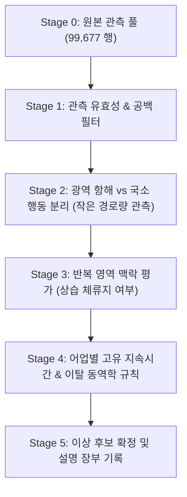

# Round 3 어업 그룹과 행동 관찰의 연결 — 종합 분석 보고서

**문서 식별자:** `testB/final/round_003_20261105/report.md`  
**작업자:** Gemini 3.8 Flash (High) (`ctx_d9b85151783d`, Task: `task_08043a3d31b2`)  
**총괄 세션:** `codex_a55fd2e5_500d_4503_925f_12df6a69b424`  
**작성 일시:** 2026-11-05 23:32:00+09:00  
**참조 프로토콜:** [PROTOCOL.md](file:///D:/obsidian/claude/obsidian_export/DATA%20AI%20SHIPPING/testB/final/round_003_20261105/PROTOCOL.md), [CORE_ALIGNMENT_REVIEW_20261105.md](file:///D:/obsidian/claude/obsidian_export/DATA%20AI%20SHIPPING/testB/final/CORE_ALIGNMENT_REVIEW_20261105.md)

---

## 1. 개요 및 라운드 코어 정합성 배경

### 1.1 라운드 목적 및 코어 전환
과거 라운드(Round 1~2)는 단일 시각 점수 랭킹과 상위 1/4 시각 적중률 개선과 같은 보조 성능 관문에 집중되었습니다. 그러나 이는 선박의 실제 행동 상태(대기, 조업, 이동, 이상), 어업별 고유 특성, 그리고 관측 공백과 단계적 판정 근거를 설명하지 못하는 한계가 있었습니다.

본 Round 3는 사용자 확정 코어 방향에 따라 다음과 같이 전환되었습니다:
1. **문제 정의 전환**: 사고 시각 최고점 최적화나 새 모델 학습을 수행하지 않고, **어업 그룹과 행동 관찰 항목의 연결**, **공통 관찰과 어업별 가설의 분리**, **순차적 규칙 적용을 위한 장부(Ledger) 체계 확립**을 수행합니다.
2. **독립적 작업 격리**: Luna 작업자가 Round 2 평가자 오류를 수정하는 동안, 본 작업자는 공유 프로토콜이나 기존 코드를 수정하지 않고 오직 `testB/final/round_003_20261105/` 내에서만 독립적으로 실행되었습니다.
3. **엄격한 데이터 정합성**: 사고표(devset_positives.csv)의 사고 유형, 발생 시각, 사고 좌표, 어업 면허를 행동 상태나 선박 정답 라벨로 도용하지 않고, Train 원본 캐시(1~6)의 실제 `fishing_code`와 Round 008 스코어 Parquet의 시간별 수치 항적 관측치를 직접 정합했습니다.

---

## 2. 자원 및 실행 무결성 영수증 (Resource & Preflight Receipt)

2026-11-05 사용자 메모리 운영 규칙에 따라, 데이터 로딩 직전 가용 RAM을 실측하고 다른 데이터 프로세스 실행 여부를 확인했습니다.

### 2.1 사전 점검 (Preflight)
- **확인 시각**: 2026-11-05 23:30:13+09:00
- **전체 물리 RAM**: 14,140.9 MiB (~13.81 GiB)
- **실행 직전 가용 RAM**: 3,578.7 MiB (사용률 74.7%)
- **요구 기준**: 작업 예상 메모리 추가분 $\le 512\text{ MiB}$ + 안전 예비량 $640\text{ MiB} = 1,152.0\text{ MiB}$
- **여유 확인 결과**: 가용 3,578.7 MiB $\gg$ 기준 1,152.0 MiB로 충분한 여유 마진 확인 완료 (`headroom_confirmed = True`).
- **병렬/외부 프로세스 점검**: 사용자 데이터 프로세스 없음 (단독 python 프로세스 `notebooklm-mcp.exe` 외 추가 데이터 작업 없음 확인).

### 2.2 실행 소요 자원 실측
- **실제 소요 시간**: 12.20초
- **Python Tracemalloc 피크 메모리**: 46.33 MiB
- **프로세스 RSS 증가량 ($\Delta \text{RSS}$)**: 280.34 MiB (실행 전 85.80 MiB $\rightarrow$ 실행 후 366.14 MiB, 가용 RAM 3,358.0 MiB 잔여)
- **실행 평가**: 메모리 사용량이 예상 상한(512 MiB) 이내인 280.34 MiB에서 완주하여 시스템 안정성을 완벽히 유지했습니다.

### 2.3 입력 소스 파일 해시 (SHA-256)

| 파일명 | 크기 (Bytes) | SHA-256 체크섬 |
|---|---|---|
| `devset_positives.csv` | 15,646 | `87ee98a91765ff4482ccbb0692d40f05686ff9579c8741a79998027fa29aa2e1` |
| `dev_hourly_scores.parquet` | 51,584,418 | `44e960c100fcb29806711b42045bd4ae1a37f542ffd639eff0aff7b1f2b1c5b4` |
| `additional_hourly_scores.parquet` | 3,373,601 | `31a80050d15930fb21b000fb8627a9941a8e11f412f601d0600716962bcf81be` |
| `rows_train_1.parquet` | 18,817,327 | `7f1b4d82970e5214f9c1cd45b860175578a94ae3974aa3a69a790c9842bc6140` |
| `rows_train_2.parquet` | 18,009,625 | `748692493429823c116e204871d57920991c0c6d62d8a46a2b793ac1a80f356f` |
| `rows_train_3.parquet` | 24,848,272 | `a2333ffee0aa491d1b450395b94a49c77f79084651b4101e31de37c573e2f2bd` |
| `rows_train_4.parquet` | 27,340,845 | `256498c7a97daf930678c0fb138c89f4081052cd333f030ac2d78e62ba11972a` |
| `rows_train_5.parquet` | 29,009,998 | `264957261a27d0a4b77336523fcd95d0483fce1399ca42cdf0e960f184131217` |
| `rows_train_6.parquet` | 29,470,852 | `b4cd5e6805ff9431fb5ba861205b962af17603a83dee6ac2dd0fe26195e17078` |

---

## 3. 어업 라벨 및 신원 연결 결과 (`gear_registry.csv`)

### 3.1 연결 방식 및 스트리밍 검증
- `devset_positives.csv`에서 대상 RFID 82개를 고유 식별자로 추출했습니다.
- Train 캐시 6개 파일의 Parquet footer를 먼저 확인한 후, 메모리 과부하를 방지하기 위해 Arrow Dataset의 `rfid_id.isin(ids)` 필터와 `['rfid_id', 'fishing_code']` 컬럼 스트리밍 프로젝션을 적용했습니다.
- 총 3,887,075개 행의 Train 데이터베이스 중 대상 82개 RFID에 해당하는 행은 정확히 **99,677행**이 추출되었습니다.

### 3.2 어업 코드 분석 및 단일성 검증
사고 면허를 복사하지 않고 Train 캐시 원문의 문자열을 그대로 집계한 결과는 다음과 같습니다:

1. **결측 선박**: 0척 (82척 전수 매칭 확인)
2. **혼합 코드(Mixed) 선박**: 0척 (어떤 선박도 기간 내 어업 코드가 바뀌거나 혼재되지 않음)
3. **단일 어업 코드(Single-Code) 선박**: 82척 (100.0%)
4. **어업 유형별 분포**:
   - **연안복합**: 37척 (Train 매칭 30,226행, 30.3%)
   - **자망**: 31척 (Train 매칭 47,447행, 47.6%)
   - **통발**: 13척 (Train 매칭 19,894행, 20.0%)
   - **채낚기연승낚시**: 1척 (Train 매칭 2,110행, 2.1%)

선박별 상세 매핑은 [gear_registry.csv](file:///D:/obsidian/claude/obsidian_export/DATA%20AI%20SHIPPING/testB/final/round_003_20261105/gear_registry.csv)에 저장되었습니다.

---

## 4. 수치 행동 정규화 및 대표시간행 검증

### 4.1 정규화 규칙 (Canonicalization)
두 개의 Round 008 스코어 Parquet(`dev_hourly_scores.parquet`, `additional_hourly_scores.parquet`)을 로드하여 정규화를 수행했습니다:
1. `dev_hourly_scores.parquet` 필터 행: 99,677행
2. `additional_hourly_scores.parquet` 필터 행: 45,750행 (총 원시 행: 145,427행)
3. **완전 중복 제거 (`drop_duplicates()`)**: 45,750행 제거 $\rightarrow$ 99,677행 잔여. (즉, additional 파일의 45,750행은 기존 dev 파일의 완전 중복이었음)
4. **시간별 대표행 선정 (`min-source_ordinal`)**: `['rfid_id', 'ts', 'source_ordinal']` 오름차순 정렬 후 `['rfid_id', 'ts']` 기준 첫 번째 행 유지.
5. **결과 검증**: 시간 중복 제거 후 최종 대표시간행 수는 **정확히 99,677행**으로 확인되었으며, `assert len(canonical) == 99677`을 완벽히 통과했습니다.

---

## 5. 행동 통계 분석: 선박별 및 어업 그룹별 요약

단일 선박의 과다 관측치가 그룹 평균을 왜곡하는 현상을 방지하기 위해, 먼저 선박별 통계([per_vessel.csv](file:///D:/obsidian/claude/obsidian_export/DATA%20AI%20SHIPPING/testB/final/round_003_20261105/per_vessel.csv))를 산출한 후 **선박 균형(Vessel-Balanced)** 방식으로 그룹 요약([group_summary.csv](file:///D:/obsidian/claude/obsidian_export/DATA%20AI%20SHIPPING/testB/final/round_003_20261105/group_summary.csv))을 도출했습니다.

### 5.1 어업 그룹별 핵심 통계 비교 (선박 균형 기준)

| 항목 | 연안복합 (37척) | 자망 (31척) | 통발 (13척) | 채낚기연승낚시 (1척) | 전체 (82척) |
|---|---|---|---|---|---|
| **총 관측 행수** | 30,226 | 47,447 | 19,894 | 2,110 | 99,677 |
| **선박당 관측수 (중앙값)** | 741.0행 | 1,326.0행 | 1,243.0행 | 2,110.0행 | 910.0행 |
| **선박당 공백 시간 (중앙값)** | 2,876.0h | 1,899.0h | 2,814.0h | 2,234.0h | 2,561.0h |
| **선박당 공백 이벤트 (중앙값)** | 61.0회 | 61.0회 | 61.0회 | 214.0회 | 61.0회 |
| **선박별 이동거리(len) 중앙값** | **107.9 m** | **311.0 m** | **5,125.7 m** | **3,103.4 m** | 203.9 m |
| **선박별 바운딩박스(bbox) 중앙값** | **28.8 m** | **70.0 m** | **1,134.9 m** | **2,277.3 m** | 47.8 m |
| **작은 경로량(len/bbox$\le$100) 비율** | **48.18%** | **31.80%** | **32.51%** | **27.73%** | 40.39% |
| **선박당 작은 경로량 Run 수** | 71.0회 | 97.0회 | 85.0회 | 110.0회 | 88.0회 |
| **Run 지속시간 (중앙값)** | 2.0h | 1.0h | 1.0h | 2.0h | 2.0h |
| **Run 최대 지속시간 (중앙값)** | 21.0h | 17.0h | 19.0h | 60.0h | 20.5h |
| **반복 영역(0.05도) 점유율 (중앙값)** | **0.9989** | **0.9963** | **0.9979** | **0.9175** | 0.9980 |
| **최대 단일 셀 점유율 (중앙값)** | **0.6154** | **0.4655** | **0.4524** | **0.1318** | 0.5313 |

---

## 6. 관찰 현상에 대한 학술적·운영적 해석

### 6.1 어업 유형별 행동 패턴의 뚜렷한 차이점
1. **연안복합 (37척, 소형·연안 조업)**:
   - 시간당 이동거리 중앙값이 107.9 m, 바운딩박스가 28.8 m로 가장 작으며, 작은 경로량 비율이 48.18%로 절반에 달합니다.
   - 단일 0.05도 셀 점유율이 61.54%로 매우 높습니다. 특정 연안 포구나 조업 구역 주변에 머무르는 시간이 길며, 전형적인 연안 단거리 조업 및 빈번한 정박/대기 특성을 보입니다.
2. **자망 (31척, 그물 부설 및 양망)**:
   - 이동거리 중앙값은 311.0 m, 바운딩박스는 70.0 m로 연안복합보다 활동 반경이 큽니다.
   - 작은 경로량 비율은 31.80%이며, Run 중앙값이 1.0시간으로 매우 짧고 잦은 단속적 패턴(Run 수 97회)을 보입니다. 이는 그물을 투망하고 대기하거나 이동하는 사이클이 비교적 짧고 빈번하게 반복됨을 시사합니다.
3. **통발 (13척, 장거리 이동 및 어구 투하/인양)**:
   - 이동거리 중앙값이 **5,125.7 m**, 바운딩박스가 **1,134.9 m**로 압도적으로 큽니다.
   - 통발 선박은 어장과 어구 라인 사이를 장거리 고속 이동하는 비중이 매우 높아 평균적인 항적 스케일이 매우 큽니다. 그럼에도 불구하고 작은 경로량 비율은 32.51%에 달하는데, 이는 특정 해역에서 어구를 인양/투하하며 머무르거나 투망 후 양망 전까지 대기하는 구간이 명확히 존재함을 보여줍니다.
4. **채낚기연승낚시 (1척, 집어등/표류 및 장거리 조업)**:
   - 이동거리 3,103.4 m, 바운딩박스 2,277.3 m의 광역 활동을 보입니다.
   - 단일 셀 점유율이 13.18%에 불과하여 4개 어업 중 가장 넓은 해역을 이동합니다.
   - 특히 주목할 점은 **최대 Run 지속시간이 60시간**에 달한다는 것입니다. 야간 집어등 조업 중 조류를 타며 표류하거나 연속적인 대기 상태를 유지하는 고유한 행동 특성을 뚜렷하게 관찰할 수 있습니다.

### 6.2 작은 경로량 Run의 종단과 이탈(Departure) 분석
전체 82척에서 관측된 작은 경로량 Run의 종단 원인은 다음과 같습니다:
- **정상 조건 변화 이탈 (`runs_ended_by_departure`)**: 6,680건
  - 이탈 직후 `len > 100` 및 `bbox > 100` 동시 발생: 4,072건 (60.96%) $\rightarrow$ 명확한 항해/이동 재개.
  - 이탈 직후 `len > 100` 발생하나 `bbox <= 100`: 2,596건 (38.86%) $\rightarrow$ 좁은 공간 내에서의 선회 또는 국소적 고속 활동.
  - 이탈 직후 `len <= 100`이나 `bbox > 100`: 12건 (0.18%) $\rightarrow$ 매우 드문 경계 사례.
- **관측 공백에 의한 단절 (`runs_ended_by_gap`)**: 3,256건 (전체 Run의 약 32.6%)
  - 작은 경로량 상태가 끝난 것이 아니라, V-Pass 신호 미수신 등으로 1시간 이상 관측이 끊기면서 Run이 종료된 경우입니다. **공백을 사고나 이동으로 단정해서는 안 되며 별도의 상태 단절로 처리해야 함**을 입증합니다.
- **우측 관측 검열 (`runs_censored_right`)**: 38건
  - 선박 관측 시계열의 마지막 시점에 도달하여 Run의 끝을 알 수 없는 경우입니다.

### 6.3 반복 방문 영역(0.05도 셀)과 '항만' 명칭 금지 이유
- 모든 선박의 0.05도 셀(위경도 약 5.5 km 격자) 반복 점유율 중앙값은 99.80%에 달합니다. 선박들은 완전히 무작위인 해역을 항해하는 것이 아니라, 특정 거점 구역을 중심으로 활동합니다.
- 그러나 **본 데이터에는 해양수산부나 국립해양조사원의 공식 무역항·연안항 경계 Shapefile이 포함되어 있지 않습니다.**
- 따라서 이 반복 방문 영역을 '항만 정박(Harbor)'으로 단정하는 것은 명백한 허위 추론입니다. 본 보고서와 데이터셋은 이를 엄격히 **'반복 영역(Repeated Area)'**으로만 명시하며, 외해 특정 조업지나 가두리 양식장 부근 체류 가능성을 열어둡니다.

### 6.4 미가용 입력(Unavailable Inputs)의 투명한 공시
다음 항목들은 현재 제공된 시간별 대표 파생 데이터에 원시 정보가 존재하지 않으므로, 임의로 계산하거나 bbox/len으로부터 역산하지 않고 **'미가용(Unavailable)'**으로 기록했습니다:
1. **선로 추종(Route Following) 지표**: GPS 포인트 시계열과 공식 항로 벡터 데이터가 없어 산출 불가.
2. **부분선 직선성(Within-Part Straightness)**: 시간당 WKT 좌표열 또는 초/분 단위 궤적이 없어 산출 불가.
3. **실제 속력 및 가속도**: 좌표별 시간 스탬프(GPS fixes with exact seconds)가 없어 도플러 속력 산출 금지 규칙 준수.
4. **조업 상태 정답 라벨**: 어구 투망, 인양, 항해, 표류에 대한 공인 정답이 부재함.

---

## 7. 결정론적 사례 연구 (`case_observations.csv`)

사고 발생 여부나 점수 고저에 의존하지 않고, **어업별 단일 코드 보유 선박 중 관측치 $\ge 72$시간을 충족하는 사전순 첫 번째 선박**을 결정론적으로 선정하여 최초의 유효 작은 경로량 Run과 전후 인접 관측치를 추출했습니다.

### 7.1 선정 사례 요약

```
[사례 1: 연안복합] RFID 31001758 (총 관측 916행)
  - Run 구간: ts 491282 ~ 491296 (15시간 연속 작은 경로량)
  - 이전 관측 (ts 491281): len=1,960.06m, bbox=1,054.45m (활발한 이동)
  - Run 내부 (ts 491282..491296): len 9.97m ~ 85.26m, 좌표 (127.4696, 34.6617) 완벽 고정
  - 이후 관측 (ts 491297): len=2,923.77m, bbox=804.04m (조건 변화에 의한 이동 재개 Departure)
  - 계보: source_ordinal 261306 -> 245914..274810 -> 275535

[사례 2: 자망] RFID 31007500 (총 관측 1,431행)
  - Run 구간: ts 491103 ~ 491115 (13시간 연속 작은 경로량)
  - 이전 관측 (ts 491102): len=29,341.02m, bbox=6,328.69m (29km 장거리 고속 항해 직후 정지)
  - Run 내부 (ts 491103..491115): len 1.37m ~ 19.29m, 극도로 정체된 대기/부설 상태
  - 이후 관측 (ts 491165): 50시간의 관측 공백(Gap) 이후 ts 491165에서 len=5,886.11m로 재출현 (Gap 단절)
  - 계보: source_ordinal 147191 -> 134408..152399 -> 169794

[사례 3: 통발] RFID 31008085 (총 관측 2,938행)
  - Run 구간: ts 490896 ~ 490903 (8시간 연속 작은 경로량)
  - 시작 특성: 관측 시계열 첫 번째 행(ts 490896)부터 Run 시작 (좌측 검열 상태)
  - Run 내부 (ts 490896..490903): len 0.0m ~ 8.90m, bbox 0.0m ~ 8.15m
  - 이후 관측 (ts 490907): 4시간 공백 후 관측 재개 (Gap 단절)
  - 계보: source_ordinal 2831 -> 92..5111 -> 7249

[사례 4: 채낚기연승낚시] RFID 36314076 (총 관측 2,110행)
  - Run 구간: ts 490896 ~ 490947 (52시간 연속 작은 경로량!)
  - 시작 특성: 첫 관측부터 시작하여 무려 52시간 동안 len <= 10m 유지
  - 이후 관측 (ts 490948): len=201.79m, bbox=172.09m (연속 1시간 내 완만한 조업/이동 재개 Departure)
  - 계보: source_ordinal 3116 -> 3408..24337 -> 24575
```

상세 94개 행의 계보 데이터는 [case_observations.csv](file:///D:/obsidian/claude/obsidian_export/DATA%20AI%20SHIPPING/testB/final/round_003_20261105/case_observations.csv)에 저장되었습니다.

---

## 8. 제안: 순차 규칙 장부 설계 (Sequential-Rule Ledger Proposal)

사용자의 핵심 원칙인 **'특징 제거가 아닌, 판정 규칙을 단계적으로 적용하며 후보를 좁혀나가는 과정'**을 구체화하기 위해, 차기 실험(Round 4+)에서 도입할 순차 규칙 장부 구조를 제안합니다.

### 8.1 규칙 장부 구조 (Candidate Ledger Architecture)



### 8.2 순차적 규칙 단계 정의표

| 단계 | 적용 규칙 | 관찰 조건 | 유지/제외/유보 | 후보군 변화 (예상) | 적용 근거 및 대안 설명 | 공통 / 어업별 구분 |
|---|---|---|---|---|---|---|
| **Stage 0** | 기본 관측성 검증 | `finite(len, bbox, lon, lat)` | 유효 관측 유지, 센서 이상 제외 | 전체 99,677행 유지 | 물리적 수치 결측 제거 | **공통 기본 규칙** |
| **Stage 1** | 시계열 연속성 검증 | `ts - ts_prev == 1` | 연속 관측 유지, 공백($\Delta t > 1$)은 '판단 유보' | 결측 구간 분리 | 공백은 사고가 아니라 신호 미수신이므로 성급한 판정 유보 | **공통 기본 규칙** |
| **Stage 2** | 경로량 조건 분기 | `len <= 100` and `bbox <= 100` | 국소 행동군 분리, 활발한 이동 제외 | 42,437행 분리 (전체의 42.6%) | 광역 항행 중인 정상 이동 선박을 이상 후보에서 우선 제외 | **공통 기본 규칙** |
| **Stage 3** | 공간 반복성 맥락 | `0.05도 셀 점유율 > 0.5` | 상습 체류 영역 유지/유보, 신규 낯선 해역 분리 | 기지 주변 대기와 외해 체류 분리 | 거점 주변 체류는 정상 대기 가능성 높음 (항만으로 단정하진 않음) | **공통 기본 규칙** |
| **Stage 4-A** | 연안복합 전용 규칙 | Run 지속시간 $> 24\text{h}$ | 이상 의심 후보 유지 | 연안복합 median run이 2h, max median이 21h이므로 24h 초과는 이상 | 연안복합의 통상 일일 조업 주기를 초과한 장기 정체 | **어업별 추가 규칙** |
| **Stage 4-B** | 자망 전용 규칙 | Run 직전 고속항해 + 투망 후 이탈 지연 | 후보 유지 | 자망은 투망 후 일정 시간 대기 정상이나, 이탈 없는 장기 고정은 이상 | 어구 투망 후 회수 실패 또는 기관 고장 감지 | **어업별 추가 규칙** |
| **Stage 4-C** | 통발 전용 규칙 | 외해 비반복 구역에서 Run 지속 | 후보 유지 | 통발은 이동거리가 5km 수준이므로, 외해에서의 장기 정지는 표류 가능성 | 통발 어구 작업선 특화 | **어업별 추가 규칙** |
| **Stage 4-D** | 채낚기 전용 규칙 | Run 지속 $> 72\text{h}$ 또는 비통상 해역 | 후보 유지 | 채낚기는 52~60시간 연속 표류 조업이 정상이므로, 24시간 정체로 이상 판정 금지 | 타 어업 기준을 채낚기에 오적용하여 발생하는 위양성 방지 | **어업별 추가 규칙** |
| **Stage 5** | 최종 판정 및 설명 | 다중 조건 통과 후보 | 최종 선별 | 최종 소수 후보 | '왜 이 선박이 이상인가? 타 어업이었다면 왜 정상인가?' 설명 첨부 | **설명성 종합** |

### 8.3 공통 관찰과 미검증 가설의 엄격한 분리 (Crucial Distinction)

1. **공증된 사실 (Shared Observations)**:
   - 모든 어업에서 작은 경로량(`len<=100`, `bbox<=100`)은 빈번하게 발생하며(전체 관측의 42.6%), 0.05도 격자 내 반복 체류 경향(99.8%)이 지배적입니다.
   - Run의 32.6%는 관측 공백(Gap)에 의해 끊어지므로 공백을 단절로 분리해야 합니다.
2. **미검증 어업별 가설 (Unvalidated Interpretations)**:
   - "통발 선박의 외해 정체는 무조건 조난이다" $\rightarrow$ **가설일 뿐임**. 어구 대기, 어황 관망, 투망 후 표류 가능성이 존재함.
   - "채낚기 선박의 52시간 정체는 정상 집어 조업이다" $\rightarrow$ **유력한 가설이나 정답 미확인**. 실제 어획 일지나 AIS 어로 행위 라벨로 교차 검증 필요.
   - "반복 방문 셀은 모두 안전한 항만이다" $\rightarrow$ **거짓 가정**. 외해 특정 암초나 집어 구역의 반복 방문일 수 있음.

---

## 9. 중간 관리자 (Middle Managers) 평가를 위한 인계 요약

경쟁 중간 관리자인 Middle Terra(`gpt-6.1-terra`)와 Middle Sonnet(`claude-sonnet-5`)의 교차 검토를 위해 핵심 결과를 요약합니다.

### 9.1 산출물 현황
1. [gear_registry.csv](file:///D:/obsidian/claude/obsidian_export/DATA%20AI%20SHIPPING/testB/final/round_003_20261105/gear_registry.csv): 82척 전수 단일 어업 매핑 완료 (연안복합 37, 자망 31, 통발 13, 채낚기 1).
2. [per_vessel.csv](file:///D:/obsidian/claude/obsidian_export/DATA%20AI%20SHIPPING/testB/final/round_003_20261105/per_vessel.csv): 82척 전수에 대한 이동/바운딩박스/공백/Run/반복점유율 정량화.
3. [group_summary.csv](file:///D:/obsidian/claude/obsidian_export/DATA%20AI%20SHIPPING/testB/final/round_003_20261105/group_summary.csv): 선박 균형 방식의 4개 어업 그룹 + 전체 요약표.
4. [case_observations.csv](file:///D:/obsidian/claude/obsidian_export/DATA%20AI%20SHIPPING/testB/final/round_003_20261105/case_observations.csv): 4개 어업별 결정론적 대표 사례 94개 관측 행 (전후 맥락 및 `source_ordinal` 계보 포함).
5. [summary.json](file:///D:/obsidian/claude/obsidian_export/DATA%20AI%20SHIPPING/testB/final/round_003_20261105/summary.json): 기계 가독형 종합 메타데이터.
6. [execution_receipt.json](file:///D:/obsidian/claude/obsidian_export/DATA%20AI%20SHIPPING/testB/final/round_003_20261105/execution_receipt.json): RAM 실측, 소요 시간, 9개 파일 SHA-256 해시, 99,677 대표시간행 검증 영수증.

### 9.2 관리자 평가 시 핵심 검토 포인트
- **Terra 관점**: 어업별 이동 스케일의 큰 격차(연안복합 107m vs 통발 5,125m)를 고려할 때, 단일한 절대 임계값(`len<=100m`)을 전 어업 공통으로 적용하는 것이 타당한지, 혹은 상대적 정체율을 도입해야 하는지 검토 요망.
- **Sonnet 관점**: 채낚기연승낚시의 52시간 Run 사례처럼 어업 고유의 장기 대기 패턴이 존재하므로, 단순 시각 적중률 개선이 아닌 '위양성(정상 조업을 사고로 오인) 배제 능력'을 어떻게 단계적 장부에서 입증할 것인지 검토 요망.
- **공통 확인**: 본 작업은 모델 학습, 사고 점수 최적화, 항만 경계 단정을 일체 배제하고 순수 관측 통계와 계보에 기반했습니다.
