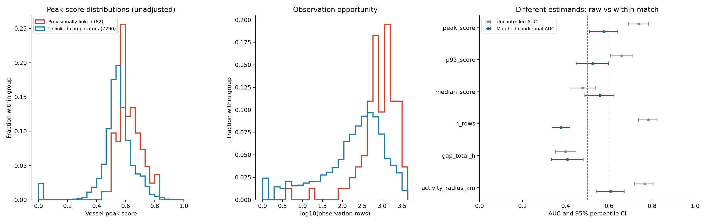

# ROUND019 — Test B 선박 단위 사고 판정력 실측

**최고 이상점수의 선박 판정력은 입증하지 못했다. 잠정 연결과의 관측 수 통제 후 연관 기준을 통과한 후보: 부분선 중심점 반경(km). 확정 사고 판정력이나 외부 검증 완료를 뜻하지 않는다.**

최고점의 관측 수 통제 후 조건부 AUC는 **0.5756**, 95% CI **[0.5098, 0.6415]**다. 최고점 판정: **판정력 입증 못함**. 이 결과는 2026 자료의 실제 계산 결과지만, 라벨은 **잠정 사고 연결**이고 비교군은 **미연결**이다. 실제 사고 여부의 확정 정답과 정상 선박 표본을 확보한 검증으로 해석할 수 없다.

## 평가 범위와 사전 고정

3,887,065행, 7,372척의 2026년 1–6월 보관 기하 요약을 사용했다. 제공된 100사건의 연결 목록은 82개 RFID로 줄어들며, 비교군은 7,290척이다. 이 평가 집단의 연결 비율은 1.112%로, 요청된 p=2.27% 시나리오와 다르다. 167행은 고유 사고 선박 수가 아니므로 167/7,372를 실제 선단 사고율 실측치로 사용하지 않았다.

[분석 계획](PROTOCOL.md)을 2026-11-06 14:22:23 KST에 고정했다. 최고점·점수 95분위·중앙값·관측 행 수·내부 공백 총량·부분선 중심점 활동 반경을 사전 지정했으며, 방향은 모두 큰 값→잠정 연결로 고정했다. 결과를 보고 방향·후보·매칭 범위·채택 기준을 바꾸지 않았다. 관측 행 수는 편향 진단 전용이다. 신규 학습이나 점수함수 변경은 없으며, 보관된 2026 기준자료를 사용하는 사후 분석이다. 독립 검증 집단이나 당시 가용 정보만 사용하는 실시간 성능이 아니다.

## 최고점 분포와 관측 수 통제 전후

| 집단 | 척수 | 평균 | 25분위 | 중앙값 | 75분위 | 95분위 |
| --- | --- | --- | --- | --- | --- | --- |
| 잠정 사고 연결 | 82 | 0.6254 | 0.5773 | 0.6117 | 0.6832 | 0.7720 |
| 미연결 비교군 | 7290 | 0.5422 | 0.5005 | 0.5459 | 0.5989 | 0.7242 |

| 지표 | 교란 미통제 AUC [95% CI] | MW 단측 p | 관측 수 매칭 내 AUC [95% CI] | 통제 Holm p | 판정 |
| --- | --- | --- | --- | --- | --- |
| 최고점 | 0.7389 [0.6902, 0.7842] | 4.617e-14 | 0.5756 [0.5098, 0.6415] | 0.0988 | 판정력 입증 못함 |
| 점수 95분위 | 0.6597 [0.6070, 0.7106] | 3.172e-07 | 0.5244 [0.4488, 0.5976] | 0.5386 | 판정 불가 |
| 점수 중앙값 | 0.4790 [0.4195, 0.5384] | 0.7433 | 0.5585 [0.4878, 0.6245] | 0.1947 | 판정력 입증 못함 |
| 관측 행 수(진단) | 0.7831 [0.7368, 0.8235] | 5.204e-19 | 0.3780 [0.3366, 0.4195] | 진단 제외 | 관측 편향 진단 전용; 판정 후보 제외 |
| 내부 관측 공백(h) | 0.3994 [0.3518, 0.4472] | 0.9991 | 0.4073 [0.3341, 0.4805] | 0.9923 | 판정력 입증 못함 |
| 부분선 중심점 반경(km) | 0.7660 [0.7198, 0.8085] | 5.338e-17 | 0.6073 [0.5415, 0.6707] | 0.0165 | 잠정 연결과의 조건부 연관 기준 통과 |

미통제 AUC는 **교란 미통제**이며 그 값만으로 판정력을 주장하지 않는다. 일반 AUC는 Mann–Whitney U/(양성 수×비교군 수), 동점 0.5이며 단측 greater 점근 검정을 사용했다. CI는 두 집단 선박을 각각 복원추출한 5,000회 percentile 95% 구간이다. 구현 정의는 [SciPy Mann–Whitney 문서](https://docs.scipy.org/doc/scipy/reference/generated/scipy.stats.mannwhitneyu.html)를 따른다.

관측 행 수 비율 1/1.10–1.10 안에서 양성당 최대 5척을 비복원 매칭했다. 82/82척을 매칭해 커버리지는 100.00%, 중복 없는 비교군은 410척이다. 비교군/양성 관측 수 비율은 0.9929–1.0093, 가중 log 관측 수 SMD는 -0.000653다. 점수는 매칭에 사용하지 않았다.

통제 AUC는 각 매칭 집합 내부의 양성–비교군 승률을 양성별 동일 가중치로 평균한 **조건부 AUC**다. 미통제 AUC와 표본·비교 대상을 달리하므로 단순한 보정 전후 동일 추정량으로 취급하지 않는다. CI는 고정 매칭 집합을 복원추출한 5,000회 구간이고, 단측 p는 집합 내 양성 위치 교환 9,999회 Monte Carlo(+1 보정)이다. 근접 매칭의 교환가능성을 가정하는 근사 검정이며 잔여 교란을 모두 제거했다고 주장하지 않는다. 관측 개수만 맞췄으므로 관측 기간·해역·조업 형태·시공간 연결 조건의 차이가 남을 수 있다. 판정 후보 5개의 p에 Holm 보정을 적용했다.

유한 점수 수와 원 관측 행 수가 다른 선박은 0척이다. 양성은 82척뿐이므로 CI 폭과 미검출 가능성을 함께 보아야 한다. AUC가 0.5 근처이면 판정 불가로 기록하며, 그것만으로 모든 가능한 사고 판별 방식의 무효를 입증한 것은 아니다. CI에는 잠정 연결의 오분류, 미연결 집단의 숨은 사고, 매칭 선택의 불확실성이 포함되지 않는다.

채택 기준은 조건부 AUC≥0.60, 95% CI 하한>0.50, Holm p<0.05, 양성 커버리지≥90%, |log 관측 수 SMD|≤0.10의 동시 충족이다. 실제 결과는 위 표에 모두 공개했다. 운영 임계값을 결과에 맞춰 최적화하지 않았다.

## p 가정별 시간 포함 기대 F1

TPR=a, FPR=b, 선택된 양성 선박에서의 시각 적중률 h=.0366을 놓으면 k=100[pa+(1−p)b], q=pa/[pa+(1−p)b], F1=2pah/[p(1+a)+(1−p)b]다. 선박당 1개 예측에서 시각을 틀린 양성은 FP와 FN 모두에 포함하는 계산이다. 아래는 **기대 개수의 비율로 계산한 시나리오**이며 공식 F1 실측이나 100척 표본 F1의 정확한 수학적 기댓값이 아니다.

| p 가정 | 전부 제출, h=.0366 | 전부 제출, h=1(완벽 시각) | 완벽 선별, h=.0366 |
| --- | --- | --- | --- |
| 2.27% | 0.001625 | 0.044392 | .036600 |
| 10% | 0.006655 | 0.181818 | .036600 |
| 50% | 0.024400 | 0.666667 | .036600 |
| 100% | 0.036600 | 1.000000 | .036600 |

사고 선박을 완벽히 골라도 h=.0366이면 F1 상한은 .0366이다. 1.0의 상한은 h=1과 완벽한 선박 선별을 함께 가정할 때만 성립한다.

최고점의 사전 대표 임계값 .75와 기준 통과 후보가 있을 경우 그 후보의 사전 대표 임계값을 표시한다. 기준 미통과 후보의 수치는 민감도 계산일 뿐 채택 권고가 아니다.

| 지표 | 고정 임계값 | 비율의 출처 | p | TPR | FPR | k/100 | q | 기대 개수 기반 F1 |
| --- | --- | --- | --- | --- | --- | --- | --- | --- |
| 최고점 | 0.7500 | 교란 미통제 | 2.27% | 0.0854 | 0.0241 | 2.55 | 0.0759 | 0.002941 |
| 최고점 | 0.7500 | 교란 미통제 | 10% | 0.0854 | 0.0241 | 3.03 | 0.2821 | 0.004797 |
| 최고점 | 0.7500 | 교란 미통제 | 50% | 0.0854 | 0.0241 | 5.48 | 0.7795 | 0.005632 |
| 최고점 | 0.7500 | 교란 미통제 | 100% | 0.0854 | 0.0241 | 8.54 | 1.0000 | 0.005757 |
| 최고점 | 0.7500 | 매칭 분포 가정 | 2.27% | 0.0854 | 0.0780 | 7.82 | 0.0248 | 0.001406 |
| 최고점 | 0.7500 | 매칭 분포 가정 | 10% | 0.0854 | 0.0780 | 7.88 | 0.1084 | 0.003495 |
| 최고점 | 0.7500 | 매칭 분포 가정 | 50% | 0.0854 | 0.0780 | 8.17 | 0.5224 | 0.005371 |
| 최고점 | 0.7500 | 매칭 분포 가정 | 100% | 0.0854 | 0.0780 | 8.54 | 1.0000 | 0.005757 |
| 부분선 중심점 반경(km) | 81.9936 | 교란 미통제 | 2.27% | 0.1463 | 0.0490 | 5.12 | 0.0649 | 0.003291 |
| 부분선 중심점 반경(km) | 81.9936 | 교란 미통제 | 10% | 0.1463 | 0.0490 | 5.87 | 0.2493 | 0.006750 |
| 부분선 중심점 반경(km) | 81.9936 | 교란 미통제 | 50% | 0.1463 | 0.0490 | 9.77 | 0.7493 | 0.008962 |
| 부분선 중심점 반경(km) | 81.9936 | 교란 미통제 | 100% | 0.1463 | 0.0490 | 14.63 | 1.0000 | 0.009345 |
| 부분선 중심점 반경(km) | 81.9936 | 매칭 분포 가정 | 2.27% | 0.1463 | 0.1293 | 12.97 | 0.0256 | 0.001596 |
| 부분선 중심점 반경(km) | 81.9936 | 매칭 분포 가정 | 10% | 0.1463 | 0.1293 | 13.10 | 0.1117 | 0.004638 |
| 부분선 중심점 반경(km) | 81.9936 | 매칭 분포 가정 | 50% | 0.1463 | 0.1293 | 13.78 | 0.5310 | 0.008398 |
| 부분선 중심점 반경(km) | 81.9936 | 매칭 분포 가정 | 100% | 0.1463 | 0.1293 | 14.63 | 1.0000 | 0.009345 |

**부분선 중심점 반경(km)의 사전 대표 임계값에서는 매칭 분포를 가정한 기대 F1이 네 p 시나리오 모두 전부 제출 기준보다 낮았다.** AUC 연관 기준 통과를 제출 F1 개선으로 해석할 수 없다. 다른 고정 임계값도 CSV에 공개했으나 결과를 보고 최적 임계값을 채택하지 않았다.

여기서 TPR/FPR은 잠정 연결군/미연결군의 선택률을 관례적으로 표기한 것이며 확정 사고 재현율·실제 오경보율이 아니다. 매칭 FPR은 양성의 관측 수 분포에 맞춘 값으로 전체 선단 FPR가 아니다. 미통제 수치는 관측량 교란을 포함한다. 두 종류 모두 p만 바꿔 적용하려면 조건부 점수 분포와 **선택된 양성에서의 h**가 유지된다는 미검증 가정이 필요하다. h=.0366은 사용자가 제공한 기준값으로 이번 라운드에서 재측정한 시각 적중률이 아니다. 후보마다 모든 고정 임계값·p 시나리오는 [threshold_sweep.csv](execution_001/threshold_sweep.csv), [expected_f1.csv](execution_001/expected_f1.csv)에 있다.

## 실행·검증 근거와 해석 한계

- 6개 입력의 ts가 2026년 1–6월 범위 안에 있음을 검사했다. 각 선박의 전체 이력을 정렬해 `frozen_baseline.py`를 그대로 호출했다. 부분선을 연결하거나 중심점 차이를 속력으로 변환하지 않았다.
- [점수화 메타데이터](execution_001/score_metadata.json): 완료 상태 complete, 처리 3,887,065행/7,372척, 선박 오류 0건. [전후 해시](execution_001/source_checksums_after.json)에서 입력·기준자료·고정 함수 불변 여부를 확인했다.
- 점수화 시작·진행·RAM 검사와 실제 실행 시간은 [로그](execution_001/score_progress.jsonl)에 있다. 첫 실행 직전 가용 RAM은 4,050.70MiB(약 3.96GiB)였다. 순차 실행 중 관측 RSS 약 308MiB와 실제 입력 동일성 검사의 peak 355.12MiB를 근거로, 추가 RAM 확인 뒤 4개 파티션 작업으로 전환했다. 병렬 실행 직전 가용 3,490.79MiB, 추정 parent 512MiB+worker 4×512MiB+여유 640MiB=3,200MiB 조건을 통과했다. [전환 기록](execution_001/parallel_migration.json)을 보존했다. 512MiB는 강제 상한이 아닌 추정치이고, 각 작업은 기존의 더 보수적인 1GiB 기준 단계별 메모리 검사도 수행했다. 작업별 관측 peak의 합은 1113.71MiB이며, 이 합을 동시점 실측 메모리로 부르지 않는다. 병렬 구간 경과 시간은 875.0초다. 전체 적재 대신 청크/파티션을 사용했고 점수 정의는 동일하다.
- 평가 직전 가용 RAM 3801.8MiB를 확인했다. 평가 입력·계획·코드·잠정 연결 목록 전후 해시 일치는 True다. 보고서 렌더링 전 메모리는 [별도 기록](execution_001/report_memory.json)에 있다.
- 합성 코드 검증과 실제 선단 계산은 구분한다. 합성 점수화 검증 5개와 통계 검증 10개를 통과했다. 검증은 파티션 점수 동등성·동점·공백·결측·재개와 AUC·매칭·순열·Holm·F1 경계 사례 및 점수 CSV 변조 거부를 다룬다. 실제 결과의 AUC·매칭·F1·해시는 [별도 검산 코드](audit_verify.py)와 [검산 결과](execution_001/audit_verification.json), 검토 범위는 [독립 감사](AUDIT.md)에 기록한다. 실제 장치 실험은 하지 않았다.
- 허용된 2026 RFID 묶음 및 이미 제공된 잠정 연결 목록의 소속 여부만 사용했다. 다른 자료의 동일 선박 재식별·ID 조인·2025 테스트 적합·외부 수집은 수행하지 않았다.
- 공백은 첫·마지막 관측 사이의 미관측 시간 합계이며 통신 장애나 사고 기간 정답이 아니다. 활동 반경은 부분선 중심점의 공간 분포이며 실제 항해거리·GPS·침로·속력이 아니다. 실시간 판정 능력·확정 사고 정밀도·공식 F1은 이 결과만으로 산출할 수 없다.

## 학습 관점

기술 목표는 전체 선단의 고정 점수를 계산하고 같은 선박 단위에서 분포·불확실성·관측량 교란을 비교하는 것이다. 학습 목표는 ‘이상점수가 높다’와 ‘사고가 있었다’를 구별하는 것이다. 결과를 설명할 때에는 관측이 많은 선박이 최대값에서 유리한 이유, 매칭 조건부 AUC가 실제 선단 정밀도와 다른 이유, 시간 적중률이 F1 상한을 제한하는 이유를 답할 수 있어야 한다. 이번 결과를 넘어 새 모델·학습·운영 시스템을 자동으로 완성하지 않았다.

원시 지표 [vessel_peaks.csv](execution_001/vessel_peaks.csv), 라벨 포함 평가표 [evaluation_vessels.csv](execution_001/evaluation_vessels.csv), [summary.json](execution_001/summary.json), [매칭 명세](execution_001/matched_sets.csv)가 재검산 근거다.
