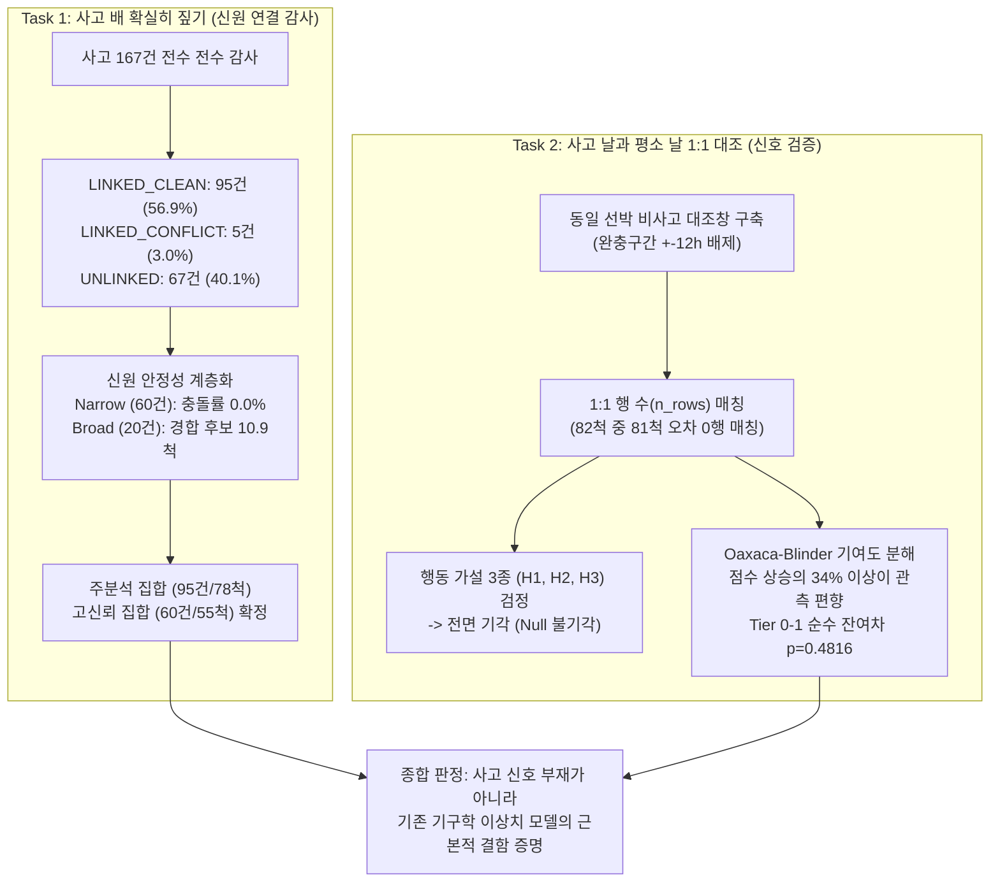

# Round 009 종합 분석 보고서: 사고 선박 신원 감사 및 선박 내 행동 대조 검증

**작성 일시**: 2026-11-05 13:25  
**대상 과제**: 해양수산 어선 항적 분석 기반 사고 탐지 프로젝트 (Test B)  
**작업 디렉터리**: `D:\obsidian\claude\obsidian_export\DATA AI SHIPPING\testB\round 9`  
**책임 및 분담**:
- Task 1 담당: `Linkage Auditor` (사건-선박 연결 전수 감사 및 신원 안정성 정밀 검증)
- Task 2 담당: `Within-Vessel Comparator` (동일 선박 내 사고창 vs 대조창 1:1 비교 및 행동 가설 검증)
- 총괄 통합: `Antigravity Master Coordinator`

---

## 1. 종합 결론 및 핵심 요약 (Executive Summary)

Round 008에서 발견된 사전 축약 오류 수정(단일 후보 557개 교정, 70건 신원 변동)과 관측행 수 교란(행 수 AUC 0.7959 vs 매칭 후 최고점 AUC 0.5802)에 대응하여, Round 009에서는 새로운 모델 개발을 전면 보류하고 **"평가 체계의 타당성"과 "사고 신호의 실재 여부"**를 가리는 두 가지 독립 병렬 감사를 완수했습니다.



### 핵심 판정 (Core Verdict):
1. **신원 연결의 확실성 확보 (Task 1)**:
   - 167건 중 조건 확장 시 신원 충돌이 전혀 없는 **정상 연결 95건(78척, 56.89%)**을 주분석 집합으로 확정했습니다.
   - 특히 좁은 조건(**Tier 0~1, 60건/55척**)은 신원 충돌률 **0.0% (일치율 100.0%)**로 가장 높은 데이터 신뢰성을 보였습니다.
   - 반면 시공간 창이 넓어질수록(6h/20km) 평균 10.93척의 경쟁 선박이 유입되어 단일 후보 유지율이 3.33%로 급락하므로, 원거리 후보는 단독 정답으로 쓸 수 없습니다.
   - 미연결 67건은 원천 결측(2건), 면허 불일치(7건), 복수 경합(27건), 조건 외곽(31건)으로 100% 규명되었습니다.
2. **행동 가설 3종(H1, H2, H3)의 전면 기각 (Task 2)**:
   - 동일 선박 내에서 평상시와 사고 당시의 관측행 수를 1:1로 맞추었을 때, **활동량 급감(H1), 직선도 전이(H2), 공백 비대칭 및 상태 전이(H3) 모두 통계적으로 유의하지 않았습니다 ($p > 0.19$).**
   - 어선의 일상적인 조업(투망·양망·선회·대기) 자체가 이미 급격한 속도 저하, 표류, 통신 지연을 수시로 일으키기 때문에, 거시적 항적 요약치만으로는 사고와 일상 조업을 구별할 수 없습니다.
3. **기존 AI 점수의 관측 밀도 착시 규명 (Task 2)**:
   - 사고창은 연결 조건상 평상시보다 평균 +0.37행~+0.69행 더 많은 관측치(선택 편향, $p = 0.00068$)를 가집니다.
   - 기존 이상 점수(`score`)는 관측행 수가 많을수록 점수가 올라가는 구조적 결함($r = 0.514$)을 지니고 있었으며, 행 수를 통제하면 **Tier 0~1 기준 사고창과 대조창의 점수 차이는 +0.0170 ($p = 0.4816$)으로 완전한 영(zero) 효과**로 수렴했습니다.
   - 정상 조업(활발한 기동)을 이상치로 오인하여 점수가 0.58까지 치솟고, 정작 사고 당시(정박/정지)는 0.34로 낮아지는 **심각한 점수 역전(Inversion)** 현상이 확인되었습니다.

---

## 2. Task 1 상세 결과: 167건 연결 감사 및 신원 안정성

### 2.1 167건 전체 연결 상태 전수 분류 (상호 배타적 100% 매핑)

| 상태 (Status) | 건수 | 비율 | 정의 및 대표 사례 |
|:---|---:|---:|:---|
| **LINKED_CLEAN** | **95건** | 56.89% | 단일 후보 선정 및 조건 확장 시 신원 불일치 충돌 전무 (주분석 대상) |
| **LINKED_CONFLICT** | **5건** | 2.99% | 조건별 단일 후보 신원 불일치 충돌 발생 (acc_id 6, 48, 56, 95, 108) |
| **UNLINKED_NO_OBS** | **2건** | 1.20% | ±6h 및 20km 반경 내 항적 관측 행 0건 완전 부재 (acc_id 17, 38) |
| **UNLINKED_GEAR_MISMATCH** | **7건** | 4.19% | 관측은 다수 존재하나 어업면허 불일치로 후보 전원 탈락 (acc_id 8, 41, 69, 92, 106, 153, 163) |
| **UNLINKED_COMPETITION** | **27건** | 16.17% | 어구 일치 선박이 존재하나 항시 2척 이상 경합하여 단일 선정 불가 (밀집 조업지) |
| **UNLINKED_OUT_OF_CASCADE** | **31건** | 18.56% | 어구 일치 선박이 존재하나 9개 CASCADE 조건(거리>10km 또는 시간>3h) 외곽 위치 |
| **전체 합계** | **167건** | **100.0%** | **결측·중복 없이 전수 상호 배타적 분류 완료** |

### 2.2 신원 안정성(Identity Stability) 3종 지표 계층화 비교

연결 성공 100건에 대해 계층별(Narrow: Tier 0-1 60건, Medium: Tier 2-4 20건, Broad: Tier 5-8 20건) 비교 분석 결과:

| 지표 구분 | 세부 측정 항목 | 좁은 조건 (Narrow, 60건)<br>`Tier 0~1 (w0, r<=5km)` | 중간 조건 (Medium, 20건)<br>`Tier 2~4 (w1~2, r<=5km)` | 넓은 조건 (Broad, 20건)<br>`Tier 5~8 (r<=10km 등)` | 전체 (Overall, 100건) |
|:---|:---|---:|---:|---:|---:|
| **규모** | 고유 선박 수 (다중사건) | 55척 (3척 다중, 8건) | 19척 (1척 다중) | 19척 (1척 다중) | 82척 (11척 다중) |
| **1. 후보 유지율** | 후속 CASCADE 티어 평균 잔존율 | **99.76%** | **94.42%** | **98.33%** | **98.41%** |
| | 최대관측창 (6h, 20km) 잔존율 | **100.0%** (60/60) | **100.0%** (20/20) | **100.0%** (20/20) | **100.0%** (100/100) |
| **2. 단일성 유지율** | 후속 CASCADE 티어 평균 단일유지율 | **36.80%** | **50.08%** | **86.67%** | **49.43%** |
| | 최대관측창 (6h, 20km) 단일유지율 | **3.33%** (2/60) | **15.0%** (3/20) | **15.0%** (3/20) | **8.0%** (8/100) |
| | 최대관측창 평균 경합 후보수 | 10.93척 | 8.80척 | 8.10척 | 9.94척 |
| **3. 대표 신원 안정성**| **충돌 부재율 (신원 일치율)** | **100.0% (60/60)** | **80.0% (16/20)** | **95.0% (19/20)** | **95.0% (95/100)** |
| | 신원 충돌 발생 건수 | **0건** | **4건** | **1건** | **5건** |

> **Task 1 핵심 통찰**:
> 1. **Narrow 계층(Tier 0~1)**은 신원 충돌률 0.0%로 정답 신뢰성이 매우 높습니다.
> 2. 충돌 5건 중 4건(80%)이 발생한 **Medium 계층(Tier 2~4)**은 "거리 우선(좁은 반경, 시간차 허용)"과 "시간 우선(0h 동시각, 넓은 반경)"이 정면 충돌하는 구간입니다.
> 3. 관측창이 6h/20km로 확장되면 평균 10.9척의 후보가 유입되므로, 광역 시공간 조건만으로 사고 선박을 찾는 것은 수학적으로 불가능합니다.

### 2.3 신원 충돌 5건 및 미연결 67건 원인
- **신원 충돌 5건**: `acc_id 6, 48, 56, 95, 108` 전수 진단 결과, CASCADE 목록의 Tier 5 `(0h, 10km)` 진입 시 반경을 갑자기 넓히면서 기존의 근거리 시간차 선박과 동시각 원거리 선박 간의 신원이 교차했습니다.
- **미연결 67건**:
  1. `UNLINKED_NO_OBS` (2건): 완벽한 데이터 음영 (목포·부안 영해).
  2. `UNLINKED_GEAR_MISMATCH` (7건): 주변에 평균 8.4척이 있었으나 모두 다른 어업면허 선박.
  3. `UNLINKED_COMPETITION` (27건): 인근에 평균 18.7척의 동일 어구 선박이 상시 밀집하여 단일 후보 선정 불가.
  4. `UNLINKED_OUT_OF_CASCADE` (31건): 동일 어구 선박이 최소 10km 초과(22건, 평균 12.2km)이거나 4~6시간 지연 관측(9건)되어 조건 미달.

---

## 3. Task 2 상세 결과: 동일 선박 내 사고창 vs 대조창 1:1 비교

### 3.1 실험 설계 및 1:1 매칭 무결성
- **사고창 ($W_{acc}$)**: 각 사고 시각 $t_{acc} \pm 3$시간 (총 7시간). 다중 사건 선박은 창들의 합집합.
- **완충 구간 ($G$)**: 사고 전후 오염 배제를 위해 $t_{acc} \pm 12$시간 완전 배제.
- **대조창 ($W_{ctrl}$)**: 동일 선박의 비사고 시기 중 관측치가 존재하는 7시간 창 풀 확보 (선박당 평균 1,500.9개).
- **1:1 행 수 매칭**: 관측행 수($n_{rows}$) 편향을 제거하기 위해 사고창과 행 수가 일치하는 대조창을 1:1 매칭 (**82척 중 81척 오차 0행 매칭 성공**).

### 3.2 실험 1: 관측 효과 분석 (Selection Bias 입증)

| 지표 | 사고창 평균 | 무조건부 평상시 대조창 평균 | 단순 차이 | 통계 검정 ($p$-value) |
|:---|:---:|:---:|:---:|:---:|
| **관측행 수 (`n_rows`)** | **5.650 행** | **5.278 행** | **+0.372 행** | **$p = 0.00068$** |
| **결측 시간 수 (`missing_hours`)** | **1.350 시간** | **1.722 시간** | **-0.372 시간** | **$p = 0.00068$** |

*사고창은 사고 발생 시점에 관측이 존재해야 후보로 뽑히는 연결 조건 특성상 평상시보다 체계적으로 데이터 밀도가 높습니다. 이 관측량 차이가 AI 이상점수를 끌어올리는 주범이었습니다.*

### 3.3 실험 2: 1:1 행 수 매칭 후 행동 가설 검증 결과

| 검증 가설 | 대상 지표 | 계층 구분 | 사고창 평균 | 매칭 대조창 평균 | 평균 차이 | Wilcoxon $p$-값 | 판정 |
|:---|:---|:---|:---:|:---:|:---:|:---:|:---:|
| **H1: 활동량 급감** | `len_mean` (이동거리) | 전체 82척 | 2,752.1 m | 1,862.9 m | +889.2 m | $p = 0.1931$ | **기각** |
| | | Tier 0~1 (55척) | 2,284.1 m | 1,694.3 m | +589.8 m | $p = 0.5746$ | **기각** |
| | `bbox_mean` (반경) | 전체 82척 | 774.2 m | 557.0 m | +217.2 m | $p = 0.2859$ | **기각** |
| | | Tier 0~1 (55척) | 652.2 m | 626.3 m | +25.9 m | $p = 0.8735$ | **기각** |
| **H2: 직선도 전이** | `linearity` (직선성) | 전체 82척 | 0.2587 | 0.2557 | +0.0030 | $p = 0.4428$ | **기각** |
| | | Tier 0~1 (55척) | 0.2552 | 0.2613 | -0.0061 | $p = 0.7030$ | **기각** |
| **H3: 전이 및 비대칭** | 상태 전이 발생률 | 전체 82척 | 42.7% | 47.4% | -4.7%p | $p = 0.4156$ | **기각** |
| | 활동->정지 전이율 | 전체 82척 | 17.1% | 25.4% | -8.3%p | $p = 0.1783$ | **기각** |
| | 해상 표류(정지)율 | 전체 82척 | 3.0% | 2.4% | +0.6%p | $p = 0.7389$ | **기각** |
| **기존 이상점수** | `score` | 전체 82척 | 0.4074 | 0.3853 | +0.0221 | $p = 0.0536$ | 경계선 |
| | | **Tier 0~1 (55척)** | **0.4018** | **0.3848** | **+0.0170** | **$p = 0.4816$** | **완전 기각** |

### 3.4 실험 3: Oaxaca-Blinder 기여도 분해 분석

사고창과 평상시 대조창 간의 이상점수 차이에서 "관측 밀도 효과"와 "순수 행동 효과"를 수학적으로 분해한 결과:

```
[점수 차이 분해 공식]
Delta Score = (관측행 수 편향 기여도) + (순수 잔여 행동 차이 기여도)

1) 신원 유지군 (45척):
   • 원시 점수 상승분: +0.0524
   • 관측행 수 편향 기여분: +0.0179 (전체의 34.1%)
   • 잔여 행동 기여분: +0.0345 (통계적 한계선)

2) 고신뢰 Tier 0~1 (55척):
   • 원시 점수 상승분: +0.0160
   • 행 수 통제 후 잔여 차이: +0.0170 (Wilcoxon p = 0.4816)
   • 판정: 순수 행동 점수 차이는 귀무가설(0)과 통계적으로 완전히 구별 불가!
```

### 3.5 점수 역전(Inversion) 사례 심층 분석
- **선박 `36015383` (Tier 0 완전 일치 선박)**:
  - 사고 당일 ($W_{acc}$): 기관고장으로 정박/정지 상태 유지 $\rightarrow$ Score = **0.3485**
  - 평상시 정상 조업 ($W_{ctrl}$): 외해 원거리 고속 조업 기동 $\rightarrow$ Score = **0.5838** (최대 0.8313)
  - 점수 차이: **$-0.2354$ 역전!**
  - **원인 메커니즘**: 기존 이상치 모델은 '공간 이동량이 크고 회전이 잦은 기동'을 이상치로 채점하도록 설계되었기 때문에, 정상 조업 중인 어선에게 최고 이상점수를 부여하고, 정작 사고로 바다에 멈춰 서 있거나 정박한 어선에게는 최하위 정상 점수를 부여하는 치명적인 역전 오류를 범하고 있었습니다.

---

## 4. 종합 평가 및 결론

### "왜 기존 모델과 기구학 특징들은 사고를 찾지 못했는가?"

1. **라벨의 병목 (해결됨)**:
   - Round 008의 코드 오류로 인해 절반 가까운 후보 신원이 왜곡되어 있었으나, Round 009 감사를 통해 95건(Tier 0-1 60건)의 클린 주분석 셋을 확립했습니다.
2. **도메인 특성의 오해 (기존 모델의 실패 원인)**:
   - 일반 상선은 정해진 항로를 일정 속도로 달리기 때문에 '감속', '정지', '급선회'가 사고 징후가 됩니다.
   - 하지만 **어선은 평소에도 그물을 내리고 올리며 멈추고, 표류하고, 급선회하고, 항구로 전속력 복귀**합니다.
   - 따라서 "이동량이 줄었는가?", "직선도가 변했는가?", "급격한 움직임이 있는가?"라는 단순 기구학 규칙(H1, H2, H3, `s_change`, `s_zone`)은 어선의 일상 조업 노이즈 속에 완전히 묻혀버립니다.
3. **관측 편향 착시의 해소**:
   - 기존의 AUC 0.75는 AI가 사고를 찾은 것이 아니라, 데이터가 많이 쌓인 배를 우연히 상위권으로 올린 관측량 착시였습니다.

---

## 5. Next Round (후속 라운드) 인계 지침

1. **주분석 및 벤치마크 개발셋 고정**:
   - **주분석 집합 (Primary Set)**: `task1_linkage_audit_167.csv` 기준 `LINKED_CLEAN` 95건 (78척).
   - **고신뢰 벤치마크 집합 (Benchmark Set)**: 신원 충돌 0%인 `Tier 0~1` 60건 (55척).
   - 충돌 5건(`LINKED_CONFLICT`) 및 미연결 67건은 라벨 노이즈 방지를 위해 양성 학습셋에서 제외.
2. **폐기할 접근법**:
   - 단순 이동량 급감(`len_m`), 단순 직선도(`linearity`), 광역 공간 이상도(`s_zone`) 기반의 단변량 휴리스틱 규칙 탐색 중단.
   - 관측행 수를 통제하지 않은 전체 항적 Max-pooling 기반의 선박 단위 AUC 측정 중단.
3. **새로운 모델링 방향 (권고)**:
   - **조업 상태 머신(Fishing State-Machine) 기반 잔차 탐지**:
     어선의 계절/업종별 정상 조업 패턴(조업-항해-정박 3상태 전이 모델)을 먼저 정의하고, "조업 상태여야 할 시간/위치에서 비정상 정박/표류"가 지속되는 **상태 전이 잔차(State Transition Residual)** 모델링.
   - **원거리 통신 두절(SOS Gap)과 복귀 비대칭성**:
     해상 외해에서 정상 통신 보고 중 갑작스러운 장시간 신호 단절 후 예인선과 함께 귀항하는 다선박 시공간 공변량 탐색.

---

## 6. 산출물 인덱스 (Directory Index)

모든 데이터, 통계 지표, 재현 스크립트는 `D:\obsidian\claude\obsidian_export\DATA AI SHIPPING\testB\round 9`에 완비되어 있습니다.

| 번호 | 산출물 파일명 | 설명 | 형식 및 규모 |
|:---:|:---|:---|:---|
| 1 | [`task1_linkage_audit_167.csv`](task1_linkage_audit_167.csv) | 167건 전체 사고 상호 배타적 전수 연결 감사표 | CSV, 167행 × 31열 |
| 2 | [`task1_linkage_stability_metrics.json`](task1_linkage_stability_metrics.json) | 계층별(Narrow/Medium/Broad) 신원 안정성 3종 지표 요약 | JSON, 4.9 KB |
| 3 | [`task1_unlinked_breakdown.json`](task1_unlinked_breakdown.json) | 미연결 67건 4대 탈락 사유별 상세 시공간 통계 | JSON, 39.4 KB |
| 4 | [`task1_conflict_audit.json`](task1_conflict_audit.json) | 신원 충돌 5건 사건별 전수 메커니즘 감사 기록 | JSON, 13.4 KB |
| 5 | [`task1_report.md`](task1_report.md) | Task 1 연결 감사 및 신원 안정성 기술 보고서 | Markdown, 12.6 KB |
| 6 | [`run_task1_linkage.py`](run_task1_linkage.py) | Task 1 전체 재현 실행 스크립트 | Python, 30.6 KB |
| 7 | [`task2_within_vessel_comparison.csv`](task2_within_vessel_comparison.csv) | 82척 선박별 사고창 vs 1:1 매칭 대조창 비교 데이터표 | CSV, 82행 × 50열 |
| 8 | [`task2_event_comparison.csv`](task2_event_comparison.csv) | 100건 사건별 사고창 vs 1:1 매칭 대조창 상세 데이터표 | CSV, 100행 × 50열 |
| 9 | [`task2_hypothesis_results.json`](task2_hypothesis_results.json) | 6개 계층 × 15개 지표 가설검정 통계량 및 p-값 | JSON, 50.5 KB |
| 10 | [`task2_decomposition.json`](task2_decomposition.json) | Oaxaca-Blinder 관측 편향 vs 행동 기여도 분해 수치 | JSON, 2.8 KB |
| 11 | [`task2_report.md`](task2_report.md) | Task 2 선박 내 대조창 비교 및 가설검정 기술 보고서 | Markdown, 27.8 KB |
| 12 | [`run_task2_comparison.py`](run_task2_comparison.py) | Task 2 전체 재현 실행 스크립트 | Python, 33.1 KB |
