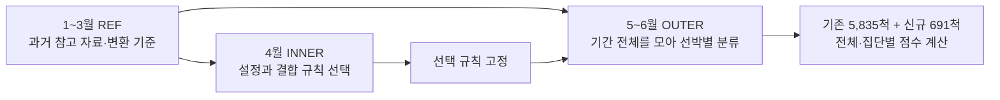
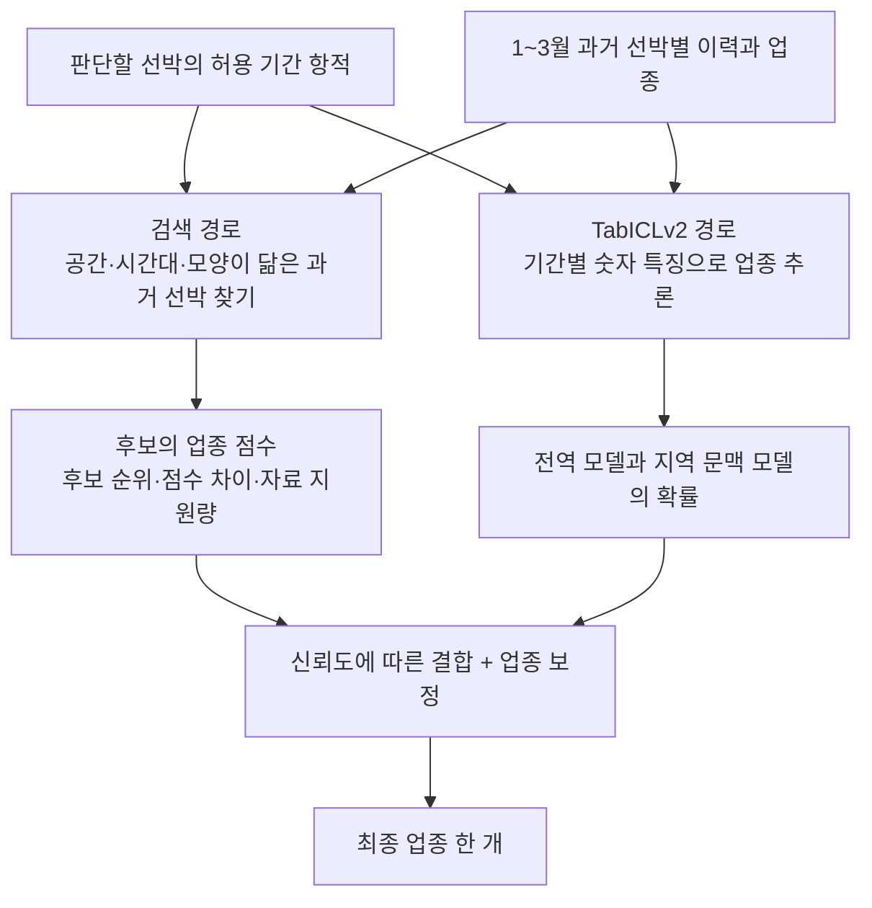

# 1104_총정리

**6~10차 조업분류 실험의 성과·정당성·과적합 위험 검토 및 인수인계**  
실험일: 2026-11-04 · 검토일: 2026-11-05

> **판정: 점수는 실제 예측에서 재계산되며, 기존 선박의 다른 기간을 분류하는 능력은 개선됐다. 그러나 0.8383은 ‘처음 보는 선박의 업종을 83.8% 맞힌다’는 뜻이 아니다. 높은 성적의 중심은 기존 선박의 과거 항적을 다시 찾는 능력이다. 신규 선박 분류, 공식 Test A 적합성, 독립적인 최종 일반화는 아직 해결·입증되지 않았다.**

이 보고서는 저장된 코드·입력·예측·검증 기록과 우선순위 문서를 다시 읽고 작성했다. 새로운 모델을 학습하거나 6~10차의 예측을 고치지 않았다. 추가한 것은 **기존 예측의 재계산, 구성요소 분해, 검색 후보 제외 진단, 불확실성 분석**이다. 사후 진단에서 더 좋은 숫자가 나오더라도 이를 새로운 정식 시도나 제출 모델 성적으로 바꾸어 부르지 않는다.

핵심 결론은 다음과 같다.

- **정당한 성과:** 같은 6,526척에 대한 Micro-F1이 6차 **0.7536 → 10차 0.8383**으로 상승했다. 맞힌 선박은 **553척 증가**했다.
- **성과의 범위:** 10차는 기존 선박 **0.8734**, 신규 선박 **0.5427**이다. 신규 통발 F1은 **0.1017**로 특히 낮다.
- **방법의 의미:** ID 문자열을 입력해 업종을 직접 조회하지는 않았다. 대신 항적에서 선박을 알아보는 기능을 학습했다. 이는 기존 선박 특화라는 목적에는 부합하지만, 업종 행동에 대한 일반화와는 다른 능력이다.
- **과적합 판단:** 현재 점수만으로 ‘심각한 과적합이 확정됐다’고 단정할 수 없으며, 반대로 ‘과적합이 없다’고도 말할 수 없다. **강한 개별 선박 의존성, 반복 개발 평가, 미측정된 환경 변화 위험**은 확인된다.
- **알고리즘 성과의 귀속:** TabICLv2 내부 신경망이 5번의 학습으로 계속 좋아진 결과가 아니다. 내부 변경은 공통 FFN 계수 조정이며, 큰 변화는 **검색·재순위·참고 문맥·결합 방식**에서 일어났다.

---

## 1. 어떤 문서와 지침을 기준으로 검토했는가

이번 검토에서는 사용자가 지정한 다음 **6개 MD의 전체 본문**을 확인했다. ‘이전에 만들었으므로 기억한다’는 가정으로 내용을 생략하지 않았다. 원문 파일의 위치·크기·지문과 상세 대조는 [문서 대조 기록](<1104_총정리_자료/문서대조_검토.md>)에 보존한다.

|우선순위|문서|이번 실험을 판단하는 핵심 기준|
|---|---|---|
|1순위|새로운 방향성 총정리|기존 선박 특화는 후보가 될 수 있다. 기존 선박의 이후 기간 평가와 미학습 ID 평가를 구별하고, 과거만으로 요약·문맥을 만들어야 한다.|
|1순위|공통점 차이점 비교_데이터 전처리|선박 재식별과 업종 분류는 다르다. 두 경로의 신뢰도 결합은 유용할 수 있지만, 이웃 점수·순위 차이는 검증된 확률이 아니다.|
|2순위 중 최우선|팀원공유_분석요약_20261103|같은 선박의 과거를 찾는 효과와 처음 보는 선박을 분류하는 효과를 분리한다. 높은 Top-K 검색률이 곧 높은 최종 F1은 아니다.|
|2순위|조업분류_총정리_통합피드백|연안복합·자망·통발 혼동, 짧은 관측, 입력 정보 보존, 검증 분리를 계속 점검한다.|
|2순위|이상탐지_총정리_통합피드백|조업분류와 사고·이상탐지 성과를 혼동하지 않는다. **이번 6~10차에서 이상탐지 개선은 실행·평가하지 않았다.**|
|3순위|재식별_투트랙_시스템_설계_|검색용 프로필, 여러 크기의 공간 격자, 신뢰도에 따른 결합을 구체화한 참고 설계다. 상위 문서의 검증 제한을 함께 적용한다.|

이후 사용자는 **편향 학습·투트랙·TabICLv2 변형을 실제로 사용하고, 과거 기준과의 대조보다 F1 개선에 집중하라**고 요청했다. 따라서 과거 문서의 ‘우선 단일 모델부터 비교’라는 작업 순서를 그대로 강제하지 않은 것은 최신 요청에 부합한다. 다만 비교를 생략해도 **정보 누수 방지와 성능 주장 범위**까지 생략할 수는 없다.

### 문서의 아이디어는 실제로 얼마나 반영됐는가

|아이디어|실제 적용 상태|평가|
|---|---|---|
|기존 선박에 특화한 편향 학습|REF의 선박별 이력을 검색 자료로 유지. 같은 선박의 서로 다른 월을 같은 개체로 알아보는 재순위 학습 수행|**유용성이 확인됨.** 주로 기존 선박에서 효과가 큼|
|1차 기존 선박 / 2차 신규 선박|두 경로를 계산하고 점수를 결합. 신원 확인 후 신규만 2차로 보내는 엄격한 직렬 구조는 아님|**수정 적용됨.** ‘신규 선박을 정확히 골라내는 장치 완성’은 아님|
|대표 항적 + 다양한 추가 항적|8차에서 전체 요약과 가장 다른 월별 요약을 함께 제공|**시도했으나 긍정적 효과를 확정할 수 없음.** 지역 TabICL 단독 성적은 약함|
|세밀한 공간과 넓은 공간을 함께 사용|9~10차에서 5종 격자와 후보 합집합 적용|**이번 성과의 중요한 근거.** 다만 선박 고유 위치를 기억하는 의존성도 커짐|
|관측 품질과 닮음의 구분|관측량·공간 지원률을 보류/가중치에 사용. 재순위 입력에도 일부 품질 항목 포함|**부분 적용.** 품질을 검색 유사성에서 완전히 분리한 대조는 안 함|
|신규·짧은 관측·업종별 평가|모두 계산하여 내부 기록, 이번 보고서에 공개|**적용됨.** 전체 F1만으로 숨겨졌던 큰 취약점이 존재|
|여러 seed·완전 미사용 최종 시험|실험별 고정 설정만 사용. 같은 OUTER를 보며 후속 설계|**미충족.** 독립 최종 검증 통과로 표현할 수 없음|
|양방향 검색·선박 카드·공식 제출 완성|이번 6~10차에서는 수행하지 않음|미완료 기능이며 이번 F1의 근거로 사용하지 않음|

---

## 2. 먼저 이해해야 할 변화: 이전과 같은 시험을 본 것이 아니다

### 2.1 이번에 실제 사용한 분할

**REF**는 모델이 참고하는 공부 자료, **INNER**는 설정을 고르는 연습시험, **OUTER**는 선택한 구성을 평가하는 개발시험이다.

|역할|사용 기간|선박 수|어떻게 사용했는가|
|---|---|---:|---|
|REF|2026년 1~3월|6,585|TabICLv2 참고 문맥, 검색 자료, 특징 선택·변환 기준, 월별 재순위 학습|
|INNER|2026년 4월|5,981|이웃 수, 혼합 비중, 격자 비중, 신뢰도 규칙, 업종 보정 선택|
|OUTER|2026년 5~6월|6,526|선박당 최종 업종 하나를 예측하고 채점|

REF는 끝까지 1~3월로 고정했다. 4월에 나타난 새 선박을 검색 자료에 추가하지 않았다. OUTER 중 REF에 같은 ID가 있는 선박은 **5,835척(89.41%)**, 없는 선박은 **691척(10.59%)**이다. 이 비율은 원자료의 해당 기간에서 자연스럽게 나온 값으로, 점수를 높이려고 어려운 신규 선박을 빼서 맞춘 비율은 아니다.



‘기존’은 **REF에 같은 문자열 ID가 있다**는 내부 구분이다. 외부 기관이 실제 선박 신원을 다시 인증했다는 의미는 아니다. 이 구분은 평가에만 사용하며, 추론 시 ‘이 배는 기존/신규’라는 정답을 먼저 알려주지 않는다.

### 2.2 어떤 점수와 비교할 수 있는가

|비교|가능한 해석|
|---|---|
|6차 ↔ 10차|같은 OUTER 선박과 같은 정답에서의 개발 성적 변화로 비교 가능|
|이전 1~5차 ↔ 이번 6~10차|이전은 미학습 ID 중심의 평가, 이번은 기존 선박의 다른 기간이 다수인 평가. 차이를 알고리즘만의 개선량으로 볼 수 없음|
|다른 팀 F1 0.65~0.70 ↔ 이번 0.8383|평가 대상·지표 정의·정답·분할이 같다는 근거가 없으므로 우열 판정 불가|
|이번 결과 ↔ 공식 Test A|공식 테스트 정답을 채점한 결과가 아니므로 제출 성적 보장 불가|

이번 OUTER는 **5~6월 기록을 전부 모아 분류하는 일괄 평가**다. 5월 초에 아직 관측하지 않은 6월 항적까지 이용하는 실시간 모델이라고 설명하면 안 된다.

### 2.3 공식 공지와 현재 자료의 중복은 함께 봐야 한다

[공식 문제 과제 공지](<공지사항/공지-문제 과제.png>)에는 Test A를 **원칙적으로 Train에 없는 신규 선박**으로 구성한다고 적혀 있다. 한편 현재 배포된 자료에서 2026 학습·2025 테스트의 동일 문자열 ID가 많이 겹친다는 분석도 있었다.

두 사실을 합쳐도 **최종 채점이 반드시 기존 선박 90%로 이루어진다**고 확정할 수는 없다. 공지가 새 선박 일반화를 요구하는 쪽이라면 이번 전체 0.8383보다 **신규 집단 0.5427**이 더 중요한 경고다. 다만 이 691척도 공식 Test A와 동일한 집단은 아니다.

현재 제공 자료는 **2026년 학습 → 2025년 테스트**인 반면, 이번 검증은 **2026년 안에서 과거 → 이후 기간**이다. 연도 방향과 자료 역할도 달라 이번 시간 평가가 실제 제공 테스트 상황을 그대로 재현한 것은 아니다. 주최 측이 제공한 학습 자료를 쓰는 것과, 실시간 운영에서 미래 정보를 쓸 수 있는지는 구별한다.

재식별 방식이 대회 규정상 금지됐다고 이 자료만으로 단정할 수는 없다. 반대로 ‘현재 ID가 겹치므로 어떤 재식별 의존도든 공식 목적에 맞는다’고도 단정할 수 없다. **방법의 계산상 정당성, 공식 평가에 대한 적합성, 실시간 운영 가능성은 서로 다른 판단**이다.

---

## 3. 실제 모델은 무엇을 보고 어떻게 판단했는가

### 3.1 원자료를 모델 입력으로 만드는 과정

원자료 한 행은 특정 선박의 특정 시간대 항적이다. 이를 기간별로 다시 집계했다. 기존 1~6월 전체 요약을 1~3월 자료처럼 재사용한 것이 아니다.

1. **움직임의 모양:** 선 내부 길이, 직선성, 선회 정도, 활동 범위, 반복 좌표 비율 등의 시간대 특징을 날짜별로 요약한다.
2. **전체 기간의 분포:** 날짜별 대표값의 중앙값·범위·분위수를 만든다. 단순 평균 하나로만 압축하지 않는다. 분위수는 작은 값부터 나열했을 때 어느 위치의 값인지 나타낸다.
3. **관측 시간과 품질:** 24시간대 관측 비중, 실제 관측 날짜 수, 유효 항적·결측·분리된 선의 비율 등을 포함한다. 관측 시간대를 실제 조업 시각으로 확정하지 않는다.
4. **공간 사용:** 각 시간대 항적의 대표 위치를 격자에 넣어, 어떤 칸에 얼마나 관측됐는지 요약한다. 날짜별 총 비중을 맞춰 기록이 많은 하루가 과도하게 지배하지 않도록 한다.

**세밀한 격자에 넣은 것은 모든 원시 점의 정확한 방문시간이 아니라 시간대 항적의 대표 위치 분포다.** 점별 시각이 없으므로 실제 순간 속도·가속도·정확한 체류시간은 복원하지 않았다. 분리된 선 사이를 임의로 이어 가짜 경로를 만들지도 않았다.

기간별 기본 특징은 **161개**다. TabICLv2용 입력은 REF 정답만으로 ExtraTrees라는 트리 모델을 이용해 고른 **112개 숫자**, 결측 표시 **44개**, 공간 압축값 **64개**, REF 공간 사전으로 표현되는 관측 비중 **2개**를 합친 **222개**다. 결측 표시는 원래 161개 특징 중 REF에서 결측이 한 번이라도 있었던 44개에 붙였다. 공간 압축에는 수많은 공간 칸의 분포를 적은 숫자로 요약하는 SVD를 사용했다. **0.02°·0.005° 격자에서 각각 32개**를 만든 것이다. 뒤에서 추가한 0.001°·0.0002° 세밀 격자는 검색·재순위 쪽 정보이며 이 TabICLv2 입력에 직접 추가한 것은 아니다.

결측을 채우는 값, 특징 선택, 공간 압축 기준은 REF에서만 정했다. 여기서 ExtraTrees는 최종 업종을 직접 출력하는 주력 모델이 아니라 **입력 특징을 고르는 보조 모델**이다.

### 3.2 두 경로의 역할



사용자의 원래 그림은 ‘1차에서 기존 선박을 골라내고, 남은 신규 선박만 2차로 보낸다’에 가까웠다. **실제로 완성된 구조는 두 경로의 점수를 함께 계산하는 가중 결합**이다. 검색이 잘못 고른 기존 선박이나 비슷한 신규 선박도 결합에 참여할 수 있다.

따라서 ‘투트랙을 사용했다’는 말은 맞지만, **‘기존·신규를 정확히 분리했다’는 말은 틀리다.** 10차에서 검색 가중치가 양수인 신규 선박은 **464/691척(67.15%)**였다. 이 값은 검색 의견을 조금이라도 사용했다는 뜻이며, 그 선박의 신원을 확정했다는 뜻은 아니다.

### 3.3 어디에서 실제 학습이 일어났는가

|부분|실제로 한 일|하지 않은 일|
|---|---|---|
|TabICLv2 본체|기학습된 v2 체크포인트 사용. 참고 예시를 등록하고 마지막 ICL 블록의 FFN 기여를 0.5배로 변경|6~10차에서 신경망 전체나 새 출력층을 역전파로 다시 학습하지 않음|
|특징 선택|REF의 업종 정답으로 ExtraTrees 학습|INNER·OUTER 정답으로 입력 특징을 고르지 않음|
|7차 재순위|REF 내 1월→2월·3월의 같은 ID 쌍과 다른 ID 쌍으로 HGB 학습|평가 ID를 REF에서 직접 조회해 답을 복사하지 않음|
|8차 문맥|REF 특징으로 12개 집단을 만들고, 해당 집단에 맞는 참고 선박과 월별 요약 선택|선박마다 별도의 신경망을 학습하지 않음|
|10차 재순위|세밀한 공간 정보를 포함한 25개 쌍 특징으로 HGB 재순위 모델 학습|4~6월을 재순위 모델의 학습 쌍으로 사용하지 않음|
|최종 판정|INNER에서 이웃 수·결합 규칙·업종 보정 선택|정식 결과를 만든 뒤 OUTER에 맞춰 같은 회차의 규칙을 덮어쓰지 않음|

**HGB**는 작은 결정나무들을 순차적으로 학습하는 모델이다. 여기서는 ‘두 항적이 같은 선박의 기록인가’를 비교하는 **재순위 보조 모델**이다. 10차는 1월→2월의 양성 질의 4,409개, 1월→3월의 4,542개에 각각 어려운 다른 선박 12개를 붙여 **116,363개 쌍**을 학습했다. ID는 이 학습 쌍의 정답을 만드는 데 사용되므로 ‘ID를 전혀 쓰지 않았다’고 말하면 부정확하다. 정확한 표현은 **‘ID는 쌍의 정답·그룹 구성에 사용했지만, 평가 시 ID 일치 여부를 예측 입력으로 주지 않았다’**다.

TabICLv2 내부의 **FFN**은 신경망 블록 안에서 값을 변환하는 부분이다. 마지막 FFN의 출력 기여를 절반으로 줄인 것은 실제 내부 계산 변경이다. 그러나 이 변경은 6~10차에 공통이며, 원본 신경망의 가중치 수를 줄인 것도 아니다. **0.8383의 주된 상승을 이 변경 하나의 효과로 설명할 대조는 이번에 하지 않았다.**

### 3.4 ‘편향 학습’이 구체적으로 의미한 것

- 검색 자료에는 REF **6,585척의 과거 이력**을 유지했다. 익숙한 선박의 반복 위치를 활용할 수 있게 한 것이다.
- 재순위는 같은 선박의 서로 다른 월을 알아보도록 학습했다. 선박 고유성을 의도적으로 이용했다.
- 8차는 가까운 행동·지역 집단의 참고 자료에 집중하고, 해당 선박의 다른 월 요약을 추가했다.

이 중 8차의 ‘다양한 월’은 **전체 요약에서 가장 멀리 떨어진 월별 요약 하나**를 고른 것이다. 실제로 유익한 조업 방식이 다른 달이라는 확인은 없었다. 짧은 관측이나 잡음 때문에 멀리 떨어졌을 수도 있다. 따라서 ‘대표성·다양성을 최적으로 확보했다’가 아니라 **다양성 선정 가설을 한 번 구현했다**고 표현해야 한다.

12개 지역 문맥의 선박 합집합은 4,809척이다. 모든 REF 선박이 지역 문맥에 들어간 것은 아니지만, 전역 TabICLv2와 검색 경로에는 전체 REF가 참여한다.

---

## 4. 6~10차에서 바꾼 것과 실제 결과

### 4.1 회차별 설계와 다음 회차로 넘어간 이유

|시도|주요 변경|실제 선택된 구성|관찰과 다음 판단|
|---|---|---|---|
|6차|과거 선박 검색 + FFN 0.5의 TabICLv2를 결합|0.1°·0.02°·0.005° 공간, 상위 3척 투표, 검색 비중 0.75|기존 선박의 반복 이력이 유효했으나 후보 오인·신규 취약. 후보 순위를 학습하도록 확장|
|7차|같은 선박의 월간 쌍을 학습해 검색 순위 변경|HGB 재순위, 상위 5척, 검색 비중 0.75|전체 Micro는 상승, 채낚기연승 F1은 하락. 분류 경로의 입력 문맥 보완 필요|
|8차|전역 참고 문맥에 지역·행동별 문맥과 월별 항적을 추가|전역·지역 TabICLv2 확률 50:50, 검색 상위 10척과 50:50 결합|신규 집단은 조금 개선. 세밀한 공간 단서가 남아 있는지 확장|
|9차|0.001°·0.0002° 격자 추가, 넓은/세밀한 검색 후보의 합집합|세밀한 격자 총 비중 30%, 상위 5척, 검색과 TabICL 경로 50:50|동일 선박 구분이 더 정확해짐. 세밀한 증거의 가중치를 학습하고 결합 신뢰도를 조절|
|10차|세밀한 쌍 특징의 학습 재순위 + 신뢰도에 따른 결합 + 업종 보정|학습 재순위의 1등, `score_margin`, 최대 검색 비중 0.75, 업종 배수 `[1,0.9,1.1,0.9]`|전체 Micro 최고. 그러나 신규·짧은 관측 취약과 채낚기연승의 9차 대비 하락이 남음|

격자의 도 단위는 미터 단위와 같지 않다. 위도 35° 부근에서 0.001°는 대략 남북 111m·동서 91m, 0.0002°는 약 22m·18m다. 위도에 따라 동서 길이가 달라진다. 이것은 **대표 위치를 나눈 칸의 크기**이며 원자료의 위치 정확도가 그만큼 좋다는 뜻은 아니다.

### 4.2 같은 OUTER에서의 최종 점수

|시도|Micro-F1|연안복합 F1|자망 F1|통발 F1|채낚기연승낚시 F1|Macro-F1|
|---|---:|---:|---:|---:|---:|---:|
|6차|0.7536|0.7945|0.7303|0.6774|0.7126|0.7287|
|7차|0.7629|0.8050|0.7349|0.6978|0.6498|0.7219|
|8차|0.7679|0.8123|0.7391|0.6814|0.6783|0.7278|
|9차|0.8054|0.8396|0.7789|0.7509|**0.7860**|0.7889|
|10차|**0.8383**|**0.8667**|**0.8148**|**0.8119**|0.7261|**0.8049**|

10차는 사용자가 희망한 최소 0.65 수준을 **이 혼합 평가의 전체 Micro와 네 업종 F1에서** 넘겼다. 공식 평가나 모든 신규·짧은 관측 집단까지 통과했다는 뜻은 아니다.

이번 분류는 선박당 정답 하나이므로 **Micro-F1 = 맞힌 선박 수 ÷ 전체 선박 수**다. 업종별 F1은 그 업종을 놓친 경우와 다른 업종을 잘못 가져온 경우를 함께 반영한다. Macro-F1은 네 업종 F1을 같은 비중으로 평균한 값이다. 10차 Weighted-F1은 0.8378이지만, 다수 업종과 기존 선박이 성적을 지배하는 문제를 없애 주는 지표는 아니다.

실제 최종 선택은 6~10차 모두 다음 공동 목적함수를 사용했다.

`선택 점수 = Micro-F1 + 0.20 × Macro-F1 + 0.10 × 가장 낮은 업종 F1`

Micro에 가장 큰 계수를 두었지만, **Micro가 무조건 최대인 후보부터 고르는 방식은 아니다.** 다른 업종 F1을 위해 약간의 Micro를 포기할 수 있다. 10차의 선택된 INNER Micro는 해당 후보군의 최고 Micro보다 약 0.0010 낮았다. 사용자가 요구한 두 목표를 함께 고려한 선택이지, 다섯 지표를 모두 동시에 최대로 만든 해답은 아니다.

---

## 5. 0.8383은 정확히 어디에서 나왔는가

### 5.1 기존 선박의 높은 점수가 전체를 끌어올렸다

10차는 기존 선박 **5,096/5,835척**, 신규 선박 **375/691척**을 맞혔다.

**전체 Micro-F1 = (5,096 + 375) ÷ (5,835 + 691) = 5,471 ÷ 6,526 = 0.838339**


그림에서 기존 선박의 성적은 0.7859→0.8734, 신규 선박은 0.4805→0.5427로 변했다. 둘 다 이 평가에서는 개선됐지만 **기존과 신규의 격차는 여전히 크다.** 모든 회차는 같은 OUTER 선박을 사용했다.

‘기존 선박이 대부분이므로 실전에 유용하다’는 판단은 실제 운영 대상도 그 구성을 유지할 때 성립한다. 각 집단의 관측된 정확도를 그대로 둔 단순 계산에서는 신규 비율이 25%이면 전체 Micro가 약 0.7907, 50%이면 0.7080, 100%이면 0.5427이다. **새 집단의 성능을 예측한 결과가 아니라, 집단 구성만 바뀌어도 전체 점수가 달라진다는 산술 예시**다.

### 5.2 중심 기여는 TabICLv2 단독보다 검색 경로에 있다

아래는 **이미 저장된 각 경로의 확률을 같은 OUTER에서 따로 채점한 사후 진단**이다. 새로운 모델을 학습한 결과가 아니다. 모든 TabICLv2 경로에는 공통 FFN 0.5 변경이 적용돼 있다.

|저장된 구성만으로 분류|전체 Micro-F1|신규 Micro-F1|통발 F1|채낚기연승 F1|
|---|---:|---:|---:|---:|
|전역 TabICLv2|0.6515|0.5789|0.3496|0.7279|
|지역·월별 문맥 TabICLv2|0.5458|0.4457|0.4136|0.1983|
|두 TabICLv2 확률의 50:50 혼합|0.6336|0.5427|0.4130|0.4021|
|10차 검색 1등의 업종만|0.8282|0.5166|0.8076|0.7390|
|10차 최종 결합|0.8383|0.5427|0.8119|0.7261|


**TabICLv2 분류 경로가 스스로 0.83까지 좋아진 것은 아니다.** 검색 1등 업종만으로도 0.8282였으며, 최종 결합은 여기서 0.0101을 추가했다. 검색이 틀린 선박 213척을 결합이 바로잡았지만, 검색이 맞힌 147척을 잘못 바꾸어 **순증가는 66척**이었다.

TabICLv2 혼합 경로와 비교하면 최종 모델은 1,646개 오답을 고치고 310개 정답을 망쳐 1,336척을 더 맞혔다. 이 순증가는 전부 기존 집단에서 나왔다. 신규 집단에서는 **72개를 고치고 72개를 망쳐 정답 수가 같았다.** 같은 Micro라고 동일한 선박을 맞혔다는 뜻은 아니다.

따라서 이번 모델의 정확한 설명은 **‘TabICLv2를 포함한 분류 경로와, 선박별 과거 항적 검색·학습 재순위를 결합한 시스템’**이다. ‘TabICLv2 자체만 변형해 0.8383을 얻었다’는 표현은 기여를 잘못 전달한다.

### 5.3 같은 선박을 다시 찾았을 때 대부분 맞혔다

|10차 검색 1등 후보의 상태|선박 수|최종 정답 수|최종 Micro-F1|
|---|---:|---:|---:|
|판단할 선박과 같은 2026 ID|4,292|4,265|0.9937|
|다른 ID이지만 같은 업종|1,113|993|0.8922|
|다른 ID이며 다른 업종|1,121|213|0.1900|

같은 ID의 과거 업종과 현재 업종이 실제 자료에서 일치하므로, 같은 선박을 찾으면 업종을 맞히기 쉬워진다. 이는 **‘자망의 조업 행동을 이해했다’는 설명만으로는 포착되지 않는 재식별 효과**다. 반대로 다른 배를 골라도 업종이 같으면 분류는 맞을 수 있으므로, 검색의 신원 일치율과 조업분류 F1은 서로 다르다.

### 5.4 자기 선박의 과거를 후보에서 빼면 검색 성능이 크게 떨어진다

이번 검토에서 저장된 검색 후보 중 평가 선박과 같은 ID만 지우고, 다음 1등 후보의 업종을 채점했다. ID는 **이 사후 진단의 제외 기준**으로만 사용했다.

|검색 경로 / 기존 선박 집단|자기 과거 후보가 있는 원래 검색|자기 ID를 후보에서 제외한 검색|
|---|---:|---:|
|6차 검색 1등 업종 Micro-F1|0.7763|0.4956|
|10차 검색 1등 업종 Micro-F1|0.8651|0.4809|

10차의 세밀한 검색은 **자기 선박을 다시 찾는 쪽에서는 강해졌지만, 자기 후보가 없을 때 다른 배의 업종을 참고하는 능력이 함께 좋아졌다고 볼 근거는 없다.** 신규 선박은 원래 자기 ID가 없으므로 제외 전후 예측이 같았다.

이는 **검색 부분만의 제한된 진단**이다. 전체 모델에서 자기 선박의 TabICLv2 참고 이력까지 제거한 실험이 아니고, 모든 후보를 다시 검색하거나 재학습한 새 일반화 시험도 아니다. 이 한계를 붙여도, 성과가 자기 이력에 강하게 의존한다는 사실을 보여주는 유용한 근거다.

### 5.5 10차의 신뢰도 결합은 어떻게 계산됐는가

10차의 선택된 검색은 상위 **1척**의 업종을 사용한다. TabICLv2 쪽은 전역·지역 경로의 50:50 혼합이다.

```text
s = 학습 재순위의 1등 점수
d = 1등 점수 − 2등 점수
공간 관측일이 1일 이상이고 공간 증거 점수가 0.05를 넘으면:
  검색 비중 a = 0.75 × [0.4 + 0.6 × clip(d / 0.05, 0, 1)] × clip(s, 0, 1)
위 조건을 만족하지 않으면 a = 0

결합 점수 = a × 검색 업종 점수 + (1 − a) × TabICLv2 혼합 점수
업종별로 [1.0, 0.9, 1.1, 0.9]를 곱한 뒤 합이 1이 되도록 정규화
가장 높은 업종을 최종 예측
```

`clip`은 값을 0~1 범위로 제한한다는 뜻이다. 재순위 학습은 같은 선박 쌍 1개에 다른 선박 쌍 12개를 뽑고, 가중치를 각각 12와 1로 주어 두 종류의 총 비중을 맞췄다. 이런 학습에서 나온 점수는 실제 후보 집단에서 **정확히 보정된 신원 확률이 아니다.** ‘1등 점수 0.9이므로 실제 같은 배일 확률도 90%’라고 읽으면 안 된다.

코드의 공간 지원 조건은 `spatial_days > 0`과 `spatial_evidence > 0.05`다. 일주일 이상 관측돼야 검색을 쓰는 규칙이 아니다.

실제 평균 검색 비중은 기존 집단 **0.5851**, 신규 집단 **0.3179**였다. 신규에는 검색을 덜 반영했지만, 그것만으로 신규 업종 분류가 충분히 좋아지지는 않았다. 이 결합은 **부드럽게 비중을 조절하는 구조**이며, 신규 선박 판별기의 완성을 뜻하지 않는다.

---

## 6. 잘된 아이디어와 성과로 인정하기 어려운 아이디어

### 6.1 유지할 근거가 생긴 부분

- **시간을 나눠 만든 과거 선박별 검색 자료:** 평가 항적을 답과 함께 학습에 넣지 않고, 허용된 과거로 이후 항적을 분류했다.
- **넓고 세밀한 공간을 함께 비교:** 근처에서 비슷하게 움직이는 배 사이의 차이를 포착할 구체적 성과가 생겼다.
- **같은 선박의 월간 쌍을 학습한 세밀한 재순위:** 10차에서는 기존 선박을 찾는 능력의 개선으로 이어졌다. 다만 새 선박에 대한 개선의 근거와 분리해야 한다.
- **검색과 분류의 신뢰도 결합:** 검색 1등만 사용하는 경우보다 전체 정답 수를 66척 늘렸다. 모든 집단·업종을 동시에 개선한 것은 아니다.

창의성은 ‘과적합을 일부러 허용했다’는 표현보다 **관할 선박의 반복 이력을 검색 자료로 만들고, 자료 지원량·검색 모호성에 따라 분류 경로와 결합했다**는 구체적 설계에서 설명하는 편이 정확하다. 이 구성이 학술적으로 새로운 발명이라고 증명한 것은 아니며, 일반적인 검색·개인화·결합 기법을 이 데이터에 맞게 구성한 응용이다.

### 6.2 8차의 지역 특화는 그대로 성공으로 평가하면 안 된다

지역·월별 TabICLv2 단독은 Micro 0.5458, 채낚기연승 F1 0.1983이었다. 전역 모델과 섞어도 해당 경로의 Micro는 0.6515→0.6336으로 낮아졌다. 지역 문맥에 소수 업종 예시를 추가하고 다양한 월을 고르는 아이디어가 **이번 구현에서 자동으로 좋은 표현을 만든 것은 아니다.**

가능한 원인은 참고 문맥 축소, 극단적인 월을 다양성으로 선택한 방식, 월별 요약과 기간 요약의 관측량 차이, 집단별 분포 차이다. **원인을 하나로 확정할 추가 분리 실험은 하지 않았다.**

상호작용도 확인했다. 10차의 검색·가중치·업종 보정을 모두 고정하고 TabICL 혼합만 전역 경로로 대체하는 **사후 계산**은 Micro 0.8393, 채낚기연승 F1 0.7814였다. 실제 10차는 각각 0.8383·0.7261이다. 지역 경로를 줄이는 후속 검증의 근거는 되지만, OUTER를 본 뒤 발견한 대체 구성이므로 **정식 10차 결과를 이것으로 교체하지 않았다.**

### 6.3 INNER에서 골랐던 업종 보정도 OUTER에서는 손해였다

10차의 업종 배수 `[1, 0.9, 1.1, 0.9]`를 적용하기 직전의 같은 모델은 OUTER Micro **0.8402**였다. 적용 후 **0.8383**이 됐다. 59척의 예측이 바뀌었고, 21척을 바로잡는 대신 33척을 새로 틀려 **정답 12척이 줄었다.** 통발 F1은 소폭 좋아졌지만 다른 업종은 낮아졌다.

보정은 OUTER 정답으로 정한 것이 아니라 INNER에서 고른 것이므로 이 결과 자체가 부정한 채점이라는 뜻은 아니다. 다만 **개발 자료에서 유리한 작은 보정이 다음 기간에는 잘 옮겨가지 않은 사례**다. 이를 생략하고 ‘모든 보정이 유용했다’고 보고하면 잘못이다.

보정 제거 수치도 사후 진단이다. 이번 보고서 작성 중 새 제출 모델로 채택하거나 원래 성적을 바꾸지 않았다.

---

## 7. 여전히 해결하지 못한 선박과 업종

### 7.1 신규 선박의 통발·자망 혼동

|10차 평가 집단|척수|Micro-F1|연안복합 F1|자망 F1|통발 F1|채낚기연승 F1|
|---|---:|---:|---:|---:|---:|---:|
|전체|6,526|0.8383|0.8667|0.8148|0.8119|0.7261|
|기존 ID|5,835|0.8734|0.8952|0.8548|0.8603|0.7540|
|신규 ID|691|0.5427|0.6608|0.4365|**0.1017**|0.5882|

신규 집단의 실제 업종 수는 연안복합 356척, 자망 236척, 통발 75척, 채낚기연승 24척이다. **신규 통발 75척 중 정답은 6척**이다. 46척은 연안복합, 20척은 자망, 3척은 채낚기연승으로 분류됐다. 신규 자망도 236척 중 129척이 연안복합으로 넘어갔다.


행은 실제 업종, 열은 예측 업종이다. 괄호는 같은 실제 업종 안에서의 비율이며 F1이 아니다. 그림처럼 **전체 통발 F1이 0.8119여도 신규 통발을 잘 분류한다고 말할 수 없다.**

전체 오답 1,055척 중 연안복합↔자망·통발의 네 방향 혼동은 **847척(80.28%)**이다. 과거부터 문제였던 업종 간 경계가 없어졌다기보다, 기존 선박을 알아보면서 그 경계를 상당 부분 우회한 것으로 해석하는 편이 증거에 맞는다.

### 7.2 짧게 관측된 선박

|10차 관측 날짜 수|척수|Micro-F1|통발 F1|채낚기연승 F1|
|---|---:|---:|---:|---:|
|1~7일|1,621|0.7187|0.6062|0.3030|
|8~30일|2,641|0.8463|0.8048|0.6506|
|31일 이상|2,264|0.9148|0.9167|0.8342|
|신규이면서 1~7일|379|0.5277|0.0690|0.2500|

여기서 날짜 수는 **기록이 있는 서로 다른 날짜 수**다. 실제 운항시간이나 연속 운항일이 아니다. 관측이 짧아 단서가 적다는 설명은 타당한 가설이지만, 집단별 해역·업종·수신 품질 차이도 있으므로 이 표만으로 관측량이 유일한 원인이라고 확정하지 않는다.

1~7일 집단의 실제 채낚기연승은 6척뿐이며 5척을 맞혔지만, 다른 업종 22척을 채낚기연승으로 오인해 F1이 0.3030이다. 작은 분모와 오탐을 함께 봐야 한다. 신규이면서 짧게 관측된 통발은 40척 중 2척만 맞혔다.

### 7.3 모든 업종이 계속 좋아진 것은 아니다

10차의 전체 Micro가 가장 높아도 채낚기연승 F1은 9차 **0.7860 → 10차 0.7261**로 하락했다. 전체 채낚기연승은 141척으로, 다른 업종보다 적다. 9→10차의 이 F1 변화에 대한 선박 재표본 95% 구간은 약 **−0.1175~−0.0029**였다. 반복 개발 편향을 제거한 확정 검정은 아니지만, 하락을 단순한 개선으로 덮을 근거는 없다.

따라서 현재 10차는 **전체 Micro 우수 구성**, 9차는 **채낚기연승에서 더 좋은 구성**으로 기록해야 한다. 모든 업종에 대해 10차가 우월하다고 결론내리지 않는다.

---

## 8. 이 방법은 정당한가, 과적합인가

### 8.1 서로 다른 네 문제를 구분해야 한다

|문제|이번 검토의 판단|판단 근거와 남는 한계|
|---|---|---|
|**계산 오류·점수 조작**|확인되지 않음|CSV에서 지표 재계산, 예측·정답·ID 순서, 혼동행렬, 확률 결합, 파일 지문이 일치|
|**직접적인 평가 정답 누수**|검토한 경로에서 발견하지 못함|REF만으로 변환·검색 자료·학습 쌍 구성. 평가 ID를 조회해 업종을 복사하지 않음. 다만 이것이 모든 가능한 누수의 부재를 수학적으로 증명하는 것은 아님|
|**의도한 기존 선박 특화**|실제로 작동하고 유용함|서로 겹치지 않는 이후 기간에서도 기존 집단 Micro 0.8734. 검색의 자기 이력 제외 진단에서 강한 의존성 확인|
|**지나친 특화·선택 과적합**|위험이 크며 최종 검증 미완료|신규·짧은 관측 취약, 세밀 좌표 의존, INNER 반복 선택, 같은 OUTER를 보고 다음 설계, 완전 미사용 시험 부재|

**기억하는 것 자체가 과적합은 아니다.** 고정된 관할 선박을 관리한다면 과거의 반복 경로를 기억하는 기능은 실용적일 수 있다. 반면 항구가 달라지거나 새 선박이 들어와도 잘해야 하는 목표라면, 지금처럼 자기 이력에 크게 의존하는 설계는 그 목표를 충분히 충족하지 못한다.

목표 운영 조건에서의 일반화 손실을 더 신뢰성 있게 판단하려면 **아직 설계에 영향을 주지 않은 자료**로 성능을 확인해야 한다. 지금 신규 성적이 낮다는 사실은 일반화 부족의 증거지만, 그 원인이 모두 과도한 모델 복잡성 때문인지, 새로운 선박의 정보가 부족해서인지, 자료 분포가 달라서인지는 분리되지 않았다.

현재 가장 정확한 판단은 **‘기존 선박에 강하게 특화된 개발 모델이며, 그 특화의 이득과 일반화 한계가 모두 실측됐다. 과적합이 없다고 인증할 단계는 아니다’**이다.

### 8.2 확인된 누수 방지 장치

- 원본 기간을 나눈 뒤 그 기간 안에서 특징과 정답을 다시 집계했다.
- 학습 공간 사전은 REF에서만 만들었다. REF에 없는 평가 위치를 사전에 몰래 추가하지 않았다.
- 재순위 학습에 쓰는 월별 쌍은 1~3월 안에 있다. 월별 비교에서는 그 시점의 참고 자료에 실제 존재하는 공간 칸만 사용했다.
- 같은 배의 과거와 미래를 허용하되, 미래 행을 과거 요약에 섞지 않았다.
- ID 문자열·기존/신규 정답 마스크는 최종 예측 입력으로 사용하지 않았다. 검색 후보의 ID는 결과 설명과 진단을 위해 저장했다.
- 기간별 라벨 누락 1행은 정답 투표에서만 제외했다. 어려운 평가 선박을 골라 삭제하지 않았다.

여기서 **같은 선박의 과거 정답이 참고 자료에 있다는 점은 의도된 설계**다. 미학습 ID 시험이었다면 해당 선박의 모든 과거도 제외해야 하므로, 같은 설계를 아무 설명 없이 이전의 신규 선박 성능으로 보고할 수는 없다.

### 8.3 검증 자료에 과하게 맞춰질 여지는 남아 있다

이번 내부 정책 비교 수는 6차 216개, 7차 216개, 8차 432개, 9차 864개, 10차 207개였다. 9차는 선택된 안의 216개 조합을 다시 계산했으며, 이를 별도 독립 실험 216개로 세면 안 된다. 설정 대부분은 서로 관련되지만, **같은 INNER에서 많이 고를수록 그 자료에서만 좋은 구성을 고를 위험**이 있다.

회차 안에서는 INNER로 설정을 고정한 뒤 OUTER를 평가했다. 그러나 6차 OUTER를 보고 7차 방향을 정하고, 이후에도 같은 방식으로 설계했다. 더 이전의 모델 개발과 전체 기간 분석에서도 자료를 보았다. 따라서 이번 OUTER는 **개발에 반복 사용된 평가**이며, 완전히 새로 봉인한 시험셋은 아니다.

코드의 접근 순서도 구분해야 한다. 6~9차는 선택 전에 OUTER 파일을 메모리에 읽고 정답 일관성을 점검했다. 설정 선택의 점수 계산에는 INNER만 사용했지만, **‘선택 전에는 OUTER 정답 파일을 전혀 열지 않았다’는 설명은 맞지 않는다.**

‘OUTER 정답을 gradient에 넣지 않았다’와 ‘OUTER가 설계에 아무 영향도 주지 않았다’는 다른 말이다. 전자는 확인됐지만 후자는 아니다. 감사 파일의 통과는 **계산·재현·정보 경로 점검 통과**이며, 독립 일반화 인증이 아니다.

### 8.4 세밀한 좌표는 왜 양날의 검인가

0.0002° 같은 작은 칸은 서로 비슷한 배를 구분할 수 있지만, 다음을 함께 기억할 수 있다.

- 특정 선박의 고정된 주요 관측 위치·정박 후보 위치
- 특정 해역과 선박의 관측·수신 특성
- 기간마다 달라질 수 있는 대표 위치 계산·좌표 오차

이는 과거 선박을 찾는 목적에는 도움이 된다. 다만 새 어장·계절 변화·위치 잡음에도 유지되는지는 확인하지 않았다. 세밀 격자의 REF 공간 지원률이 낮은 경우가 있어 넓은 격자와 함께 사용했지만, 이것만으로 환경 변화에 안전해졌다고 볼 수는 없다.

좌표를 조금 흔들어도 성능이 유지되는지, 새 해역이나 이후 기간에서도 같은지 확인해야 한다. 자기 이력 제외는 **검색 후보만 제외하는 사후 진단은 실행했다**. 검색·TabICL 문맥·변환·재순위 학습 모두에서 해당 선박을 제외하고 다시 학습하는 전체 시스템 검사는 미실시다. 좌표 잡음과 새 시기·해역 시험도 이번 보고서에서는 실행하지 않았다.

### 8.5 INNER와 OUTER 차이는 곧 과적합의 크기가 아니다

|시도|INNER Micro|OUTER Micro|차이(OUTER−INNER)|
|---|---:|---:|---:|
|6차|0.8142|0.7536|−0.0606|
|7차|0.8136|0.7629|−0.0506|
|8차|0.8184|0.7679|−0.0506|
|9차|0.8569|0.8054|−0.0515|
|10차|0.8686|0.8383|−0.0302|

INNER는 한 달, OUTER는 두 달이고 대상 선박 구성도 다르다. 10차에서 두 기간에 공통으로 등장한 **5,601척만** 비교하면 Micro는 0.8777→0.8657로 하락폭이 줄었다. 따라서 전체 0.0302 하락에는 선박 구성 차이도 포함된다. 반대로 공통 선박 차이가 작다는 이유로 과적합이 없다고 결론내려서도 안 된다.

여러 독립 seed 평균이나 별도의 지역·시기 반복 검증도 수행하지 않았다. 지역 문맥마다 다른 고정 seed를 쓴 것은 전체 실험을 여러 seed로 반복한 것과 다르다.

---

## 9. 점수를 얼마나 믿을 수 있는가

저장된 OUTER 선박을 4,000회 다시 뽑아 점수 변동을 계산했다. 같은 재표본을 두 모델에 적용하는 **대응 부트스트랩**이다. 새로운 선박을 실제로 추가 수집한 시험은 아니다.

|지표|관측값|95% 재표본 구간|
|---|---:|---|
|10차 전체 Micro-F1|0.8383|0.8295~0.8472|
|6→10차 Micro 개선량|+0.0847|+0.0740~+0.0961|
|10차 연안복합 F1|0.8667|0.8578~0.8751|
|10차 자망 F1|0.8148|0.8020~0.8273|
|10차 통발 F1|0.8119|0.7921~0.8315|
|10차 채낚기연승 F1|0.7261|0.6667~0.7790|

근처 선박의 오류가 비슷할 수 있다는 점을 보려고 0.25° 공간 칸 **202개 블록**을 다시 뽑는 민감도 분석도 했다. 이 경우 전체 Micro 구간은 **0.8221~0.8547**, 6→10차 개선 구간은 **+0.0689~+0.0979**였다.

이 결과는 **지금의 같은 평가 집단에서 관측한 개선이 몇 척의 우연한 결과만은 아니라는 보조 근거**다. 그러나 반복 설정 선택의 낙관적 편향, 실제 새 지역·새 연도·ID 체계 변화는 보정하지 못한다. 5~6월을 합친 예측밖에 없으므로 충분한 독립 월 블록으로 시간 의존성을 보정한 것도 아니다. 이 구간을 공식 테스트 성적의 예측 범위로 사용하면 안 된다.

---

## 10. 최종 판단과 다음에 검증할 일

### 10.1 현재 모델을 어떻게 평가하는가

**기존 선박 특화 개발 모델로서는 타당한 가치가 있지만, 공식 신규 선박 일반화와 최종 배포 검증은 미완료다.** 실제 점수와 재현 근거는 인정하되, 전체 성적만으로 과제 해결 완료를 선언하지 않는 것이 현재 증거에 맞는 판단이다.

또한 6~10차 전체를 ‘경량 신경망을 계속 학습해 성능을 높인 5회’라고 설명하면 안 된다. TabICLv2의 가중치는 고정됐고, 참고 문맥과 검색·재순위·결합이 바뀌었다. 12개 지역 문맥과 검색 자료가 추가돼 **전체 시스템이 더 가벼워졌다는 측정 근거도 없다.** 불필요한 1.67GB 추론 캐시는 제거하고 약 4MB의 전역 학습 문맥으로 재구성 가능함을 확인했지만, 이것은 저장 최적화이지 모든 지연시간·메모리 목표를 달성했다는 뜻은 아니다.

### 10.2 다음 작업의 우선순위

|우선|검증할 내용|이유와 판정 기준|현재 상태|
|---|---|---|---|
|1|최종 Test A의 신규 ID 원칙, 제공 테스트의 역할, 과거 자기 항적 활용 조건 확인|무엇을 잘해야 하는지 먼저 확정. ID 중복만으로 최종 평가 구성을 추정하지 않음|제공 공지는 재확인. 추가 공식 확인은 미완료|
|2|현재 구성을 고정한 신규 선박 중심 검증과 혼합 운영 검증을 분리|첫째는 업종 일반화, 둘째는 기존 선박 관리 능력. 두 점수를 서로 대체하지 않음|이번 자연 신규 691척 진단은 완료. 별도 미사용·엄격 그룹 검증은 미완료|
|3|지역 문맥과 업종 보정의 유지 필요성 검증|복잡도를 늘렸는데 약해진 부분부터 점검. 새 자료에서 재현되면 축소·교체 판단|저장 예측 사후 대조만 완료. 새 독립 선택·검증은 미완료|
|4|신규 자망·통발의 비슷한 해역·관측량 사례에서 행동 단서 확인|자기 이력 검색으로 우회할 수 없는 업종 경계를 해결. 전역 분류 경로의 정보 보존이 핵심|이번 혼동 분해 완료. 새 행동 특징 설계·학습은 미완료|
|5|좌표 잡음·격자 해상도·다른 시기/해역에 대한 안정성 검사|세밀한 위치에 지나치게 의존하는지 확인|미실시|
|6|실제 추론 시간·최대 GPU/RAM·필요 저장량과 제출 파일 검증|성능과 운영 비용을 함께 확인. 클래스 순서·선박 누락·확률 형식도 점검|예측 재현은 확인. 배포 전체 성능·최종 제출 검증은 미완료|

시간이 제한돼도 **전체 0.8383을 공식 예상 점수로 채택하는 단계로 바로 넘어가는 것은 추천하지 않는다.** 현재 자료가 과거 개발 전반에 노출됐다는 사실을 남기고, 새 분할을 만든다고 자동으로 완전 미사용 시험이 된다고 부르지 않는다. 가능하다면 실제로 설계에 쓰이지 않은 새로운 시기·선박 자료로 마지막 검증을 해야 한다.

이 보고서에서는 위 후속 학습을 실행하지 않았다. 6~10차의 성적과 최종 선택도 그대로 보존했다.

---

## 11. 팀원의 ChatGPT가 이어받을 때 반드시 알아야 할 사실

### 11.1 다시 해석을 바꾸면 안 되는 핵심 조건

1. 범위는 **조업분류**다. 이번 F1로 사고·이상탐지 성능을 주장하지 않는다.
2. 원자료 학습은 2026년 1~6월이다. 이번 내부 실험은 **REF 1~3월 / INNER 4월 / OUTER 5~6월**이다.
3. 선박 수는 **6,585 / 5,981 / 6,526**이다. OUTER의 기존·신규는 REF ID 기준 **5,835 / 691**이다.
4. 공식 2025 테스트 정답을 추정해 F1을 계산한 결과가 아니다.
5. 기본 특징 161개, 전역 TabICL 입력 222개다. ID 문자열·정답·기존/신규 마스크는 모델 입력에서 제외됐다.
6. 실제 정답 순서는 **0 연안복합 / 1 자망 / 2 통발 / 3 채낚기연승낚시**다. CSV 확률 `p0~p3`도 이 순서다.
7. 재순위의 ID 사용은 학습 쌍의 정답과 자료 연결에 한정된다. 추론에서 ID 일치를 조회하지 않는다.
8. TabICLv2 신경망 가중치는 고정. 마지막 ICL FFN의 기여를 **0.5배**로 적용한다. 새 추론 때도 이 변경을 다시 적용해야 한다.
9. 10차 선택: `learned`, `k=1`, `score_margin`, `alpha=0.75`, 업종 배수 `[1,0.9,1.1,0.9]`. `temperature=0.08`은 기록되지만 **k=1의 단일 후보 투표에는 실질적인 차이를 만들지 않는다.**
10. 10차 TabICL 경로는 전역·지역 문맥 모델의 확률을 **50:50**으로 혼합한다. 검색과의 결합 비중은 선박별로 달라진다.
11. 최종 정식 10차 Micro는 **0.8383389519**다. 사후 보정 제거 0.8402나 전역 대체 0.8393으로 결과를 덮어쓰지 않는다.
12. 신규 Micro **0.5426917511**, 신규 통발 F1 **0.1016949153**를 전체 점수와 함께 인계한다.
13. `accepted_reid`는 검색 비중이 양수인 행이다. 신원을 확정한 표시로 해석하지 않는다.
14. OUTER는 반복 개발 자료다. 기존 감사 통과를 과적합 없음·공식 성능 인증으로 표현하지 않는다.
15. 앞으로 검증에서 같은 선박을 완전히 제외하려면 검색 자료뿐 아니라 **TabICL 참고 문맥·특징 선택·변환·재순위 학습 쌍**에서도 그 선박을 제외해야 한다.

### 11.2 근거 파일 지도

아래 경로는 이 MD가 있는 `2026 데이터 분석대회` 폴더 기준이다. 파일을 다른 기기로 옮겨도 본문의 핵심 판단·수치·조건은 이 MD만으로 이해할 수 있다. **재현 실행에는 원자료·모델 체크포인트·코드·저장 예측도 필요하다.** 그림을 함께 보려면 `1104_총정리_자료/그림`도 옮긴다.

|목적|위치와 읽을 내용|
|---|---|
|회차별 정식 결과|`TabICLv2_투트랙_6_10차_20261104/{6~10}차 시도/result.json` — `metrics.inner`, `metrics.outer`, 선택 구성|
|선박별 결과|같은 회차의 `inner.csv`, `outer.csv`, `inner.npy`, `outer.npy` — 정답·최종 예측·확률·기존/신규·관측량|
|선택 기록|각 회차 `design_and_selection.json`, `policies/` — INNER 후보와 실제 선택; 10차는 별도 신뢰도 판독기 형식|
|기간별 입력|`TabICLv2_투트랙_6_10차_20261104/inputs/` — `ref/inner/outer/m01~m06/ref_late.npz`, 기본 격자, 라벨 근거, 출처 지문|
|세밀 공간 입력|같은 실험 폴더 `inputs_fine/` — 0.001°·0.0002° 격자와 공간 지원량|
|분류 경로|`shared/global/`, `shared/local8/`, `shared/blend8/` — 변환 기준·참고 문맥·라우터·경로별 확률·결합 비율|
|검색 경로|`shared/retrieval6/`, `retrieval7/`, `retrieval9/`, `retrieval10/` — 후보 ID·순위·점수·학습 재순위 모델·영수증|
|실행 코드|[코드 폴더](<TabICLv2_투트랙_6_10차_20261104/code>) — `temporal_data.py`, `model_core.py`, `retrieval.py`, `local_context.py`, `fine_retrieval.py`, `fine_ranker10.py`, `confidence_decoder10.py`|
|정식 계산 감사|[CPU 감사](<TabICLv2_투트랙_6_10차_20261104/audit/completed_cpu_audit.json>)·[native 재현](<TabICLv2_투트랙_6_10차_20261104/audit/native_replay.json>) — 지표·출처·13개 분기 재현|
|이번 통계 재검토|[독립 측정 JSON](<1104_총정리_자료/독립_성적분해_측정.json>)·[분석 코드](<1104_총정리_자료/독립_성적분해_분석.py>) — 집단·혼동·자기 후보 제외·부트스트랩|
|이번 경로·보정 분해|[구성요소 JSON](<1104_총정리_자료/component_analysis.json>)·[분석 코드](<1104_총정리_자료/analysis_components.py>) — 경로 단독·결합 이득/손해·사후 대체|
|문서·구현의 비판 검토|[문서 대조](<1104_총정리_자료/문서대조_검토.md>)·[구현 검토](<1104_총정리_자료/구현_비판검토.md>)|

설치된 TabICL 버전은 **2.2.0**, 체크포인트는 `tabicl-classifier-v2-20260212.ckpt`다. 체크포인트 SHA-256은 `bdc7dbd5e4ff21f8f0456fcf90c6b7cdf72dbea960f2d05b19bec19f9b3d4ed0`이다. 분류 경로는 `n_estimators=4`, `softmax_temperature=0.9`, 고정 체크포인트와 캐시를 사용했다. 지역 문맥은 12개이며 각 질의는 해당 문맥 하나로 배정된다.

현재 코드의 일부 공통 함수는 이전 폴더 `TabICLv2_알고리즘변형_20261104/code/data_bridge.py`와 `readout_variants.py`를 가져온다. 따라서 새 실험 폴더만 복사했다고 모든 코드 의존성이 해결되는 것은 아니다. `feature_map.joblib`의 `__main__.PastFeatureMap` 직렬화 경로도 주의해야 하며, 기존 검증 스크립트처럼 클래스 참조를 맞춰 읽어야 한다. 안전한 재현 기준은 **고정 체크포인트 + 저장된 입력/문맥 + 생성자 설정 + FFN 0.5 재적용**이다.

재현 감사는 전역 경로와 12개 지역 경로의 표본 예측을 다시 생성했다. 전역 최대 차이는 0, 지역 최대 절대 차이는 약 **4.67×10⁻⁷**이었다. 모든 OUTER 행을 native로 다시 추론한 감사는 아니며, 전체 행의 최종 지표·확률 결합은 별도 CPU 감사로 재검산했다.

라벨 처리에도 한계가 있다. 현재 자료에서는 유효 업종 변경 없이 누락 라벨 1행만 발견됐다. 향후 실제 업종 변경이 있으면 현행 전처리의 일부 일치성 검사가 중단될 수 있다. **현재 숫자의 오류는 아니지만, 실제 업종 변경을 자동으로 처리하는 시스템까지 구현된 것은 아니다.**

이 보고서는 기존 우선순위 문서를 자동으로 수정하거나 대체하지 않는다. **6~10차를 설명할 때 사용할 최신 검토 근거**로 보존한다. 공식 성적, 신규 선박 일반화, 이상탐지, 독립 최종 검증 중 아직 측정하지 않은 항목을 채워 넣어 완료로 표시하지 않는다.
